# PRD: Image Enhancement module

**Prototype:** [Interactive workflow, Vision to Edge, Today vs After change](https://vbv-fr.github.io/image-enhancement-prototype/)
**Product:** Vision + Edge
**Status:** Draft
**Date:** 23 October 2026
**Owner:** Tanay Deo
**Related:** FP-2436 (OCR epic), FP-2375 (Masking module epic: the same "change the image, pass it on" pattern). Filter reference: [Image Filter Guide](https://claude.ai/artifact/3S5hj7dJaBNiTWtfhefu2m) (what each filter does, with before/after pictures)
**Code checked:** 20 October 2026 — 34 repos at their latest default-branch commit (list in Appendix B)

---

## Discussion points
Everything still to be settled. Each row is decided before the tickets are cut.

| # | Point to settle | Options on the table | Owner | Needed by |
|---|---|---|---|---|
| Q1 | An integrator builds Search Area → Masking (blanks out a logo) → Image Enhancement → OCR and clicks Train. Today the trainers of several model types (OCR reading, object detection, classification) stop with an error whenever a Masking module sits anywhere above the module being trained, so this tree could not be trained. The part's OK/NG is not affected: the enhanced area counts toward the verdict even under Masking. | (a) Allow Image Enhancement under Masking and make those trainers handle Masking in this release. (b) Grey it out under Masking until a separate ticket fixes training under Masking. | Tanay Deo, Smit | Before the ticket breakdown |
| Q2 | Only the latest Edge version will run Image Enhancement (exact version numbers to come). Today an integrator can still pick an older version in "Select Scripts Bundle Version" when downloading; Vision then leaves the enhancement settings out of the package and that Edge fails to start the deployment. This is handled as a separate task. | (a) Hide older versions in the download dropdown for instances that contain an Image Enhancement. (b) Show them, with a warning. (c) Leave the dropdown as it is. | Tanay Deo | Before that separate task is cut |
| Q6 | An ML engineer opens the model training results page and needs to see which enhancement each model was trained with (the filters, their order and values), for every model type. With no retrain pop-up (AC4.2, AC9.5 removed), this page is also where someone notices that a model was trained on older filters than the recipe or Edge now has. How should it be shown? | To be designed with the AI team: for example a line per trained model listing its chain, a before/after picture, and a mark when the recipe's current filters differ from the ones the model was trained with. | Smit, Tanay Deo | Before the ticket breakdown |

## 1. Summary
- A new module, **Image Enhancement**, can be added to a capture's recipe in Vision, under a Search Area (including the master image's Input Image) or an Orientator.
- It takes one area, runs an ordered **chain of filters** on it and hands down an **enhanced area**. Any module can be placed under it, and each one picks in its "Base search area" either the area as it is or the enhanced area.
- The chain has no length limit, the same filter can appear more than once, and filters are picked from 26, grouped under six bold category headings. Once applied, the Vision canvas shows the area enhanced, live.
- It has no AI model and never makes a part OK or NG by itself; the modules below it still count toward the verdict.
- Annotators label, and models of every type train, on the enhanced image when their module picked the enhanced area.
- Any change to an Image Enhancement puts back to draft only the instances that use that capture, with no warning pop-up; each drafted instance goes through its five instance steps again.
- On Edge, Edit Module Configurations lists the module; filters can be added, reordered, removed and tuned there, with a Raw Image / Enhanced Image preview on the master image or an uploaded picture. On an instance update, Vision's changes win: a differing filter list is replaced by Vision's, Edge-tuned values that Vision did not change are kept, and the pop-up shows both for information.
- The enhanced area is one more analysed image next to the master image and the search areas: it shows the enhanced picture with the boxes, while they keep the normal picture with the boxes. Image Saving keeps its two blocks.

## 2. Why we are making this
- **Today:** Every module works on the camera image of its search area exactly as captured. Faint, noisy, shiny or unevenly lit print reaches the reading and detection models as it is, which leads to misreads and false NGs. Nothing in Vision or Edge can clean the image first; the only clean-up in the inspection engine is hidden inside the Code Reader and nobody can set it.
- **Evidence:** Competitor parity (competing read tools offer image-enhancement filters before reading) and the need to improve our OCR performance.
- **After:** An integrator places an Image Enhancement under a search area, and the modules below it pick the cleaner image when it helps, with their models trained on that same cleaner image.

## 3. Goals and non-goals
**Goals**
- G1. Better reads and detections on hard print, by cleaning the image before a module works on it.
- G2. Offer the 26 image-enhancement filters that competing read tools offer, in an ordered chain.
- G3. A model under an Image Enhancement is trained and annotated on exactly the images the line feeds it.

**Non-goals**
- Image Enhancement under Masking (Q1).
- Changing which Edge versions the download dropdown offers (Q2, a separate task).
- Colour enhancement: the enhanced image is always greyscale.
- Auto-annotation: it does not work today.
- Fixing Masking's existing gaps (modules directly under Masking are left out of the verdict; training under Masking): raised separately.
- Recommending filters automatically.

## 4. Key concepts
- **Image Enhancement module:** a module with no AI model that runs a filter chain on one area and hands the result to the modules under it.
- **Filter chain:** the ordered list of filters in one Image Enhancement. Each filter works on the result of the one before it.
- **Enhanced area:** what the module hands down, next to the area it received. Same size and position as that area, enhanced pixels, its own name (default "Enhanced Search Area 1").
- **Greyscale image:** an image with no colour, only shades from black to white; each point holds one brightness value.

## 5. Impact map
The parts this changes. Parts checked and not affected are listed at the very end.

| Part | What will happen | User stories |
|---|---|---|
| Recipe tree (vision-recipe-tree) | "Image Enhancement" appears in Select Module under a Search Area or Orientator; every module can be added under it; changing its filters puts the instances that use the capture back to draft | US1, US2, US4, US11, US12 |
| Search Area (mod-search-area) | A Search Area can sit above and below an Image Enhancement; one below cuts its areas out of the area it picked | US1, US3 |
| Orientator and Orientation & Tilt Check (mod-orientation) | An Orientator's areas can feed an Image Enhancement; both modules can sit under one and pick the enhanced area | US1, US3 |
| OCR (mod-ocr) | Can sit under an Image Enhancement and read the enhanced area | US3, US13 |
| Object Detection & Classification (mod-odc) | Can sit under an Image Enhancement and detect on the enhanced area | US3 |
| Image Classification (mod-classification) | Can sit under an Image Enhancement and classify the enhanced area | US3 |
| Segmentation (mod-segmentation) | Can sit under an Image Enhancement and segment the enhanced area | US3 |
| Code Reader (mod-code-reader) | Can sit under an Image Enhancement and read the enhanced area | US3 |
| Colour Detection (mod-color-detection) | Can sit under an Image Enhancement; its colour picks show the picture of the area it picked | US3 |
| Shape Extractor (mod-shape-extractor) | Can sit under an Image Enhancement; its shape previews in Vision and shape generation on Edge use the picture of the area it picked | US3, US9 |
| Bead Inspection (mod-bead-inspection) | Can sit under an Image Enhancement; its trace in Vision and on Edge shows the picture of the area it picked | US3, US9 |
| Masking (mod-masking) | Can sit under an Image Enhancement; Image Enhancement under Masking waits on Q1; how modules under Masking are judged is unchanged | US1, US13 |
| Result module (mod-result) | The enhanced area counts as a valid area, so the modules below it count toward OK/NG; the Image Enhancement adds no OK/NG of its own | US8 |
| Python engine (engine-workflow) | Runs the chain on every image and hands the modules below both the received area and the enhanced area, without changing the image it received | US8, US14 |
| Datasets and annotation (vision-datasets-annotations) | Annotators see and label the enhanced image when the module picked the enhanced area | US5 |
| Model training (vision-model-training) | Models of every type whose module picked the enhanced area train on enhanced images, augmentation first, then the chain | US6, US12 |
| Model evaluation (vision-model-evaluation) | Evaluation of those models runs on enhanced images | US6 |
| Instance creation (vision-instance-creation) | The package carries the chain and values; the instances that use a changed capture go back to draft and through their five steps again | US4, US7, US15 |
| Instance upload (edge-instance-details) | Edge stores the chain and values on upload; on update, Vision's filter list replaces a differing Edge list and Edge-tuned values that Vision did not change are kept; the pop-up shows both for information | US7, US9, US15 |
| Edit Module Configurations (edge-emc) | Lists Image Enhancement; filters can be added, reordered, removed and tuned, with Raw Image \| Enhanced Image on the master image or an uploaded picture | US9, US11, US13 |
| Inferencing customization (edge-inferencing-customization) | Analysed Image Configurations does not list the enhanced area; its boxes follow the settings of the search area it comes from | US10 |
| Image saving (edge-storage-image-saving) | With Analysed Image on, the enhanced area's analysed image is saved too, under its own name; the screen keeps its two blocks | US10 |
| Live Dashboard (edge-live-dashboard) | An image widget pointed at the enhanced area shows its analysed image live | US10 |
| Dashboard Builder (edge-dashboard-builder) | The image widget's area list includes the enhanced area | US10 |
| Reports (edge-reports-analytics) | View Images lists Input Image, then the search areas, then the enhanced area, each by name; Excel export carries it | US10 |
| Health and error codes (edge-health) | Three new engine codes for Image Enhancement failures | US14 |
| Edge upgrades (edge-release-upgrade) | The upgrade adds the settings table; downloads for older Edge versions wait on Q2 | US15 |
| Edge backup and migration (edge-backup-migration) | Backups and upgrades carry the enhancement settings | US15 |
| Edge roles (edge-access-audit) | Editing values needs the existing Edit Module Configurations permission | US11 |
| Vision access (vision-access) | Adding and editing the module needs the existing recipe permissions | US11 |
| Python Docker image (engine-runtime-packaging) | No change: every filter uses libraries already in the image | US14 |

## 6. User stories and acceptance criteria

### US1 — Add an Image Enhancement to a recipe
*As an integrator, I want to add an Image Enhancement under a search area, so that the modules below it can work on a cleaner image.*
- **Kind:** Feature
- **Parts:** vision-recipe-tree, mod-search-area, mod-orientation, mod-masking
- **Teams:** SDE
- **Covers:** C2, C3, C4
- **Today:** Select Module has no way to clean an image; modules work on their area as captured.
- **Prototype:** [Workflow, step 1 and step 5](https://vbv-fr.github.io/image-enhancement-prototype/#vision-add)

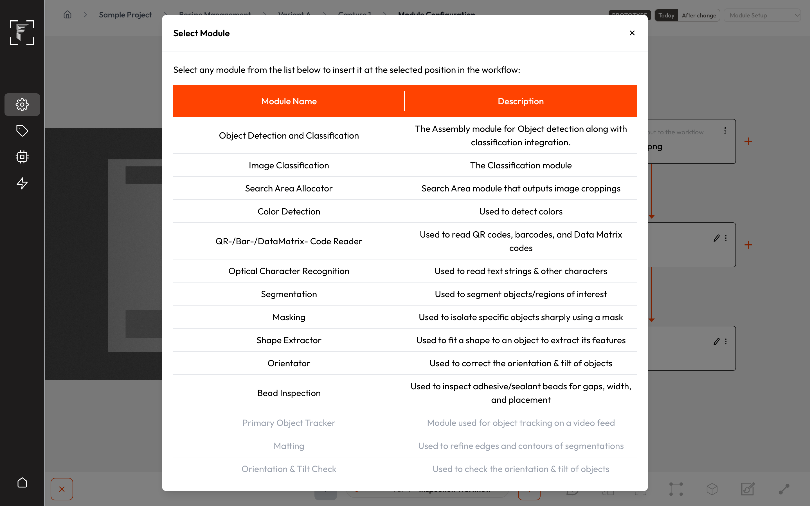
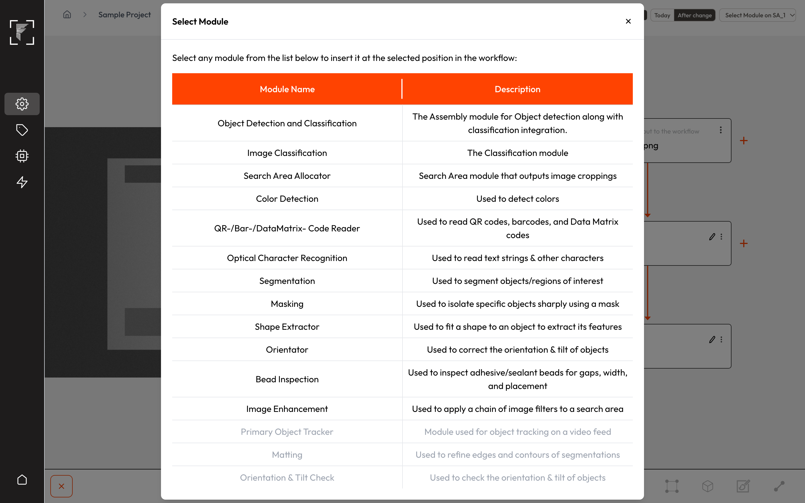
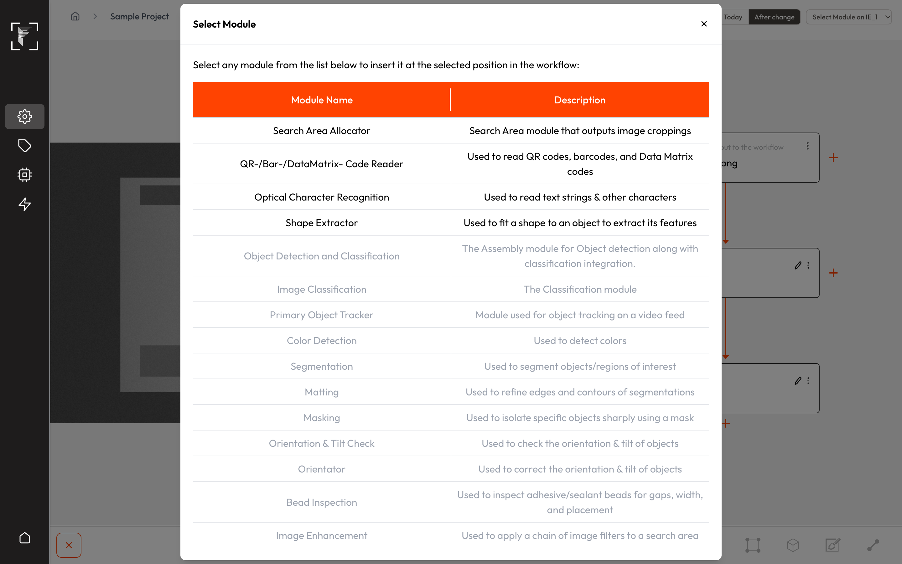

- **AC1.1** Select Module, opened on a Search Area (including the master image's Input Image) or an Orientator, lists "Image Enhancement" with a one-line description, enabled, whatever class types the project has.
- **AC1.2** Select Module opened on another Image Enhancement, or on any module other than a Search Area or Orientator (Masking: Q1), greys out "Image Enhancement" the way it greys rows today; the server refuses the same placements if they are sent directly.
- **AC1.3** A new Image Enhancement is named IE_1, then IE_2, IE_3 …; the "IE_" part of the name is locked as other module prefixes are.
- **AC1.4** A capture can hold several Image Enhancement modules, on the same or different parent areas, each with its own chain and its own enhanced area.
- **AC1.5** Select Module opened on an Image Enhancement enables every module that Select Module enables on a Search Area today, Colour Detection included.
- **AC1.6** Adding an Image Enhancement never changes how many setup steps a capture has; that still depends only on the other modules, as today.

### US2 — Build the filter chain
*As an integrator, I want to build an ordered chain of filters and see its effect live, so that I can choose the clean-up that makes the print readable.*
- **Kind:** Feature
- **Parts:** vision-recipe-tree
- **Teams:** SDE + AI
- **Stakeholders:** Smit (AI), Tanay (SDE)
- **Covers:** C4, C5
- **Today:** No such setup exists.
- **Prototype:** [Workflow, step 3](https://vbv-fr.github.io/image-enhancement-prototype/#vision-setup)

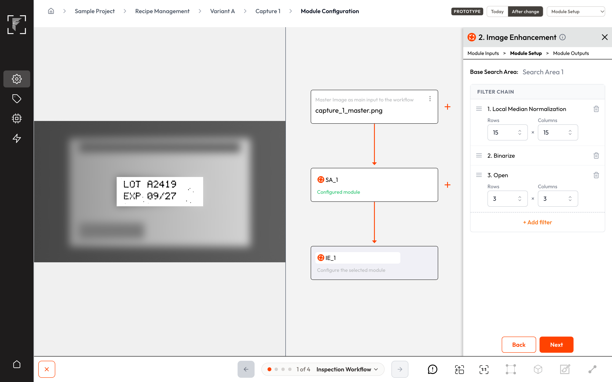
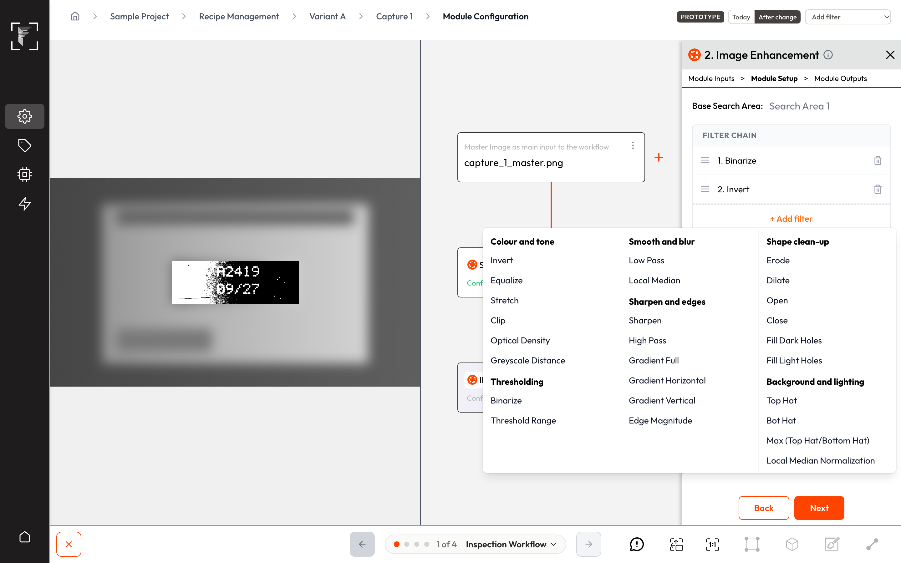
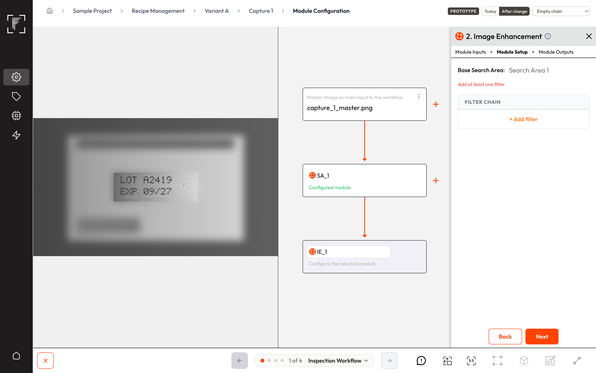

- **AC2.1** Module Setup lists the chain in order. "Add filter" opens a list grouped under six bold category headings: Colour and tone (Invert, Equalize, Stretch, Clip, Optical Density, Greyscale Distance), Thresholding (Binarize, Threshold Range), Smooth and blur (Low Pass, Local Median), Sharpen and edges (Sharpen, High Pass, Gradient Full, Gradient Horizontal, Gradient Vertical, Edge Magnitude), Shape clean-up (Erode, Dilate, Open, Close, Fill Dark Holes, Fill Light Holes), Background and lighting (Top Hat, Bot Hat, Max (Top Hat/Bottom Hat), Local Median Normalization).
- **AC2.2** Filters can be added without a limit, the same filter can appear more than once, and each row can be dragged to a new position or removed.
- **AC2.3** Each filter shows only its own values with these ranges and defaults: kernel filters (Low Pass, Local Median, Sharpen, High Pass, Erode, Dilate, Open, Close, Top Hat, Bot Hat, Max, Local Median Normalization) take Rows and Columns, odd numbers 1–15, default 5 × 5; Clip takes Low and High 0–255, default 40 and 200; Threshold Range takes Low and High 0–255, default 0 and 110; Greyscale Distance takes Grey level 0–255, default 128; the other filters, Binarize included, have no values (Binarize picks its threshold itself).
- **AC2.4** A Low above its High is refused at the field with the message "Low must not be above High"; an even or out-of-range kernel size, or a grey value outside 0–255, cannot be entered.
- **AC2.5** Saving with an empty chain is refused with the message "Add at least one filter".
- **AC2.6** Once the module is applied, the canvas shows the area enhanced, in place of the original (the master image around it as today), and updates within a second of any add, remove, reorder or value change.
- **AC2.7** On a fixed set of reference images, the Vision canvas gives exactly the same pixels as the line does for every filter and every allowed value (golden-image test run on every release).
- **AC2.8** The enhanced image is greyscale; filters whose results go beyond black and white (Optical Density, the Gradients, Edge Magnitude, High Pass) are scaled into the 0–255 range, as the guide pictures show.
- **AC2.9** A new Image Enhancement starts with Binarize followed by Invert in its chain.

### US3 — Hand the areas to the modules below
*As an integrator, I want each module under an Image Enhancement to pick the normal or the enhanced area, so that every module works on the picture that suits it.*
- **Kind:** Feature
- **Parts:** mod-search-area, mod-orientation, mod-ocr, mod-odc, mod-classification, mod-segmentation, mod-code-reader, mod-color-detection, mod-shape-extractor, mod-bead-inspection
- **Teams:** SDE
- **Covers:** C2, C4
- **Today:** A module's "Base search area" lists only its parent's search areas or masked areas.
- **Prototype:** [Workflow, steps 2, 4 and 6](https://vbv-fr.github.io/image-enhancement-prototype/#vision-ocr)

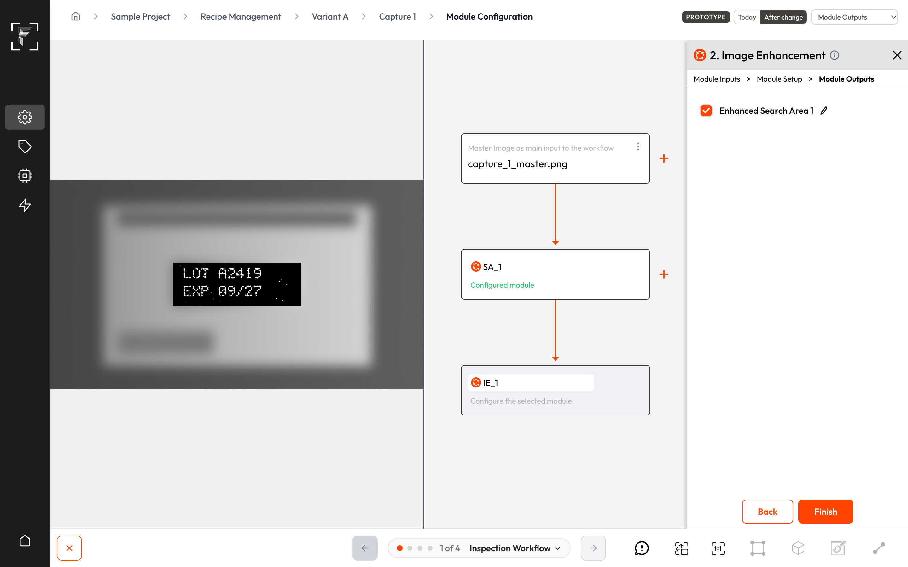
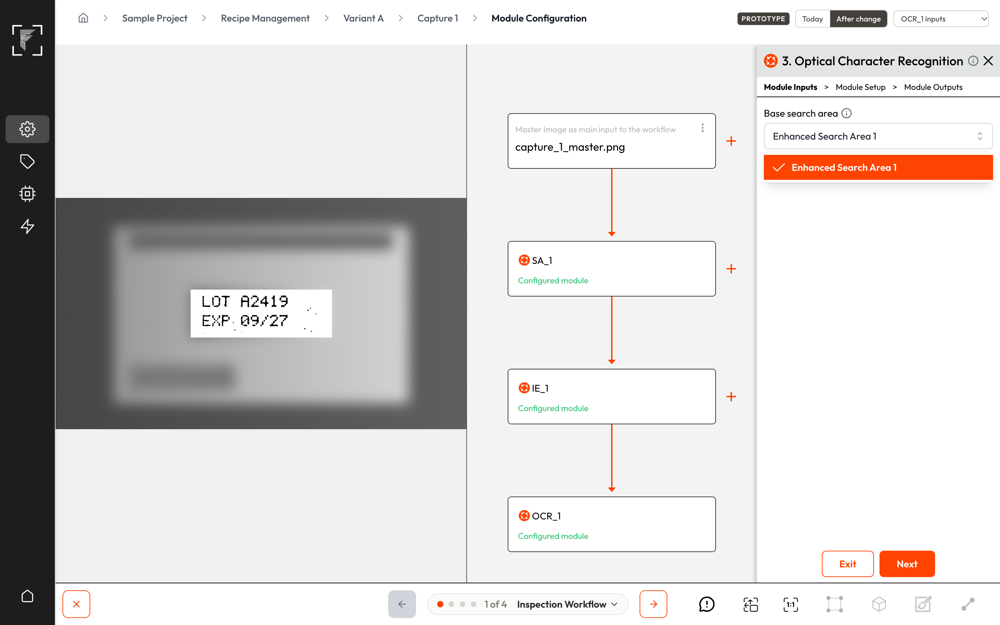

- **AC3.1** The Image Enhancement's Module Inputs has "Base search area", listing the parent's areas; with one area it is picked automatically.
- **AC3.2** Module Outputs shows one enhanced area named "Enhanced Search Area 1" (2, 3 … for later modules), editable; a name already used by any area in the capture, ignoring case, is refused with the same message search-area names get today.
- **AC3.3** The "Base search area" of any module placed under an Image Enhancement lists both the parent's area as it is and the enhanced area, and the canvas outlines the one picked; the module works on the picked area (a Search Area, for example, cuts its areas out of it).
- **AC3.4** (removed) Covered by AC3.3.
- **AC3.5** In Vision, module setup that shows the module's picture (Shape Extractor shape previews, Colour Detection colour picks, Bead Inspection trace) shows the enhanced picture when the module picked the enhanced area.
- **AC3.6** Saving or editing an Image Enhancement never changes any search area's settings.

### US4 — Edit or delete a configured Image Enhancement
*As an integrator, I want to change a configured chain, so that I can improve the clean-up after setup, with the instances that use it put back to draft.*
- **Kind:** Feature
- **Parts:** vision-recipe-tree, vision-instance-creation
- **Teams:** SDE
- **Covers:** C3, C5, C10
- **Today:** Masking, the closest module, locks once configured; any change to a recipe puts every instance of the project back to draft.
- **Prototype:** [Workflow, steps 8 and 9](https://vbv-fr.github.io/image-enhancement-prototype/#vision-edit)

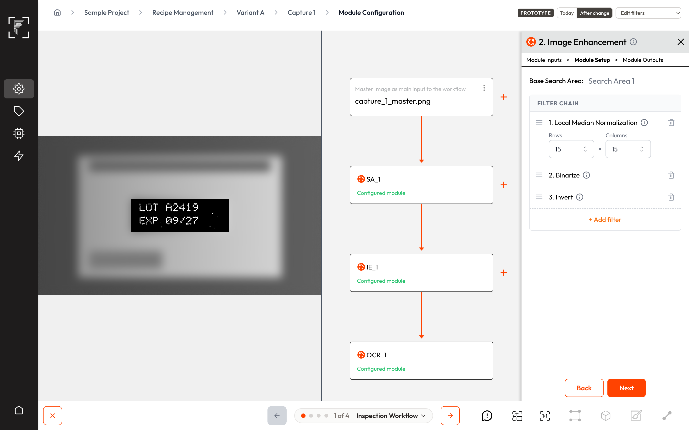
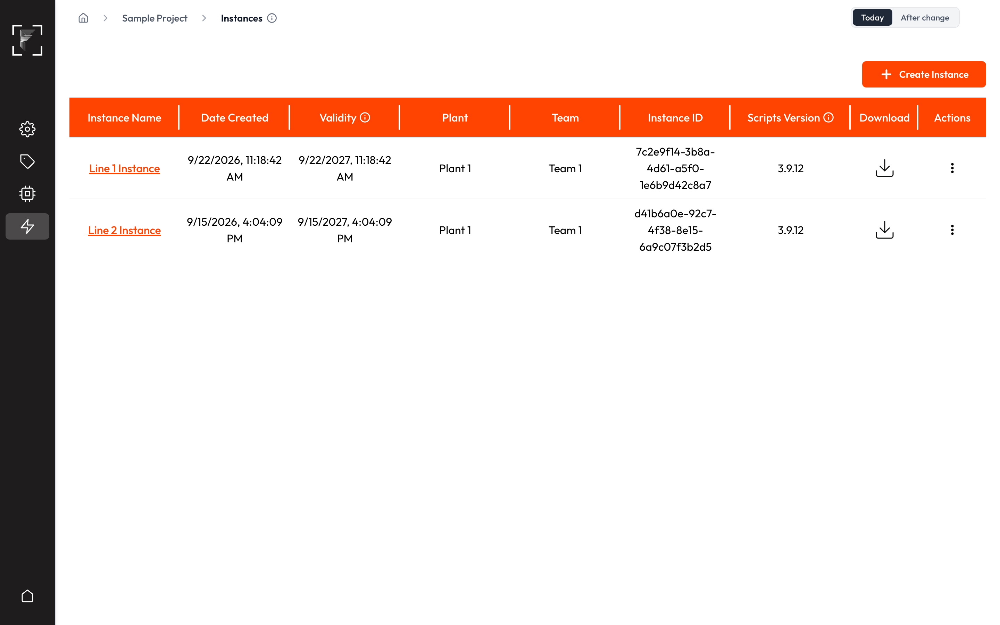
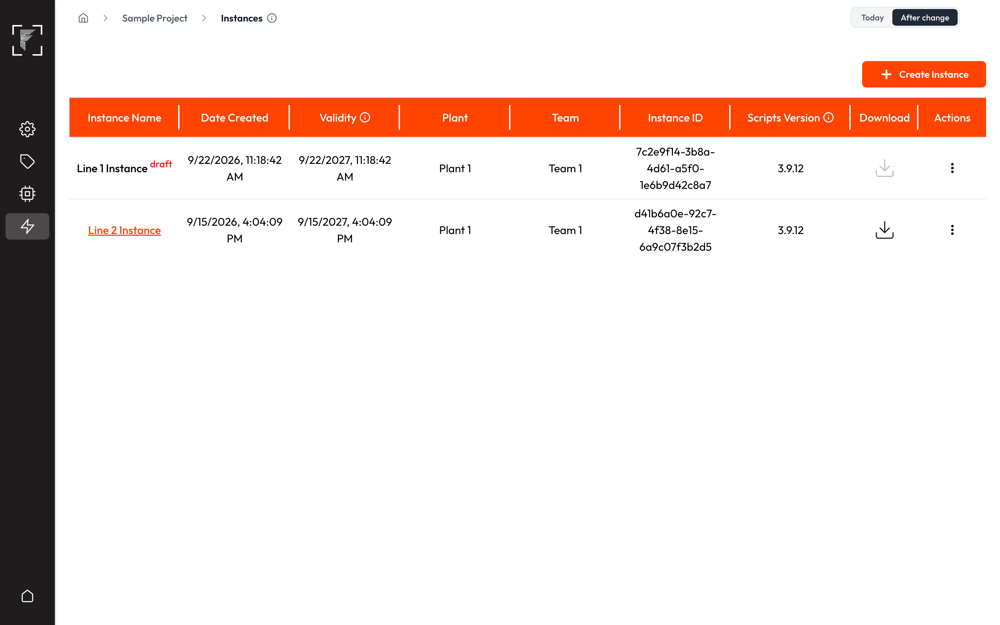
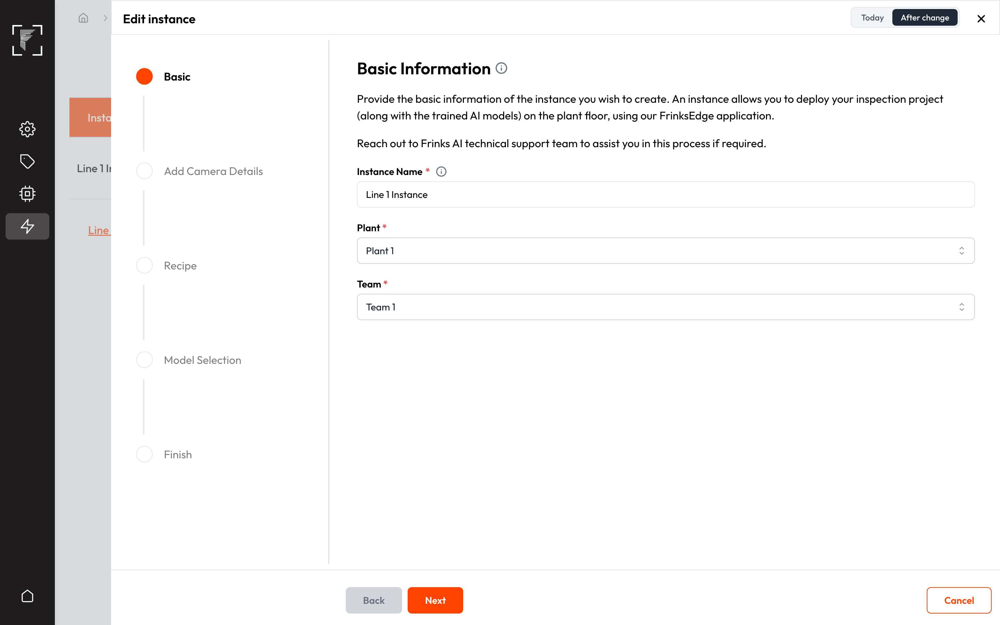

- **AC4.1** A configured Image Enhancement can be opened and its chain and values changed.
- **AC4.2** (removed) Retrain confirmation on save: dropped, because finding the affected models takes several calls; the model training results page shows the filters each model was trained with (Q6).
- **AC4.3** Deleting an Image Enhancement asks for confirmation listing the modules below it, and removes it with everything below it, as deleting any module does today.
- **AC4.4** Wherever Vision copies a recipe or project today, the Image Enhancement and its chain are copied with it.
- **AC4.5** Any change to an Image Enhancement (adding or deleting one, changing its chain or values, renaming its enhanced area) puts back to draft only the instances that include its capture; the project's other instances stay as they are.
- **AC4.6** A drafted instance must go through its five instance steps and Finish again before it is saved and can be downloaded.

### US5 — Annotate on the enhanced image
*As an annotator, I want to label on the enhanced image, so that my labels match what the model will see.*
- **Kind:** Feature
- **Parts:** vision-datasets-annotations
- **Teams:** SDE
- **Covers:** C14
- **Today:** The annotator sees the raw image, sharp inside the parent area and blurred outside it.
- **Prototype:** [Workflow, step 7](https://vbv-fr.github.io/image-enhancement-prototype/#vision-annotate)

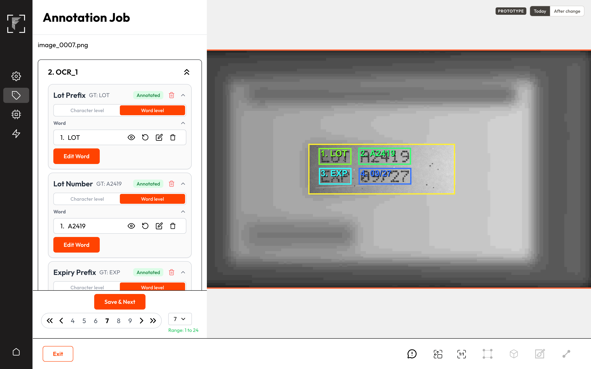
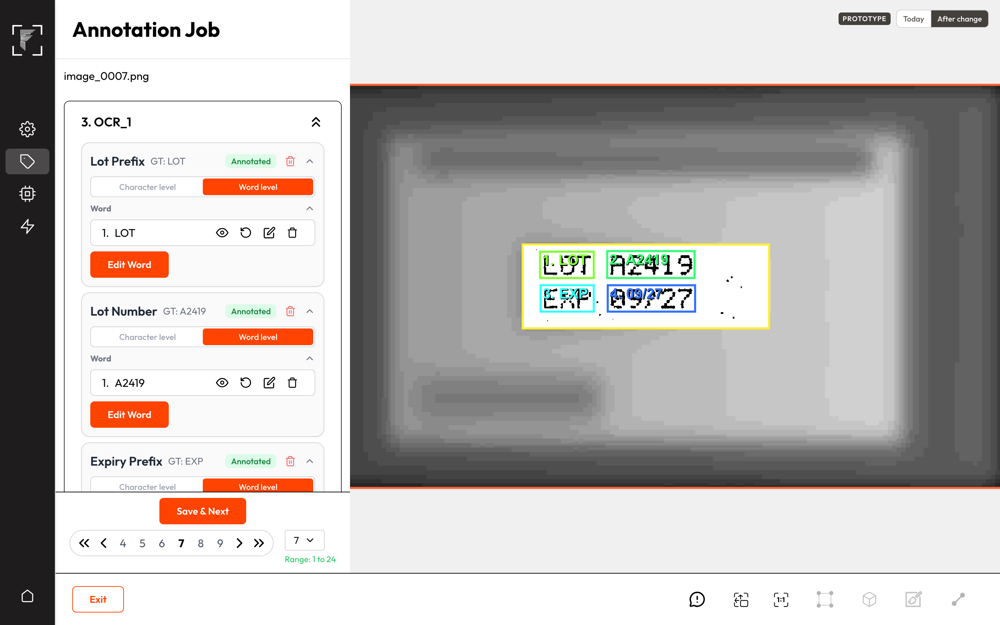

- **AC5.1** When annotating a module that picked an enhanced area, the area shows the enhanced image (same pixels as the line); outside it stays blurred.
- **AC5.2** Labels drawn on the enhanced image land in the same place on the original image, so they stay valid if the chain changes.
- **AC5.3** (removed) Auto-annotation on enhanced images: out of scope, auto-annotation does not work today.
- **AC5.4** The annotation job shows no card for the Image Enhancement itself; it has nothing to label.

### US6 — Train any model on enhanced images
*As an ML engineer, I want every model whose module picked an enhanced area to be trained on enhanced images, so that it works on the line on what it learned on.*
- **Kind:** Feature
- **Parts:** vision-model-training, vision-model-evaluation
- **Teams:** SDE + AI
- **Stakeholders:** Smit (AI), Tanay (SDE)
- **Covers:** C14
- **Today:** Training feeds each model its area cut through the parent chain; there is no enhancement step.

- **AC6.1** Training any model type (object detection, classification, segmentation, OCR detection and reading, bead inspection) whose module picked an enhanced area applies the chain to every training image.
- **AC6.2** Augmentation (brightness, blur, noise, character swaps) runs on the normal image first and the chain runs after it, so every training image looks like one the line produces.
- **AC6.3** On the reference images of AC2.7, training gives exactly the same enhanced pixels as the line (part of the same golden-image test on every release).
- **AC6.4** Restart Training and evaluation use the chain as it stands in the recipe at that moment.
- **AC6.5** A model whose module picked the parent's area, not the enhanced one, trains on normal images as today.

### US7 — Package and upload an instance with Image Enhancement
*As an integrator, I want the instance package to carry the chain, so that the line runs exactly what I set up.*
- **Kind:** Feature
- **Parts:** vision-instance-creation, edge-instance-details
- **Teams:** SDE
- **Covers:** C7, C10
- **Today:** The package carries every module's settings and Edge stores them on upload.

- **AC7.1** The instance package carries each Image Enhancement with its enhanced area, chain and values.
- **AC7.2** (removed) Download dropdown showing only supported Edge versions: moved to Q2, a separate task.
- **AC7.3** Uploading the package for the first time to a supporting Edge stores every Image Enhancement with its chain and values, and the upload's checks accept it.
- **AC7.4** On a variant change, each capture runs its own variant's chain.

### US8 — Run the enhancement on the line
*As a plant engineer, I want the line to run the chain on every image before the modules below work on it, so that reads improve without changing anything else.*
- **Kind:** Feature
- **Parts:** engine-workflow, mod-result
- **Teams:** SDE + AI
- **Stakeholders:** Smit (AI), Tanay (SDE)
- **Covers:** C8, C9
- **Today:** Modules work on their area as captured.

- **AC8.1** On every image, the engine runs the chain in order on the parent area and hands the modules below both the area as received and the enhanced area, before they run.
- **AC8.2** The image the Image Enhancement receives is never changed: the parent area, its other children and the raw image stay as captured.
- **AC8.3** The modules below an Image Enhancement count toward the capture's OK/NG exactly as they would under a search area, whichever area they picked; the Image Enhancement adds no OK/NG of its own.
- **AC8.4** When the parent area has no image on a frame, the enhanced area has none either, and the modules below report a missing area as they do today.
- **AC8.5** Each Image Enhancement's time per image is written to the engine's time log like any module's, and counts in the capture's inference time.
- **AC8.6** When a filter fails on a frame, MOD_IE_002 is logged and the frame is handled as any module failure today: no result is sent and the cycle ends NG at its timeout.

### US9 — Tune the filters on Edge
*As a quality engineer, I want to change the filters and their values on Edge with a preview, so that I can react to print changes without going back to Vision.*
- **Kind:** Feature
- **Parts:** edge-emc, edge-instance-details, mod-shape-extractor, mod-bead-inspection
- **Teams:** SDE
- **Covers:** C11
- **Today:** Edit Module Configurations has no image clean-up settings; on an instance update, Edge keeps its own ground-truth and threshold values and lists them in the update pop-up as "Edge (Preserved)".
- **Prototype:** [Workflow, steps 10 and 11](https://vbv-fr.github.io/image-enhancement-prototype/#edge-tune)

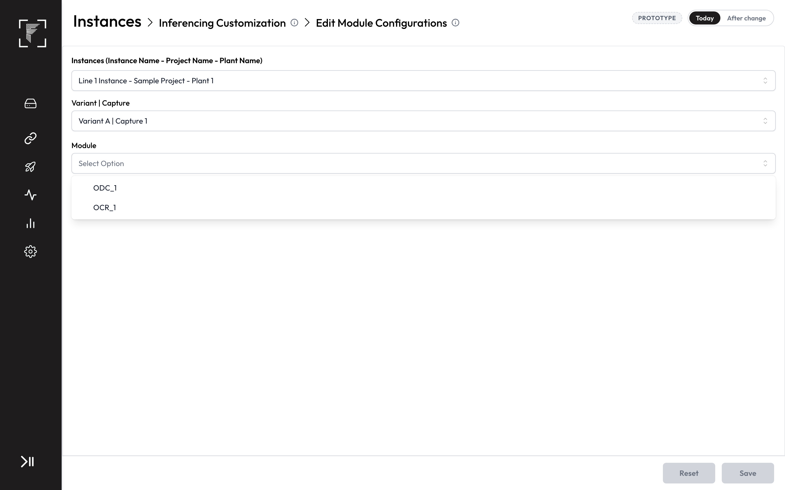
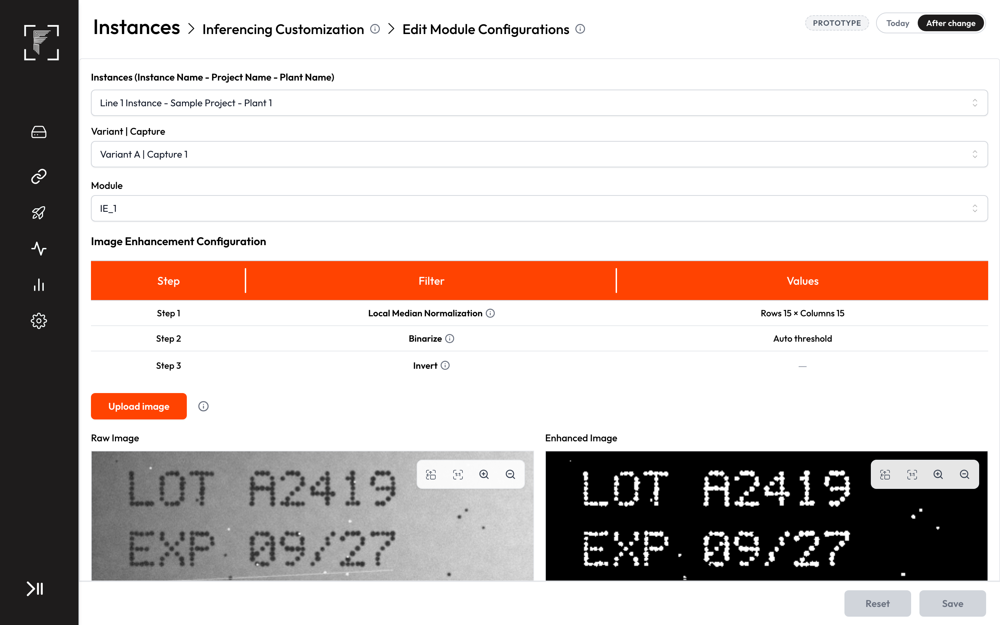
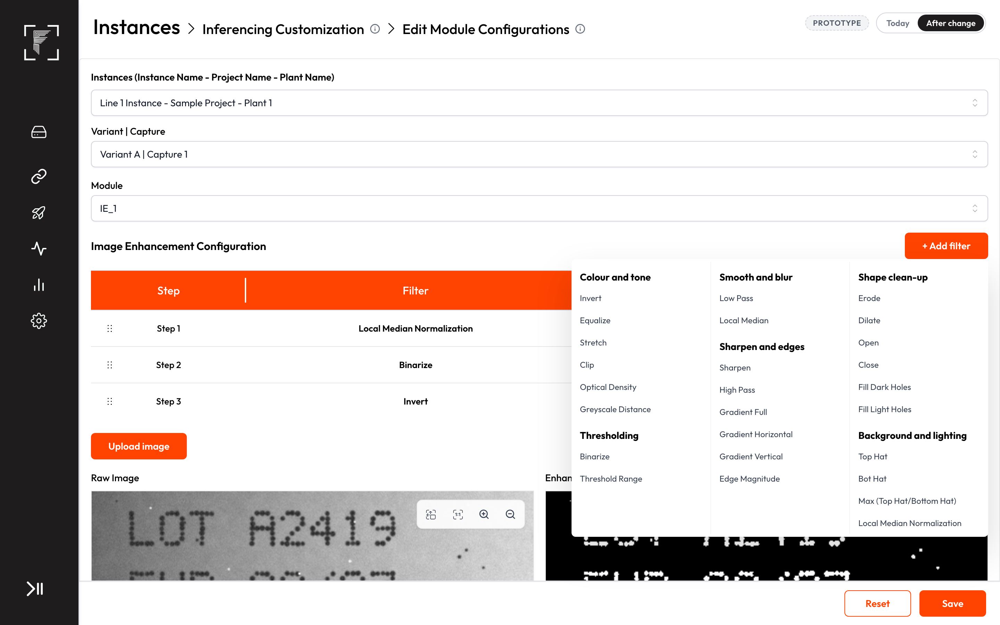
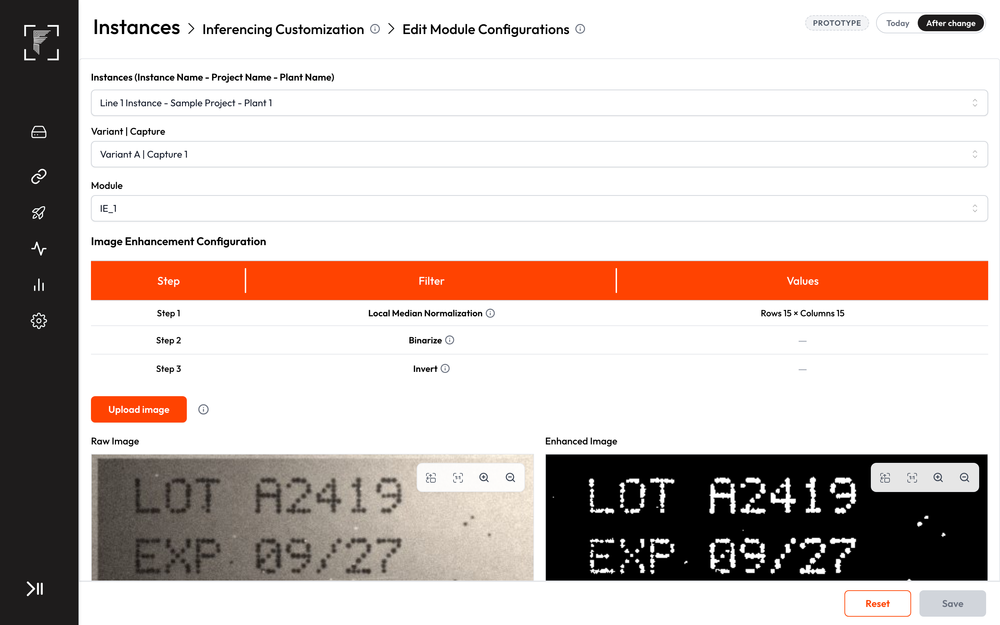
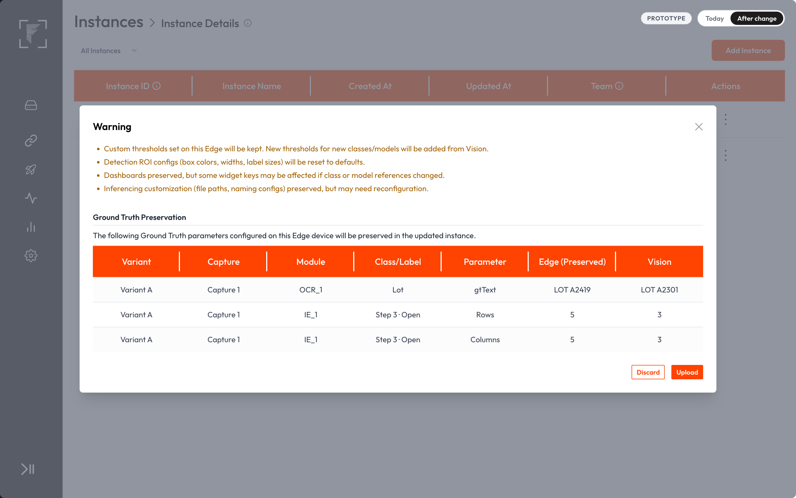
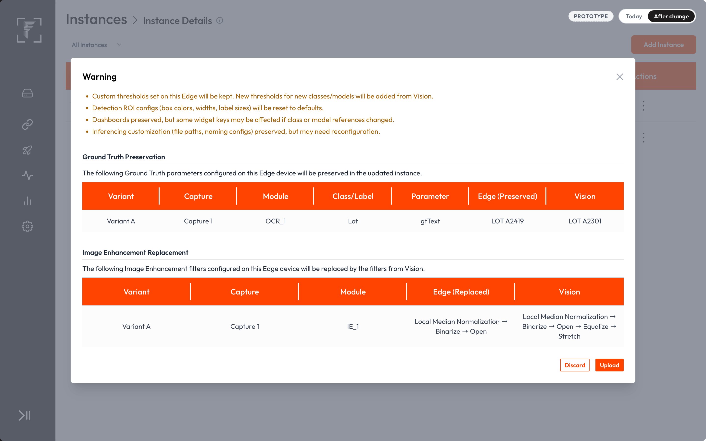

- **AC9.1** The Module list in Edit Module Configurations lists each Image Enhancement (IE_1 …).
- **AC9.2** Its section shows the chain in its current order, and filters can be added there from the same six-category list as in Vision (AC2.1), without a limit and with the same filter allowed more than once.
- **AC9.3** Each filter's values can be changed within the same ranges as in Vision (AC2.3, AC2.4), and a filter added on Edge starts with the same default values.
- **AC9.4** A Raw Image \| Enhanced Image pair shows the capture's master image cut to the area, before and after the chain, and updates within a second of any change.
- **AC9.5** (removed) Save warning about the models below: dropped for the same reason as AC4.2; Save saves straight away, as for other modules.
- **AC9.6** On Edge, setup that draws on the master image (Shape Extractor shape generation, Bead Inspection trace) shows the enhanced picture when the module picked the enhanced area.
- **AC9.7** Reset returns the chain and every value to the last saved state.
- **AC9.8** When a newer export of the instance is uploaded and its filter list is the same as Edge's (the same filters in the same order), every value tuned on Edge that the newer export did not also change is kept, and the update pop-up lists each one under Ground Truth Preservation (Module IE_1, Class/Label the filter's step and name, Parameter, Edge (Preserved), Vision).
- **AC9.9** When the filter list on Edge and in the newer export differ (changed on Edge, in Vision or both; a different order counts as different), Vision's list and values replace Edge's, and the update pop-up shows this for information only, under "Image Enhancement Replacement" (Variant, Capture, Module, Edge (Replaced), Vision); there is no choice to make.
- **AC9.10** When a newer export is uploaded and its filter list is the same as Edge's, every other value takes Vision's value, so a value changed in Vision (for example for a retrained model) always reaches the line, even if it had been tuned on Edge.
- **AC9.11** Edit Module Configurations changes to these filters and values reach the line on the next deployment, as other changes there do today.
- **AC9.12** Filters can be dragged to a new position or removed there.
- **AC9.13** Saving an empty chain there is refused with the message "Add at least one filter".
- **AC9.14** "Upload image" lets the engineer pick a PNG or JPEG that replaces the master image in Raw Image and Enhanced Image, cut to the area the same way.
- **AC9.17** A picture of a different size from the master image is refused with the message "Pick a picture the same size as the master image", and only PNG and JPEG files can be picked.
- **AC9.15** The uploaded picture is only for the preview: it is not saved, and Reset or leaving the page brings back the master image.
- **AC9.16** (removed) Per-module choice between Edge and Vision filters: dropped, Vision's list always replaces Edge's (AC9.9).

### US10 — See and save the enhanced image
*As a plant engineer, I want the enhanced image as one more analysed image, so that I can see what the modules below worked on when I investigate a result.*
- **Kind:** Feature
- **Parts:** edge-inferencing-customization, edge-storage-image-saving, edge-live-dashboard, edge-dashboard-builder, edge-reports-analytics
- **Teams:** SDE
- **Covers:** C12
- **Today:** The master image (Input Image) and every search area have an analysed image: the normal picture, scaled by the Image Saving resolution, with the boxes drawn on it.
- **Prototype:** [Workflow, steps 12 and 13](https://vbv-fr.github.io/image-enhancement-prototype/#edge-dashboard)

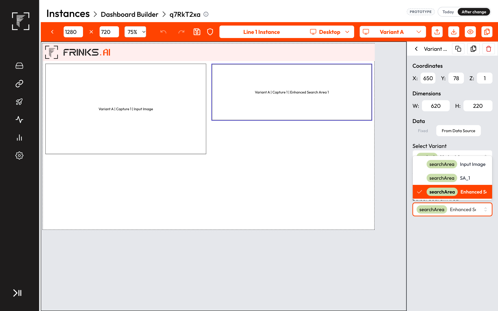
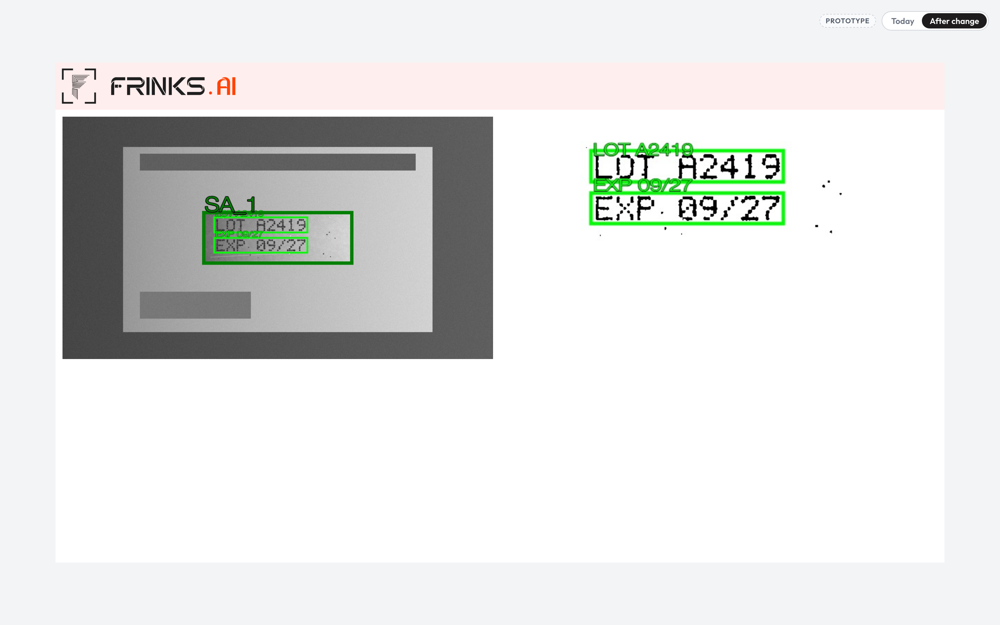
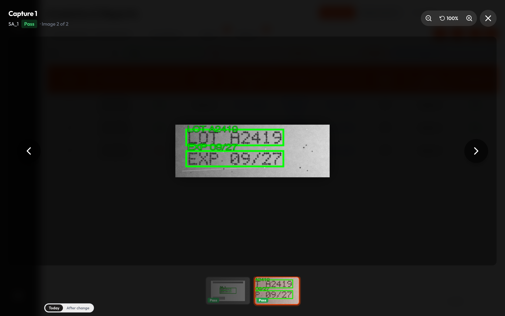
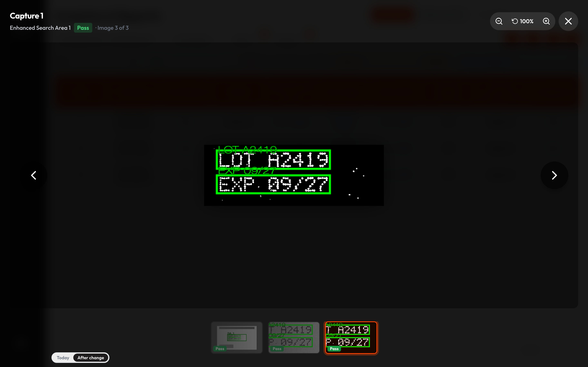

- **AC10.1** The enhanced area has its own analysed image next to the master image and the search areas: the enhanced picture, scaled by the Image Saving resolution, with the boxes of the modules under it.
- **AC10.2** Image Saving keeps only its Analysed Image and Raw Image blocks; with Analysed Image on, the enhanced area's analysed image is saved too, in a folder named after the enhanced area, by the same OK / NG choice and quality.
- **AC10.3** Analysed Image Configurations does not list the enhanced area; the boxes and labels on its analysed image follow the settings of the area it comes from (a search area or an Orientator's area).
- **AC10.4** The Dashboard Builder image widget's "Select Search Area" list includes each enhanced area by name; a widget pointed at it shows the enhanced area's analysed image in the dashboard preview and live on the Live Dashboard (on the builder canvas it shows the named placeholder every image widget shows today).
- **AC10.5** Reports → View Images lists the analysed images in this order: Input Image, then the search areas, then the enhanced areas (several of one kind in name order), each under its name, never a raw id.
- **AC10.6** Excel export and Reverse Judgement carry the enhanced area's image like other area images.
- **AC10.7** A Search Area placed under an Image Enhancement that cut its area out of the enhanced area shows that enhanced picture in its analysed image, and is listed with the search areas.
- **AC10.8** The boxes of the modules under an Image Enhancement also appear on the analysed images of the areas above it (its search area and Input Image), as boxes do today.

### US11 — Rules: who can set it up and tune it
*As an Org Admin, I want the existing permissions to cover this module, so that no new role setup is needed.*
- **Kind:** Rules
- **Parts:** vision-access, edge-access-audit, vision-recipe-tree, edge-emc
- **Teams:** SDE
- **Covers:** C1

- **AC11.1** No role or permission changes in Vision or on Edge.
- **AC11.2** In Vision, adding, editing and deleting an Image Enhancement needs the same rights as any other module in Recipe Management; users without them see it the same way they see other modules today.
- **AC11.3** On Edge, adding, reordering or removing its filters and changing its values needs the existing Edit Module Configurations update permission (in the Supervisor and Quality Engineer templates today); others see the section read-only, as they see other sections, and can still use Upload image, which saves nothing.
- **AC11.4** (removed) Covered by AC11.1.

### US12 — Keeps working: recipes without Image Enhancement
*As an integrator, I want recipes without the module to behave exactly as today, so that nothing on running lines changes.*
- **Kind:** Keeps working
- **Parts:** vision-recipe-tree, vision-model-training
- **Teams:** SDE + AI
- **Stakeholders:** Smit (AI), Tanay (SDE)
- **Covers:** C6

- **AC12.1** A recipe without an Image Enhancement shows, saves, trains, exports and runs exactly as before, apart from the new "Image Enhancement" row in Select Module (AC1.1).
- **AC12.2** In a recipe with or without an Image Enhancement, placement rules between the other modules stay as they are.
- **AC12.3** In a recipe that contains an Image Enhancement, models whose module is not under it train on the same images as before.
- **AC12.4** Recipe changes other than changes to an Image Enhancement still put every instance of the project back to draft, as today.

### US13 — Keeps working: modules under an Image Enhancement
*As a plant engineer, I want a module under an Image Enhancement to keep every behaviour it has today, so that rules and signals built on it still work.*
- **Kind:** Keeps working
- **Parts:** mod-ocr, mod-masking, edge-emc
- **Teams:** SDE
- **Covers:** C9, C10

- **AC13.1** A module under an Image Enhancement keeps its Edit Module Configurations section (apart from the picture shown in setup, AC9.6), its keys, its actions (for OCR, the Change Ground Truth action) and its PLC writes unchanged.
- **AC13.2** Result groups that include a module under an Image Enhancement work as today.
- **AC13.3** A frame on which a module fails is handled as today: no result is sent and the cycle ends NG at its timeout.
- **AC13.4** Nothing in this release changes how modules under Masking are judged.
- **AC13.5** (removed) Moved to AC9.11: it states a result for this module's values.

### US14 — Platform
*As a Frinks support engineer, I want to know which packages change, so that releases and installs are planned.*
- **Kind:** Platform
- **Parts:** engine-workflow, engine-runtime-packaging, edge-health
- **Teams:** SDE + AI
- **Stakeholders:** Smit (AI), Tanay (SDE)
- **Covers:** C13, C17, C18

- **AC14.1** Node Docker image: no change; no new Node library is needed.
- **AC14.2** Python Docker image: no change; every filter uses image libraries already in it.
- **AC14.3** Scripts bundle: changes; it carries the engine, inferencing backend, deployment backend and frontend, and report changes.
- **AC14.4** Installer: no change; it replays the database script on install and update as today.
- **AC14.5** New error codes in the engine's catalogue, each with a message: MOD_IE_001 (the chain could not be set up at start), MOD_IE_002 (a filter failed on an image), MOD_IE_003 (the parent area is not connected). They show in Deployment Health the way engine codes show today, and the Error Code Reference in the manual lists them.
- **AC14.6** The training containers of every model type change to include the filter step; no new library.
- **AC14.7** The Vision manual gains an Image Enhancement section linking the filter guide; the Edge manual's Edit Module Configurations and instance update sections are updated with new screenshots.
- **AC14.8** Release note: "Vision and Edge now offer an Image Enhancement module that cleans a search area's image with a chain of 26 filters before the modules below it work on it."

### US15 — Migration requirements
*As a Frinks support engineer, I want existing projects and Edge boxes to carry on unchanged, so that upgrades are safe.*
- **Kind:** Migration
- **Parts:** vision-recipe-tree, vision-instance-creation, edge-instance-details, edge-release-upgrade, edge-backup-migration
- **Teams:** SDE
- **Covers:** C6, C7

- **AC15.1** Existing data: projects, datasets, models and instances made before this release look and behave the same; the Vision database gains the new module type and its settings with no change to existing rows.
- **AC15.2** Older Edge with a new instance: a package that contains an Image Enhancement, downloaded without a target version, is refused by an older Edge with today's schema-mismatch message; downloads for an older target version are handled in Q2.
- **AC15.3** Older instance on the new Edge: uploads, deploys and runs unchanged.
- **AC15.4** Upgrades of Edge boxes in the field add the enhancement settings and change nothing else; backups and restores carry the enhancement settings.

## 7. Out of scope
- Image Enhancement under Masking until Q1 is decided.
- Which Edge versions the download dropdown offers (Q2, a separate task).
- Colour output, automatic filter suggestions.
- Auto-annotation on enhanced images: auto-annotation does not work today.
- Fixing how modules directly under Masking are judged, training under Masking, and channel-order differences between camera paths (raised separately).

## 8. How we'll know it worked
Not part of this PRD (PM, 23 Oct 2026). The module is used on print reading first.

## Appendix A — Coverage
**Not applicable:**
- **C15** — N/A: no network, offline or time behaviour; the module runs inside the engine like any other.
- **C16** — N/A: the settings travel inside the instance package like other module settings; no new data leaves the plant.

**Coverage check:** coverage checker, 23 Oct 2026
**Result:** PASS

- 15 user stories (10 feature, 1 rules, 2 keeps working, 1 platform, 1 migration), 96 ACs, 31 touched parts, 3 discussion points.
- Checklist: 16 items covered by stories, 2 N/A, 0 open.

Manual checks: every coverage-sheet item maps to exactly one AC; three duplicate and contradiction passes run (23 Oct), all findings applied; code back-check of the impact map done (the shared image-cutting library also serves the switched-off recommender: see Checked, not affected); every goal is delivered (G1: US2, US3, US8; G2: US2; G3: US5, US6); departures from today's code are stated (US4 departs from Masking's lock and from drafting every project instance; AC10.5 changes today's raw-id labels).

## Appendix B — Code references
- **Recipe tree (new module type):** `frinksvision-backend`: module catalogue seed `src/config/populate.ts:150-256`; settings-table switch `src/dao/module.ts:686-736` (unknown types fall back to the search-area table at 731-733); outputs `:748-848`; parent rules `src/service/module.ts:28-95`. `frinksvision-frontend`: Select Module, leaf and parent rules `src/modules/project/module-configuration/components/moduleWorkflow/index.tsx:48-64, 160-165, 1063-1125`; panel registry `selectedModule.tsx:1292` (Masking at 2537-2655); edit-after-configure list `configuredModuleEditState.ts:12-21`; two-step captures `frinksvision-backend src/utils/module.ts:20-32`.
- **Enhanced area as an area:** Masking precedent in `frinksvision-backend src/dao/module.ts:739, 755-756`, `src/service/module.ts:465-474`, `src/service/pythonModel.ts:342-383`; canvas boundaries `frinksvision-frontend src/shared/hooks/annotationPipeline/annotationPipeline.tsx:533-587`.
- **Vision preview and annotation:** OpenCV.js already loaded `frinksvision-frontend/index.html:16`, `package.json:67`; annotation renderer `src/canvas/image/registry.ts:15-21`, `BlurCropRenderer.tsx`.
- **Training:** workflow sent with every job `frinksvision-backend src/service/pythonModel.ts:837-960`; shared cutter `workflow-dataprocessor` (`modules/moduleRegistry.py:20-34`, `workflow/workflow.py:135-138, 294-299`); OCR reading-model trainer has its own copy `Assembly-Training-OCR/scripts/modules/moduleRegistry.py:12-18`; augmentation order `OCR-Training-Detection-ALL/psenet/scripts/main.py:536-544, 650-687`; every model type's trainer has its own copy of the image-cutting code (assembly-training, classification-training-docker, Segmentation-Training, Assembly-Training-OCR) and the evaluation repos likewise.
- **Instance and Edge version:** export `frinksvision-backend src/service/instance.ts:897-901, 1082-1085, 1119`; version list `src/controller/instance.ts:401-431`, `src/dao/edgeSchemaRegistry.ts:391-399`; Edge upload checks `frinksedge-deployment-backend src/service/uploadValidation.ts:116-119, 1023-1058`, reachability `src/dao/instances.ts:979-1158`, table map `src/service/instance.ts:125-142`; database script `dump.sql`.
- **Engine:** registry `vip-inference-python scripts/assembly/modules/moduleRegistry.py:20-44`; coordinate-map branch `workflow/workFlow.py:125-137`; Masking template `modules/maskingModule.py`; valid areas `modules/resultModule.py:786-829, 920-972`; config check `input_validation/config_models.py:113-138`; first-output-wins images `resultModule.py:283-301`; error catalogue `errorcode.json`; Edge config builders `frinksedge-inferencing-backend src/python-model/python-model.module.ts:23-37`, `transformers/masking.transformer.ts`, `python-model-result.service.ts:20-36, 148-162`.
- **Edit Module Configurations:** module list `frinksedge-deployment-frontend src/modules/inferencing-customizations/hooks/useModuleConfig.js:96-118`; sections `EditModuleConfigurations.jsx:510-659`; preview pattern `color-detection-emc/useColorDetection.js:20-155`; re-upload preservation `frinksedge-deployment-backend src/service/instance.ts:1412-1636` and `src/service/uploadValidation.ts:1060-1106`; permission `src/rbac/catalogue.ts:137-146, 254, 269`.
- **Images out:** Image Saving `frinksedge-deployment-frontend src/modules/inferencing-customizations/ImageSavingConfigurations.jsx:111-239`; saving areas `frinksedge-inferencing-backend src/python-model/python-model-save-info.service.ts:77-99`; Dashboard picker `frinksedge-deployment-backend src/dao/module.ts:1248-1259`; Reports labels `frinksedge-report src/features/analysis/analysis.repository.ts:528-538`.
- **Drafting instances:** a recipe change drafts every project instance today `frinksvision-backend src/service/module.ts:152-154, 294-301`, `src/dao/instances.ts:650-656`.
- **Instance update pop-up (Edge):** `frinksedge-deployment-frontend src/modules/instance/components/InstanceTable.jsx:62-160` (also `InstanceCard.jsx:73`, `CreateInstanceDrawer.jsx:270-330`); differences built in `frinksedge-deployment-backend src/service/uploadValidation.ts:1060-1470`.
- **Download picker (Q2):** `frinksvision-frontend src/modules/project/instances/DownloadModal.tsx:130-153, 210-213`, `ScriptsBundleVersionSelect.tsx:15-22`; versions `frinksvision-backend src/dao/edgeSchemaRegistry.ts:220-231`.

Repos checked: assembly-dataset-recommender @ 0556f06 (2026-07-21), Assembly-model-evaluation @ 7a0403a (2025-11-04), assembly-training @ 725f834 (2026-06-02), Assembly-Training-OCR @ 99d0d62 (2025-07-08), Auto-annotation @ d213b71 (2025-10-30), auto-training-backend @ 63ba9a6 (2026-08-04), Classification-Evaluation @ eda0d3b (2025-12-19), classification-training-docker @ 3f7a64e (2025-11-05), Craft-model-evaluation @ 5a95e16 (2025-07-10), frinkschat-backend @ 88e5c91 (2026-07-21), frinksedge-deployment-backend @ 009fc11 (2026-10-19), frinksedge-deployment-frontend @ 7e92de34 (2026-10-19), frinksedge-file-releases @ 7041254 (2026-07-16), frinksedge-health @ e8ef112 (2026-10-15), frinksedge-inferencing-backend @ eddd8e5 (2026-10-19), frinksedge-installer-electron @ b4a5049 (2026-10-12), frinksedge-plc-backend @ 254d08e (2026-10-15), frinksedge-report @ 5fe5390 (2026-10-15), frinksedge-report-frontend @ 9893a19 (2026-10-13), frinksedge-staging-environment @ 4993036 (2026-09-09), frinksvision-backend @ eda944f (2026-10-14), frinksvision-frontend @ 110a23c (2026-10-19), OCR-Evaluation @ c9c413c (2025-07-10), OCR-Training-Detection-ALL @ fc59f48 (2026-10-14), Python-inference-docker @ 62e22bd (2026-05-29), Recommendation-classification @ 0796dbb (2026-08-03), Recommendation-OCR @ ae1e953 (2026-04-30), release-manager-backend @ b8016f7 (2026-09-22), Segmentation-Data-Recommender @ d6f679e (2026-07-22), Segmentation-Evaluation @ 44bb8c6 (2025-08-28), Segmentation-Training @ f749aab (2025-08-22), train-utils @ d3e6378 (2026-09-15), vip-inference-python @ 93451d1 (2026-10-15), workflow-dataprocessor @ d2cd9bd (2026-08-11)

## Changelog
- 23 Oct 2026 — Retrain warning pop-ups dropped in Vision and on Edge: AC4.2 (removed), AC9.5 (removed); instances still go back to draft (AC4.5); Q6 now also covers spotting models trained on older filters (Tanay Deo)
- 23 Oct 2026 — No choice in the update pop-up: Vision's filter list replaces a differing Edge list and the pop-up only informs (AC9.9); AC9.16 (removed); Vision changes also win over Edge-tuned values (AC9.8, AC9.10) (Tanay Deo)
- 23 Oct 2026 — Third duplicate pass (no duplicates): out-of-scope line about Edge chain edits removed; gaps closed in AC9.2, AC9.3, AC9.5, AC9.8, AC9.9, AC10.3, AC10.5, AC11.3; new AC8.6 (filter failure on a frame), AC9.17 (upload size and type), AC10.7 (search area cut from an enhanced area), AC10.8 (boxes on the areas above) (Tanay Deo)
- 23 Oct 2026 — Edge can now add, reorder and remove filters, reversing the 23 Oct "values only" decision (AC9.2, AC9.12, AC9.13); preview labelled Raw Image / Enhanced Image (AC9.4) with Upload image, preview only (AC9.14, AC9.15); warning covers filters or values (AC9.5); differing Edge and Vision filter lists are now a choice in the update pop-up, Vision preselected (AC9.9, AC9.16), replacing "Vision's list wins"; default chain Binarize → Invert (AC2.9); Reports order Input Image, search areas, enhanced areas (AC10.5); AC10.6 split from AC10.5 (Tanay Deo)
- 23 Oct 2026 — Second duplicate pass: AC11.4 (removed): covered by AC11.1; AC2.6 and AC13.4 trimmed; AC12.2 scoped to recipes with or without the module. Decision: adding, deleting or renaming an Image Enhancement also drafts only the instances using its capture (AC4.5) (Tanay Deo)
- 23 Oct 2026 — Duplicate pass applied: AC3.4 (removed): covered by AC3.3; AC1.5 trimmed (greyed Image Enhancement is AC1.2); AC6.3 reworded to a training check; AC14.6, AC14.4, AC10.2, AC12.3, AC15.1 trimmed; contradictions fixed in AC7.3, AC15.2, AC4.5, AC12.4, AC12.1, AC13.1; AC2.4 adds 0–255. Decisions: Edge-tuned values kept, untuned values from Vision (AC9.8, AC9.10); AC13.5 (removed): moved to AC9.11; two Image Enhancements may share a search area (AC1.4) (Tanay Deo)
- 23 Oct 2026 — Q3 decided (AC9.8, AC9.9), Q4 dropped (no AC), Q5 decided (AC9.4), Q7 and section 8 measures dropped; any module can sit under the module and picks the normal or enhanced area (AC1.5, AC3.3, AC3.5, AC6.1, AC6.5, AC8.1, AC8.3); models of every type train on enhanced images (US6); analysed images: master and search areas normal, enhanced area enhanced (AC10.1); Image Saving keeps two blocks (AC10.2); Analysed Image Configurations does not list the enhanced area (AC10.3); auto-annotation removed (AC5.3); download-version filter moved to Q2 (AC7.2, AC15.2); drafting limited to instances using the capture (AC4.2, AC4.5, AC4.6, AC12.4); canvas shows only the enhanced image (AC2.6); bold category headings (AC2.1); prototype rebuilt as one interactive workflow (Tanay Deo)
- 20 Oct 2026 — Draft started as "Image filters for OCR"; scope changed to a standalone module any listed module can sit under (Tanay Deo)
- 21 Oct 2026 — Prototypes built for all seven screens; ACs aligned with them (download picker wording, Image Saving "—" for captures without the module, no annotation card for the module) (Tanay Deo)
- 21 Oct 2026 — Renamed Image Enhancement; decisions: train and annotate on enhanced images, children OCR / Code Reader / Shape Extractor / Search Area, values (not the chain) editable on Edge, six filter categories, Enhanced block in Image Saving, older Edge versions hidden in the download dropdown; Masking kept as a discussion point (Tanay Deo)

## Checked, not affected
- vision-projects, vision-variants, vision-captures-cameras: the module needs no class type, variant logic or capture change.
- vision-auto-annotation: auto-annotation does not work today (PM, 23 Oct); nothing here changes it.
- vision-training-sets-recommender: switched off today; it shares the image-cutting library that gains the filter step (US6), which changes nothing while it is off; the dataset folder counts are unchanged.
- mod-input-master-image: the master image and its Input Image are read, not changed.
- mod-matting, mod-tracker: they sit under Segmentation or Object Detection, never directly under an Image Enhancement, and work on what their parent passes.
- edge-camera-capture, edge-deployment, edge-networking, edge-system-time, edge-installer: nothing new reaches them; the settings travel in the engine's configuration.
- edge-model-loading-variant-change, edge-encryption-keys: the module has no model to load, swap or decrypt.
- edge-actions, edge-plc-read, edge-plc-write, edge-plc-setup, edge-internal-actions: the module gives no result or key; the modules below keep theirs.
