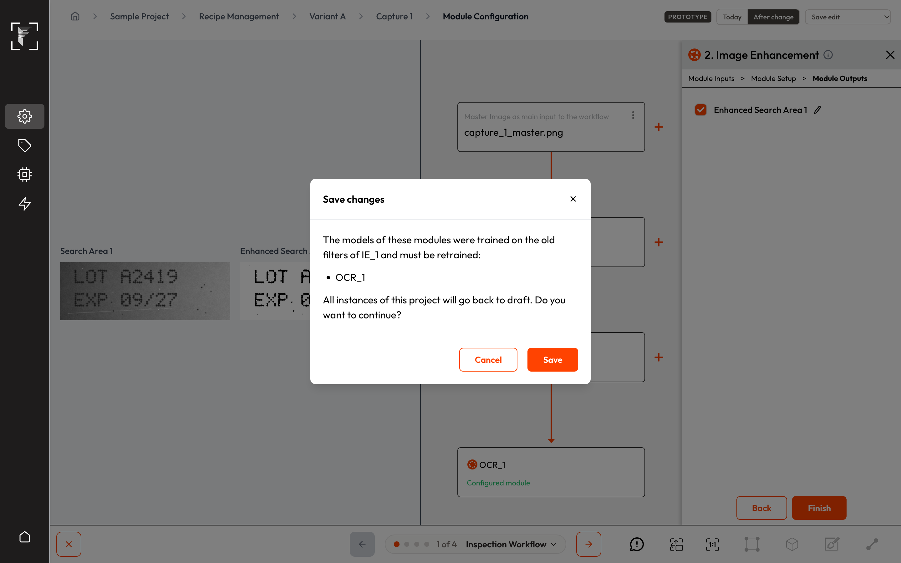
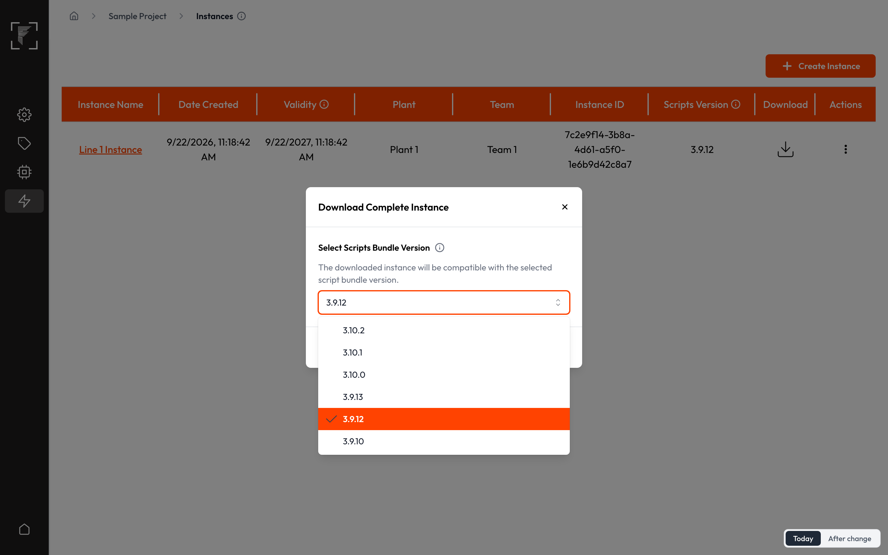
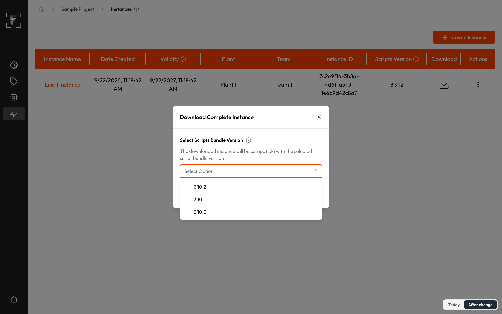
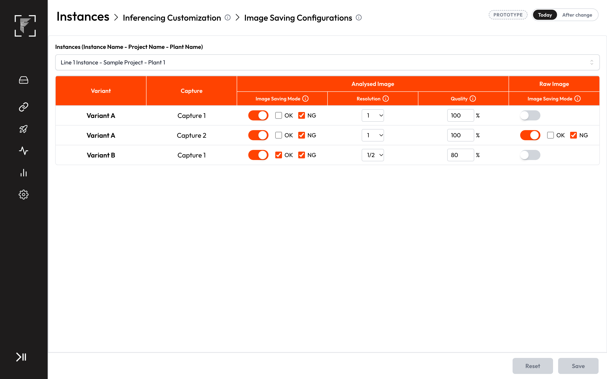
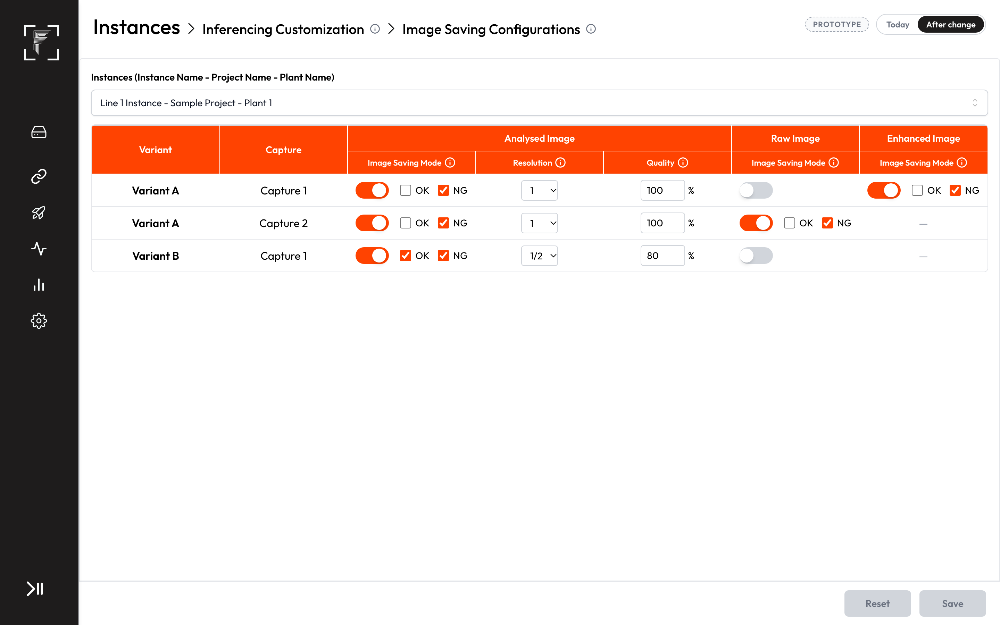

# PRD: Image Enhancement module

**Prototype:** [All screens, Today vs After change](https://vbv-fr.github.io/image-enhancement-prototype/)
**Product:** Vision + Edge
**Status:** Draft
**Date:** 21 October 2026
**Owner:** Tanay Deo
**Related:** FP-2436 (OCR epic), FP-2375 (Masking module epic: the same "change the image, pass it on" pattern). Filter reference: [Image Filter Guide](https://claude.ai/artifact/3S5hj7dJaBNiTWtfhefu2m) (what each filter does, with before/after pictures)
**Code checked:** 20 October 2026 — 34 repos at their latest default-branch commit (list in Appendix B)

---

## Discussion points
Everything still to be settled. Each row is decided before the tickets are cut.

| # | Point to settle | Options on the table | Owner | Needed by |
|---|---|---|---|---|
| Q1 | An integrator builds Search Area → Masking (blanks out a logo) → Image Enhancement → OCR and clicks Train. Today the OCR reading-model trainer and auto-annotation stop with an error whenever a Masking module sits anywhere above the OCR, so this tree could not be trained. (The part's OK/NG is not affected: the enhanced area counts toward the verdict even under Masking.) | (a) Allow Image Enhancement under Masking and make OCR training and auto-annotation handle Masking in this release. (b) Grey it out under Masking until a separate ticket fixes training under Masking. | Tanay Deo, Smit | Before the ticket breakdown |
| Q2 | Which is the first Edge version that can run Image Enhancement? Vision hides every older version in the download dropdown. | The Edge release that ships this PRD (set when the fix version is chosen). | Tanay | Before the fix version is set |
| Q3 | A quality engineer tunes the filter values on Edge, then a new export of the same instance is uploaded from Vision. Do the Edge values survive? | (a) Recommended: keep the Edge values when the chain (which filters, in which order) is unchanged; if the chain changed in Vision, Vision's values replace them. (b) Vision always wins. (c) Edge always wins. | Tanay | Before the ticket breakdown |
| Q4 | An integrator edits the chain in Vision after the OCR below it was trained, retrains, and wants the change on Edge. | (a) Recommended: only a full instance export carries a changed chain; a model-only update is refused while the chain on Edge differs from the one the model was trained with. (b) A model-only update also carries the chain. | Tanay, Smit | Before the ticket breakdown |
| Q5 | Which picture does the Image \| Preview on Edge use? | (a) Recommended: the capture's master image cut to the parent area, as in Vision. (b) A test image the engineer picks, as Colour Detection does today. (c) Both, master image by default. | Tanay | Before the prototype is approved |
| Q6 | Should each trained model record the chain and values it was trained with, so Vision and Edge can say exactly when a model and its enhancement no longer match? | (a) Yes: shown on the model's page and checked at instance creation. (b) No: rely on the warnings in US4 and US9. | Smit | Before the ticket breakdown |
| Q7 | What read-rate improvement makes this a success, and on which lines is it measured first? | Targets for section 8. | Tanay Deo | Before approval |

## 1. Summary
- A new module, **Image Enhancement**, can be added to a capture's recipe in Vision, under a Search Area (including the master image's Input Image) or an Orientator.
- It takes one area, runs an ordered **chain of filters** on it, and hands an **enhanced area** to the modules below. OCR, Code Reader, Shape Extractor and Search Area can sit under it.
- The chain has no length limit, the same filter can appear more than once, and filters are picked from 26, grouped into six categories. Module Setup shows the area before and after the chain, live.
- It has no AI model and never makes a part OK or NG by itself; the modules below it still count toward the verdict.
- Annotators label, and OCR models train, on the enhanced image, so a model learns from exactly what the line will feed it.
- On Edge, Edit Module Configurations lists the module; the filter values can be tuned there with a preview, but the chain itself is fixed in Vision.
- The raw image stays the camera picture. The enhanced area gets its own analysed image (enhanced, with the OCR boxes), its own block in Image Saving, a place in the Dashboard Builder image picker and a named entry in Reports.
- Vision's download dropdown shows only Edge versions that can run the module.

## 2. Why we are making this
- **Today:** Every module works on the camera image of its search area exactly as captured. Faint, noisy, shiny or unevenly lit print reaches the OCR model as it is, which leads to misreads and false NGs. Nothing in Vision or Edge can clean the image first; the only clean-up in the inspection engine is hidden inside the Code Reader and nobody can set it.
- **Evidence:** Competitor parity (competing read tools offer image-enhancement filters before reading) and the need to improve our OCR performance.
- **After:** An integrator places an Image Enhancement between a search area and the OCR (or Code Reader, Shape Extractor or a nested search area), so that module reads a cleaner image, and its model is trained on that same cleaner image.

## 3. Goals and non-goals
**Goals**
- G1. Better OCR reads on hard print, by cleaning the image before it is read.
- G2. Offer the 26 image-enhancement filters that competing read tools offer, in an ordered chain.
- G3. A model under an Image Enhancement is trained and annotated on exactly the images the line feeds it.

**Non-goals**
- Image Enhancement under Masking (Q1).
- Other modules under Image Enhancement (ODC, Classification, Segmentation, Colour Detection, Bead Inspection, Matting, Tracker, Orientation & Tilt Check, Orientator, Masking).
- Colour enhancement: the output is always greyscale.
- Adding, removing or reordering filters on Edge.
- Fixing Masking's existing gaps (modules directly under Masking are left out of the verdict; OCR training under Masking): raised separately.
- Recommending filters automatically.

## 4. Key concepts
- **Image Enhancement module:** a module with no AI model that runs a filter chain on one area and passes the result to the modules under it.
- **Filter chain:** the ordered list of filters in one Image Enhancement. Each filter works on the result of the one before it.
- **Enhanced area:** what the module hands down. Same size and position as its parent area, enhanced pixels, its own name (default "Enhanced Search Area 1").
- **Greyscale image:** an image with no colour, only shades from black to white; each point holds one brightness value.

## 5. Impact map
The parts this changes. Parts checked and not affected are listed at the very end.

| Part | What will happen | User stories |
|---|---|---|
| Recipe tree (vision-recipe-tree) | "Image Enhancement" appears in Select Module under a Search Area or Orientator; under it only OCR, Code Reader, Shape Extractor and Search Area can be added; editing it warns and drafts the project's instances | US1, US2, US4, US11, US12, US15 |
| Search Area (mod-search-area) | A Search Area can sit above and below an Image Enhancement; a nested Search Area cuts its area out of the enhanced image | US1, US3, US12 |
| Orientator (mod-orientation) | An Orientator's areas can feed an Image Enhancement | US1 |
| OCR (mod-ocr) | OCR's "Base search area" offers the enhanced area; OCR reads, is annotated and is trained on the enhanced image | US3, US5, US6, US8, US13 |
| Code Reader (mod-code-reader) | Code Reader can sit under an Image Enhancement and reads the enhanced image | US3, US8 |
| Shape Extractor (mod-shape-extractor) | Shape Extractor can sit under an Image Enhancement; its shape previews in Vision and shape generation on Edge use the enhanced image | US3, US9 |
| Masking (mod-masking) | Unchanged in this release; Image Enhancement under Masking waits on Q1 | US1, US13 |
| Result module (mod-result) | The enhanced area counts as a valid area, so the modules below it count toward OK/NG; the Image Enhancement adds no OK/NG of its own | US8, US13 |
| Python engine (engine-workflow) | Runs the chain on every image, hands the enhanced area to the modules below, never changes the image it receives | US8, US14 |
| Datasets and annotation (vision-datasets-annotations) | Annotators see and label the enhanced image inside the area | US5 |
| Auto-annotation (vision-auto-annotation) | Auto-annotation of an OCR under an Image Enhancement runs on enhanced images | US5 |
| Model training (vision-model-training) | OCR detection and reading models under an Image Enhancement train on enhanced images, augmentation first, then the chain | US6, US12 |
| Instance creation (vision-instance-creation) | The package carries the chain and values; the download dropdown shows only Edge versions that can run it | US7, US15 |
| Instance upload (edge-instance-details) | Edge stores the chain and values on upload; older packages upload as before | US7, US15 |
| Edit Module Configurations (edge-emc) | Lists Image Enhancement; values editable with Image \| Preview; chain order fixed; warning on save | US9, US11 |
| Inferencing customization (edge-inferencing-customization) | Analysed Image Configurations lists the module like Masking; Image Saving gets an "Enhanced" block | US10 |
| Image saving (edge-storage-image-saving) | The enhanced area's analysed image (enhanced, with OCR boxes) is saved under its own name when the Enhanced block allows it | US10 |
| Live Dashboard (edge-live-dashboard) | An image widget pointed at the enhanced area shows it live | US10 |
| Dashboard Builder (edge-dashboard-builder) | The image widget's area picker lists the enhanced area | US10 |
| Reports (edge-reports-analytics) | View Images lists the enhanced area's image by its name; Excel export carries it | US10 |
| Health and error codes (edge-health) | Three new engine codes for Image Enhancement failures | US14 |
| Edge upgrades (edge-release-upgrade) | Older Edge versions are hidden for instances with the module; the upgrade adds the settings table | US15 |
| Edge backup and migration (edge-backup-migration) | Backups and upgrades carry the enhancement settings | US15 |
| Edge roles (edge-access-audit) | Editing values needs the existing Edit Module Configurations permission | US11 |
| Vision access (vision-access) | Adding and editing the module needs the existing recipe permissions | US11 |
| Python Docker image (engine-runtime-packaging) | No change: every filter uses libraries already in the image | US14 |

## 6. User stories and acceptance criteria

### US1 — Add an Image Enhancement to a recipe
*As an integrator, I want to add an Image Enhancement under a search area, so that the modules below it read a cleaner image.*
- **Kind:** Feature
- **Parts:** vision-recipe-tree, mod-search-area, mod-orientation, mod-masking
- **Teams:** SDE
- **Covers:** C2, C3, C4
- **Today:** Select Module has no way to clean an image; modules read their search area as captured.
- **Prototype:** [Module configuration](https://vbv-fr.github.io/image-enhancement-prototype/vision-module-config.html)

- **AC1.1** Select Module, opened on a Search Area (including the master image's Input Image) or an Orientator, lists "Image Enhancement" with a one-line description, enabled, whatever class types the project has.
- **AC1.2** Select Module opened on Masking, on another Image Enhancement, or on any other module greys out "Image Enhancement", the same way it greys rows today; the server refuses the same placements if they are sent directly.
- **AC1.3** A new Image Enhancement is named IE_1, then IE_2, IE_3 …; the "IE_" part of the name is locked as other module prefixes are.
- **AC1.4** A capture can hold several Image Enhancement modules, each on its own parent area.
- **AC1.5** Select Module opened on an Image Enhancement enables only OCR, Code Reader, Shape Extractor and Search Area; every other module is greyed, and the server refuses them if sent directly.
- **AC1.6** A capture whose only modules are search areas, Image Enhancements and OCR, Code Reader or Shape Extractor still follows today's two-step setup (no sample-image steps).

### US2 — Build the filter chain
*As an integrator, I want to build an ordered chain of filters and see its effect live, so that I can choose the clean-up that makes the print readable.*
- **Kind:** Feature
- **Parts:** vision-recipe-tree
- **Teams:** SDE + AI
- **Stakeholders:** Smit (AI), Tanay (SDE)
- **Covers:** C4, C5
- **Today:** No such setup exists.
- **Prototype:** [Module configuration, Module Setup](https://vbv-fr.github.io/image-enhancement-prototype/vision-module-config.html)

- **AC2.1** Module Setup lists the chain in order. "Add filter" opens a list grouped into six categories: Colour and tone (Invert, Equalize, Stretch, Clip, Optical Density, Greyscale Distance), Thresholding (Binarize, Threshold Range), Smooth and blur (Low Pass, Local Median), Sharpen and edges (Sharpen, High Pass, Gradient Full, Gradient Horizontal, Gradient Vertical, Edge Magnitude), Shape clean-up (Erode, Dilate, Open, Close, Fill Dark Holes, Fill Light Holes), Background and lighting (Top Hat, Bot Hat, Max (Top Hat/Bottom Hat), Local Median Normalization).
- **AC2.2** Filters can be added without a limit, the same filter can appear more than once, and each row can be dragged to a new position or removed.
- **AC2.3** Each filter shows only its own values with these ranges and defaults: kernel filters (Low Pass, Local Median, Sharpen, High Pass, Erode, Dilate, Open, Close, Top Hat, Bot Hat, Max, Local Median Normalization) take Rows and Columns, odd numbers 1–15, default 5 × 5; Clip takes Low and High 0–255, default 40 and 200; Threshold Range takes Low and High 0–255, default 0 and 110; Greyscale Distance takes Grey level 0–255, default 128; the other filters, Binarize included, have no values (Binarize picks its threshold itself).
- **AC2.4** A Low above its High is refused at the field with the message "Low must not be above High"; an even or out-of-range kernel size cannot be entered.
- **AC2.5** Saving with an empty chain is refused with the message "Add at least one filter".
- **AC2.6** Module Setup shows the parent area cut from the master image before and after the chain, side by side, and updates within a second of any add, remove, reorder or value change.
- **AC2.7** On a fixed set of reference images, the Vision preview gives exactly the same pixels as the line does for every filter and every allowed value (golden-image test run on every release).
- **AC2.8** The enhanced image is greyscale; filters whose results go beyond black and white (Optical Density, the Gradients, Edge Magnitude, High Pass) are scaled into the 0–255 range, as the guide pictures show.

### US3 — Hand the enhanced area to the modules below
*As an integrator, I want the modules under an Image Enhancement to pick its enhanced area, so that they work on the cleaned image.*
- **Kind:** Feature
- **Parts:** mod-search-area, mod-ocr, mod-code-reader, mod-shape-extractor
- **Teams:** SDE
- **Covers:** C2, C4
- **Today:** A module's "Base search area" lists only the parent's search areas or masked areas.
- **Prototype:** [Module configuration, Inputs and Outputs](https://vbv-fr.github.io/image-enhancement-prototype/vision-module-config.html)

- **AC3.1** Module Inputs has "Base search area", listing the parent's areas; with one area it is picked automatically.
- **AC3.2** Module Outputs shows one enhanced area named "Enhanced Search Area 1" (2, 3 … for later modules), editable; a name already used by any area in the capture, ignoring case, is refused with the same message search-area names get today.
- **AC3.3** The "Base search area" of an OCR, Code Reader, Shape Extractor or Search Area under an Image Enhancement lists its enhanced area, and the canvas outlines it where the parent area sits.
- **AC3.4** A Search Area under an Image Enhancement cuts its areas out of the enhanced image.
- **AC3.5** A Shape Extractor under an Image Enhancement shows its shape previews in Vision on the enhanced image.
- **AC3.6** Saving or editing an Image Enhancement never changes any search area's settings.

### US4 — Edit or delete a configured Image Enhancement
*As an integrator, I want to change a configured chain and be warned about trained models, so that a model is never left running on images it was not trained for without me knowing.*
- **Kind:** Feature
- **Parts:** vision-recipe-tree
- **Teams:** SDE
- **Covers:** C3, C5
- **Today:** Masking, the closest module, locks once configured and can only be deleted and recreated.
- **Prototype:** [Module configuration, edit warning](https://vbv-fr.github.io/image-enhancement-prototype/vision-module-config.html?state=edit-warning)

- **AC4.1** A configured Image Enhancement can be opened and its chain and values changed.
- **AC4.2** Saving such a change shows a confirmation that the models below were trained on the old filters and must be retrained before the next instance; Confirm saves it and puts the project's instances back to draft, Cancel keeps the old chain.
- **AC4.3** Deleting an Image Enhancement asks for confirmation listing the modules below it, and removes it with everything below it, as deleting any module does today.
- **AC4.4** Wherever Vision copies a recipe or project today, the Image Enhancement and its chain are copied with it.

### US5 — Annotate on the enhanced image
*As an annotator, I want to label text on the enhanced image, so that my labels match what the model will see.*
- **Kind:** Feature
- **Parts:** vision-datasets-annotations, vision-auto-annotation, mod-ocr
- **Teams:** SDE + AI
- **Stakeholders:** Smit (AI), Tanay (SDE)
- **Covers:** C14
- **Today:** The annotator sees the raw image, sharp inside the parent area and blurred outside it.
- **Prototype:** [Annotation](https://vbv-fr.github.io/image-enhancement-prototype/vision-annotation.html)

- **AC5.1** When annotating a module under an Image Enhancement, the area shows the enhanced image (same pixels as the line); outside it stays blurred.
- **AC5.2** Labels drawn on the enhanced image land in the same place on the original image, so they stay valid if the chain changes.
- **AC5.3** Auto-annotation of an OCR under an Image Enhancement runs on enhanced images.

### US6 — Train an OCR on enhanced images
*As an ML engineer, I want an OCR under an Image Enhancement to be trained on enhanced images, so that it reads on the line what it learned on.*
- **Kind:** Feature
- **Parts:** vision-model-training, mod-ocr
- **Teams:** SDE + AI
- **Stakeholders:** Smit (AI), Tanay (SDE)
- **Covers:** C14
- **Today:** Training feeds each model its area cut through the parent chain; there is no enhancement step.

- **AC6.1** Training an OCR detection model (Straight Text and Angle/Curve Text) and its reading model under an Image Enhancement applies the chain to every training image.
- **AC6.2** Augmentation (brightness, blur, noise, character swaps) runs on the normal image first and the chain runs after it, so every training image looks like one the line produces.
- **AC6.3** Training and the line use the same filter code, checked by the golden-image test in AC2.7.
- **AC6.4** Restart Training and evaluation use the chain as it stands in the recipe at that moment.

### US7 — Package and download an instance with Image Enhancement
*As an integrator, I want the instance package to carry the chain and to offer only Edge versions that can run it, so that the line runs exactly what I set up.*
- **Kind:** Feature
- **Parts:** vision-instance-creation, edge-instance-details
- **Teams:** SDE
- **Covers:** C7, C10
- **Today:** The download dropdown lists every registered Edge version.
- **Prototype:** [Instance download](https://vbv-fr.github.io/image-enhancement-prototype/vision-instance-download.html)

- **AC7.1** The instance package carries each Image Enhancement with its enhanced area, chain and values.
- **AC7.2** For an instance containing an Image Enhancement, the Edge version dropdown shows only versions from the first one that can run it (Q2); older ones are not listed at all. Instances without it list every version as today.
- **AC7.3** Uploading the package to a supporting Edge stores every Image Enhancement with its chain and values, and the upload's checks accept it.
- **AC7.4** On a variant change, each capture runs its own variant's chain.

### US8 — Run the enhancement on the line
*As a plant engineer, I want the line to run the chain on every image before the modules below read it, so that reads improve without changing anything else.*
- **Kind:** Feature
- **Parts:** engine-workflow, mod-result, mod-ocr, mod-code-reader
- **Teams:** SDE + AI
- **Stakeholders:** Smit (AI), Tanay (SDE)
- **Covers:** C8, C9
- **Today:** Modules read their area as captured.

- **AC8.1** On every image, the engine runs the chain in order on the parent area and hands the enhanced area to the modules below, before they run.
- **AC8.2** The image the Image Enhancement receives is never changed: the parent area, its other children and the raw image stay as captured.
- **AC8.3** The modules below an Image Enhancement count toward the capture's OK/NG exactly as they would under a search area; the Image Enhancement adds no OK/NG of its own.
- **AC8.4** When the parent area has no image on a frame, the enhanced area has none either, and the modules below report a missing area as they do today.
- **AC8.5** Each Image Enhancement's time per image is written to the engine's time log like any module's, and counts in the capture's inference time.

### US9 — Tune the values on Edge
*As a quality engineer, I want to tune the filter values on Edge with a preview, so that I can react to print changes without going back to Vision.*
- **Kind:** Feature
- **Parts:** edge-emc, mod-shape-extractor
- **Teams:** SDE
- **Covers:** C11
- **Today:** Edit Module Configurations has no image clean-up settings.
- **Prototype:** [Edit Module Configurations](https://vbv-fr.github.io/image-enhancement-prototype/edge-emc.html)

- **AC9.1** The Module list in Edit Module Configurations lists each Image Enhancement (IE_1 …).
- **AC9.2** Its section shows the chain in its Vision order; filters cannot be added, removed or reordered there.
- **AC9.3** Each filter's values can be changed within the same ranges as in Vision (AC2.3, AC2.4).
- **AC9.4** An Image \| Preview pair shows the area before and after the chain and updates within a second of a value change (picture source: Q5).
- **AC9.5** Saving shows a warning that the models below were trained on the old values; changes reach the line on the next deployment, as other Edit Module Configurations changes do.
- **AC9.6** A Shape Extractor under an Image Enhancement generates its shapes on Edge from the enhanced image.
- **AC9.7** Reset returns every value to the last saved state.

### US10 — See and save the enhanced image
*As a plant engineer, I want to see and save the image the OCR actually read, so that I can investigate a misread.*
- **Kind:** Feature
- **Parts:** edge-inferencing-customization, edge-storage-image-saving, edge-live-dashboard, edge-dashboard-builder, edge-reports-analytics
- **Teams:** SDE
- **Covers:** C12
- **Today:** Only search areas have analysed images; Image Saving has Analysed and Raw blocks per capture.
- **Prototype:** [Image Saving](https://vbv-fr.github.io/image-enhancement-prototype/edge-image-saving.html), [Dashboard Builder](https://vbv-fr.github.io/image-enhancement-prototype/edge-dashboard-builder.html), [Reports](https://vbv-fr.github.io/image-enhancement-prototype/edge-reports.html)

- **AC10.1** The enhanced area has its own analysed image: the enhanced picture with the OCR boxes and the area border drawn on it. The parent area's analysed image stays the normal crop; the raw image stays the camera picture.
- **AC10.2** Image Saving shows a third block, "Enhanced", beside Analysed and Raw on each capture row that has an Image Enhancement, with its own on/off and OK / NG choices; it saves the enhanced area's analysed image with the Analysed block's resolution and quality, in a folder named after the enhanced area.
- **AC10.3** Analysed Image Configurations lists each Image Enhancement with a single row, as it lists Masking today.
- **AC10.4** The Dashboard Builder image widget's area list includes each enhanced area by name, and a widget pointed at it shows it live on the Live Dashboard.
- **AC10.5** Reports → View Images lists the enhanced area's image under its name, never a raw id; Excel export and Reverse Judgement carry it like other area images.

### US11 — Rules: who can set it up and tune it
*As an Org Admin, I want the existing permissions to cover this module, so that no new role setup is needed.*
- **Kind:** Rules
- **Parts:** vision-access, edge-access-audit, vision-recipe-tree, edge-emc
- **Teams:** SDE
- **Covers:** C1

- **AC11.1** No role or permission changes in Vision or on Edge.
- **AC11.2** In Vision, adding, editing and deleting an Image Enhancement needs the same rights as any other module in Recipe Management; users without them see it the same way they see other modules today.
- **AC11.3** On Edge, changing its values needs the existing Edit Module Configurations update permission (in the Supervisor and Quality Engineer templates today); others see the section read-only, as they see other sections.
- **AC11.4** Image Saving, Dashboard Builder and Reports keep their current permissions for the new options.

### US12 — Keeps working: recipes without Image Enhancement
*As an integrator, I want recipes without the module to behave exactly as today, so that nothing on running lines changes.*
- **Kind:** Keeps working
- **Parts:** vision-recipe-tree, mod-search-area, vision-model-training
- **Teams:** SDE + AI
- **Stakeholders:** Smit (AI), Tanay (SDE)
- **Covers:** C6

- **AC12.1** A recipe without an Image Enhancement shows, saves, trains, exports and runs exactly as before.
- **AC12.2** Today's placement rules for every other module stay as they are.
- **AC12.3** Training of every model type not under an Image Enhancement produces the same training images as before.

### US13 — Keeps working: modules under an Image Enhancement
*As a plant engineer, I want an OCR under an Image Enhancement to keep every behaviour it has today, so that rules and signals built on it still work.*
- **Kind:** Keeps working
- **Parts:** mod-ocr, mod-result, mod-masking
- **Teams:** SDE
- **Covers:** C9, C10

- **AC13.1** An OCR under an Image Enhancement keeps its Edit Module Configurations section, its keys, the Change Ground Truth action and its PLC writes unchanged.
- **AC13.2** Result groups that include a module under an Image Enhancement work as today.
- **AC13.3** A frame on which a module fails is handled as today: no result is sent and the cycle ends NG at its timeout.
- **AC13.4** Masking keeps today's behaviour; nothing in this release changes how modules under Masking are judged.

### US14 — Platform
*As a Frinks support engineer, I want to know which packages change, so that releases and installs are planned.*
- **Kind:** Platform
- **Parts:** engine-workflow, engine-runtime-packaging, edge-health
- **Teams:** SDE + AI
- **Stakeholders:** Smit (AI), Tanay (SDE)
- **Covers:** C13, C17, C18

- **AC14.1** Node Docker image: no change; no new Node library is needed.
- **AC14.2** Python Docker image: no change; every filter uses image libraries already in it.
- **AC14.3** Scripts bundle: changes; it carries the engine, inferencing backend, deployment backend and frontend, and report changes.
- **AC14.4** Installer: no change; it already replays the database script on every install and update, which now also creates the enhancement settings.
- **AC14.5** New error codes in the engine's catalogue, each with a message: MOD_IE_001 (the chain could not be set up at start), MOD_IE_002 (a filter failed on an image), MOD_IE_003 (the parent area is not connected). They show in Deployment Health the way engine codes show today, and the Error Code Reference in the manual lists them.
- **AC14.6** The OCR training containers get the shared filter code the same way they get the shared image-cutting code today; no new library.
- **AC14.7** The Vision manual gains an Image Enhancement section linking the filter guide; the Edge manual's Edit Module Configurations and Image Saving sections are updated with new screenshots.
- **AC14.8** Release note: "Vision and Edge now offer an Image Enhancement module that cleans a search area's image with a chain of 26 filters before OCR, Code Reader or Shape Extractor reads it."

### US15 — Migration requirements
*As a Frinks support engineer, I want existing projects and Edge boxes to carry on unchanged, so that upgrades are safe.*
- **Kind:** Migration
- **Parts:** vision-recipe-tree, vision-instance-creation, edge-instance-details, edge-release-upgrade, edge-backup-migration
- **Teams:** SDE
- **Covers:** C6, C7

- **AC15.1** Existing data: projects, recipes, datasets, models and instances made before this release look and behave the same; the Vision database gains the new module type and its settings with no change to existing rows.
- **AC15.2** Older Edge with a new instance: an instance containing an Image Enhancement cannot be downloaded for an older Edge (AC7.2); a package without a target version is refused by an older Edge with today's schema-mismatch message.
- **AC15.3** Older instance on the new Edge: uploads, deploys and runs unchanged.
- **AC15.4** Upgrades of Edge boxes in the field add the enhancement settings and change nothing else; backups and restores carry the enhancement settings.

## 7. Out of scope
- Image Enhancement under Masking until Q1 is decided.
- Modules other than OCR, Code Reader, Shape Extractor and Search Area under Image Enhancement.
- Colour output, chain edits on Edge, automatic filter suggestions.
- Fixing how modules directly under Masking are judged, and channel-order differences between camera paths (raised separately).

## 8. How we'll know it worked
| Measure | Target |
|---|---|
| OCR read rate on lines with hard print, before vs after adding an Image Enhancement | Q7 |
| False NG rate from OCR misreads on those lines | Q7 |
| Captures using Image Enhancement 3 months after release | Q7 |

## Appendix A — Coverage
**Not applicable:**
- **C15** — N/A: no network, offline or time behaviour; the module runs inside the engine like any other.
- **C16** — N/A: the settings travel inside the instance package like other module settings; no new data leaves the plant.

**Coverage check:** coverage checker, 21 Oct 2026
**Result:** PASS

- 15 user stories (10 feature, 1 rules, 2 keeps working, 1 platform, 1 migration), 75 ACs, 26 touched parts, 7 discussion points.
- Checklist: 16 items covered by stories, 2 N/A, 0 open.

Manual checks: every coverage-sheet item maps to exactly one AC; every goal is delivered (G1: US2, US8; G2: US2; G3: US5, US6); no AC contradicts today's code without saying so (US4 departs from Masking's lock on purpose; AC10.5 changes today's raw-id labels).

## Appendix B — Code references
- **Recipe tree (new module type):** `frinksvision-backend`: module catalogue seed `src/config/populate.ts:150-256`; settings-table switch `src/dao/module.ts:686-736` (unknown types fall back to the search-area table at 731-733); outputs `:748-848`; parent rules `src/service/module.ts:28-95`. `frinksvision-frontend`: Select Module, leaf and parent rules `src/modules/project/module-configuration/components/moduleWorkflow/index.tsx:48-64, 160-165, 1063-1125`; panel registry `selectedModule.tsx:1292` (Masking at 2537-2655); edit-after-configure list `configuredModuleEditState.ts:12-21`; two-step captures `frinksvision-backend src/utils/module.ts:20-32`.
- **Enhanced area as an area:** Masking precedent in `frinksvision-backend src/dao/module.ts:739, 755-756`, `src/service/module.ts:465-474`, `src/service/pythonModel.ts:342-383`; canvas boundaries `frinksvision-frontend src/shared/hooks/annotationPipeline/annotationPipeline.tsx:533-587`.
- **Vision preview and annotation:** OpenCV.js already loaded `frinksvision-frontend/index.html:16`, `package.json:67`; annotation renderer `src/canvas/image/registry.ts:15-21`, `BlurCropRenderer.tsx`.
- **Training:** workflow sent with every job `frinksvision-backend src/service/pythonModel.ts:837-960`; shared cutter `workflow-dataprocessor` (`modules/moduleRegistry.py:20-34`, `workflow/workflow.py:135-138, 294-299`); OCR reading-model trainer has its own copy `Assembly-Training-OCR/scripts/modules/moduleRegistry.py:12-18`; augmentation order `OCR-Training-Detection-ALL/psenet/scripts/main.py:536-544, 650-687`; auto-annotation `frinksvision-backend src/service/annotation.ts:446-517`, `Auto-annotation/scripts/modules/moduleRegistry.py:10-14`.
- **Instance and Edge version:** export `frinksvision-backend src/service/instance.ts:897-901, 1082-1085, 1119`; version list `src/controller/instance.ts:401-431`, `src/dao/edgeSchemaRegistry.ts:391-399`; Edge upload checks `frinksedge-deployment-backend src/service/uploadValidation.ts:116-119, 1023-1058`, reachability `src/dao/instances.ts:979-1158`, table map `src/service/instance.ts:125-142`; database script `dump.sql`.
- **Engine:** registry `vip-inference-python scripts/assembly/modules/moduleRegistry.py:20-44`; coordinate-map branch `workflow/workFlow.py:125-137`; Masking template `modules/maskingModule.py`; valid areas `modules/resultModule.py:786-829, 920-972`; config check `input_validation/config_models.py:113-138`; first-output-wins images `resultModule.py:283-301`; error catalogue `errorcode.json`; Edge config builders `frinksedge-inferencing-backend src/python-model/python-model.module.ts:23-37`, `transformers/masking.transformer.ts`, `python-model-result.service.ts:20-36, 148-162`.
- **Edit Module Configurations:** module list `frinksedge-deployment-frontend src/modules/inferencing-customizations/hooks/useModuleConfig.js:96-118`; sections `EditModuleConfigurations.jsx:510-659`; preview pattern `color-detection-emc/useColorDetection.js:20-155`; re-upload preservation `frinksedge-deployment-backend src/service/instance.ts:1412-1636` and `src/service/uploadValidation.ts:1060-1106`; permission `src/rbac/catalogue.ts:137-146, 254, 269`.
- **Images out:** Image Saving `frinksedge-deployment-frontend src/modules/inferencing-customizations/ImageSavingConfigurations.jsx:111-239`; saving areas `frinksedge-inferencing-backend src/python-model/python-model-save-info.service.ts:77-99`; Dashboard picker `frinksedge-deployment-backend src/dao/module.ts:1248-1259`; Reports labels `frinksedge-report src/features/analysis/analysis.repository.ts:528-538`.

Repos checked: assembly-dataset-recommender @ 0556f06 (2026-07-21), Assembly-model-evaluation @ 7a0403a (2025-11-04), assembly-training @ 725f834 (2026-06-02), Assembly-Training-OCR @ 99d0d62 (2025-07-08), Auto-annotation @ d213b71 (2025-10-30), auto-training-backend @ 63ba9a6 (2026-08-04), Classification-Evaluation @ eda0d3b (2025-12-19), classification-training-docker @ 3f7a64e (2025-11-05), Craft-model-evaluation @ 5a95e16 (2025-07-10), frinkschat-backend @ 88e5c91 (2026-07-21), frinksedge-deployment-backend @ 009fc11 (2026-10-19), frinksedge-deployment-frontend @ 7e92de34 (2026-10-19), frinksedge-file-releases @ 7041254 (2026-07-16), frinksedge-health @ e8ef112 (2026-10-15), frinksedge-inferencing-backend @ eddd8e5 (2026-10-19), frinksedge-installer-electron @ b4a5049 (2026-10-12), frinksedge-plc-backend @ 254d08e (2026-10-15), frinksedge-report @ 5fe5390 (2026-10-15), frinksedge-report-frontend @ 9893a19 (2026-10-13), frinksedge-staging-environment @ 4993036 (2026-09-09), frinksvision-backend @ eda944f (2026-10-14), frinksvision-frontend @ 110a23c (2026-10-19), OCR-Evaluation @ c9c413c (2025-07-10), OCR-Training-Detection-ALL @ fc59f48 (2026-10-14), Python-inference-docker @ 62e22bd (2026-05-29), Recommendation-classification @ 0796dbb (2026-08-03), Recommendation-OCR @ ae1e953 (2026-04-30), release-manager-backend @ b8016f7 (2026-09-22), Segmentation-Data-Recommender @ d6f679e (2026-07-22), Segmentation-Evaluation @ 44bb8c6 (2025-08-28), Segmentation-Training @ f749aab (2025-08-22), train-utils @ d3e6378 (2026-09-15), vip-inference-python @ 93451d1 (2026-10-15), workflow-dataprocessor @ d2cd9bd (2026-08-11)

## Changelog
- 20 Oct 2026 — Draft started as "Image filters for OCR"; scope changed to a standalone module any listed module can sit under (Tanay Deo)
- 21 Oct 2026 — Renamed Image Enhancement; decisions: train and annotate on enhanced images, children OCR / Code Reader / Shape Extractor / Search Area, values (not the chain) editable on Edge, six filter categories, Enhanced block in Image Saving, older Edge versions hidden in the download dropdown; Masking kept as a discussion point (Tanay Deo)

## Checked, not affected
- vision-projects, vision-variants, vision-captures-cameras: the module needs no class type, variant logic or capture change.
- vision-training-sets-recommender: switched off today; the dataset folder count for OCR captures is unchanged.
- vision-model-evaluation: OCR models are not evaluated today; Code Reader and Shape Extractor have no models.
- mod-input-master-image: the master image and its Input Image are read, not changed.
- mod-odc, mod-classification, mod-segmentation, mod-color-detection, mod-bead-inspection, mod-matting, mod-tracker: cannot sit under an Image Enhancement in this release.
- edge-camera-capture, edge-deployment, edge-networking, edge-system-time, edge-installer: nothing new reaches them; the settings travel in the engine's configuration.
- edge-model-loading-variant-change, edge-encryption-keys: the module has no model to load, swap or decrypt.
- edge-actions, edge-plc-read, edge-plc-write, edge-plc-setup, edge-internal-actions: the module gives no result or key; the modules below keep theirs.
