# PRD: Captures with no inspection modules

**Prototype:** [Walkthrough of every screen, Today vs After change](https://vbv-fr.github.io/master-image-only-prototype/)
**Product:** Vision + Edge
**Status:** Approved
**Date:** 23 October 2026
**Owner:** Tanay Deo
**Related:** FP-3487 (skip steps 3 and 4 when nothing is trainable), FP-3325 (deployment block), FP-3444 and FP-3741 (image saving and raw images in Reports), FP-3712 and FP-3714 (Recipe flow Part A and C, in flight on the same screens)
**Code checked:** 23 October 2026 — 34 repos at their latest default-branch commit (list in Appendix B)

---

## Discussion points
None.

## 1. Summary
- A capture with **no inspection modules** — only its master image, or its master image and search areas — can now be finished and run.
- In Recipe Management, such a tree shows **Finish** instead of Next. Finish first asks for confirmation: "No inspection modules added".
- On Edge, **every image of that capture is OK**. A cycle that mixes it with normal captures is decided by the normal captures alone.
- These captures can be mixed freely with normal captures in any variant or instance, or make up a whole instance.
- Their images are **saved, shown on the dashboard and reported** like any passing capture. The analysed image is drawn like any capture's, so with only a master image it looks the same as the raw image.
- PLC and dashboard rules can use their results.

## 2. Why we are making this
- **Today:** some lines need a camera position that is part of the cycle but needs no inspection, or a picture of every part for traceability. With only the master image, Vision won't let such a capture be finished: Next is greyed out with no reason. With only search areas, Next works, but finishing means saving, generating and ticking an empty dataset folder. Teams work around both with a dummy module. On Edge, such a capture already gives OK, but its images never reach Reports or the dashboard, and a cycle made only of these captures shows "N/A" images and a wrong "Fail".
- **Evidence:** field need from a running deployment (a filler capture inside a multi-capture cycle, plus an image record of every part).
- **After:** integrators finish these captures deliberately, in one step. On the line they always pass, and their images are kept.

## 3. Goals and non-goals
**Goals**
- G1. Finish a capture that has no inspection modules, deliberately and in one step.
- G2. Every image of such a capture is OK, and cycles are decided by the other captures.
- G3. Their images are saved, shown and reported like any passing capture.
- G4. They work everywhere on Edge: mixed instances, rules and changeover.

**Non-goals**
- Any inspection on these captures, such as comparing each image with the master image.
- Changes to Datasets & Annotations, training or the Data Recommender.
- Fixing older Edge versions already in the field.

## 4. Key concepts
- **No-inspection capture:** a capture whose recipe tree holds only the master image, or the master image and search areas, and no inspection module. "These captures" below means no-inspection captures.
- **Master image search area:** the full-image search area ("Input Image") that comes with every capture's master image.
- **Filler capture:** a no-inspection capture used only so that a multi-capture cycle completes.

## 5. Impact map
The parts this changes. Parts checked and not affected are listed at the very end.

| Part | What will happen | User stories |
|---|---|---|
| Recipe tree (vision-recipe-tree) | With no inspection modules in the tree, the step shows Finish, which asks for confirmation and then completes the capture | US1, US11, US14 |
| Master image node (mod-input-master-image) | Finish needs an uploaded master image | US1, US14 |
| Recipe Management table (vision-captures-cameras) | Module Info reads "Master image only" for a tree with only the master image, and Configuration Status is green Complete | US2 |
| Instance creation (vision-instance-creation) | These captures can be ticked, and the package lets Edge save, show and report their images | US3, US14, US16 |
| Instance upload on Edge (edge-instance-details) | Edge accepts projects that have no classes | US3, US16 |
| Result module (mod-result) | Each search area of these captures gets an OK result on every image | US4, US12 |
| Python engine (engine-workflow) | The master image search area becomes an output area, so the analysed image is produced like any capture's | US4, US7, US15 |
| Cycles and result storage (edge-inferencing-customization) | Edge stores a record of every image of these captures; a cycle still needs every capture to report | US8, US12, US13, US15 |
| Model loading (edge-model-loading-variant-change) | Changeover to and from variants with these captures works as today | US14 |
| Rules and actions (edge-actions) | Each search area key of these captures holds the result (always OK here) on every image, so PLC and dashboard rules using it work | US6, US12 |
| Image saving (edge-storage-image-saving) | Raw and Analysed saving both work for these captures | US7, US14 |
| Reports & Analytics (edge-reports-analytics) | Each of these captures gets its own Pass row with its images, and all exports include it | US8, US14 |
| Live Dashboard (edge-live-dashboard) | The capture's tile shows the live image, like any capture's tile | US9 |
| Dashboard Builder (edge-dashboard-builder) | The image picker offers the master image search area | US9 |
| Edit Module Configurations (edge-emc) | Shows "No inspection modules in this capture." instead of an empty, greyed-out list | US10 |

## 6. User stories and acceptance criteria

### US1 — Finish a capture that has no inspection modules
*As an integrator, I want to finish a capture that has no inspection modules, so that I can add filler or image-record captures without dummy modules.*
- **Kind:** Feature
- **Parts:** vision-recipe-tree, mod-input-master-image
- **Teams:** SDE
- **Covers:** C3, C4, C5, C14
- **Today:** with only the master image, Next is greyed out with no reason, so the capture can never be completed. With only search areas, finishing means saving, generating and ticking an empty dataset folder.
- **Prototype:** [Recipe step](https://vbv-fr.github.io/master-image-only-prototype/#vision-recipe)

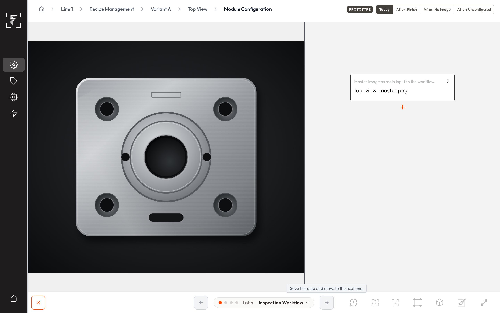
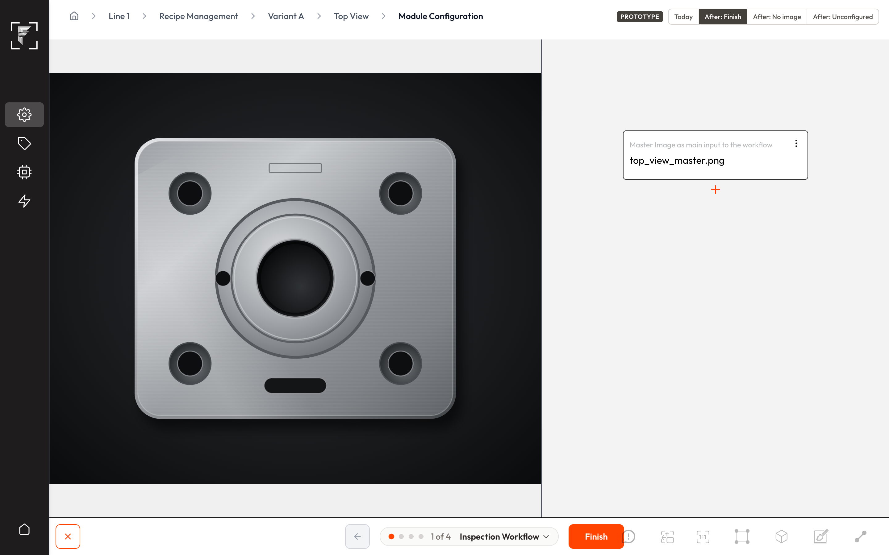
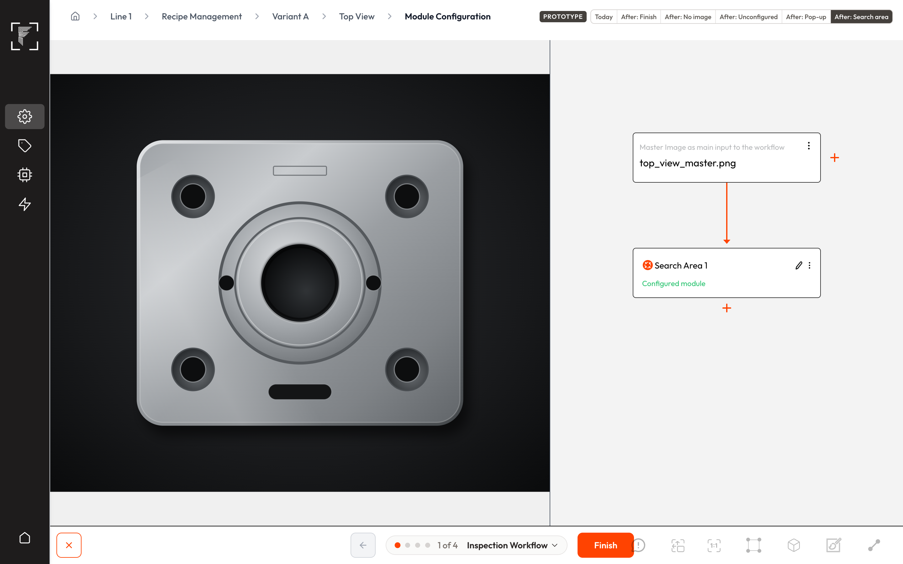
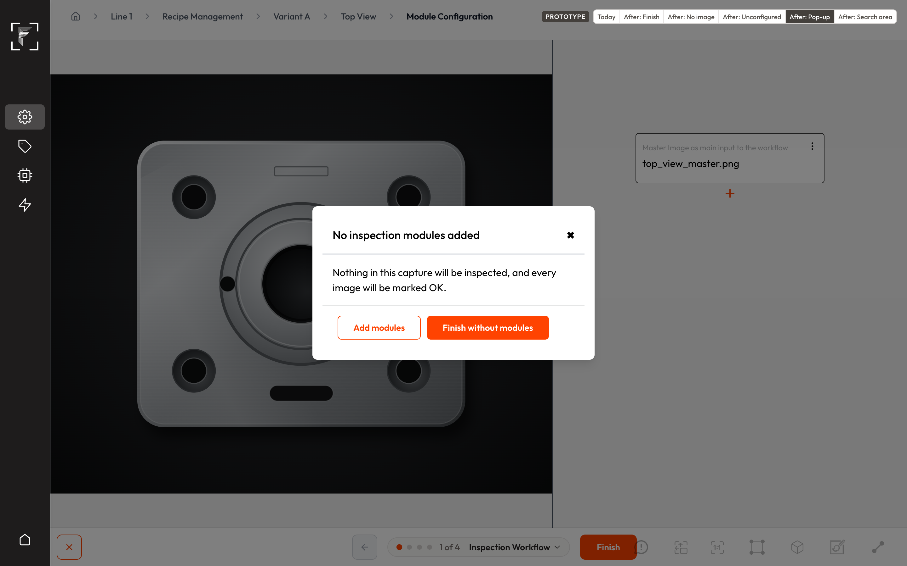
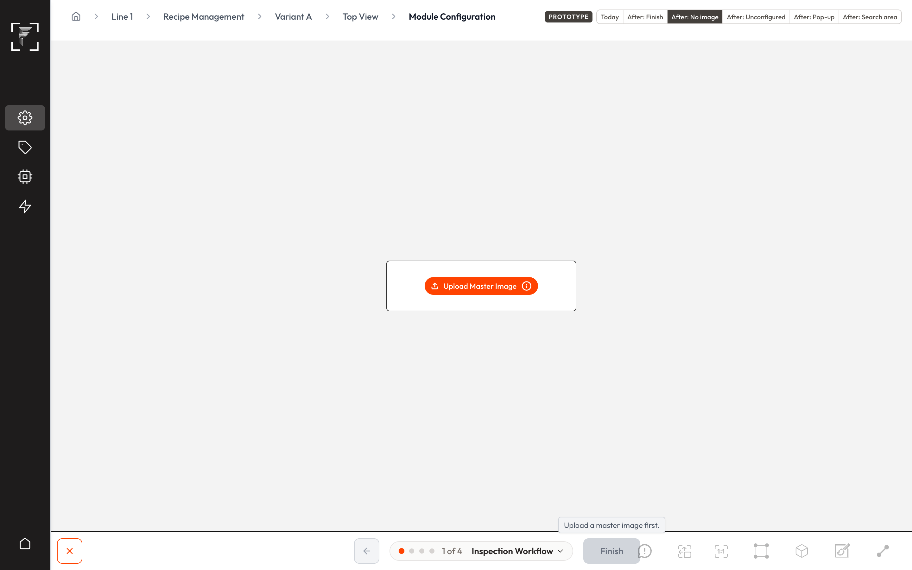
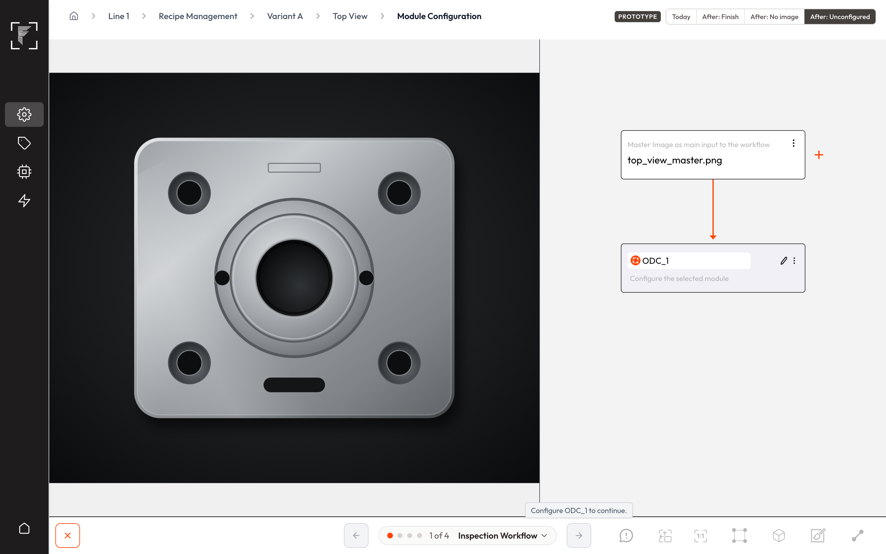

- **AC1.1** With a master image uploaded and no module in the tree other than saved search areas, the Inspection Workflow step shows Finish instead of Next.
- **AC1.2** Clicking Finish without modules in the pop-up marks the capture Complete. Dataset Folders, Sample Images and Sample Labels are skipped, and no dataset folders are created.
- **AC1.3** Until a master image is uploaded, Finish is greyed out with the tooltip "Upload a master image first."
- **AC1.4** When a module, including a search area, is added but not yet saved, the button becomes a greyed-out Next whose tooltip names the unsaved module.
- **AC1.5** Removing every inspection module from a capture brings back Finish, and the capture's existing dataset folders and labels stay as they were.
- **AC1.6** Adding an inspection module to a finished no-inspection capture returns it to in-progress until the module is configured. Instances already downloaded are unchanged.
- **AC1.7** The master image node can't be deleted: the screen offers no Delete, and the server refuses the request with an error.
- **AC1.8** If Finish without modules fails to save, the capture stays in progress, an error message shows, and the tree is unchanged.
- **AC1.9** Clicking Finish opens a pop-up titled "No inspection modules added", with the line "Nothing in this capture will be inspected, and every image will be marked OK." and the buttons Add modules and Finish without modules.
- **AC1.10** Add modules closes the pop-up and leaves the tree and the capture's status as they were.
- **AC1.11** The pop-up opens every time Finish is clicked; it has no option to stop showing it.

### US2 — Recognise these captures in Recipe Management
*As an integrator, I want Recipe Management to show which captures have no inspection modules, so that I don't mistake them for unfinished work.*
- **Kind:** Feature
- **Parts:** vision-captures-cameras
- **Teams:** SDE
- **Covers:** C3
- **Today:** with only the master image, Module Info says "No modules added yet!" and the status stays red at step 1. With only search areas, Module Info shows "SA (n)".
- **Prototype:** [Recipe Management](https://vbv-fr.github.io/master-image-only-prototype/#vision-recipe-management)

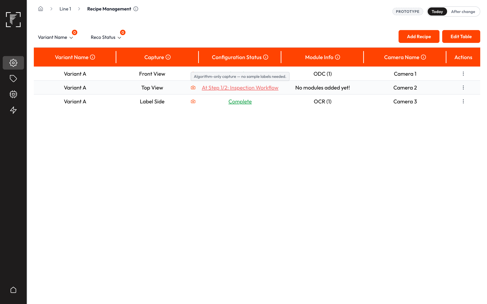
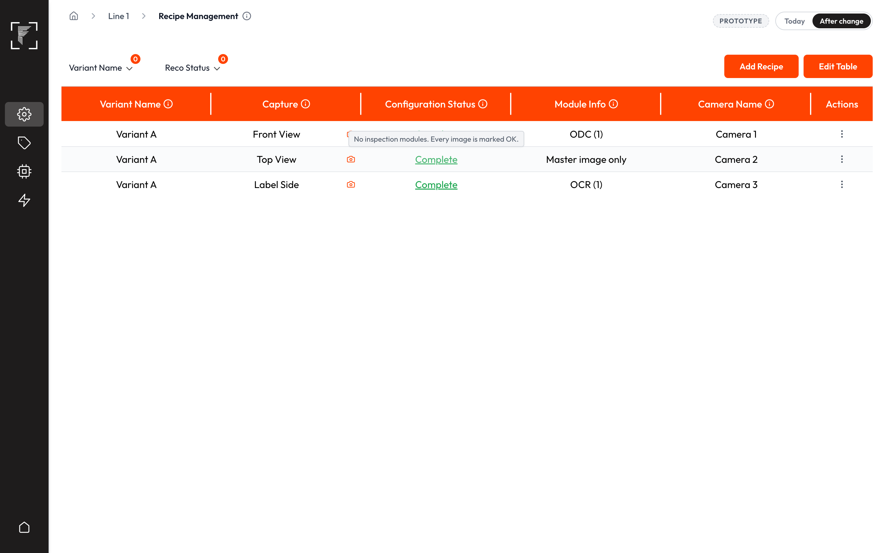

- **AC2.1** A finished capture with only the master image shows "Master image only" in Module Info.
- **AC2.2** A finished no-inspection capture shows green Complete in Configuration Status, with the tooltip "No inspection modules. Every image is marked OK."
- **AC2.3** A capture with search areas keeps showing them as "SA (n)" in Module Info, as today.

### US3 — Put these captures in an instance and load it on Edge
*As an integrator, I want to include these captures in an instance, alone or with normal captures, so that they run on the line.*
- **Kind:** Feature
- **Parts:** vision-instance-creation, edge-instance-details
- **Teams:** SDE
- **Covers:** C2, C10, C12
- **Today:** a capture with only the master image can't be ticked, because it never becomes Complete. Edge refuses an upload from a project with no classes.
- **Prototype:** [Instance captures](https://vbv-fr.github.io/master-image-only-prototype/#vision-instance)

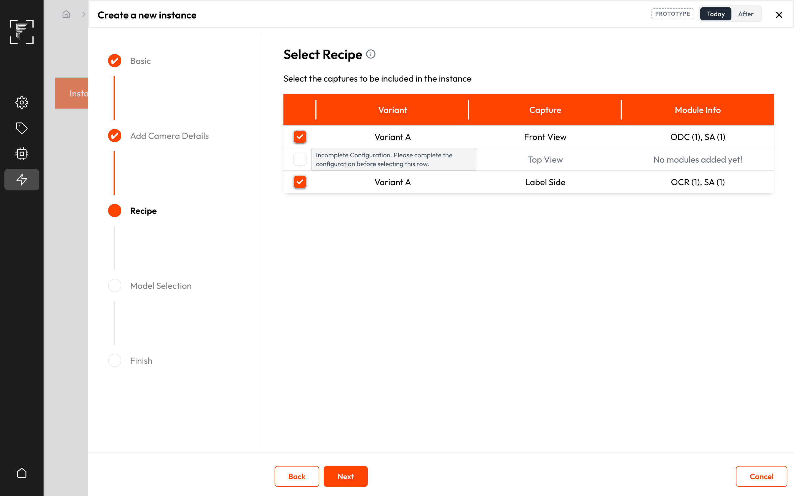
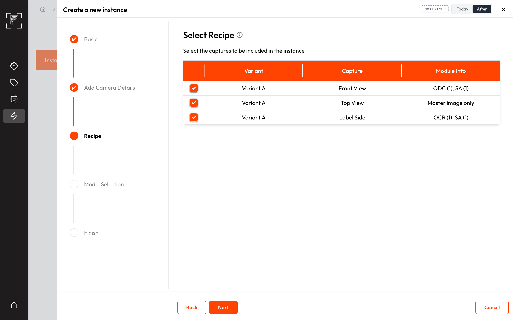

- **AC3.1** A finished no-inspection capture can be ticked in the instance wizard, together with normal captures or on its own.
- **AC3.2** (removed)
- **AC3.3** Edge accepts the upload of an instance whose project has no classes.
- **AC3.4** An instance made only of these captures deploys without error.

### US4 — Always OK
*As an operator, I want these captures to always pass, so that the part's result depends only on the real inspections.*
- **Kind:** Feature
- **Parts:** mod-result, engine-workflow
- **Teams:** AI
- **Covers:** C9
- **Today:** the capture already gives OK, but its search areas have no result of their own.

- **AC4.1** Every image of a no-inspection capture gives OK for the capture.
- **AC4.2** Every image also gives OK for each of the capture's search areas: the master image search area and any search area in the tree.

### US5 — No extra model loading (removed)
Removed 23 October 2026: the reload only costs the time to swap models on a rarely used capture, so it isn't worth custom work.
- **AC5.1** (removed)

### US6 — Use these captures in rules
*As an integrator, I want PLC and dashboard rules to use these captures' results, so that I can signal the machine as with any capture.*
- **Kind:** Feature
- **Parts:** edge-actions
- **Teams:** SDE
- **Covers:** C9
- **Today:** PLC Read, PLC Write, Internal Action and dashboard-button rules offer a key for each search area of these captures, but none ever holds a value, so a rule using one makes the deploy fail.
- **Prototype:** None — the rule screens look the same; only the value behind the key changes.

- **AC6.1** An instance with a rule on a search area key of these captures deploys without error, and the rule fires on every image.

### US7 — Save these captures' images
*As a quality engineer, I want each image of these captures saved, so that I have a picture of every part.*
- **Kind:** Feature
- **Parts:** edge-storage-image-saving, engine-workflow
- **Teams:** SDE + AI
- **Stakeholders:** Tanay (SDE), Pallavi (AI, Python)
- **Covers:** C8, C12
- **Today:** the Analysed Image switch is stuck off ("No result config was included while creating project"). Raw images can be saved, but Edge never records where.
- **Prototype:** [Image saving](https://vbv-fr.github.io/master-image-only-prototype/#edge-image-saving)

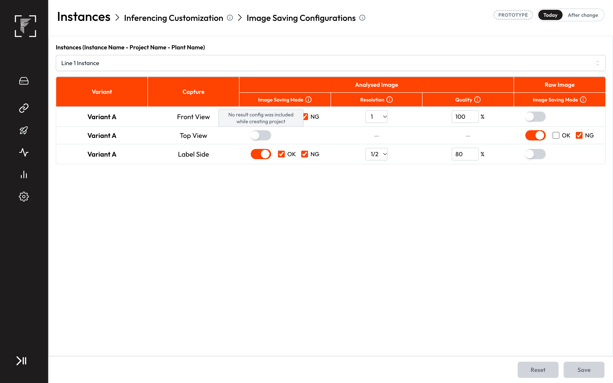
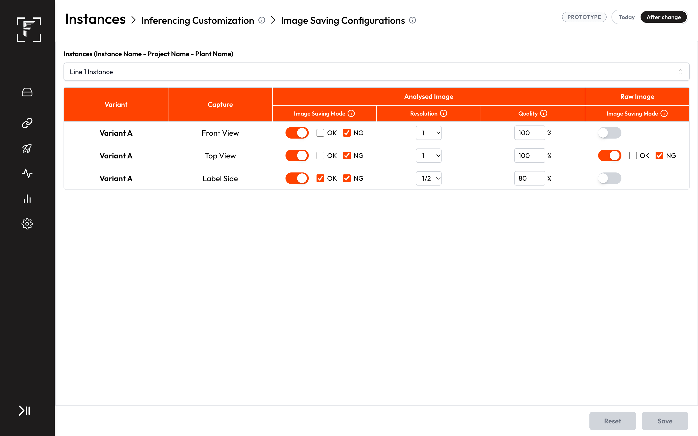

- **AC7.1** In Image Saving Configurations, the capture's row lets both Analysed Image and Raw Image be switched on, with OK/NG, Resolution and Quality, like any capture.
- **AC7.2** With Analysed Image on, every image is saved the way any capture's analysed image is: the full frame, with each search area's green box and name drawn only when Show is on in Analysed Image Configurations. With only the master image, it looks the same as the raw image.
- **AC7.3** With Raw Image on, every image is saved in the raw OK folder.
- **AC7.4** Saving the images of these captures takes no longer per image than saving a raw image of a normal capture does today.

### US8 — See these captures in Reports
*As a quality engineer, I want these captures in Reports like any passing capture, so that I can trace every part with its images.*
- **Kind:** Feature
- **Parts:** edge-reports-analytics, edge-inferencing-customization
- **Teams:** SDE
- **Covers:** C12
- **Today:** Edge stores nothing for these captures. In a mixed cycle they have no row. A cycle made only of them shows "N/A" images and "Fail" under Config Result, though the cycle passed.
- **Prototype:** [Reports](https://vbv-fr.github.io/master-image-only-prototype/#edge-reports)

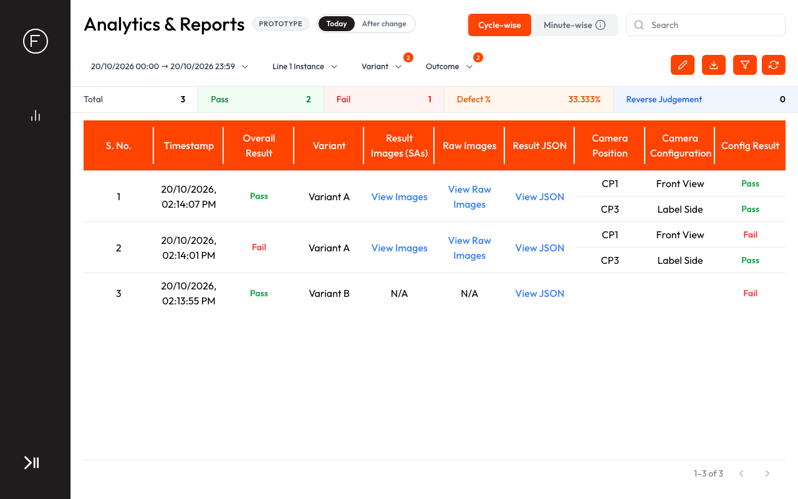
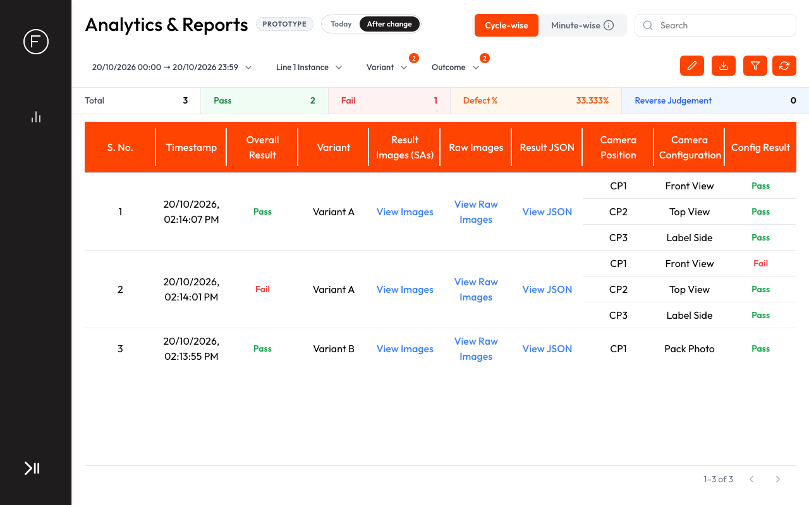
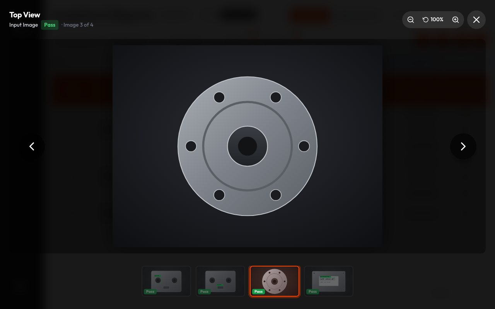

- **AC8.1** Edge stores one record for every image of these captures, with Pass, the saved image locations and the inference time.
- **AC8.2** In a mixed cycle, each of these captures has its own row with Pass under Config Result, and no special marking.
- **AC8.3** View Images for that row opens the saved analysed image, and View Raw Images opens the saved raw image.
- **AC8.4** A cycle made only of these captures shows a row for each capture, with Pass under Config Result and its images, instead of "N/A" and "Fail".
- **AC8.5** The Excel export, the old Excel export, the images zip and Reverse Judgement include these captures and their images, like any passing capture.

### US9 — See these captures on the dashboard
*As an operator, I want to see the live image of these captures, so that the screen looks the same for every camera.*
- **Kind:** Feature
- **Parts:** edge-live-dashboard, edge-dashboard-builder
- **Teams:** SDE + AI
- **Stakeholders:** Tanay (SDE), Pallavi (AI, Python)
- **Covers:** C12
- **Today:** the default dashboard gives these captures a tile, but no image ever arrives, so it stays an empty box. Dashboard Builder can't pick them.
- **Prototype:** [Live Dashboard](https://vbv-fr.github.io/master-image-only-prototype/#edge-live-dashboard), [Dashboard Builder](https://vbv-fr.github.io/master-image-only-prototype/#edge-dashboard-builder)

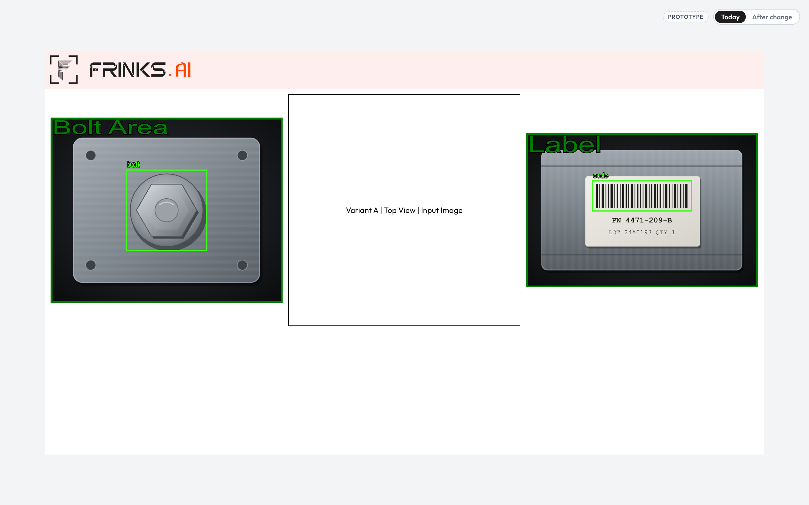
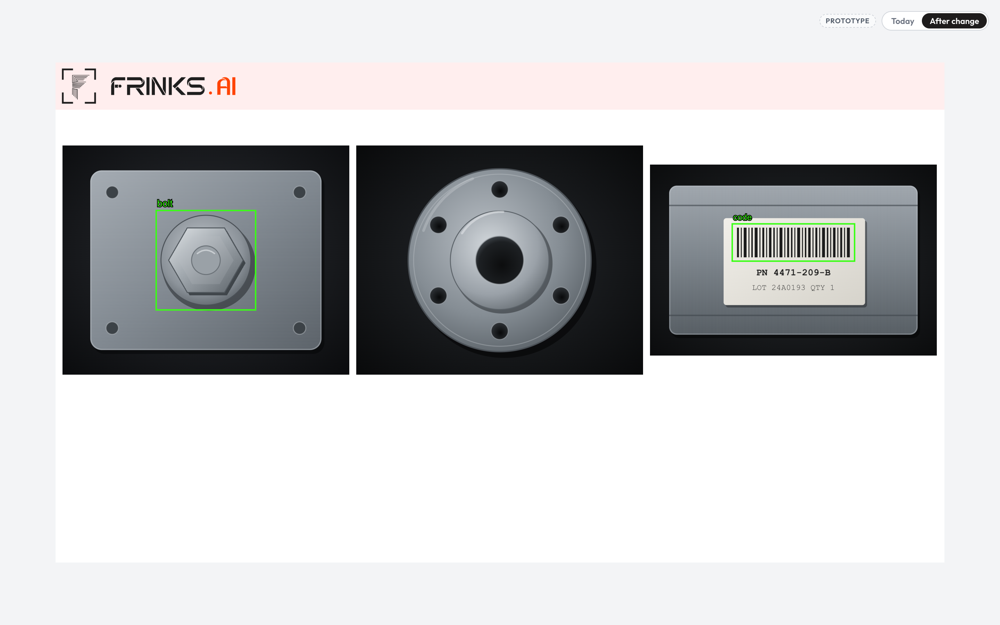
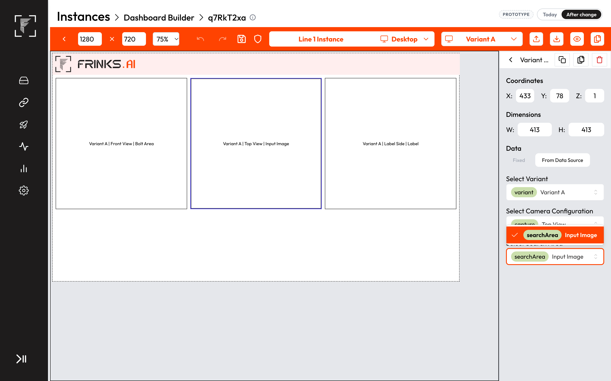

- **AC9.1** On the default dashboard, the tile of these captures shows the live image, the same way as any capture's tile.
- **AC9.2** In Dashboard Builder, the image component's picker offers the master image search area of these captures.

### US10 — Clear message in Edit Module Configurations
*As an integrator, I want EMC to tell me these captures have nothing to edit, so that I don't think the screen is broken.*
- **Kind:** Feature
- **Parts:** edge-emc
- **Teams:** SDE
- **Covers:** C11
- **Today:** the capture is listed, but the Module list is greyed out with nothing below it and no message.
- **Prototype:** [EMC](https://vbv-fr.github.io/master-image-only-prototype/#edge-emc)

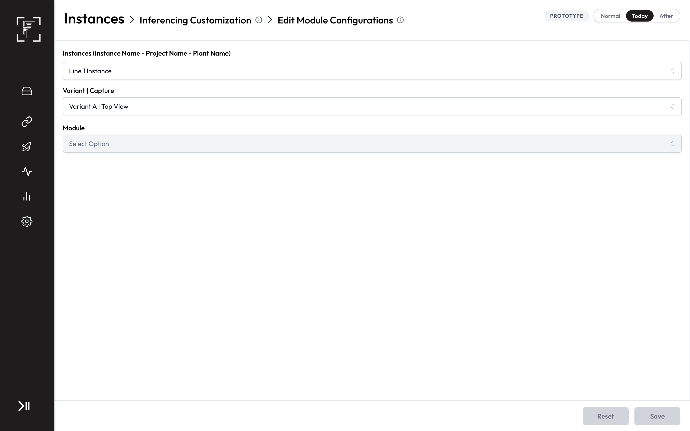
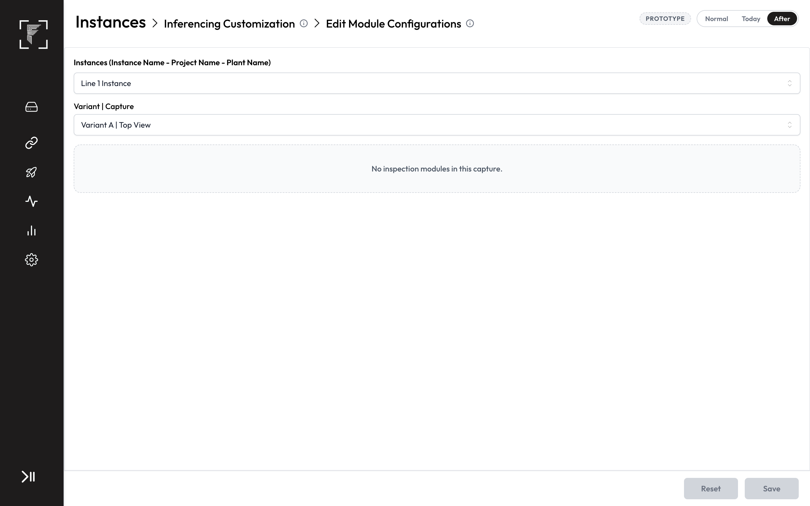

- **AC10.1** Selecting one of these captures in EMC shows "No inspection modules in this capture." in the settings area, instead of an empty, greyed-out module list.

### US11 — Who can do this
*As an Org Admin, I want this to follow today's permissions, so that no one gets new access by accident.*
- **Kind:** Rules
- **Parts:** vision-recipe-tree
- **Teams:** SDE
- **Covers:** C1

- **AC11.1** Only users who can edit recipes in Recipe Management today can finish a no-inspection capture.
- **AC11.2** No role or permission is added, removed or changed, in Vision or on Edge.

### US12 — Cycle results keep working as today
*As an operator, I want cycle results to keep their meaning, so that the reject signal stays right.*
- **Kind:** Keeps working
- **Parts:** edge-inferencing-customization, mod-result, edge-actions
- **Teams:** SDE
- **Covers:** C2, C9

- **AC12.1** In a cycle with these captures and normal captures, the cycle is OK when all normal captures pass, and NG when any normal capture fails.
- **AC12.2** A cycle made only of these captures ends OK once all of them have reported.
- **AC12.3** The capture-level result, completion and count keys work as today, and the cycle-level PLC write fires at cycle close as today.

### US13 — A capture that never reports still ends the cycle NG
*As an operator, I want a cycle to end NG when a capture's image never arrives, so that a missing picture is never passed.*
- **Kind:** Keeps working
- **Parts:** edge-inferencing-customization
- **Teams:** SDE
- **Covers:** C9

- **AC13.1** If one of these captures (like any capture) doesn't report within the cycle time, the cycle ends NG at the timeout, as today.

### US14 — Everything around these captures keeps working
*As an integrator, I want the rest of the flow to behave as it does today, so that nothing else changes for me.*
- **Kind:** Keeps working
- **Parts:** mod-input-master-image, vision-recipe-tree, vision-instance-creation, edge-model-loading-variant-change, edge-storage-image-saving, edge-reports-analytics
- **Teams:** SDE + AI
- **Stakeholders:** Tanay (SDE), Pallavi (AI, Python)
- **Covers:** C3, C4, C10, C12, C14

- **AC14.1** Deleting the uploaded master image (the picture, not the node) still removes every module under it, search areas included, and deactivates the project's instances, as today.
- **AC14.2** Model Selection is skipped when no ticked capture needs a model, and shows no row for these captures in a mixed instance.
- **AC14.3** Camera details are still required for every capture position in the instance wizard.
- **AC14.4** Changing to or from a variant that contains these captures completes within the existing 20-second changeover limit.
- **AC14.5** Saved images of these captures count against the storage limits and are cleaned up like any other saved image.
- **AC14.6** The Total, Pass, Fail and Defect % counters in Reports count cycles exactly as today.
- **AC14.7** Moving a search area still marks the search areas under it as unsaved, as today.

### US15 — Platform requirements
*As a Frinks support engineer, I want to know exactly what ships, so that installs and upgrades go as planned.*
- **Kind:** Platform
- **Parts:** engine-workflow, edge-inferencing-customization
- **Teams:** SDE + AI
- **Stakeholders:** Tanay (SDE), Pallavi (AI, Python)
- **Covers:** C13, C16, C17, C18

- **AC15.1** Scripts bundle: changes. It carries the Edge backend, frontend and Python engine changes of this PRD. Vision ships through its normal cloud release.
- **AC15.2** Node Docker image: no change. No new libraries are needed.
- **AC15.3** Python Docker image: no change. No new libraries are needed, and every released Python scripts version already starts an instance with no models.
- **AC15.4** Installer: no change.
- **AC15.5** Error codes: none new. The remaining failures are covered by existing codes, and the refused delete in AC1.7 is a Vision error message.
- **AC15.6** The Vision Recipe Management manual and the Edge Analytics and Reports, Image Saving, Dashboard and Edit Module Configurations sections are updated, and the release note reads: "Captures with no inspection modules (only a master image, or only search areas) can now be finished: every image is OK, and their images are saved, shown and reported like any other capture."

### US16 — Migration requirements
*As a Frinks support engineer, I want existing data and boxes to keep working, so that upgrading is safe.*
- **Kind:** Migration
- **Parts:** vision-instance-creation, edge-instance-details
- **Teams:** SDE
- **Covers:** C6, C7

- **AC16.1** Existing data: no new tables or columns, so no database migration. Existing captures behave as before, and captures that already hold only a master image or only search areas can be finished after the release.
- **AC16.2** Older Edge with a new instance: it still gives OK for these captures, but shows no images in Reports or on the dashboard, a rule on their search area keys fails the deploy, and projects with no classes are refused. The release note states that the Edge release this ships in is the minimum version.
- **AC16.3** Older instance on the new Edge: works as before.
- **AC16.4** Upgrading Edge boxes in the field needs no extra upgrade step.

## 7. Out of scope
- Any inspection on these captures, such as comparing with the master image.
- The instance wizard's separate list of "trainable" modules, and the other existing bugs found while checking the code. They're raised separately.
- Data lost from Reports during Edge updates (a separate bug).
- Trees whose only other modules are Masking or Orientator: Edge treats them like search areas, but they keep today's flow.
- Avoiding the model reload in loading mode 3 (and mode 2 with its own capture position) when a capture needs no models: the delay is small and it would be custom work.

## 8. How we'll know it worked
| Measure | Target |
|---|---|
| New instances that use a dummy module to make a filler capture pass | 0 |
| Support tickets about missing images for filler or image-record captures | 0 |

## Appendix A — Coverage
**Not applicable:**
- **C15** — N/A: no new network use, timestamps or offline behaviour.

**Coverage check:**

**Result:** PASS

- 15 user stories (9 feature, 1 rules, 3 keeps working, 1 platform, 1 migration), 56 ACs, 15 touched parts, 0 discussion points.
- Checklist: 17 items covered by stories, 1 N/A, 0 open.
- Duplicate and contradiction pass (23 October 2026): 4 duplicates and 1 contradiction found and fixed (see Changelog).
- Every punchlist item in notes.md maps to exactly one AC.

## Appendix B — Code references
For the ticket skill and developers. Paths are relative to each repo's `src` unless shown.
- **Recipe tree:** `frinksvision-frontend`: `modules/project/module-configuration/index.tsx:353` (Next blocked when `currentModules.length === 1`), `:989-991` (tooltip), `:1021-1038` (button); `moduleWorkflow/index.tsx:857-869` (tree hidden until master image); `moduleNode.tsx:107` (no Delete on root). `frinksvision-backend`: `service/cameraConfig.ts:409-414, 440-458` (finishWithoutLabelImages), `utils/module.ts:20-32` (trainable types), `dao/cameraConfig.ts:177-213` (step flags), `dao/module.ts:1495` (delete has no root guard), `dao/module.ts:597-610` (root Input Module created with the capture).
- **Master image node:** `frinksvision-backend`: `service/configuration.ts:341-360` (deleting the master image removes child modules and deactivates instances), `controller/instance.ts:680-714` (export adds master image files only where one exists).
- **Recipe Management table:** `frinksvision-backend`: `utils/module.ts:18, 40-45` (Module Info text). `frinksvision-frontend`: `project-configuration/index.tsx:244-289`, `shared/copy/tooltips.ts:82-83, 97-98`.
- **Instance creation:** `frinksvision-frontend`: `instances/steps/CameraConfig.tsx:311-316, 400-413`, `instances/steps/MapCameraIp.tsx:377-455`, `instances/index.tsx:186-213`, `ModelSelection.tsx:428-429, 774-787`, `instanceWizard.ts:8-21`. `frinksvision-backend`: `service/instance.ts:676-690, 783-800, 1096`, `service/packageManifest.ts:83-86`.
- **Instance upload on Edge:** `frinksedge-deployment-backend`: `dao/instances.ts:1036-1037` (class join is required although commented optional), `service/instance.ts:966-975, 1950`.
- **Result module and engine:** `vip-inference-python/scripts`: `assembly/modules/resultModule.py:366, 505-575, 772, 1256`, `assembly/modules/searchAreaModule.py:149-153`, `assembly/models/ModelManager.py:52-70` (no models → no model key needed), `components/mainProcessor.py:231-249`. `frinksedge-inferencing-backend`: `module.repository.ts:499-521`, `python-model-result.service.ts:146-160`.
- **Cycles and result storage:** `frinksedge-inferencing-backend`: `result-flush.service.ts:78-96` (rows only per module result), `parser.dto.ts:643-646`, `cycle-manager.service.ts:528-533, 668, 725-727, 765-768`, `orchestrator.service.ts:111-163`.
- **Model loading:** `vip-inference-python/scripts`: `components/mainProcessor_utils.py:321-414`.
- **Rules and actions:** `frinksedge-deployment-frontend`: `createKeys.ts:156, 256-290`. `frinksedge-inferencing-backend`: `key-populator.service.ts:282, 413`, `system-key-writer.service.ts:95-101`, `action-loader.service.ts:568-592`.
- **Image saving:** `frinksedge-deployment-frontend`: `ImageSavingConfigurations.jsx:111-127, 391-421, 488-522`. `frinksedge-deployment-backend`: `dao/cameraConfig.ts:745-767`, `service/imageSavingConfig.ts:36-46`.
- **Reports:** `frinksedge-report`: `analysis.service.ts:200, 486-531`, `analysis.repository.ts:15-30, 357`, `download.service.ts:287, 599-607`. `frinksedge-report-frontend`: `ResultTable.jsx:140, 166`. `frinksedge-deployment-backend`: `inferenceResultConfigWise.schema.ts:48-52` (no schema change needed).
- **Dashboards:** `frinksedge-deployment-backend`: `dao/instances.ts:1267-1310`, `service/dashboard.ts:297`, `service/module.ts:71-75`. `frinksedge-deployment-frontend`: `ImageComponent.jsx:643-656`.
- **EMC:** `frinksedge-deployment-frontend`: `inferencing-customizations/hooks/useModuleConfig.js:96-118`, `EditModuleConfigurations.jsx:505-510`.

Repos checked (20 October 2026): frinksvision-frontend @ 110a23c, frinksvision-backend @ eda944f, vip-inference-python @ 93451d1, frinksedge-deployment-backend @ 009fc11, frinksedge-deployment-frontend @ 7e92de34, frinksedge-inferencing-backend @ eddd8e5, frinksedge-report @ 5fe5390, frinksedge-report-frontend @ 9893a19, plus 26 more in `.frinks-sync.tsv`.

## Changelog
- 20 October 2026 — First draft from the PRD skill dry run.
- 20 October 2026 — Owner set; Reports prototype hosted on GitHub Pages.
- 20 October 2026 — Restructured: user stories are the single list of work (Rules, Keeps working, Platform and Migration stories added); Changes by part, Edge cases and Decisions sections removed; prototypes for every changed screen; Q1 closed (model-less instances already start), Q2 turned into AC7.4, Q3 answered in AC16.2.
- 20 October 2026 — OK is shown the way every passing search area shows it: a green border and the "Input Image" label on the analysed image (AC7.2, AC8.3, AC9.1).
- 20 October 2026 — Stakeholders for SDE + AI stories: Tanay (SDE), Pallavi (AI, Python).
- 20 October 2026 — Approved (Tanay Deo).
- 23 October 2026 — Back to In review. Scope widened to captures with only search areas (AC1.1, AC1.2, AC1.4, AC1.5, AC1.6, AC2.2, AC3.1, AC4.2, AC6.1, AC11.1, AC15.6, AC16.1, AC16.2; AC2.3 and AC14.7 added). Finish asks for confirmation (AC1.9–AC1.11 added). US5 and AC5.1 removed: the model reload is small and would be custom work (now in Out of scope). Analysed image is drawn like any capture's, with no frame around the whole image (AC7.2, AC8.3, AC9.1; corrects the 20 October decision). AC3.2 (removed): covered by AC7.1, AC8.2, AC9.1. AC7.3 trimmed: the recorded location is AC8.1. Header moved to the current template (prototype first, Discussion points). Duplicate pass: AC8.4 merged its two Pass statements; AC11.1 trimmed (Edge access is AC11.2); AC16.4 trimmed (no database change is AC16.1); AC6.1 trimmed (each area's OK is AC4.2); AC14.1 reworded to the uploaded picture, so it no longer reads against AC1.7.
- 23 October 2026 — Approved again (Tanay Deo).
- 26 October 2026 — Prototype rebuilt as one walkthrough (step navigator, shared state across screens, Today / After change); story links now open their step. No AC changed.

## Checked, not affected
- vision-projects, vision-access, vision-variants: permissions, projects and variants work as today.
- vision-datasets-annotations, vision-training-sets-recommender, vision-auto-annotation, vision-model-training, vision-model-evaluation: these captures have nothing to label or train. They get no dataset folders and don't appear in Datasets & Annotations, as today.
- mod-search-area, mod-odc, mod-tracker, mod-classification, mod-color-detection, mod-code-reader, mod-masking, mod-ocr, mod-segmentation, mod-bead-inspection, mod-shape-extractor, mod-matting, mod-orientation: no inspection module is used. The master image node is a search area, but the Search Area Allocator itself doesn't change.
- edge-deployment, engine-runtime-packaging, edge-camera-capture: the deploy checks, the inference image and the cameras already handle these captures.
- edge-plc-setup, edge-plc-read, edge-plc-write, edge-internal-actions: their screens are unchanged. The values they pick from are covered in US6.
- edge-health: no new ways to fail; existing error codes cover the remaining failures (US15).
- edge-backup-migration, edge-release-upgrade, edge-installer, edge-networking, edge-system-time, edge-encryption-keys, edge-access-audit: no new data, services, ports, keys or permissions.
