# PRD: Module Outputs in Reports & Analytics

**Prototype:** [Interactive workflow: Reports & Analytics, Today vs After change](https://vbv-fr.github.io/module-outputs-prototype/)
**Product:** Frinks Edge
**Status:** Approved
**Date:** 28 October 2026
**Owner:** Tanay Deo
**Timeline:** SPRINT 26-15, 27 Oct – 10 Nov 2026 (running sprint)
**Related:** FP-528 (open epic: Analytics & Reports menu). Earlier Reports work: FP-3715 (Raw Images column, Download popup), FP-3622 (Cycle Complete column), FP-3727 (Write to DB custom key)
**Code checked:** 26 October 2026 — 34 repos at their latest default-branch commit (list in Appendix B)

---

## Discussion points
None open. Q1 (success targets) and Q3 (keys for values that have none) were decided on 26 October 2026; see the changelog.

## 1. Summary
- Reports & Analytics gets a **Module Outputs** button. It opens a setup window for the selected instance, listing every capture (grouped by variant) and, for each module, its **keys exactly as Edge shows them today** in PLC Write and Dashboard Builder (for example `[cls] Screw > [key-num] current_count`). Every key Edge has today is offered, including running totals such as pass and fail counts, plus the per-line angle and length keys of Edge Search and Parallel Lines shapes, which Edge writes today but never listed; these also appear in PLC Write, Internal Action Config and Dashboard Builder.
- Each capture also lists its **dimensions**: those measured within the capture, and those measured across it and another capture.
- Ticking a key shows a **Display Name** box. The person types the name the value appears under on the Reports page, for example "Screw count" or "Serial No.".
- The window opens on the instance shown in the Reports table, with an **Instance** dropdown to set up any other instance on the box.
- Two options at the top, **Show in same column** and **Show in separate columns**, decide the layout. In the same column, the ticked keys share one Module Outputs column. In separate columns, each ticked key gets its own column, headed by its Display Name.
- After saving, a new **Module Outputs** column (or one column per key) shows the ticked keys on each capture's row as `Display Name: value` lines, such as `Screw count: 4` or `Serial No.: SN-48213`.
- When each capture finishes, Edge **saves a copy of each ticked key** with the cycle; keys not ticked are not saved, to keep disk use down. Reports shows those copies: each value is what the key held at that moment, the same value the dashboard and PLC saw. Cycles run before a key was in use show "Not saved".
- **Changes saved while an instance is running wait for a restart.** A pop-up says so before saving. Until the deployment is restarted, Reports keeps the setup the deployment started with, and Edge keeps saving its keys.
- Every module type that has keys is covered: object detection, image classification, OCR, code reader, segmentation (single-class mode), bead inspection, colour detection, shape extractor, orientation & tilt check, and dimensions measured within one capture or across two.
- The column (or key columns) is searchable with the existing Search box and exported to Excel the same way.
- Saving the setup needs the existing **Update** permission on Analytics & Reports. Everyone who can view Reports sees the column.

## 2. Why we are making this
- **Today:** Reports & Analytics shows only Pass or Fail for each cycle and each capture. To see why a capture failed (how many screws were found, which class a slot got, what serial number or code was read), someone has to open View JSON. It shows raw ids, one cycle at a time. The Class Name and Class Count columns show object counts only, show nothing for image classification, and never show read text or codes. The only workaround is one Write to DB rule per value. That gives one value per cycle (not per capture), and only for cycles run after the rule was made. Quality engineers, plant admins and support teams are affected.
- **Evidence:** customer request, and parity with competing inspection systems that show tool results next to each part.
- **After:** someone sets up once, per instance, which module keys to show and under what Display Name. A "Module Outputs" column then shows them as readable pairs, such as "Screw count: 4" or "Serial No.: SN-48213", for each capture of every cycle run once the setup is in use, on screen and in the Excel export.

## 3. Goals and non-goals
**Goals**
- G1. Inside Reports & Analytics, choose which of each capture's module keys to show, and give each a Display Name.
- G2. Show the chosen values as name: value pairs in a new "Module Outputs" column, per capture, for every cycle run while they are in use.
- G3. Cover every module type that has keys on Edge today.
- G4. The column works with the existing Search box and appears in the Excel export.

**Non-goals**
- New search or filter controls for module values. The existing Search box is enough.
- Fast Mode lines (Minute-wise), which store no per-capture results.
- Values no key holds today, such as the default text of conditional classification, bead width in pixels (the `_bead_width` key is a pass/fail flag) and per-caliper widths.
- New keys for values that have no key today. The only keys Edge adds are the per-line shape keys it already writes (AC3.15).
- Any change to how OK or NG is decided, or to the PLC and dashboard keys that exist today.

## 4. Key concepts
- **Key:** a named value Edge keeps for an instance, capture, module, class, search area or label, the same keys offered today in PLC Write, Internal Actions and Dashboard Builder (for example `current_count` of class Screw), plus the per-line shape keys of AC3.15.
- **Display Name:** the name a ticked key's value appears under on the Reports page and in the Excel, typed by the person setting it up.
- **Key copy:** the value a ticked key held when its capture finished, saved by Edge with that capture in the cycle. Only ticked keys are copied. Reports shows key copies, never today's live value.
- **Setup in use:** while an instance is running, the setup its deployment started with; changes saved meanwhile go into use at the next start. While the instance is not running, its saved setup is in use.
- **Cross-capture dimension:** a distance measured from a feature in one capture to a feature in another capture of the same variant, set up in Dimension Configuration.
- **Module Outputs setup:** the per-instance choice of which keys show in Reports, their Display Names, and whether they share one column or get one column each.
- **Show in same column / Show in separate columns:** the per-instance layout. Same column puts every ticked key in one Module Outputs column as `Display Name: value` lines. Separate columns gives each ticked key its own column, headed by its Display Name.

## 5. Impact map
The parts this changes. Parts checked and not affected are listed at the very end.

| Part | What will happen | User stories |
|---|---|---|
| Reports & Analytics (edge-reports-analytics) | New Module Outputs button and setup window; restart pop-up when saving on a running instance; new Module Outputs column on each capture row; new Edit Table option; new Excel column; the column is searchable | US1, US2, US4, US5, US8, US13 |
| Edge access & audit (edge-access-audit) | Saving the setup needs Update on Analytics & Reports, checked by the report server; every save is written to the audit log | US7 |
| Object Detection (mod-odc) | Offers its module keys and, per output class, `result`, `current_count` and `count_till_now` | US3, US9 |
| Image Classification (mod-classification) | Offers its module keys, `detected_class (<search area>)` per area and `correct_class` | US3, US9 |
| OCR (mod-ocr) | Offers `detected_text`; in Read & Match also its module keys and each label's `labelName:<label>_…` keys | US3, US9 |
| Code Reader (mod-code-reader) | Offers `detected_string`; in Read & Match also its module keys and `gt_string` | US3, US9 |
| Segmentation (mod-segmentation) | Offers its keys only with single-class output on; in normal mode its card shows "No keys" and nothing is shown for it in Reports | US3, US9 |
| Bead Inspection (mod-bead-inspection) | Offers its module keys, `caliper_pass_percentage`, `bead_class_name` and per-bead `bead:<bead>_…` keys | US3, US9 |
| Colour Detection (mod-color-detection) | Offers its module keys and per-colour `colorName:<colour>_…` keys | US3, US9 |
| Shape Extractor (mod-shape-extractor) | Offers per-shape `shape:<shape>_…` measurement keys, and registers the per-line angle and length keys of Parallel Lines and Edge Search shapes; each dimension, within one capture or across two, offers its five `dim_…` keys under each capture it measures | US3, US9, US11, US12 |
| Orientation & Tilt (mod-orientation) | Offers its module keys (`result`, `pass_count`, `fail_count`) | US3, US9 |
| Tracker (mod-tracker) | Not offered: it has no keys and produces no result on Edge today | US3 |
| Matting (mod-matting) | Not offered: it has no keys | US3 |
| Instance upload on Edge (edge-instance-details) | A re-upload keeps the setup; removed captures, modules and classes drop out of it; deleting the instance deletes it | US6, US11 |
| Edit Module Configurations (edge-emc) | Edits keep the setup; the values offered follow the current module settings | US6 |
| Cycles and result storage (edge-inferencing-customization) | Saves a copy of each ticked key with the capture's row as the capture finishes, and of cross-capture dimensions when the cycle ends; a module that did not run is saved as "Not run"; keeps saving the setup in use until the restart | US12, US13, US9 |
| Python engine (engine-workflow) | No change: results are produced and sent exactly as today | US9 |
| Result module (mod-result) | No change: OK and NG are decided exactly as today | US9 |
| Actions (edge-actions) | Write to DB rules that copy values into Additional Info columns keep working; rules can use the per-line shape keys like any other key | US8, US3 |
| PLC Write (edge-plc-write) | Its key picker also lists the per-line shape keys | US3 |
| Internal Action Config (edge-internal-actions) | Its key picker also lists the per-line shape keys | US3 |
| Dashboard Builder (edge-dashboard-builder) | Its key picker also lists the per-line shape keys | US3 |
| Deployments (edge-deployment) | Deploy and Restart All Deployments put the saved setup in use; Fast Mode deployments get no Module Outputs, as they store no per-capture results | US13, US8 |
| Health Monitoring (edge-health) | Storage cleanup deletes key copies together with their capture rows, and counts them in the data limit | US12 |
| Backup and migration (edge-backup-migration) | The saved setup is created on upgrade and survives every later upgrade | US11, US12 |
| Release and upgrades (edge-release-upgrade) | Ships in the scripts bundle as a normal release, with database additions for the setup and the key copies | US10 |

## 6. User stories and acceptance criteria

### US1 — Open the Module Outputs setup
*As a quality engineer, I want one place in Reports to choose which module values to show, so that I don't have to open View JSON for every cycle.*
- **Kind:** Feature
- **Parts:** edge-reports-analytics
- **Teams:** SDE
- **Covers:** C2, C5, C10, C13
- **Today:** Reports has Edit Table, Download, Filter and Refresh buttons. Module values can only be read in View JSON, as raw ids, one cycle at a time.
- **Prototype:** [Step 2: Open Module Outputs](https://vbv-fr.github.io/module-outputs-prototype/#setup)

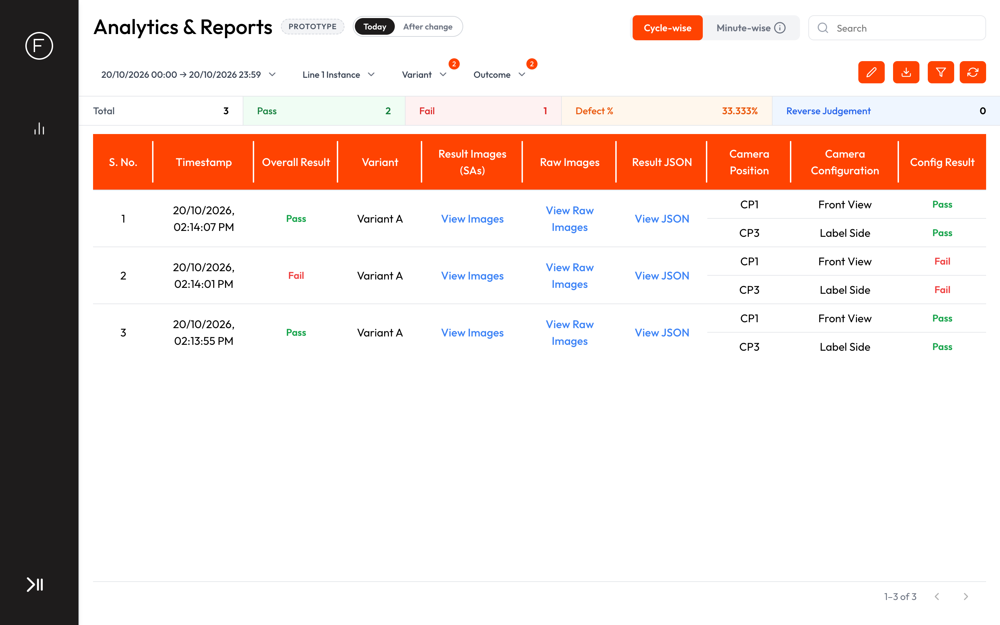
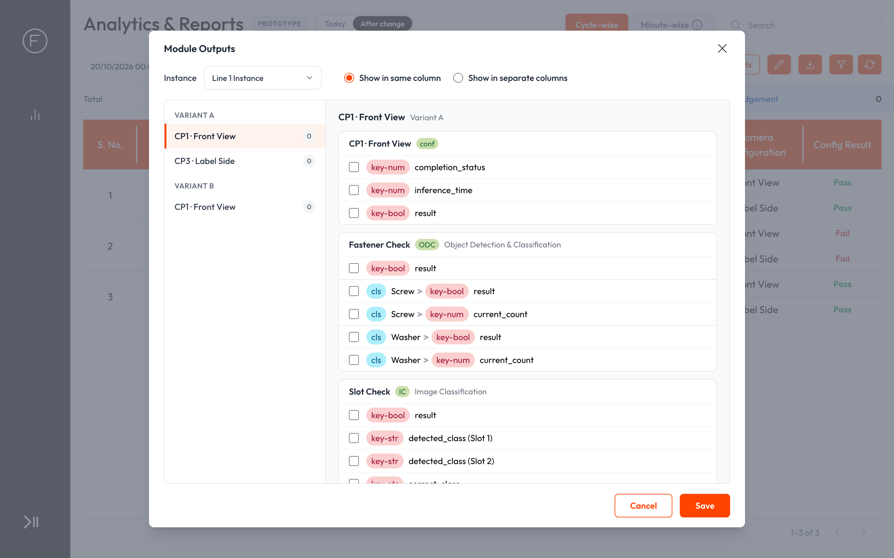
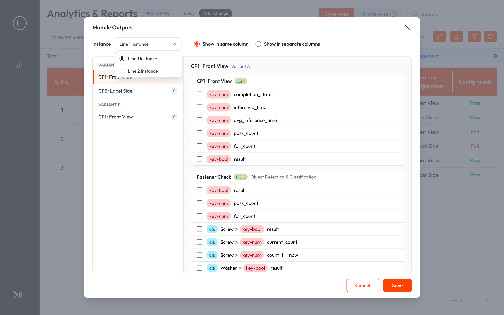

- **AC1.1** On the Cycle-wise tab, a "Module Outputs" button sits to the left of the Edit Table, Download, Filter and Refresh buttons. It is not shown on the Minute-wise tab.
- **AC1.2** The button is enabled whether or not an instance is selected in the Reports filter bar.
- **AC1.3** Clicking it opens the "Module Outputs" window. Its top pane holds an "Instance" dropdown, set to the instance selected in the Reports filter bar. On the left, every capture of the instance is listed under its variant as "<capture position> · <capture name>", each with a count of its ticked values. On the right, the selected capture's modules are shown, one card each with the module name and type, listing every key it has (US3). Each capture's own keys come first, in a card headed by the capture.
- **AC1.4** A module with no keys (for example segmentation in normal mode) shows its card with "No keys".
- **AC1.5** (removed — saving on a running instance and on one that is not running are AC13.1 and AC13.6)
- **AC1.6** If the setup cannot be loaded, the window shows "Module Outputs could not be loaded (RPT-MOUT-002)", and the table keeps working without the Module Outputs column.
- **AC1.7** The Instance dropdown lists every instance on the box. Choosing another instance shows its captures, keys and saved setup. Unsaved changes on each instance are kept while switching, until Save or Cancel. Save stores every instance changed in the window. If no instance is selected in the Reports filter bar, the dropdown shows "Select an instance" and the panes stay empty until one is chosen.

### US2 — Choose and name the values
*As a quality engineer, I want to tick the keys I care about and give each a Display Name my team knows, so that the report reads like our own checklist.*
- **Kind:** Feature
- **Parts:** edge-reports-analytics
- **Teams:** SDE
- **Covers:** C2, C3, C4, C5, C13
- **Today:** Keys can only be picked one at a time, in PLC Write, Internal Actions or Dashboard Builder. Nothing puts them in Reports.
- **Prototype:** [Step 3: Choose keys and Display Names](https://vbv-fr.github.io/module-outputs-prototype/#choose)

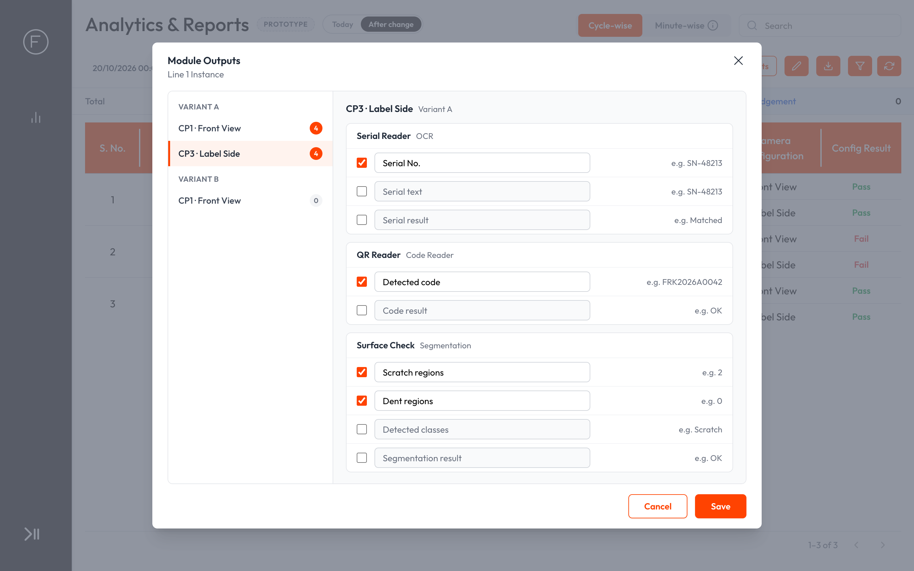
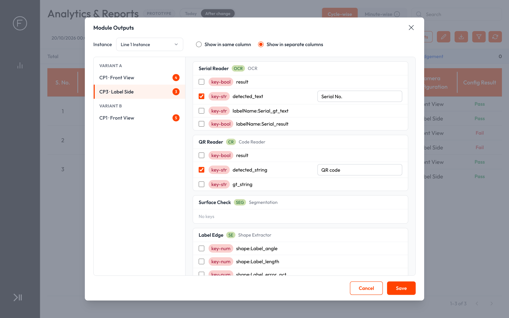

- **AC2.1** The first time the setup is opened for an instance, nothing is ticked, and the table has no Module Outputs column.
- **AC2.2** Each key row shows a tick box and the key the way Edge's key picker shows it today: the class, search area or label chip where there is one, then a "key-bool", "key-str" or "key-num" chip and the key name exactly as Edge stores it (for example `[cls] Screw > [key-num] current_count`).
- **AC2.3** Ticking a key shows a "Display Name" box on that row; unticking hides it.
- **AC2.4** A Display Name is required for every ticked key, up to 40 characters, and unique within a capture. An empty box shows "Enter a display name" and a duplicate shows "Name already used in this capture" under the box. Save stays disabled until every error is fixed.
- **AC2.5** Save (after the pop-up of AC13.1 when a changed instance is running) stores the setup, closes the window and shows "Module Outputs saved". Cancel or the close (×) button discards unsaved changes.
- **AC2.6** If saving fails, the window stays open with the person's choices and shows "Module Outputs could not be saved (RPT-MOUT-001)". The setup saved earlier is unchanged.
- **AC2.7** When two people change the setup at the same time, the last save wins.
- **AC2.8** The setup belongs to the instance and is shared by everyone on the box: anyone who opens Reports for that instance sees the same columns. Two instances of the same project keep separate setups.
- **AC2.9** The top pane has two radio buttons, "Show in same column" (selected by default) and "Show in separate columns".

### US3 — Values each module offers
*As a quality engineer, I want to see the same keys Edge already uses for PLC and dashboards, so that what I pick for Reports matches what the line already knows.*
- **Kind:** Feature
- **Parts:** mod-odc, mod-classification, mod-ocr, mod-code-reader, mod-segmentation, mod-bead-inspection, mod-color-detection, mod-shape-extractor, mod-orientation, mod-tracker, mod-matting, edge-plc-write, edge-internal-actions, edge-dashboard-builder, edge-actions
- **Teams:** SDE
- **Covers:** C2, C12
- **Today:** These keys are offered in PLC Write, Internal Actions and Dashboard Builder, except the per-line shape keys, which Edge writes but never lists. Their per-cycle values sit inside each cycle's stored result, keyed by ids, visible only in View JSON.
- **Prototype:** [Step 4: Other module types](https://vbv-fr.github.io/module-outputs-prototype/#more-modules)

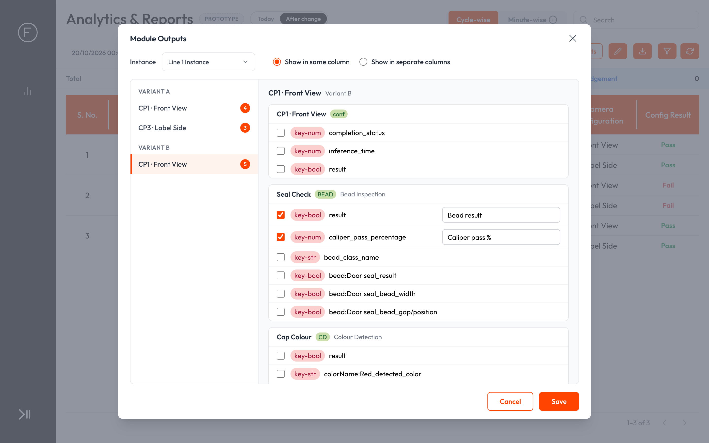
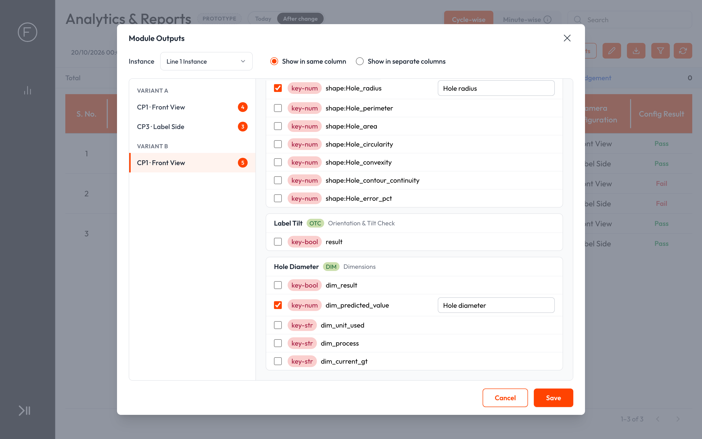
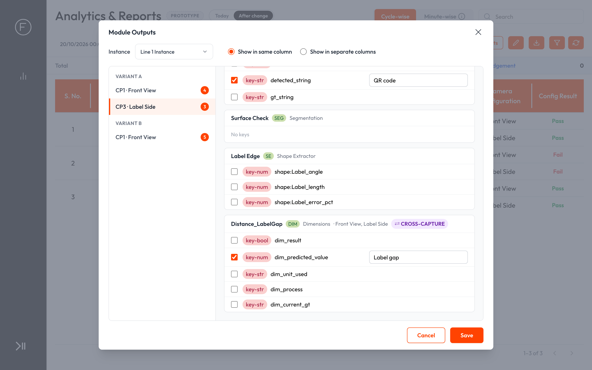
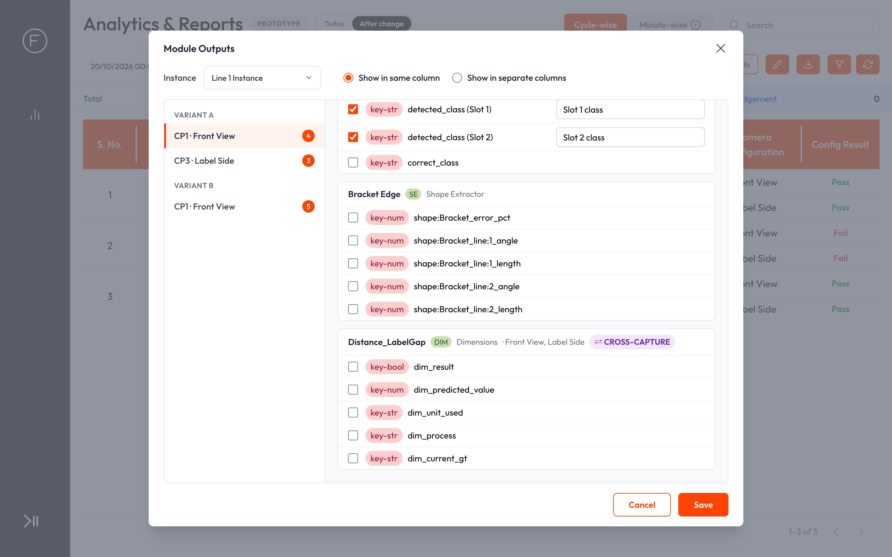

The list is every key Edge creates for the instance today, running totals included, plus the per-line shape keys of AC3.15; no other key is shown.
- **AC3.1** Each capture offers its own keys: `result`, `inference_time`, `avg_inference_time`, `pass_count`, `fail_count` and `completion_status`.
- **AC3.2** Object Detection & Classification offers `result`, `pass_count` and `fail_count`, and for each output class `result`, `current_count` and `count_till_now`.
- **AC3.3** Image Classification offers `result`, `pass_count`, `fail_count`, `detected_class (<search area>)` for each search area, and `correct_class`.
- **AC3.4** OCR offers `detected_text`. In Read & Match it also offers `result`, `pass_count`, `fail_count` and, for each label, `labelName:<label>_gt_text`, `labelName:<label>_result`, `labelName:<label>_pass_count` and `labelName:<label>_fail_count`.
- **AC3.5** Code Reader offers `detected_string`. In Read & Match it also offers `result`, `pass_count`, `fail_count` and `gt_string`.
- **AC3.6** Segmentation offers `result`, `pass_count`, `fail_count`, `detected_class` and `correct_class` only when its single-class output is on.
- **AC3.7** Bead Inspection offers `result`, `pass_count`, `fail_count`, `caliper_pass_percentage` and `bead_class_name`, and for each bead `bead:<bead>_result`, `_pass_count`, `_fail_count`, `_bead_width` and `_bead_gap/position`.
- **AC3.8** Colour Detection offers `result`, `pass_count` and `fail_count`, and for each colour `colorName:<colour>_detected_color`, `_result`, `_pass_count`, `_fail_count` and `_distribution_percentage`.
- **AC3.9** Shape Extractor offers, for each shape, the `shape:<shape>_…` keys of its shape type: radius, perimeter, area, circularity, convexity, contour_continuity, error_pct, angle, length, major_axis, minor_axis, line_1 to line_4, diagonal_1, diagonal_2 and sector_angle, as Edge registers them.
- **AC3.10** Orientation & Tilt Check offers `result`, `pass_count` and `fail_count`. Each dimension measured within one capture offers `dim_result`, `dim_predicted_value`, `dim_unit_used`, `dim_process` and `dim_current_gt`, in a card at the end of the capture it belongs to.
- **AC3.11** Tracker, Matting, Orientator, Masking, Search Area Allocator and the master image have no keys here and are not listed.
- **AC3.12** Values show as they would in the key: numbers with up to 2 decimals, `distribution_percentage` as a percentage, true/false keys as "OK" or "NG".
- **AC3.13** (removed — running totals are offered again; like every key, each cycle shows the copy saved when its capture finished, AC4.3)
- **AC3.14** A dimension measured across two captures offers the same five `dim_…` keys in a card at the end of each of the two captures, under its name from Dimension Configuration, with both capture names and the "⇄ CROSS-CAPTURE" badge. It is ticked and named separately under each capture, and shows only on the rows of the captures it is ticked under.
- **AC3.15** Each Edge Search and Parallel Lines shape also offers, for each line it can find, `shape:<shape>_line:<n>_angle` and `shape:<shape>_line:<n>_length`: lines 1 and 2 for Parallel Lines, and lines 1 up to the shape's maximum results for Edge Search.
- **AC3.16** These per-line keys are registered like every other Edge key, so PLC Write, Internal Action Config and Dashboard Builder list them too. Edge Search line values update with each capture; Parallel Lines line keys stay empty until the engine supports Parallel Lines.

### US4 — See Module Outputs in the table
*As a quality engineer, I want each capture's chosen values on its row, so that I can see at a glance why a cycle failed or which part it was.*
- **Kind:** Feature
- **Parts:** edge-reports-analytics
- **Teams:** SDE
- **Covers:** C5, C6, C12, C16
- **Today:** Each capture row shows only Camera Position, Camera Configuration and Config Result (Pass or Fail). Class Name and Class Count show object counts only.
- **Prototype:** [Step 7: Column after restart](https://vbv-fr.github.io/module-outputs-prototype/#column), [Step 8: Separate columns](https://vbv-fr.github.io/module-outputs-prototype/#separate), [Step 9: Edit Table](https://vbv-fr.github.io/module-outputs-prototype/#edit-table), [Step 10: Search](https://vbv-fr.github.io/module-outputs-prototype/#search)

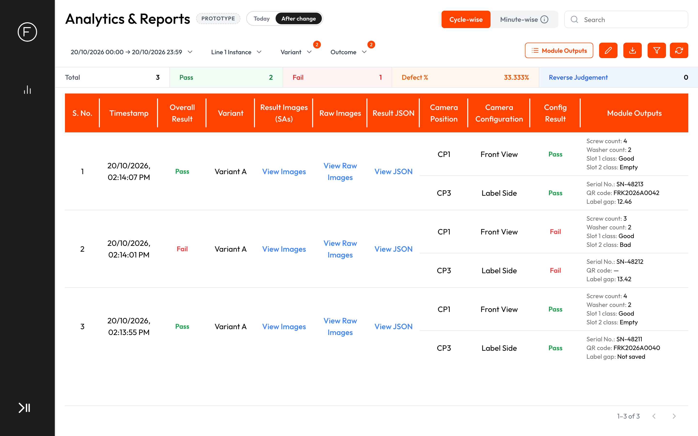
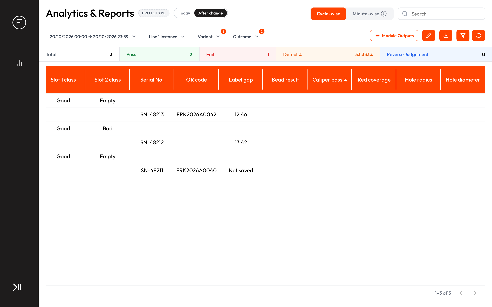
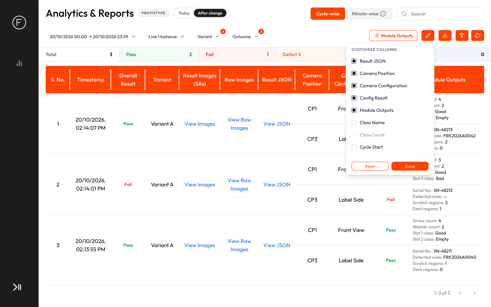
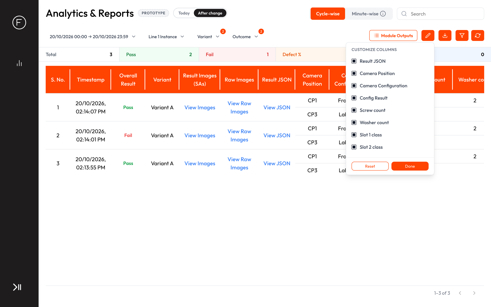

- **AC4.1** Once a setup is in use (US13), the ticked keys appear after Config Result, as the last per-capture column or columns, and Camera Position and Camera Configuration are turned on with them.
- **AC4.2** With "Show in same column", one "Module Outputs" column shows each capture's ticked keys, one per line, as "Display Name: value", in the order of the setup (module order, then key order).
- **AC4.3** Values are the key copies saved with each cycle (US12). A cycle run while a key was not in use (before it was ticked and put in use, or before this release) shows "Not saved" for that key.
- **AC4.4** For a capture triggered more than once in a cycle, the values come from the latest attempt, the same attempt Config Result shows.
- **AC4.5** A value with nothing found (no text read, no code decoded) shows "—"; a count of zero shows "0". A key saved as "Not run" (US12) shows "Not run". With "Show in same column", a capture with nothing ticked shows "N/A".
- **AC4.6** Once set up, Edit Table lists "Module Outputs" after Config Result, or, with "Show in separate columns", each key column by its Display Name. Unticking one hides it. While any of them is ticked, Camera Position and Camera Configuration cannot be turned off, as with Config Result today. Edit Table choices stay shared for the whole box, as today.
- **AC4.7** The existing Search box also matches text in the Module Outputs column or the key columns, the same way it matches the other visible columns on the page. No new search or filter controls are added.
- **AC4.8** Text read from parts (OCR text, codes) is shown exactly as read, as plain text, never as a link or formatted content.
- **AC4.9** With "Show in separate columns", there is no Module Outputs column. Each ticked key gets its own column, headed by its Display Name, in setup order (capture order, then module, then key). A cell holds only the value. A capture row fills only its own keys' columns; the others stay blank. Keys from different captures with the same Display Name share one column, each capture row filling its own value.
- **AC4.10** When the key columns don't fit the page width, the table scrolls sideways, keeping today's header style.

### US5 — Module Outputs in the Excel export
*As a quality engineer, I want the same values in the Excel, so that I can share and analyse them outside Edge.*
- **Kind:** Feature
- **Parts:** edge-reports-analytics
- **Teams:** SDE
- **Covers:** C8, C12, C16
- **Today:** The Excel has Class Name and Class Count columns only. Image classification rows come out blank, and read text and codes are never exported.
- **Prototype:** [Step 11: Excel export](https://vbv-fr.github.io/module-outputs-prototype/#excel)

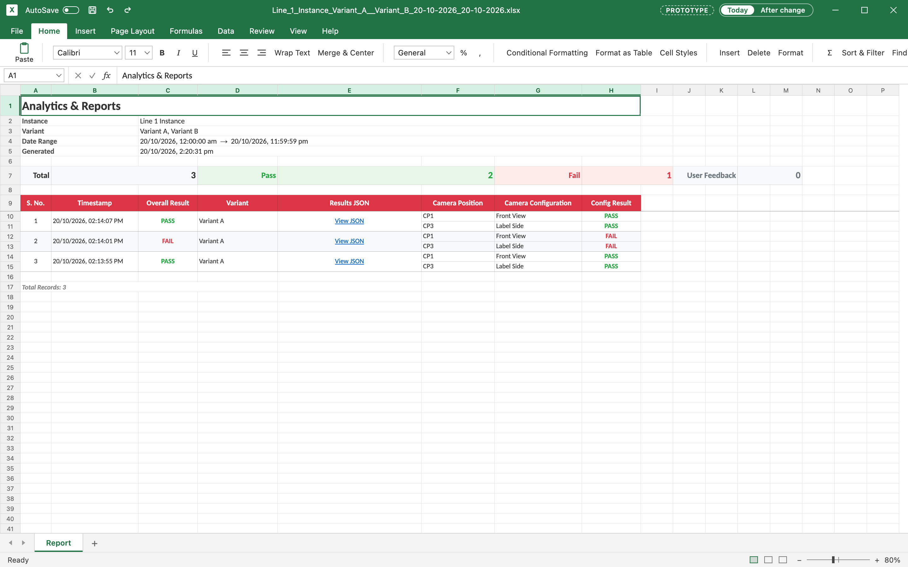
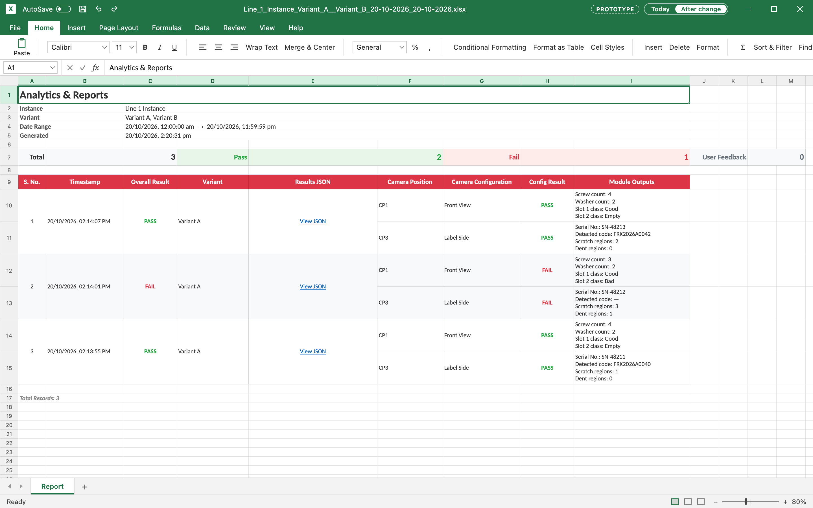
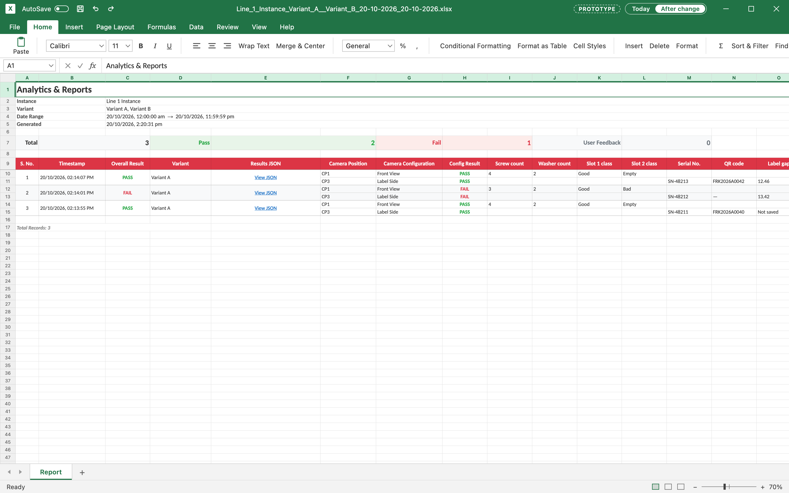

- **AC5.1** With "Show in same column" and the column visible, "Report (Excel Sheet)" gets a "Module Outputs" column after Config Result, with one cell per capture row holding the same "Display Name: value" lines as the screen, separated by line breaks.
- **AC5.2** When the column is hidden in Edit Table, it is not exported, as with every other column today.
- **AC5.3** Values are written as text. A value that starts with =, +, - or @ is never treated as a formula.
- **AC5.4** Up to 100,000 cycles still export with Module Outputs on.
- **AC5.5** With "Show in separate columns", the Excel gets one column per visible key column instead, after Config Result, headed by its Display Name, in the same order and with the same value-only cells as the screen.

### US12 — Edge saves a copy of each ticked key with each capture
*As a quality engineer, I want each cycle to keep the values its keys had at that moment, so that the report shows what the line actually saw, not what the keys say now.*
- **Kind:** Feature
- **Parts:** edge-inferencing-customization, mod-shape-extractor, edge-health, edge-backup-migration
- **Teams:** SDE
- **Covers:** C6, C8, C12
- **Today:** Keys hold only their latest value; nothing keeps a key's value per cycle. A module that does not run on an image leaves its keys holding the previous image's value. A cross-capture dimension is measured when its second capture reports, and is set to NG when the cycle ends if it could not be measured; its result is never saved with the cycle.

- **AC12.1** When a capture's result arrives and its keys are updated, Edge saves the value of each key ticked for that capture in the setup in use (US13) with that capture's row in the cycle (cross-capture dimensions: AC12.7). Keys not ticked are not saved.
- **AC12.2** A module that did not run on that image (its search area was not found) has its keys saved as "Not run", not the value left from the previous image.
- **AC12.3** Each attempt of a capture triggered more than once in a cycle saves its own copies.
- **AC12.4** Fast Mode deployments save no copies, as they store no capture rows.
- **AC12.5** Saving copies does not delay the capture result, PLC writes or dashboard updates.
- **AC12.6** Storage cleanup deletes key copies together with their capture rows, and counts them in the instance's data limit.
- **AC12.7** A cross-capture dimension's keys are saved when the cycle ends, with the value they hold then, on the row of each capture they are ticked under. One that could not be measured (a capture never reported, a shape did not fit) is saved as its keys show it today: `dim_result` NG and no measured value, shown "—".
- **AC12.8** Copies saved before a key was unticked stay, and show again if the key is ticked again.

### US13 — Changes to a running instance wait for a restart
*As a plant admin, I want changes made while the line runs to wait for a restart, so that what a running deployment saves and shows stays the same from its first cycle to its last.*
- **Kind:** Feature
- **Parts:** edge-reports-analytics, edge-deployment, edge-inferencing-customization
- **Teams:** SDE
- **Covers:** C2, C5, C10, C11
- **Today:** Edit Module Configurations and Dimension Configuration changes already reach the line only after Deploy or Restart All Deployments.
- **Prototype:** [Step 5: Save while running](https://vbv-fr.github.io/module-outputs-prototype/#restart), [Step 6: Before restart](https://vbv-fr.github.io/module-outputs-prototype/#before-restart)

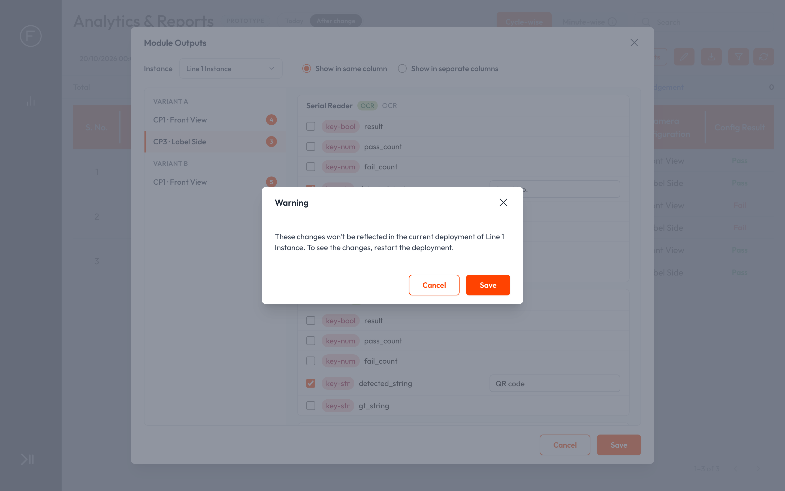
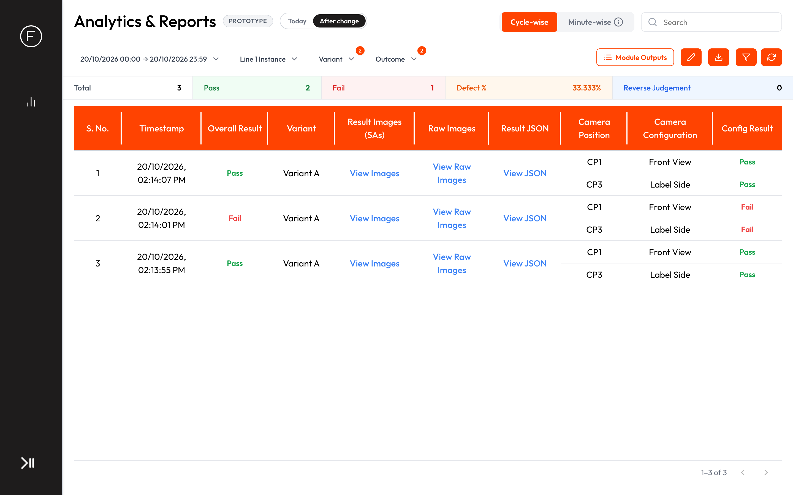
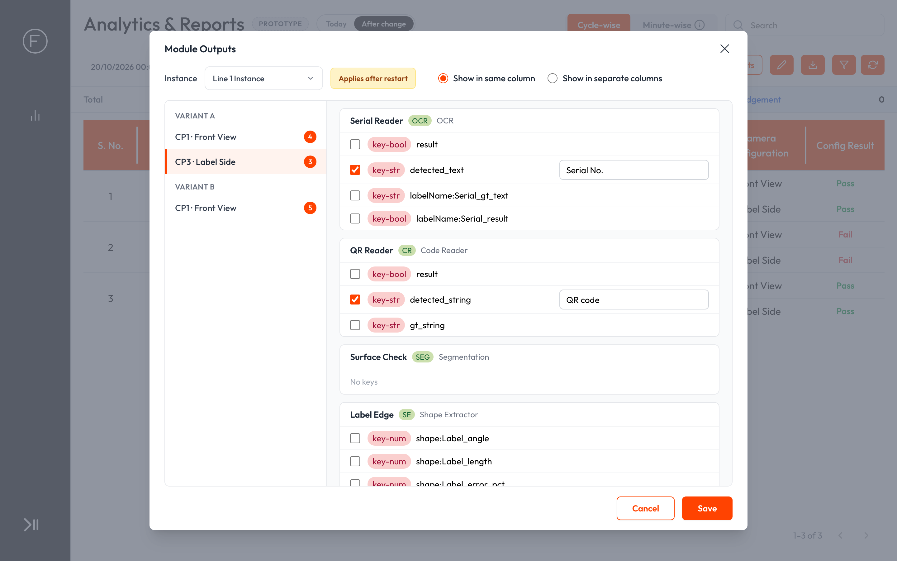

- **AC13.1** Clicking Save while an instance changed in the window is running shows a "Warning" pop-up: "These changes won't be reflected in the current deployment of <instance>. To see the changes, restart the deployment.", with Cancel and Save. When several changed instances are running, it names them all.
- **AC13.2** Cancel closes the pop-up and returns to the window with every choice kept.
- **AC13.3** While an instance is running, Reports uses the setup in use: the table, Edit Table, Search and the Excel keep its keys, Display Names and layout, including keys unticked since.
- **AC13.4** For a running instance, the saved setup goes into use when its deployment next starts, by Deploy or Restart All Deployments on the Deployments page.
- **AC13.5** Reopening the window before then shows the saved choices, with an "Applies after restart" tag next to the Instance dropdown while that instance is shown.
- **AC13.6** While an instance is not running, its saved setup is in use: Save shows no pop-up, the table updates at once, and the instance's next deployment saves those keys from its first cycle.

### US6 — The setup follows the instance
*As a plant admin, I want the setup to survive instance updates and Edge-side edits, so that I set it up once.*
- **Kind:** Feature
- **Parts:** edge-instance-details, edge-emc
- **Teams:** SDE
- **Covers:** C3, C11
- **Today:** No setup exists.

- **AC6.1** Re-uploading the instance from Vision keeps the setup, including Display Names.
- **AC6.2** Captures, modules, classes, search areas or labels removed by a re-upload drop out of the setup, and their keys stop showing. New ones appear unticked.
- **AC6.3** Saving changes in Edit Module Configurations (for example switching OCR between Read and Read & Match, or changing ground truth or thresholds) keeps the setup. The values offered follow the current module settings, and a ticked key that no longer exists (for example a label's keys after switching to Read) drops out with its Display Name.
- **AC6.4** Deleting the instance deletes its setup.

### US7 — Who can do this
*As a plant admin, I want only trusted people to change what Reports show, so that the shared view stays reliable.*
- **Kind:** Rules
- **Parts:** edge-access-audit, edge-reports-analytics
- **Teams:** SDE
- **Covers:** C1, C16
- **Prototype:** [Step 12: Without Update permission](https://vbv-fr.github.io/module-outputs-prototype/#no-permission)

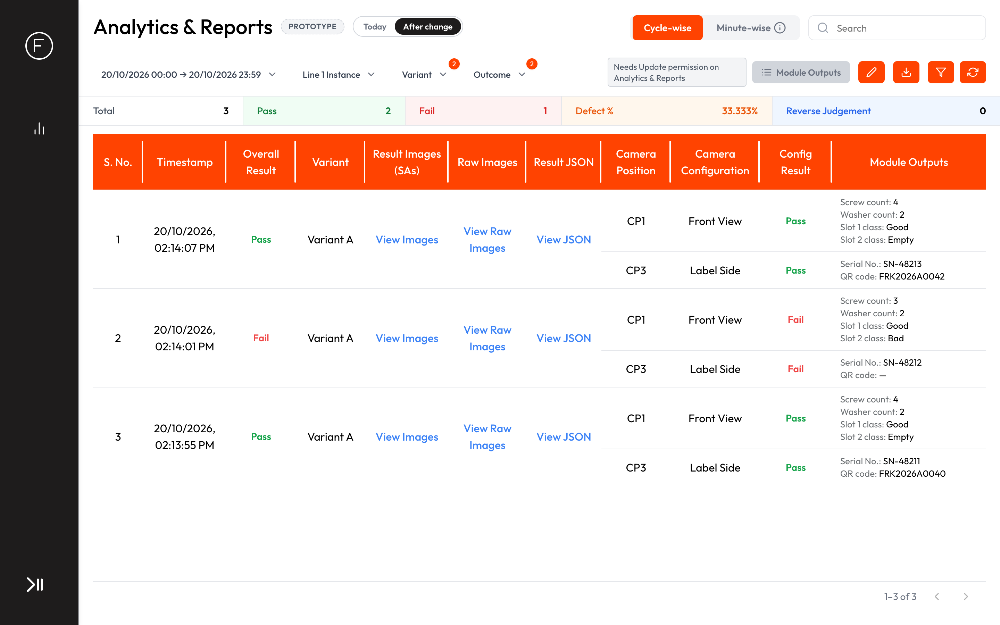

- **AC7.1** No role or permission changes. Saving the setup needs the existing Update level on Analytics & Reports, the same as Mark and Comment. Administrator always can.
- **AC7.2** Without Update, the Module Outputs button is disabled, with the hover text "Needs Update permission on Analytics & Reports".
- **AC7.3** The report server refuses a save without Update, with the existing "Update on Analytics and Reports" message, even if the request does not come from the screen.
- **AC7.4** With Roles & Permissions switched off on the box, everyone can change the setup, as with Mark and Comment today.
- **AC7.5** Each save is written to the audit log as "Module Outputs updated", with the user, time and instance (shown as "Guest" when Roles & Permissions is off).
- **AC7.6** Viewing and exporting Module Outputs follow today's rules for viewing and exporting reports, which are open to everyone.

### US8 — Reports & Analytics keeps working as today
*As a quality engineer, I want everything I use in Reports today to stay as it is.*
- **Kind:** Keeps working
- **Parts:** edge-reports-analytics, edge-actions, edge-deployment, edge-health
- **Teams:** SDE
- **Covers:** C9, C12

- **AC8.1** Every existing column, including Class Name, Class Count and Config Result, shows the same values as before.
- **AC8.2** View Images, View Raw Images, View JSON, Mark (Reverse Judgement) and Comment work as before.
- **AC8.3** Write to DB rules that copy module values into Additional Info columns keep working alongside Module Outputs.
- **AC8.4** The Minute-wise tab shows the same per-minute rows and totals as before for Fast Mode deployments.
- **AC8.5** Filters, the Download popup ("Report (Excel Sheet)" and "Images Only") and its size checks work as before.
- **AC8.6** (removed — storage cleanup of key copies is now AC12.6)

### US9 — Inspection results keep working as today
*As an integrator, I want inspection, verdicts and PLC signals untouched, so that the line runs exactly as before.*
- **Kind:** Keeps working
- **Parts:** edge-inferencing-customization, engine-workflow, mod-result, mod-odc, mod-classification, mod-ocr, mod-code-reader, mod-segmentation, mod-bead-inspection, mod-color-detection, mod-shape-extractor, mod-orientation
- **Teams:** SDE
- **Covers:** C8, C9

- **AC9.1** OK and NG for every capture and cycle, PLC writes and existing dashboard keys are unchanged.
- **AC9.2** Edge keeps storing each module's full result for every capture of every cycle, exactly as today.
- **AC9.3** (removed — the only added work per image is saving key copies, covered by AC12.5)

### US10 — Platform requirements
*As a Frinks support engineer, I want to know what ships and how, so that the release goes out like any other.*
- **Kind:** Platform
- **Parts:** edge-release-upgrade, edge-reports-analytics
- **Teams:** SDE
- **Covers:** C13, C17, C18

- **AC10.1** Node Docker image: no change. No new libraries are needed; the Excel export already has one.
- **AC10.2** Python Docker image: no change. The engine is not touched.
- **AC10.3** Scripts bundle: changes. It carries the Reports app (screen and server), the inference service change for key copies, the registration of the per-line shape keys, and the Edge database additions for the saved setup, the setup in use and the key copies.
- **AC10.4** Installer: no change. Database additions already run on every install and update.
- **AC10.5** New error codes: RPT-MOUT-001 and RPT-MOUT-002 (AC2.6, AC1.6). The report server logs them; they are not added to the Health page.
- **AC10.6** The Edge manual's Analytics & Reports section describes the Module Outputs button, the setup window, the restart pop-up, the column and the Excel column, with new screenshots. Release note: "Reports & Analytics can now show chosen module and dimension keys, such as counts, classes, read text, codes and measurements, under your own Display Names in a new Module Outputs column. Changes made while an instance is running apply after its deployment restarts. Edge Search line angles and lengths are now available as keys in PLC Write, Internal Action Config and Dashboard Builder."

### US11 — Migration requirements
*As a Frinks support engineer, I want upgrades to keep every box's data and setup, so that no plant loses its reports or has to set them up again.*
- **Kind:** Migration
- **Parts:** edge-backup-migration, edge-instance-details, mod-shape-extractor
- **Teams:** SDE
- **Covers:** C6, C7, C15

- **AC11.1** Existing data: after the upgrade every instance starts with no setup and no column. No stored result is changed or moved.
- **AC11.2** The saved setup survives restarts and every later Edge upgrade.
- **AC11.3** An older Edge with a new instance: nothing changes, because the instance package is not touched. The new Edge with an older instance: Module Outputs offers that instance's values like any other.
- **AC11.4** Edge boxes in the field get it as a normal release. It works offline.
- **AC11.5** Instances uploaded before the upgrade get the per-line shape keys after the upgrade, with no re-upload.

## 7. Out of scope
- New search or filter controls for module values.
- Values that have no key today, such as image classification confidence, the text read for each OCR label, tilt angle, and bead incorrect calipers and gap sizes. No new keys are added for them.
- Segmentation in normal mode, which has no keys.
- Tracker counts. The tracker produces no result on Edge today, so it needs its own fix first.
- Matting mask counts.
- Copying a setup from one variant or instance to another.
- Module Outputs on the Live Dashboard, PLC or Minute-wise reports.

## 8. How we'll know it worked
No success targets are set for this release (decided 26 October 2026).

## Appendix A — Coverage
**Not applicable:**
- **C14** — N/A: no change to datasets, annotation, training, evaluation or model selection; values come from results the line already produces.

**Coverage check:**

**Result:** PASS, 3 warnings

- 13 user stories (8 feature, 1 rules, 2 keeps working, 1 platform, 1 migration), 91 ACs (4 marked removed), 26 touched parts, 0 discussion points.
- Checklist: 17 items covered by stories, 1 N/A, 0 open.
- Warnings kept on purpose: AC8.4 and AC12.4 contain "Fast", the product name "Fast Mode"; US3 and the impact map name keys such as `current_count`, which are the names users see in Edge's key picker, not code.
- Every punchlist item I1–I91 in notes.md maps to exactly one AC (I-items for AC1.5, AC3.13, AC8.6 and AC9.3 marked removed).

## Appendix B — Code references
For the ticket skill and developers. Paths are relative to each repo.
- **Reports & Analytics:** `frinksedge-report-frontend`: `src/modules/analytics/index.jsx:1201-1646` — toolbar, Edit Table dropdown (1431-1518), column locks (1123-1180), session save (689-719), browser-side Search (773-925), Write to DB columns (476-494); `src/modules/analytics/columns.js:2-144` — columns, defaults, new-column restore; `src/modules/analytics/ResultTable.jsx:186-319` — per-cycle and per-capture cells, Class Name/Count; `src/modules/analytics/DownloadModal.jsx`, `downloadRequest.js:29-64` — export columns.
- **Reports server:** `frinksedge-report`: `src/features/analysis/analysis.service.ts:458-501` — folds a capture's module rows into one (drops module id); `src/features/analysis/analysis.repository.ts:174-251, 397-425, 492-605` — class filter, View JSON, name lookups (captures, variants, classes, search areas, modules); `src/features/session/session.service.ts:5-21` — box-wide saved view (`app_config` type `report_analytics`); `src/features/download/excel/excel.service.ts:573-597, 977-1009` — Excel headers, class columns, dropped empty cycles; `src/features/download/download.service.ts:235, 450-469` — 100,000-cycle limit, old result shapes; `src/shared/error/error.internal-codes.ts:1-49` — RPT codes.
- **Access & audit:** `frinksedge-deployment-backend`: `src/rbac/catalogue.ts:219-231, 244-279` — `rep` R/U and role templates; `frinksedge-report`: `src/features/analysis/analysis.module.ts:25-34`, `src/shared/auth/auth.service.ts:66-83`, `require-permission.ts:15-19`, `auth.errors.ts:21` — Update check; `src/shared/audit/audit.service.ts:10-13, 48-59` — audit codes; `frinksedge-report-frontend`: `src/core/auth/AuthContext.jsx:60-70` — `can()`.
- **Stored results:** `frinksedge-inferencing-backend`: `src/result-flusher/result-flush.service.ts:75-97` — one row per capture × module, capture outcome; `src/shared/dto/dto.base.ts:14-17`, `src/shared/dto/dtos/parser.dto.ts:118-142, 241-307, 404-440` — fields kept per module; `src/cycle/cycle-manager.service.ts:569-579` — repeat captures (sequence).
- **Module results:** `vip-inference-python`: `scripts/assembly/resultProcess/assembly.py:180-396` (ODC), `classification.py:118-459` (IC), `ocr.py:962-1071` (OCR), `codeReader.py:124-239` (code reader), `segmentation.py:145-208` (segmentation), `beadInspection.py:571-726` (bead), `color.py:49-225` (colour), `shape.py:354-388` (shape), `dimension.py:618-636` (dimensions), `orientation.py:190-214` (tilt), `tracker.py:81-124` (tracker); `scripts/assembly/modules/resultModule.py:786-795, 911-918` — tracker skipped, module skipped when its search area is invalid.
- **Names on the box:** `frinksedge-deployment-backend` `dump.sql` tables `variants`, `capture_position`, `camera_configs`, `modules`, `class`, `search_area_config.output_name`, `ocr_config.info[].labelName`, `bead_inspection_config.name`, `shape_extractor_config.name`.
- **Instance upload:** `frinksedge-deployment-backend`: `src/service/instance.ts:908-950, 1411-1469, 1856-1869, 2230-2267, 2610-2693` — dropped captures, label merge, id-keeping upsert, delete, per-instance module settings reconcile (`module_class_roi_config` precedent).
- **Database and upgrades:** `frinksedge-deployment-backend`: `dump.sql:2823-2869` (per-instance × module table precedent), `dump.sql:2969-2974` (repeat-capture delete replayed at every update; the replay must not erase or reset the Module Outputs setup, AC11.2); `frinksedge-installer-electron`: `src/main.js:265, 387, 512` — dump replay with `--force`; `release-manager-backend`: `src/services/edgeSchemaRegistry.ts:11-13, 169-182` — schema registration on new tables.
- **Health cleanup:** `frinksedge-health`: `src/service/storageMonitor.ts:164-200, 595-686`.
- **Keys offered:** `frinksedge-deployment-backend`: `src/dao/systemKeyDefinition.ts:39-111` — `pass_count`/`fail_count` at every level, `count_till_now`, `avg_inference_time` (offered, AC3.1–AC3.10); `:113-120` — dimension keys at variant level, the same five for single- and cross-capture dimensions. `frinksedge-inferencing-backend`: `src/cycle/cycle-manager.service.ts:542-556` — `avg_inference_time` is the mean of the last 10 inference times; `src/key/key-writer/system-key-writer/system-key-writer.service.ts:101-104` — `completion_status` is 1 once the capture reports.
- **Cross-capture dimensions:** `frinksedge-inferencing-backend`: `src/dimensioning/dimensioning-registry.service.ts:60-90` — definition (Feature A and B on two camera configurations), boot-time cache that needs a restart; `src/cycle/cycle-manager.service.ts:537-540` — measured when the second capture reports, before that capture's keys (558) and row (578); `:729-742` — unresolved ones set to NG at cycle end and counted in the cycle result; `:849-889` — measurement; `system-key-writer.service.ts:159-208` — the five keys, unresolved fail. `frinksedge-deployment-frontend`: `src/modules/inferencing-customizations/dimension-configuration/DimensionsTable.jsx:56-60`, `dimensionDisplay.js:94-99` — capture names and the "⇄ CROSS-CAPTURE" badge.
- **Per-line shape keys:** `frinksedge-inferencing-backend`: `src/key/key-writer/system-key-writer/system-key-writer.service.ts:306-340` — line angle and length written for Parallel Lines (2 lines; engine support not shipped yet) and Edge Search; `:58-61` — unregistered keys are refused and logged; `src/key/keys/system-key.ts:269-270` — `shape:<id>_line:<n>_angle/_length`. `frinksedge-deployment-backend`: `src/dao/systemKeyDefinition.ts` (comment above id 79) — not registered; `src/keys/shapeKeyMetrics.ts` — metrics per shape type; `src/keys/createKeys.ts:231-242` — per-shape key creation; `src/dao/dimensioningConfig.ts:92` — lines per shape (Parallel 2, Edge = maxResult); `src/index.ts:46`, `src/service/inferenceProcess.ts:292` — keys rebuilt at boot and on inference restart (AC11.5).
- **Restart:** `frinksedge-deployment-backend`: `src/service/deployment.ts:1868-1906` (a deploy from an idle box restarts the inference service), `:1922-1960` (Restart All Deployments); `frinksedge-deployment-frontend`: `src/modules/deployments/RestartAllDeployments.jsx:35`. Pop-up look: `frinksedge-report-frontend`: `src/shared/ui/WarningModal.jsx`.

Repos checked: frinksedge-report @ 5fe5390 (15 Oct 2026), frinksedge-report-frontend @ 9893a19 (13 Oct 2026), frinksedge-inferencing-backend @ 310c18e (22 Oct 2026), frinksedge-deployment-backend @ 7e2951e (26 Oct 2026), frinksedge-deployment-frontend @ 3c027014 (23 Oct 2026), frinksedge-health @ 2dbc622 (23 Oct 2026), vip-inference-python @ 14670bf (26 Oct 2026), frinksvision-backend @ 093a734 (26 Oct 2026), frinksvision-frontend @ 67e4d4a (26 Oct 2026), Python-inference-docker @ 62e22bd (29 May 2026), release-manager-backend @ b8016f7 (22 Sep 2026), and the other 23 repos in the skill's list, all up to date on 26 Oct 2026.

## Changelog
- 28 October 2026 — Approved. PM check, no AC changes: nothing is ticked by default (AC2.1, AC11.1); only the ticked keys are saved with each cycle (AC12.1); a key ticked later shows "Not saved" on rows from before it was in use (AC4.3). Timeline added: SPRINT 26-15, 27 Oct – 10 Nov 2026 (Tanay Deo)
- 26 October 2026 — Q1 decided: no success targets (section 8). Q3 decided: no keys are added for values that have none; Module Outputs offers every key Edge has today. Running totals are offered again: AC3.13 (removed); AC3.1–AC3.8 and AC3.10 restored; out-of-scope line removed. Edge registers the per-line angle and length keys of Parallel Lines and Edge Search shapes, listed everywhere keys are used: AC3.15, AC3.16, AC11.5 added; AC10.3, AC10.6 changed; PLC Write, Internal Action Config, Dashboard Builder added to the impact map. Duplicate pass: AC11.5 trimmed (existing rules unchanged is AC9.1); AC9.1 and non-goals say "existing" keys; summary, Key concept and US3 Today mention the per-line keys; AC3.16 notes Parallel Lines keys stay empty until the engine supports it (Tanay Deo)
- 26 October 2026 — Only ticked keys are copied, to keep disk use down: AC12.1 changed, AC12.8 added; cycles from before a key was in use show "Not saved" (AC4.3, G2, summary changed). Changes saved while an instance is running wait for a restart, after a Warning pop-up: new US13 (AC13.1–AC13.6); AC1.5, AC2.5, AC4.1, AC10.3 changed. Keys that add up or average across cycles are no longer offered: AC3.13 added; AC3.1–AC3.8, AC3.10 and AC4.5 changed. Dimensions measured across two captures are offered under both captures: AC3.14 and AC12.7 added, AC3.11 changed, out-of-scope line removed. Segmentation in normal mode shows nothing: removed from Q3 and listed in Out of scope (Tanay Deo)
- 26 October 2026 — Duplicate pass: AC1.5 (removed): covered by AC13.1 and AC13.6. Trimmed restated sentences: AC1.3 (layout options are AC2.9), AC1.4 (modules never listed are AC3.11), AC2.3 (Display Name on Reports and Excel is US4/US5), AC2.9 (where the layout applies is US4/US5), AC3.6 (normal mode), AC4.5 (settings show the copy, AC4.3), AC4.9 (position is AC4.1), AC5.4 (filters are AC8.5), AC7.2 (viewing is AC7.6), AC8.1 (Additional Info is AC8.3), AC9.2 (View JSON is AC8.2), AC10.3, AC10.5 (messages are AC1.6/AC2.6), AC11.2 (mechanism moved to Appendix B), AC11.4 (data untouched is AC11.1), AC12.8 (not ticked = not saved is AC12.1), AC13.2 and AC13.3. Contradictions fixed: AC4.5 "N/A" applies to "Show in same column"; AC13.4 applies to running instances; AC2.5 names the pop-up; AC12.1 points to AC12.7; release note, G2, section 2 and summary say "while in use"; stale non-goal about segmentation and bead values reworded. AC5.5 moved after AC5.4 (Tanay Deo)
- 26 October 2026 — Reports show a copy of each key saved when the capture finished (new US12; AC4.3, AC4.5, AC9.2, AC10.3 changed; AC8.6 and AC9.3 removed). Every key of every capture is copied, ticked or not, so cycles since the release show values; older cycles show "—". Q2 (running totals) closed: they show the copy at that moment. Same Display Name across captures sharing a column, and columns for every variant's keys, confirmed (Tanay Deo)
- 24 October 2026 — Instance dropdown at the top of the setup window, defaulting to the instance in the Reports table (AC1.2 changed, AC1.7 added); "Show in same column / Show in separate columns" layout per instance (AC2.9, AC4.9, AC4.10, AC5.5 added; AC2.8, AC4.1, AC4.2, AC4.6, AC4.7, AC5.1 changed) (Tanay Deo)
- 23 October 2026 — Setup lists each module's real Edge keys as the key picker shows them; ticking a key asks for a Display Name used on the Reports page. US2 and US3 rewritten; old Q2 (segmentation "Detected classes") dropped as segmentation offers only its keys; new Q2 (running totals) and Q3 (values with no key) (Tanay Deo)
- 23 October 2026 — Duplicate pass: AC8.4, AC11.1 and AC11.3 no longer restate AC1.1, AC4.3 and AC4.5 (Tanay Deo)
- 23 October 2026 — Moved to the current template: open questions now sit in Discussion points at the top; added Q2 (segmentation "Detected classes"); Word copy dropped, the PRD repo is the only published copy (Tanay Deo)
- 23 October 2026 — Prototype rebuilt as one interactive workflow with a step navigator; stories link to their step (Tanay Deo)
- 20 October 2026 — Draft started (Tanay Deo)
- 20 October 2026 — Prototype live on GitHub Pages; sent to the PM for review (Tanay Deo)
- 20 October 2026 — First full draft: 11 user stories after two decision rounds (setup in Reports, all module types, Update permission, one Excel column, past cycles shown, output values only, Tracker out, latest attempt) (Tanay Deo)

## Checked, not affected
- vision-access, vision-auto-annotation, vision-captures-cameras, vision-datasets-annotations, vision-instance-creation, vision-model-evaluation, vision-model-training, vision-projects, vision-recipe-tree, vision-training-sets-recommender, vision-variants: Edge-only feature; every name it needs is already on the box after upload, and the instance package does not change.
- mod-input-master-image, mod-search-area, mod-masking: no values of their own; their names are only used as labels.
- edge-plc-read, edge-plc-setup, edge-live-dashboard: rules, PLC reads and dashboards are untouched; the live dashboard shows whatever keys a dashboard already uses.
- edge-camera-capture, edge-model-loading-variant-change, edge-storage-image-saving: capture, model loading and saved images are untouched.
- engine-runtime-packaging, edge-installer, edge-encryption-keys, edge-networking, edge-system-time: no new libraries, steps, keys, ports or time logic; the Reports app keeps its ports.
