# PRD: Dimensioning — distance and angle to a fixed line

**Prototype:** [Interactive workflow, Today vs After change](https://vbv-fr.github.io/dimension-fixed-line-prototype/)
**Product:** Frinks Edge
**Status:** Approved
**Date:** 28 October 2026
**Owner:** Tanay Deo
**Related:** FP-3228 Dimension Configuration (Edge), FP-3404 Canvas for Dimension Configuration, FP-3456 Capture Layout, FP-3230 Keys for Shapes and Dimensions (all Done); PRD "Module Outputs in Reports & Analytics" (In review: its setup window lists every single-capture dimension's keys, fixed-line dimensions included, with no change there)
**Code checked:** 28 October 2026 (re-synced for the round 6 changes) — 34 repos at their latest default-branch commit (list in Appendix B)

---

## Discussion points
None. Every decision is made and written into the user stories.

## 1. Summary
- On Edge's **Dimension Configuration** page, a Distance's Feature B can now be a **Fixed line** that the user types in, instead of a shape. "Fixed line" is the last entry of Feature B's Shape dropdown.
- A distance's fixed line is set by its **Angle** (0°–180°) and its centre, **Centre x** and **Centre y** in px. At 0° and 180° Centre x is greyed out, and at 90° Centre y is, because the line doesn't depend on them.
- The Angle form's "Angle from" dropdown is renamed **Angle type**, and its "Two features" mode is renamed **Between two features**. It gets a new type, **From a fixed line**, where the user types only the line's angle.
- While a Distance is being set up, the preview canvas draws the line across the whole image and shows the measured span. An Angle's fixed line is not drawn on the setup canvas. A live cursor read-out helps the user find the numbers to type.
- A distance's line is typed in camera pixels, counted from the image's top-left corner, and stays fixed to the camera image on every cycle, wherever the part sits.
- For every Distance, not only fixed-line ones, the setup canvas now shows the length measured on the master image, in the Ground Truth unit.
- A new dimension starts as a Distance in mm. Ground Truth puts Min, Max and Unit in one row, and the Unit picked turns the Pixel to mm ratio box on or off.
- By default the distance is the shortest distance from Feature A's point to the line (Perpendicular on the line). When Feature A is a point on a line, a **Perpendicular type** dropdown also offers **Perpendicular from Previous Line**, as it does today for a shape line. The distance is always positive and is judged against Ground Truth like any other distance, in px or mm.
- Fixed lines also work in cross-capture distances, measured through Capture Layout.
- A **Show the fixed line on inferenced image** toggle under Inference Line Colours (off to start) draws the line on the analysed image, in a colour picked from the usual list (yellow to start). For a cross-capture distance, the line is drawn on its own camera's analysed image. The setup canvas always draws a distance's line.
- No role or permission changes, no Vision changes, and no Docker image or installer change.

## 2. Why we are making this
- **Today:** A Distance needs two detected features: two points, or a point and a detected line. An integrator who must check how far a hole, edge or peak sits from a fixed position in the image (a fixture line, a datum row, a slanted reference) has nothing to pick, because no shape exists there. The workarounds are adding a dummy Shape Extractor shape on a fixed edge, which breaks when the edge isn't visible, or skipping the check. Setting Ground Truth is slow for every distance: the setup canvas never shows the measured value, and mm can't be picked until a ratio is typed.
- **Evidence:** Product's own idea: a gap in Dimensioning found while reviewing the module. The setup-form changes came from the PM's review on 26 October 2026.
- **After:** The user types the reference line, sees it on the image straight away with the measured length, and gets an OK/NG distance or angle against it on every cycle.

## 3. Goals and non-goals
**Goals**
- G1. Measure the distance from any Feature A point to a typed-in line (an angle and a centre point), in one capture or across two captures.
- G2. Measure the angle between a Feature A line and a typed-in line.
- G3. Show a distance's line on the setup canvas while it is being typed, and, when the integrator turns it on, on the analysed image in a colour they pick.
- G4. Fixed-line dimensions save, list, deploy and report like every other dimension, and nothing that works today changes.
- G5. Set Ground Truth without a trial run: the measured length shows on the setup canvas, and a new dimension starts as a Distance in mm.

**Non-goals**
- A line that moves with the part.
- Placing the line by dragging or clicking on the canvas.
- Telling which side of the line a point is on.
- Any change in Frinks Vision.

## 4. Key concepts
- **Fixed line:** a reference line the user types in on the Dimension Configuration page. For a Distance it is an angle from 0° to 180° and a centre point (Centre x, Centre y). For an Angle only its angle is typed, and it is measured through the middle of Feature A's line. It has no length: it runs across the whole image.
- **Camera pixels:** positions in the capture's full-size image, counted from the top-left corner, with y growing downward. The preview canvas shows a smaller copy of the image but works in camera pixels.

## 5. Impact map
The parts this changes. Parts checked and not affected are listed at the very end.

| Part | What will happen | User stories |
|---|---|---|
| Shape Extractor (mod-shape-extractor) | Dimensions no longer need a second shape: Feature B's Shape dropdown offers a typed-in Fixed line, shown in the table as "Fixed line · …". The line's analysed-image toggle and colour are stored with the dimension | US1, US2, US4, US5, US9, US15 |
| Edit Module Configurations and Dimension Configuration page (edge-emc) | Feature B's Shape dropdown gets "Fixed line" with Angle, Centre x and Centre y boxes (one centre box greyed out at 0°, 90° and 180°), plus a Perpendicular type dropdown when Feature A is a point on a line. "Angle from" becomes "Angle type" with "From a fixed line" (angle only) and "Between two features". Inference Line Colours gets the analysed-image toggle and Fixed line colour. The canvas draws a distance's line with a cursor read-out (an Angle's fixed line isn't drawn) and shows every distance's measured length. A new dimension starts as a Distance in mm, and Ground Truth's Unit turns the ratio box on or off | US1, US2, US3, US5, US8, US9, US13, US14, US15 |
| Master image (mod-input-master-image) | The canvas places the typed camera-pixel values on the smaller preview copy of the master image | US2 |
| Result module (mod-result) | The engine measures and judges point-to-line distances and line-to-line angles against the fixed line. It draws the line on the analysed image only when the toggle is on, in the picked colour, including a cross-capture line on its own camera's image | US3, US4, US6, US7, US10 |
| Search Area (mod-search-area) | No change to areas. Fixed lines are measured in the full camera image, whatever area Feature A's shape sits under | US6 |
| Orientator and Orientation & Tilt (mod-orientation) | No change. Datum alignment does not move a fixed line | US6 |
| Cycles and result storage (edge-inferencing-customization) | Cross-capture fixed-line distances are worked out at cycle close through Capture Layout. A cross-capture line whose toggle is on is sent to its own camera's engine run for drawing | US4, US10 |
| Deployments (edge-deployment) | The deploy check counts fixed-line dimensions as configured and never blocks them for a missing Feature B shape | US5, US9 |
| Instance upload (edge-instance-details) | A re-upload keeps fixed-line dimensions. A changed image size does not flag them | US5, US10, US12 |
| Edge access & audit (edge-access-audit) | Same Inferencing Customization – Update permission and the same audit entries | US8 |
| Rules and actions (edge-actions) | The same five dimension keys drive rules | US10 |
| PLC Write (edge-plc-write) | The same keys can be written to the PLC | US10 |
| Internal actions (edge-internal-actions) | The same keys drive internal actions | US10 |
| Live Dashboard (edge-live-dashboard) | The analysed image shown live carries the fixed line | US7 |
| Image saving (edge-storage-image-saving) | Saved analysed images carry the fixed line | US7 |
| Reports & Analytics (edge-reports-analytics) | Each cycle's stored result includes fixed-line dimensions | US10 |
| Model loading and variant change (edge-model-loading-variant-change) | After a changeover, the new variant's fixed-line dimensions are measured | US10 |
| Backup and migration (edge-backup-migration) | New stored fields arrive on install and update. Backups keep them. Existing dimensions are untouched | US12 |
| Release and upgrades (edge-release-upgrade) | Ships in the scripts bundle. Rolling back makes fixed-line dimensions errored | US11, US12 |
| Python runtime image (engine-runtime-packaging) | No change: no new library | US11 |
| Installer (edge-installer) | No change: the new fields ride in the database script the installer already runs | US11 |
| Health and error codes (edge-health) | No new error codes | US11 |
| Instance creation (vision-instance-creation) | No change: instance packages carry no dimensions | US12 |

## 6. User stories and acceptance criteria

### US1 — Measure a distance to a fixed line
*As an integrator, I want to measure the distance from a feature to a line I type in, so that I can check where the feature sits against a fixed position in the camera image.*
- **Kind:** Feature
- **Parts:** mod-shape-extractor, edge-emc
- **Teams:** SDE
- **Covers:** C3, C4
- **Today:** A Distance's Feature B must be a point or line on a Shape Extractor shape (Capture → Shape → Part → Point). The Shape dropdown lists only the capture's shapes. There is no way to type a line in.
- **Prototype:** [Distance to a fixed line](https://vbv-fr.github.io/dimension-fixed-line-prototype/#edge-dim-distance), [Perpendicular type](https://vbv-fr.github.io/dimension-fixed-line-prototype/#edge-dim-perp)

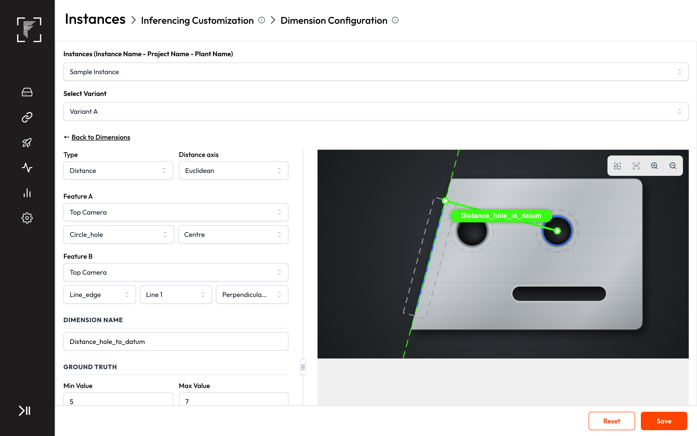
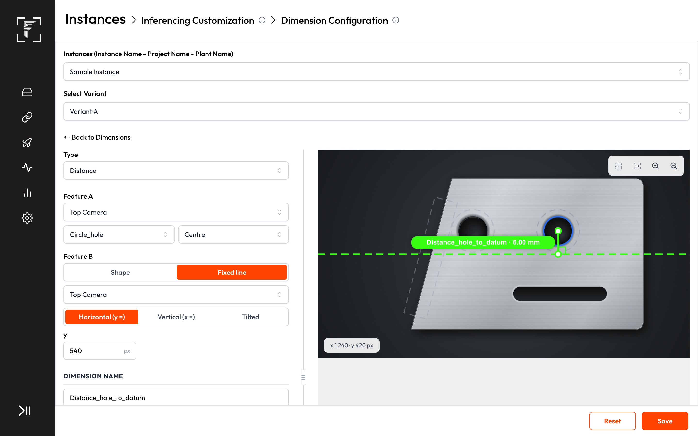
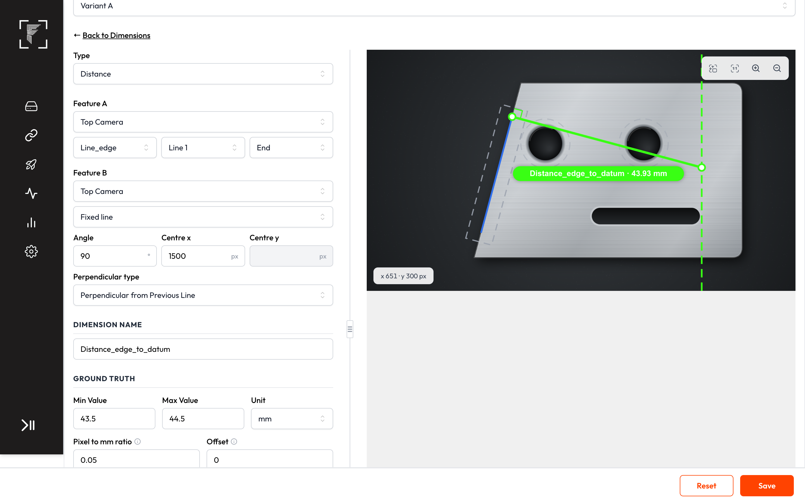

- **AC1.1** In a Distance dimension, Feature B's Shape dropdown lists the capture's shapes, then "Fixed line" as its last entry. Picking a shape shows today's Part and Point dropdowns unchanged.
- **AC1.2** Picking Fixed line hides the Part and Point dropdowns and shows three boxes in one row: "Angle" in °, "Centre x" in px and "Centre y" in px. There is no line-type choice.
- **AC1.3** Picking Fixed line starts at Angle 90°, with Centre x on the middle column of the capture's image (960 on a 1920-column image).
- **AC1.4** While Feature B is a fixed line, the Distance axis field is hidden.
- **AC1.5** Centre x and Centre y take up to 2 decimals and must lie inside the capture's image: Centre x from 0 to the image width, Centre y from 0 to the image height. After a Save attempt, a value outside these limits shows "Enter a value between 0 and <limit> px." under its box, and the dimension is not saved.
- **AC1.6** Angle takes 0° to 180°, counted counter-clockwise from horizontal as seen on screen. After a Save attempt, a value outside this range shows "Enter an angle between 0° and 180°." and the dimension is not saved.
- **AC1.7** Saving a Distance with a fixed-line Feature B succeeds. Opening it again with Edit shows Fixed line with the same angle, the centre value(s) it uses and, where shown, the same Perpendicular type.
- **AC1.8** Edge's server refuses a fixed-line dimension with a missing or out-of-range angle, or a missing or out-of-range centre value its angle needs (Centre y at 0° and 180°, Centre x at 90°, both at any other angle), even when it is sent without the page, and stores nothing.
- **AC1.9** Picking a shape in Feature B's Shape dropdown after Fixed line, or Fixed line after a shape, and saving keeps only the last pick. Picking Fixed line again later starts from the defaults in AC1.3.
- **AC1.10** Feature A's Shape dropdown, and the shape dropdowns of other dimension types, never list Fixed line.
- **AC1.11** When Feature B's capture has no shape a Distance can use, its Shape dropdown still offers Fixed line, and the note "This capture has no shape that a point of this kind can use." no longer shows under Feature B.
- **AC1.12** At exactly 0° or 180°, Centre x is greyed out; at exactly 90°, Centre y is greyed out. Any other angle, 89.9° included, keeps both centre boxes active.
- **AC1.13** A greyed-out centre box shows no value and can't be typed in.
- **AC1.14** When the angle moves away from 0°, 90° or 180°, the box that was greyed out comes back with the value typed earlier for this fixed line, or with the image's middle column (Centre x) or middle row (Centre y) if none was typed.
- **AC1.15** Saving skips a greyed-out box: it is neither checked nor stored.
- **AC1.16** When Feature B is a fixed line and Feature A is a point on a line (the same Feature A points that allow Perpendicular from Previous Line with a shape today: a Start, End or Middle point of a Line, Parallel or Edge line, or an Ellipse focus), Feature B shows a "Perpendicular type" dropdown below Angle | Centre x | Centre y, with Perpendicular on the line and Perpendicular from Previous Line. This holds for single-capture and cross-capture distances.
- **AC1.17** Perpendicular type starts on Perpendicular on the line, including for a fixed line picked again after a shape.
- **AC1.18** For any other Feature A, a circle centre for example, Perpendicular type is not shown and the distance is measured as Perpendicular on the line.
- **AC1.19** If Feature A changes to a point that is not on a line, Perpendicular type disappears and the dimension goes back to Perpendicular on the line.
- **AC1.20** With Perpendicular from Previous Line, if Feature A's line is at right angles to the fixed line, so the perpendicular from Feature A never meets it, a Save attempt shows "Feature A’s line is perpendicular to the fixed line, so the perpendicular from A never meets it. Change the angle or pick a different point." under Feature B, and the dimension is not saved.
- **AC1.21** Edge's server refuses Perpendicular from Previous Line with a fixed line when Feature A is not a point on a line, even when it is sent without the page, as it does for a shape line today.

### US2 — See the fixed line on the canvas while setting it up
*As an integrator, I want to see the fixed line on the master image as I type it, so that I place it where I mean to without trial deployments.*
- **Kind:** Feature
- **Parts:** mod-shape-extractor, edge-emc, mod-input-master-image
- **Teams:** SDE
- **Covers:** C4
- **Today:** The canvas draws only shapes and the span between two picked features. There is no cursor position read-out anywhere on the page.
- **Prototype:** [Distance to a fixed line](https://vbv-fr.github.io/dimension-fixed-line-prototype/#edge-dim-distance)

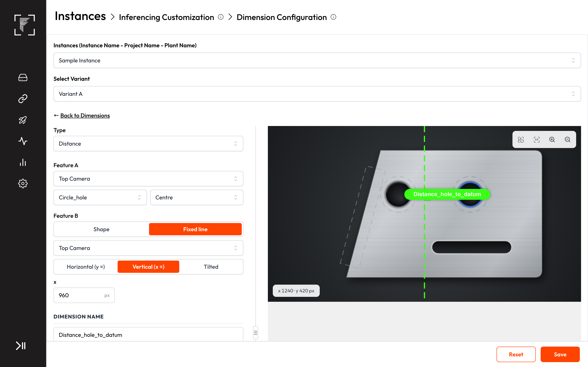
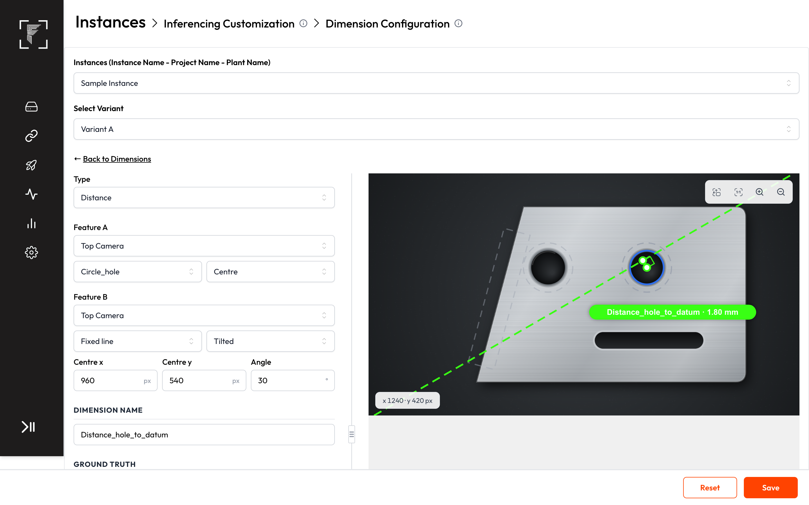

- **AC2.1** On a single-capture Distance, the preview canvas draws the fixed line dashed, in the dimension's OK colour, from image edge to image edge through its centre at its angle (for example across the full image width at 0° and 180°, and the full image height at 90°).
- **AC2.2** The line moves on the canvas as each value is typed, before saving.
- **AC2.3** With Perpendicular on the line, the canvas draws the span from Feature A's point to the fixed line solid, with today's end markers and a right-angle mark where it meets the line.
- **AC2.4** Moving the cursor over the image shows its position as "x <n> · y <n> px", in camera pixels, at the bottom-left of the canvas.
- **AC2.5** At every zoom level, a line at 0° with Centre y 540 sits exactly on row 540 of the camera image.
- **AC2.6** With Perpendicular from Previous Line, the canvas draws the span from Feature A's point, at right angles to Feature A's line, to where it meets the fixed line, with today's end markers and the right-angle mark at Feature A's point.

### US3 — Measure an angle from a fixed line
*As an integrator, I want to measure the angle of a detected edge against a line I type in, so that I can check tilt against a reference that is not horizontal or vertical.*
- **Kind:** Feature
- **Parts:** edge-emc, mod-result
- **Teams:** SDE + AI
- **Stakeholders:** Tanay (SDE), Pallavi (AI, Python)
- **Covers:** C4, C9
- **Today:** Angle measures Feature A's line against the X axis, the Y axis, or a second shape's line, picked in an "Angle from" dropdown (From X axis, From Y axis, Two features). There is no tilted or positioned reference.
- **Prototype:** [Angle from a fixed line](https://vbv-fr.github.io/dimension-fixed-line-prototype/#edge-dim-angle)

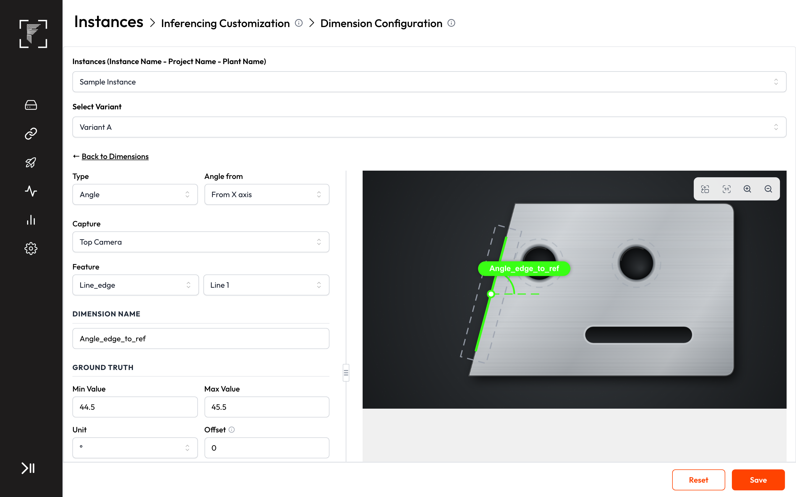
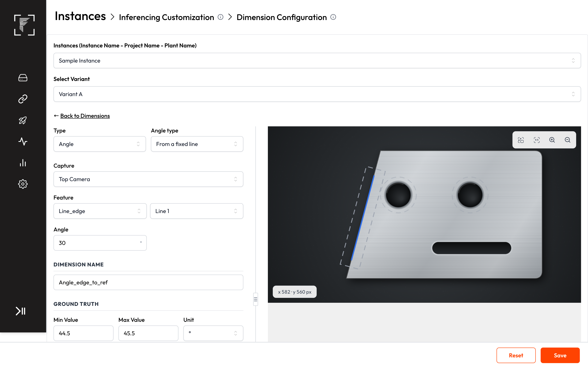

- **AC3.1** The Angle form's mode dropdown is labelled "Angle type" (was "Angle from") and lists From X axis, From Y axis, From a fixed line, Between two features (was "Two features").
- **AC3.2** From a fixed line shows a single Angle box in °, with the limits and message in AC1.6. It has no capture picker and no Centre x or Centre y box: the line sits on Feature A's capture.
- **AC3.3** For From a fixed line, the setup canvas draws no fixed line, no arc and no label. The capture's shapes still show, as for every dimension.
- **AC3.4** The result is the angle between Feature A's line and the fixed line, from 0° to 180°, like other Angle results.

### US4 — Use a fixed line in a cross-capture distance
*As an integrator, I want to measure from a feature on one camera to a fixed line on another camera's image, so that I can check positions across a part that no single camera sees whole.*
- **Kind:** Feature
- **Parts:** mod-shape-extractor, edge-inferencing-customization, mod-result
- **Teams:** SDE + AI
- **Stakeholders:** Tanay (SDE), Pallavi (AI, Python)
- **Covers:** C2, C4, C9, C12
- **Today:** A cross-capture Distance joins a point on one capture to a point on another, always as a straight mm distance across the Capture Layout. No image draws anything for a cross-capture dimension: the combined cross-capture result image is switched off.
- **Prototype:** [Cross-capture fixed line](https://vbv-fr.github.io/dimension-fixed-line-prototype/#edge-dim-cross), [Analysed image: cross-capture](https://vbv-fr.github.io/dimension-fixed-line-prototype/#edge-analysed-cross)

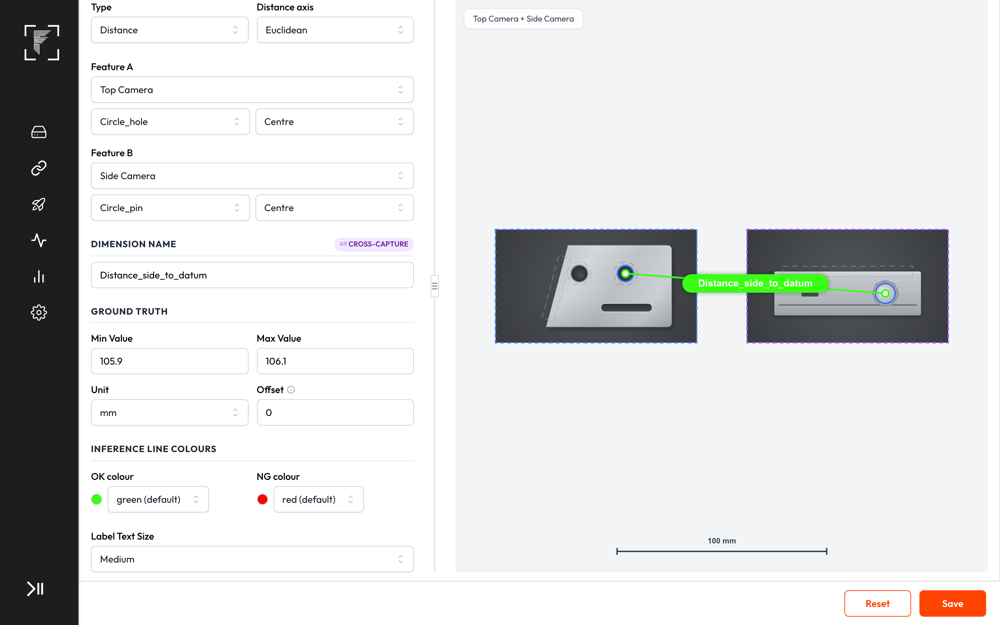
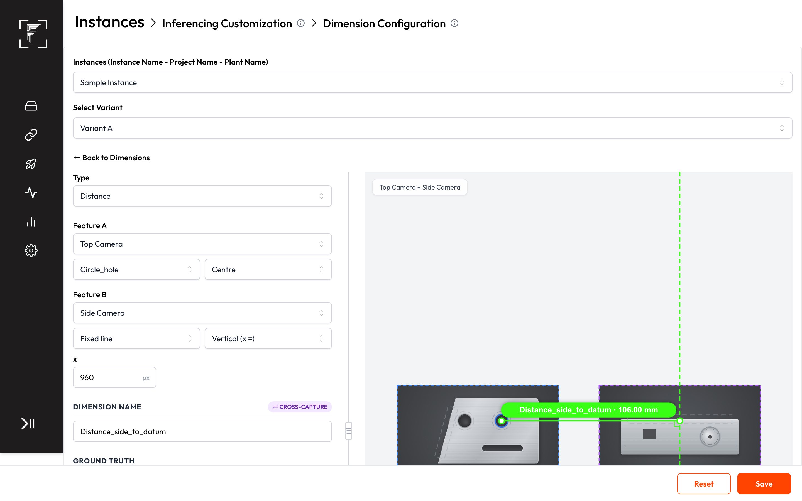
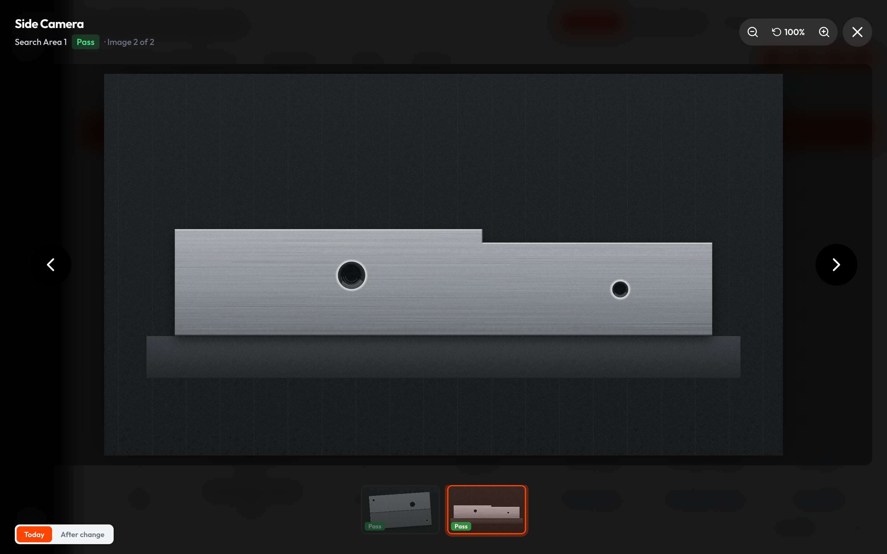
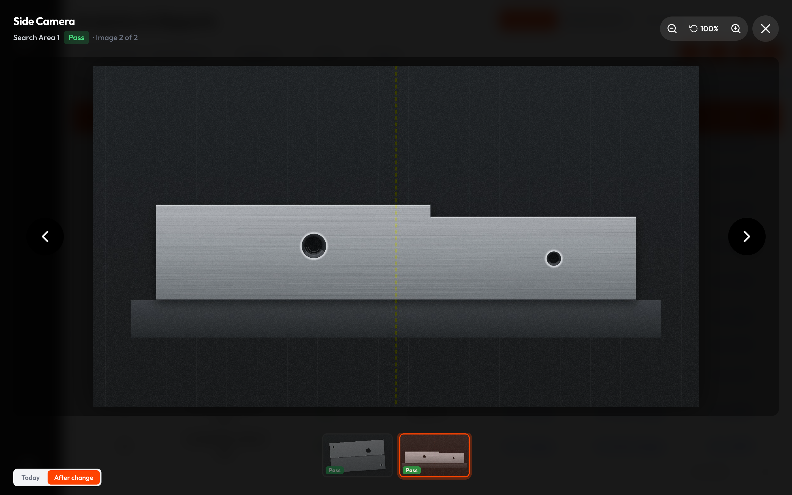

- **AC4.1** When Feature B's capture differs from Feature A's and its Shape is Fixed line, the dimension is cross-capture, with the "⇄ CROSS-CAPTURE" badge.
- **AC4.2** With Perpendicular on the line, the value is the shortest distance in mm from Feature A's point to the line, after both captures are placed by Capture Layout using each capture's pixel-to-mm, orientation and position.
- **AC4.3** Saving needs Capture Layout for both captures, with today's message "Configure Capture Layout (Pixel to mm) for … before saving".
- **AC4.4** The cross-capture preview draws the line across the whole layout stage, at its place on Feature B's capture image.
- **AC4.5** With "Show the fixed line on inferenced image" on, the analysed image of the line's own capture (Feature B's capture) draws the line dashed across the whole image, in the Fixed line colour. With it off, no image draws the line.
- **AC4.6** No image draws a cross-capture fixed-line dimension's span or value, as for every cross-capture dimension today.
- **AC4.7** With Perpendicular from Previous Line, the value is the distance in mm from Feature A's point, at right angles to Feature A's line, to where it meets the fixed line, after Capture Layout places both captures.

### US5 — See fixed-line dimensions in the table and deploy them
*As an integrator, I want fixed-line dimensions listed clearly and accepted by the deploy check, so that I can review them and run the line.*
- **Kind:** Feature
- **Parts:** mod-shape-extractor, edge-emc, edge-deployment, edge-instance-details
- **Teams:** SDE
- **Covers:** C5, C6, C10
- **Today:** The table shows Feature B as "Shape · part · point". A Distance with no Feature B shape is marked errored, and the deploy check blocks it.
- **Prototype:** [Saved dimensions](https://vbv-fr.github.io/dimension-fixed-line-prototype/#edge-dim-saved)

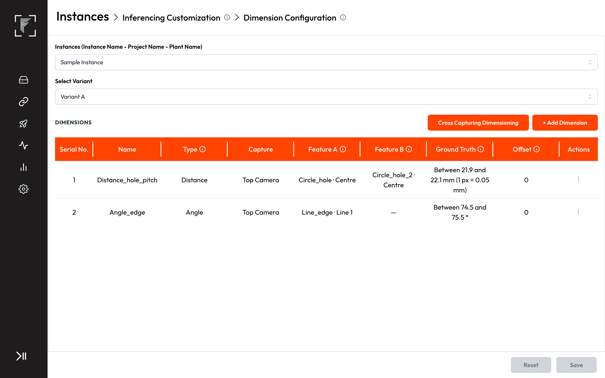
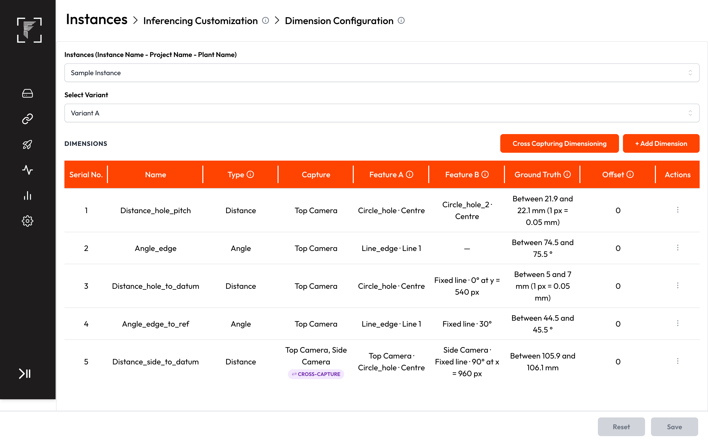

- **AC5.1** The Feature B cell names the angle first and only the centre values that count: "Fixed line · 0° at y = 540 px" (0° or 180°), "Fixed line · 90° at x = 960 px" (90°) or "Fixed line · 30° at (960, 540) px" (any other angle) for a Distance, and "Fixed line · 30°" for an Angle. On a cross-capture row the capture name comes first, for example "Side Camera · Fixed line · 90° at x = 960 px".
- **AC5.2** A fixed-line dimension is never marked errored for having no Feature B shape: no red "errored" badge, no list banner and no form banner.
- **AC5.3** On Deployments, a variant whose dimensions use fixed lines counts as configured, and its fixed-line dimensions never block Next for a missing Feature B shape.
- **AC5.4** If a later instance upload changes the capture's image size so that a saved line falls outside the image, the dimension keeps measuring and is not marked errored. Its values are checked against the new size only when it is next saved.
- **AC5.5** When Perpendicular type is shown, the Feature B cell ends with it, for example "Fixed line · 90° at x = 1500 px · Perpendicular from Previous Line".

### US6 — Measure and judge against the fixed line on the line
*As a quality engineer, I want every cycle measured against the same fixed line, so that the OK/NG verdict reflects where the part really sits.*
- **Kind:** Feature
- **Parts:** mod-result, mod-search-area, mod-orientation
- **Teams:** SDE + AI
- **Stakeholders:** Tanay (SDE), Pallavi (AI, Python)
- **Covers:** C9
- **Today:** The engine measures distances only between two shape features, always as a positive number, in the full camera image.

- **AC6.1** On a single-capture Distance with Perpendicular on the line, on every image the engine measures the shortest distance from Feature A's point to the fixed line in camera pixels of the full image. It then applies the pixel-to-mm ratio, the unit and the Offset exactly as for other distances.
- **AC6.2** A Distance's fixed line stays at the same place in the camera image on every cycle, whichever search area, Orientator or datum alignment Feature A's shape sits under. With Perpendicular on the line and a line at 0°, a part sitting 20 px lower, and staying on the same side of the line, gives a value 20 px different.
- **AC6.3** The value is always positive: a point 120 px above the line and a point 120 px below it give the same value.
- **AC6.4** A fixed-line dimension whose value falls outside its Ground Truth Min–Max fails, and the capture's verdict is NG.
- **AC6.5** On a single-capture Distance with Perpendicular from Previous Line, on every image the engine measures from Feature A's point, at right angles to Feature A's line as found on that image, to where it meets the fixed line, then applies the pixel-to-mm ratio, the unit and the Offset as for other distances.
- **AC6.6** On a single-capture Distance with Perpendicular from Previous Line, an image on which Feature A's line is at right angles to the fixed line gives no value, and the dimension fails.

### US15 — Choose whether the analysed image shows the fixed line
*As an integrator, I want to choose whether the analysed image shows the fixed line, and in which colour, so that operators see the reference only when it helps and never mistake it for a pass or fail mark.*
- **Kind:** Feature
- **Parts:** edge-emc, mod-shape-extractor
- **Teams:** SDE
- **Covers:** C3, C12
- **Today:** Inference Line Colours holds OK colour and NG colour (one Colour for Convexity and Contour Continuity). Nothing on the form controls a reference line on the analysed image.
- **Prototype:** [Show the line on the analysed image](https://vbv-fr.github.io/dimension-fixed-line-prototype/#edge-dim-line)

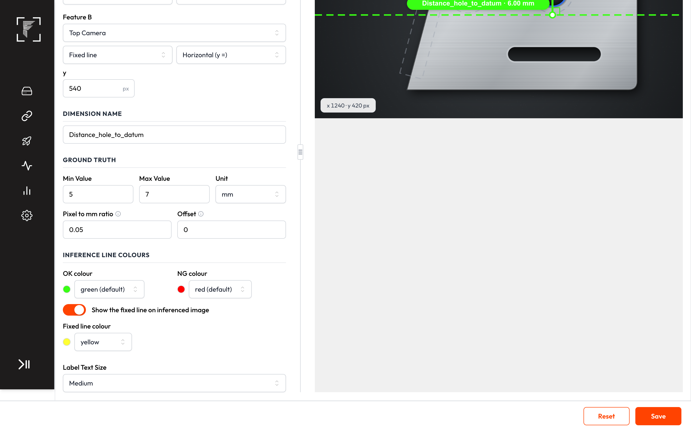

- **AC15.1** When a dimension uses a fixed line (a Distance whose Feature B is Fixed line, single- or cross-capture, or an Angle of type From a fixed line), Inference Line Colours shows a "Show the fixed line on inferenced image" toggle under OK colour and NG colour. Other dimensions don't show it.
- **AC15.2** The toggle starts off on every new fixed line, including one picked again after a shape.
- **AC15.3** Turning the toggle on shows a "Fixed line colour" dropdown under it. Turning it off hides the dropdown.
- **AC15.4** Fixed line colour lists the same 40 colours as OK colour and NG colour, each with its swatch, and starts on yellow, including for a fixed line picked again after a shape.
- **AC15.5** Turning the toggle off and on again, in the same form or after saving, brings back the colour picked before.
- **AC15.6** Saving keeps the toggle and Fixed line colour, and opening the dimension again with Edit shows them as saved.
- **AC15.7** Neither the toggle nor Fixed line colour changes the setup canvas: it draws a distance's fixed line as in AC2.1 and AC4.4, and an Angle's as in AC3.3.

### US7 — See the fixed line on the analysed image
*As an operator or quality engineer, I want the analysed image to show the fixed line and the measured span, so that I can see at a glance why a part passed or failed.*
- **Kind:** Feature
- **Parts:** mod-result, edge-live-dashboard, edge-storage-image-saving
- **Teams:** SDE + AI
- **Stakeholders:** Tanay (SDE), Pallavi (AI, Python)
- **Covers:** C12
- **Today:** The analysed image draws a distance between two shape features, with the value label, in the OK or NG colour.
- **Prototype:** [Analysed image: OK](https://vbv-fr.github.io/dimension-fixed-line-prototype/#edge-analysed), [NG](https://vbv-fr.github.io/dimension-fixed-line-prototype/#edge-analysed-ng), [angle](https://vbv-fr.github.io/dimension-fixed-line-prototype/#edge-analysed-angle)

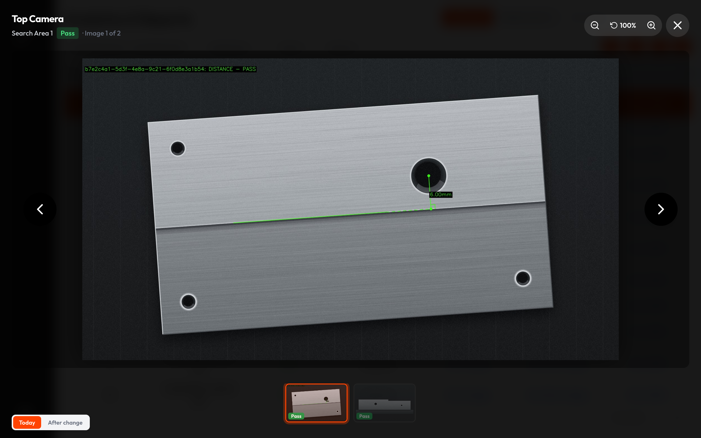

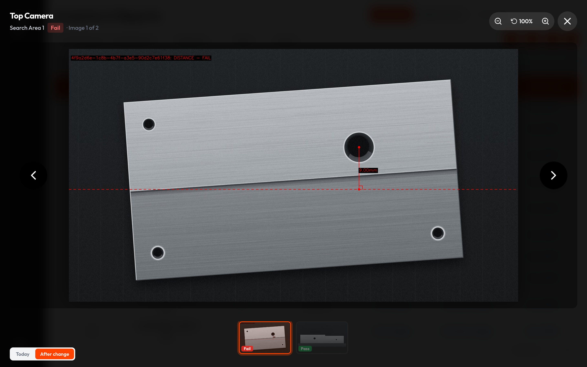
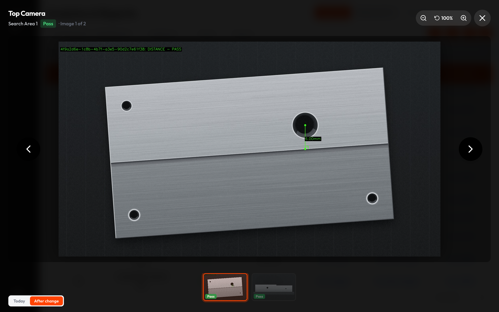

- **AC7.1** For a single-capture fixed-line dimension (Distance or Angle) with "Show the fixed line on inferenced image" on, the analysed image draws the fixed line dashed across the whole image, in the Fixed line colour, on OK and NG cycles alike.
- **AC7.2** For a single-capture Distance with Perpendicular on the line, the analysed image draws the span from Feature A's point to the line with today's dots, a right-angle mark where it meets the line, and today's value label (for example "6.00mm"), in the OK colour when it passes and the NG colour when it fails.
- **AC7.3** For an Angle from a fixed line, the analysed image draws Feature A's line, an arc at its middle spanning the measured angle to the fixed line (never the reflex angle outside it), and the value in degrees, in the OK or NG colour. The fixed line itself passes through the middle of Feature A's line (AC7.1).
- **AC7.4** The Live Dashboard image and saved analysed images show the same drawing as the analysed image.
- **AC7.5** For a single-capture fixed-line dimension with "Show the fixed line on inferenced image" off, the analysed image draws no fixed line. Everything else in AC7.2, AC7.3 and AC7.6 is still drawn.
- **AC7.6** For a single-capture Distance with Perpendicular from Previous Line, the analysed image draws the span from Feature A's point to where it meets the fixed line, with today's dots, the right-angle mark at Feature A's point and today's value label, in the OK or NG colour.

### US13 — See the measured length while setting up a distance
*As an integrator, I want to see the length the canvas measures on the master image, in my Ground Truth unit, so that I can set Min and Max without a trial run.*
- **Kind:** Feature
- **Parts:** mod-shape-extractor, edge-emc
- **Teams:** SDE
- **Covers:** C4
- **Today:** The label on the setup canvas shows only the dimension's name. The measured value appears only on the analysed image, after a deployment runs.
- **Prototype:** [Measured value on the canvas](https://vbv-fr.github.io/dimension-fixed-line-prototype/#edge-dim-shape-value)

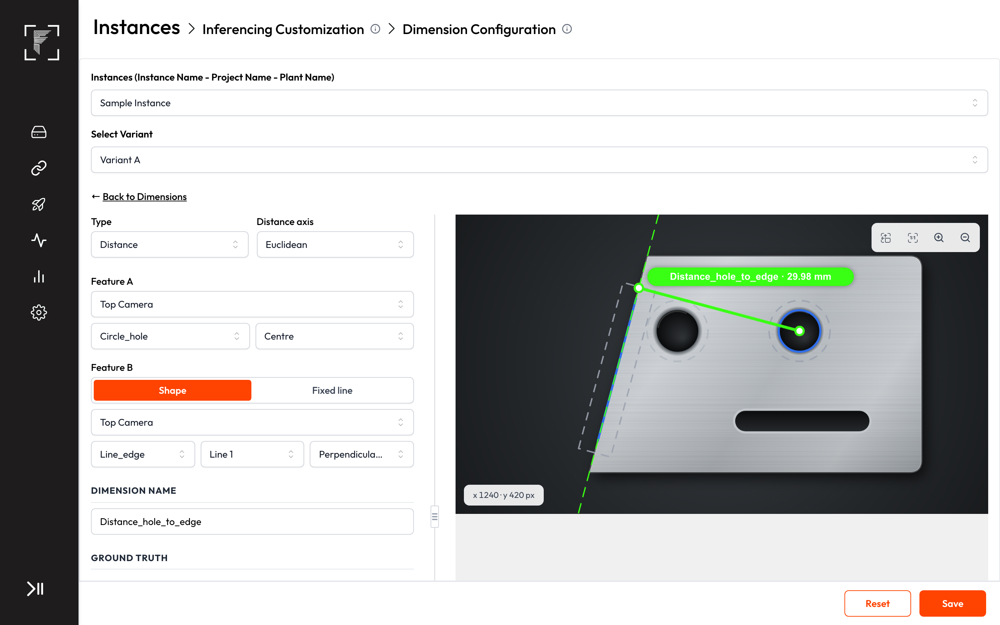

- **AC13.1** On every single-capture Distance, whatever Feature B is (a shape point, a perpendicular or a fixed line), the canvas label shows the dimension's name and the length of the drawn span on the master image, to 2 decimals, for example "Distance_hole · 6.25 mm".
- **AC13.2** On a single-capture Distance, the length is in the Ground Truth Unit: px as measured on the image, or mm using the Pixel to mm ratio.
- **AC13.3** The Offset is added to the length shown, so it compares directly with Min Value and Max Value.
- **AC13.4** While Unit is mm and the ratio box is empty or invalid, the label shows the length in px.
- **AC13.5** On a cross-capture Distance, the label shows the length in mm across the Capture Layout.
- **AC13.6** The length updates, before saving, as the features, the fixed line, Unit, ratio or Offset change.
- **AC13.7** Until both features are set, no length shows.

### US14 — Start in mm and pick the unit first
*As an integrator, I want a new dimension to start as a Distance in mm, and the unit I pick to decide whether a ratio is needed, so that the most common setup takes the fewest steps.*
- **Kind:** Feature
- **Parts:** mod-shape-extractor, edge-emc
- **Teams:** SDE
- **Covers:** C3, C4
- **Today:** Add Dimension opens an Angle. A Distance starts in px, and mm stays greyed out in the Unit list until a Pixel to mm ratio is typed. Ground Truth shows Min and Max, then the ratio beside Unit, then Offset.
- **Prototype:** [Ground Truth in px](https://vbv-fr.github.io/dimension-fixed-line-prototype/#edge-dim-units)

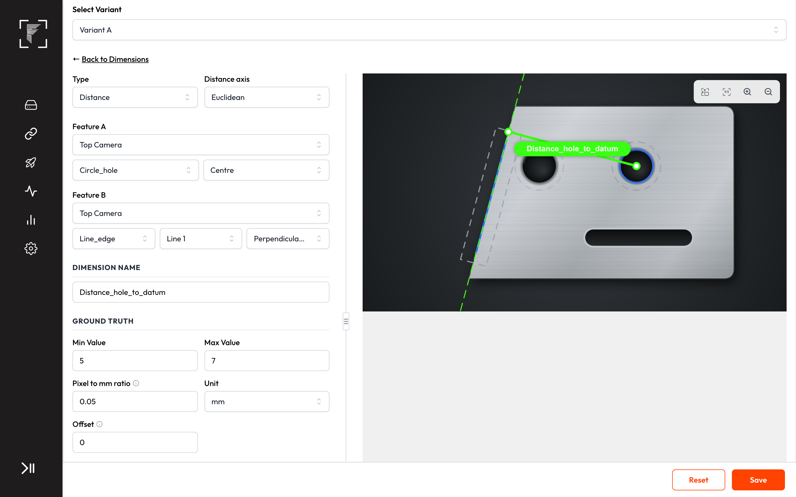

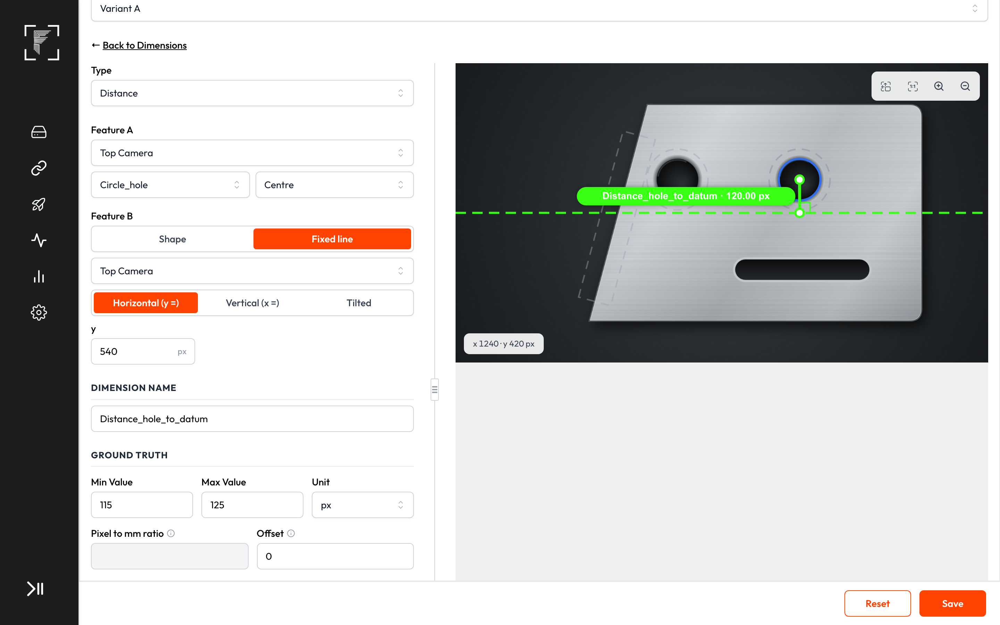

- **AC14.1** Add Dimension opens a new dimension as a Distance, with the name prefix "Distance_".
- **AC14.2** A new dimension's Unit starts on mm, or mm² for an Area Shape Feature, and goes back to it whenever the type or the Shape Feature changes. Types measured in degrees keep °.
- **AC14.3** Ground Truth shows Min Value, Max Value and Unit in one row, and Pixel to mm ratio and Offset in the row below. Where there is no ratio box today (Angle, Sector angle, cross-capture Distance), the second row holds Offset alone.
- **AC14.4** Every unit in the Unit list can be picked at any time: mm and mm² no longer wait for a ratio.
- **AC14.5** On a single-capture dimension, with mm or mm², the Pixel to mm ratio box is active. With px, it is greyed out, shows no value and can't be typed in.
- **AC14.6** Switching Unit from px back to mm or mm² in the same form brings back the ratio typed earlier in it, or an empty box if none was typed.

### US8 — Rules
*As a plant admin, I want fixed-line dimensions governed by the same permission as every dimension, so that access stays as I set it.*
- **Kind:** Rules
- **Parts:** edge-access-audit, edge-emc
- **Teams:** SDE
- **Covers:** C1

- **AC8.1** No role or permission changes. Adding, editing and deleting any dimension, fixed-line ones included, needs Inferencing Customization – Update. Viewing the page stays open to everyone who can open it today.
- **AC8.2** Edge's server refuses a fixed-line dimension save from a user without Inferencing Customization – Update.
- **AC8.3** Adding, editing and deleting a fixed-line dimension writes "dimension added", "dimension updated" or "dimension deleted" to the audit log, as for any dimension.

### US9 — Keeps working: setting up dimensions
*As an integrator, I want every dimension I set up today to behave as before, so that the new option costs me nothing.*
- **Kind:** Keeps working
- **Parts:** mod-shape-extractor, edge-emc, edge-deployment
- **Teams:** SDE + AI
- **Stakeholders:** Tanay (SDE), Pallavi (AI, Python)
- **Covers:** C3, C5, C10, C11

- **AC9.1** Shape-based Feature B options (points, "Perpendicular on the line", "Perpendicular from Previous Line") measure and draw their span on the canvas as today (the label's length is AC13.1), and the Angle types From X axis, From Y axis and Between two features measure and draw exactly as today.
- **AC9.2** If Feature A's shape is deleted, a fixed-line dimension shows as errored and blocks deployment, as any dimension with a missing shape does today.
- **AC9.3** Saving while a deployment is running shows today's confirmation, and the change reaches the line only after a deploy or Restart All.
- **AC9.4** A fixed-line dimension is deleted from the table's Actions menu like any dimension.
- **AC9.5** The Shape Extractor editor canvas in Edit Module Configurations, which shares the image viewer with the Dimension Configuration canvas, looks and works as today, with no cursor read-out added.
- **AC9.6** Saving a single-capture dimension in mm or mm² with an empty or invalid ratio shows today's "Enter a valid pixel-to-mm ratio." under the ratio box, and the dimension is not saved.
- **AC9.7** Edge's server still refuses a single-capture dimension in mm or mm² without a ratio above 0, even when it is sent without the page.

### US10 — Keeps working: on the line
*As a quality engineer, I want fixed-line dimensions to flow through keys, reports and changeovers like any dimension, so that nothing downstream needs special handling.*
- **Kind:** Keeps working
- **Parts:** mod-result, edge-inferencing-customization, edge-actions, edge-plc-write, edge-internal-actions, edge-reports-analytics, edge-model-loading-variant-change, edge-instance-details
- **Teams:** SDE + AI
- **Stakeholders:** Tanay (SDE), Pallavi (AI, Python)
- **Covers:** C2, C9, C10, C11, C12

- **AC10.1** When Feature A's shape is not found, or its fit fails, on an image, a single-capture fixed-line dimension fails with no value, as other dimensions do.
- **AC10.2** Cross-capture distances between two shape features stay a straight mm distance, as today.
- **AC10.3** Fixed-line dimensions write the same five dimension keys (result, predicted value, unit used, process, current ground truth). PLC Write, Internal Actions and dashboard rules built on those keys keep working.
- **AC10.4** A cross-capture fixed-line dimension that can't be computed in a cycle is FAIL when the cycle closes, like other cross-capture dimensions.
- **AC10.5** Each cycle's stored result in Reports & Analytics includes fixed-line dimensions like any dimension.
- **AC10.6** After a variant change, the new variant's fixed-line dimensions are the ones measured.
- **AC10.7** Re-uploading the instance from Vision keeps the fixed-line dimensions of every capture the re-upload keeps unchanged.
- **AC10.8** A capture removed by a re-upload takes its fixed-line dimensions out of the table, like any dimension on that capture.

### US11 — Platform
*As a release engineer, I want to know exactly what ships, so that the release is packaged and documented right.*
- **Kind:** Platform
- **Parts:** edge-release-upgrade, engine-runtime-packaging, edge-installer, edge-health
- **Teams:** SDE + AI
- **Stakeholders:** Tanay (SDE), Pallavi (AI, Python)
- **Covers:** C13, C17, C18

- **AC11.1** Node Docker image: no change. The work is code inside existing Edge services.
- **AC11.2** Python Docker image: no change. The measuring and drawing use libraries the engine already has.
- **AC11.3** Scripts bundle: changes. It carries the Dimension Configuration page, the Edge deployment server (save, list and deploy check), the Edge inferencing server (what is sent to the engine, the cross-capture maths, and sending a cross-capture line to its own camera's engine run for drawing) and the Python engine (measuring and drawing).
- **AC11.4** Installer: no change. The new stored fields ship in the release's database script.
- **AC11.5** New error codes: none. A fixed line has no detection that can fail, and the existing engine and cross-capture error codes still apply.
- **AC11.6** The Edge manual gets a Dimension Configuration section that covers fixed lines, the measured length on the canvas and the Ground Truth unit (there is none today). The release note reads: "Dimensioning on Edge can now measure a distance against a fixed line you type in (pick Fixed line in Feature B's Shape list, then set its angle and centre; when Feature A is a point on a line, you can switch Perpendicular type to Perpendicular from Previous Line), or an angle against a line at an angle you set. A distance's line shows live on the setup canvas, and the line shows on the analysed image when you turn on "Show the fixed line on inferenced image", in a colour you pick. "Angle from" is now called "Angle type", and "Two features" is now "Between two features". The setup canvas now shows each distance's measured length in the Ground Truth unit, new dimensions start as a Distance in mm, and the unit you pick decides whether a pixel-to-mm ratio is needed. Before rolling an Edge back to an older version, delete its fixed-line dimensions."

### US12 — Migration requirements
*As a site engineer, I want updates and rollbacks to leave existing dimensions intact, so that upgrading Edge is safe.*
- **Kind:** Migration
- **Parts:** edge-backup-migration, edge-release-upgrade, edge-instance-details, vision-instance-creation
- **Teams:** SDE
- **Covers:** C6, C7

- **AC12.1** Existing data: after an Edge upgrade, every existing dimension keeps its type, Angle type, features, Unit, ratio and Offset, and measures exactly as before, with Feature B on a shape. An angle saved as Two features opens as Between two features.
- **AC12.2** The new fixed-line fields exist after both a fresh install and an update. A backup restored on another box keeps fixed-line dimensions unchanged.
- **AC12.3** Fixed lines can be added to the variants of an older instance, one uploaded before this release.
- **AC12.4** A new instance on an older Edge is unaffected: instance packages from Vision carry no dimensions, and Vision does not change.
- **AC12.5** After an Edge is rolled back from this release to an older Edge version, its fixed-line dimensions show as errored and block deployment until they are deleted.

## 7. Out of scope
- Signed distance, i.e. telling which side of the line a point is on.
- Placing or moving the line by dragging or clicking on the canvas.
- A line that moves with the part (set relative to a search area or the datum).
- Typing the line in millimetres.
- Fixed lines in Shape Features, Convexity and Contour Continuity.
- Drawing a cross-capture dimension's span or value on any image. The combined cross-capture result image stays switched off.
- A fixed-line colour on the setup canvas: the canvas keeps the OK colour.
- Any change in Frinks Vision.

## 8. How we'll know it worked
| Measure | Target |
|---|---|
| Deploys wrongly blocked by a fixed-line dimension | None reported after release |
| The line on the setup canvas and on the analysed image sit on the same pixel row or column | Same place on every test image |
| Dummy Shape Extractor shapes added only to act as a reference line, on sites that upgrade | Replaced by fixed lines on the next site visit |

## Appendix A — Coverage
**Not applicable:** every checklist item no story covers, one line each.
- **C8** — N/A: one point-to-line calculation per dimension per image, with no measurable effect on cycle time, GPU or memory.
- **C14** — N/A: no datasets, annotation, training or models are involved.
- **C15** — N/A: no network or clock dependence; works offline as today.
- **C16** — N/A: no licensing or encryption change, and nothing new leaves the plant.

**Coverage check** (28 Oct 2026, after round 6): **PASS**, no warnings. 15 user stories (10 Feature, 1 Rules, 2 Keeps working, 1 Platform, 1 Migration), 104 ACs, 23 touched parts, 0 discussion points. Checklist: 14 items covered by stories, 4 N/A, 0 open.

**Checks beyond the script:** every coverage-sheet item maps to exactly one AC; the duplicate pass found 5 duplicates and 6 wording conflicts, all fixed (see Changelog); the code back-check added AC9.5; every goal is delivered (G1: US1, US4, US6; G2: US3; G3: US2, US7, US15; G4: US5, US9, US10; G5: US13, US14). Round 4 duplicate pass: 3 duplicates fixed, 2 scope gaps closed, no contradictions; round 5 duplicate pass: 4 duplicates and 2 edge-case contradictions fixed, no old line-type wording left; round 6 duplicate pass: 2 duplicates and 3 scope contradictions fixed; the code back-check found no new part (all changed files sit in the Dimension Configuration page, the Edge deployment and inferencing servers and the Python engine, already Yes).

## Appendix B — Code references
For developers. Per touched part: the files that hold today's behaviour, from this sync.
- **Dimension Configuration page (edge-emc, mod-shape-extractor):** `frinksedge-deployment-frontend`:
  - `src/modules/inferencing-customizations/DimensionConfigurationPage.jsx:333-461` — list and form views; errored banner `:367-376`; Add/Edit/Delete gated `:386,399,410-411`.
  - `.../dimension-configuration/DimensionForm.jsx:282-510` — form fields; errored banner `:268-279`.
  - `.../dimension-configuration/FeaturePicker.jsx:94-160` — Capture → Shape → Part → Point; Shape dropdown `:104-111`; no-shape note `:156-160`.
  - `.../dimension-configuration/DimensionForm.jsx:291` ("Angle from" label), `:51-69` (ColourField: swatch + dropdown), `:469-503` (Inference Line Colours); `dimensionConstants.js:82` (angle mode names), `:165-171` (COLOR_OPTIONS = NEON_COLORS, 40 colours; OK/NG defaults); `src/@constants/colors.js` NEON_COLORS (yellow #FFFF33).
  - `.../dimension-configuration/dimensionConstants.js:81-97` — angle modes, distance axis, derivations; `:518-535` Feature B perpendicular entries; `:747-757` needsFeatureB / canCrossCapture.
  - `.../dimension-configuration/dimensionFormModel.js:96-139` (row → form), `:326-331` (cross-capture rule), `:372-508` (validateForm), `:527-592` (buildPayload).
  - `.../dimension-configuration/dimensionGeometry.js:35-39` (angle convention), `:56-64` (perpendicularFoot), `:407-467` (resolveDistanceSpan).
  - `.../dimension-configuration/DimensionPreviewCanvas.jsx:227-319` (distance and angle drawing), `:445-625` (cross-capture stage).
  - `.../dimension-configuration/dimensionDisplay.js:50-92` (table cells).
  - `src/shared/ui/MasterImageCanvas.jsx:16-18,69-236` (pixel overlays, pan/zoom).
  - `.../dimension-configuration/DimensionPreviewCanvas.jsx:188-215,420-430` — label pill shows the name only.
  - `.../dimension-configuration/DimensionForm.jsx:93` (new form uses DEFAULT_TYPE), `:170-192` (unit resets), `:414-466` (Ground Truth block).
  - `.../dimension-configuration/dimensionConstants.js:70-71` (DEFAULT_TYPE = Angle), `:100-135` (units per type, unitNeedsRatio); `dimensionFormModel.js:73-93` (emptyForm: first unit = px), `:333-351` (mm disabled until a ratio is typed), `:471-472` (ratio error), `:586` (no ratio saved for px).
- **Save, list, deploy check (mod-shape-extractor, edge-deployment, edge-access-audit):** `frinksedge-deployment-backend`:
  - `src/dto/dimensioningConfig.ts:27-84,154-157` — create/update contract.
  - `src/service/dimensioningConfig.ts:36-82` (normalizeTypeSpecificFields; ratio stored only for mm/mm² `:69-76`), `:366-367` (mm without a ratio refused), `:88-103,327` (Feature B always loaded as a shape), `:156-289` (validateFeature, validateDerivation), `:321-368` (cross-capture and ratio rules), `:403-431` (create mapping).
  - `src/dao/dimensioningConfig.ts:50-121` (column lists, splitFields), `:123-195` (listByVariantId, isErrored), `:329-538` (readiness SQL; Feature B null check `:477-505`).
  - `src/service/deployment.ts:260-285,927-933`; `src/controller/deployment.ts:26-58` — deploy check.
  - `src/db/dimensioningConfig.schema.ts:66-118`, `src/db/dimensioningFeatureReference.schema.ts:40-108` — tables and delete rules.
  - `src/routes/dimensioningConfig.ts:8-13`; `src/rbac/catalogue.ts:126-136`; `src/audit/catalogue.ts:43-45`; `src/controller/dimensioningConfig.ts:32-76` — permission and audit.
  - `src/db/cameraConfig.schema.ts:61-62` — capture width/height; `src/service/instance.ts:149,200-205` — preview master image downscaled to 1080 px.
  - `src/service/instanceUploadOwnership.ts:1-10` — dimensions are Edge-owned; `src/service/shapeExtractorUploadReconciliation.ts:255-331` — re-upload.
- **Engine payload and cross-capture (mod-result, edge-inferencing-customization):** `frinksedge-inferencing-backend`:
  - `src/python-model/python-model-dimensions.service.ts:86-103,137-234` — payload; FeatureB only when a shape is set `:166-190`; target area list `:215-220`; cross-capture rows skipped `:144-145` (a cross-capture line to draw must be sent to its own capture's run).
  - `src/orchestrator/orchestrator.service.ts:85` — combined cross-capture result image switched off.
  - `src/shared/infrastructure/module-config/dimensioning/dimensioningFeatureReference.schema.ts:42-47` — its own schema copy.
  - `src/cycle/cycle-manager.service.ts:725-742,849-891`; `src/dimensioning/cross-capture-geometry.ts:303-354` — cross-capture maths and verdict.
  - `src/key/key-writer/system-key-writer/system-key-writer.service.ts:142-207`; `src/key/keys/system-key.ts:241-245` — dimension keys.
  - `src/result-flusher/result-flush.service.ts:75-97` — stored result.
- **Measuring and drawing (mod-result, mod-search-area, mod-orientation):** `vip-inference-python`:
  - `scripts/assembly/resultProcess/dimension.py:49-107` (frames), `:264-640` (process, failures), `:185-241,503-549` (pixel-to-mm, unit, offset).
  - `scripts/assembly/resultProcess/dimensioning/distance.py:203-266,403-426` — point-to-line foot on the infinite line, absolute values.
  - `scripts/assembly/resultProcess/dimensioning/angle.py:57-78,146-234` — axis angle, 0–180°; the axis reference is drawn through the middle of Feature A's line `:147-163`.
  - `scripts/assembly/resultProcess/dimensioning/utils/visualization.py:116-410` — drawing.
  - `scripts/assembly/modules/searchAreaModule.py:146-151,771-833` — root area identity matrix, datum alignment.
  - `scripts/assembly/modules/resultModule.py:1010-1026,1250-1256` — verdict.
- **Install and upgrade (edge-backup-migration, edge-installer):** `frinksedge-deployment-backend` `dump.sql:993,1005,1044` (recent dimension columns), `src/db/dataMigrations/index.ts:34-39`; `frinksedge-installer-electron` `src/main.js:265,347-401,512`.

Repos checked: frinksedge-deployment-frontend @ 857dfddd (2026-10-26), frinksedge-deployment-backend @ 5a69c77 (2026-10-26), frinksedge-inferencing-backend @ 310c18e (2026-10-22), vip-inference-python @ 14670bf (2026-10-26), frinksedge-report-frontend @ 9893a19 (2026-10-13), frinksedge-installer-electron @ b4a5049 (2026-10-12), frinksvision-backend @ 093a734 (2026-10-26), frinkschat-backend @ 88e5c91 (2026-07-21); the other 26 repos were synced and not read. The 26 Oct re-syncs moved no dimensioning file used here (the frontend moved only Dashboard restart files, the deployment backend only the Restart All code).

## Changelog
Every line names the US / AC ids it touched.
- 24 Oct 2026 — Draft written: US1–US12 (Tanay Deo)
- 24 Oct 2026 — AC9.5 added at the code back-check: the Shape Extractor editor canvas shares the image viewer. Duplicate pass: AC2.5 trimmed (engine row is AC6.1); AC9.1 trimmed (Shape pickers are AC1.1); AC11.4 trimmed (install and update are AC12.2); AC11.5 trimmed (missing Feature A shape is AC10.1); AC12.3 trimmed (existing dimensions are AC12.1). Wording conflicts settled: AC2.1, AC7.2 and the AC11.6 release note limited to single-capture (cross-capture is AC4.4, AC4.5); AC5.3 limited to a missing Feature B shape (AC9.2); AC6.2 limited to the same side of the line (AC6.3); AC10.7 limited to kept captures (AC10.8). (Tanay Deo)
- 26 Oct 2026 — Status Draft → Approved; no US or AC changed (Tanay Deo)
- 26 Oct 2026 — Status Approved → In review after PM review. G5 added. US13 added (AC13.1–AC13.7): measured length on the setup canvas for every Distance. US14 added (AC14.1–AC14.6): new dimension starts as a Distance in mm; Min, Max and Unit in one row; Unit turns the ratio box on or off. AC9.6, AC9.7 added: a ratio is still required for mm. AC3.2, AC3.3 changed: From a fixed line asks only for the angle and draws the line through the middle of Feature A's line. Reworded: AC5.1 (Angle cell), AC6.2 (Distance lines only), AC7.3 (analysed angle drawing), AC9.1 (canvas label and Ground Truth layout now change), AC11.6 (manual and release note), AC12.1 (Ground Truth layout now changes). Duplicate pass: AC2.1 trimmed ("never a short segment" is its first sentence) and limited to a Distance; AC3.2 trimmed (a single box needs no "no position boxes"); AC13.5 trimmed (Offset is AC13.3). Conflicts settled: AC9.1 points to AC13.1 for the label; AC9.7 and AC13.2 limited to single-capture (cross-capture uses Capture Layout); AC7.3 arc reworded to "never the reflex angle". (Tanay Deo)
- 26 Oct 2026 — Round 4 (PM review of the prototype). Fixed line moves into Feature B's Shape dropdown: AC1.1 changed (the "Shape | Fixed line" switch is gone), AC1.2 changed (line type is now a "Line type" dropdown, and the line's capture is Feature B's Capture dropdown); AC1.9, AC3.2 and AC4.1 reworded; AC1.10 and AC1.11 added. Rename: AC3.1 changed ("Angle from" → "Angle type", "Two features" → "Between two features"); AC9.1 and AC12.1 reworded. US15 added (AC15.1–AC15.7): "Show the fixed line on inferenced image" toggle (off to start) and "Fixed line colour" (40 colours, yellow to start) under Inference Line Colours; the setup canvas is unaffected. AC7.1 changed (line only with the toggle on, in the Fixed line colour); AC7.2 reworded (span keeps OK/NG colours); AC7.3 changed (arc and value; the line is AC7.1); AC7.5 added (toggle off). AC4.5 changed: with the toggle on, a cross-capture line is drawn on its own camera's analysed image (was: never drawn); AC4.6 added; US4 and US7 now SDE + AI. G3, Summary, impact map (mod-shape-extractor, edge-emc, mod-result, edge-inferencing-customization), AC11.3, AC11.6 release note and Out of scope reworded. Duplicate pass: AC7.2 and AC7.3 trimmed (toggle-off drawing is AC7.5); AC15.7 merged into one sentence; AC1.10 trimmed (the Distance list is AC1.1). Scoped: AC7.5 to single-capture (cross-capture is AC4.5), AC14.5 to single-capture (AC14.3). AC1.9: picking Fixed line again also starts the toggle off and the colour on yellow. Status stays In review. (Tanay Deo)
- 27 Oct 2026 — Round 5 (PM). The Line type dropdown (Horizontal / Vertical / Tilted) is gone: a distance's fixed line is always Angle (0°–180°), Centre x and Centre y. AC1.2 changed (three boxes, Angle first); AC1.3 changed (starts at 90° on the middle column, was Horizontal on the middle row); AC1.5, AC1.7 and AC1.8 reworded; AC1.12–AC1.15 added (0° and 180° grey out Centre x, 90° greys out Centre y; a greyed box is empty, comes back with the earlier value or the middle column/row, and is neither checked nor stored). AC2.1 and AC2.5 reworded. AC3.3 changed: an Angle from a fixed line draws nothing on the setup canvas (was the line and an arc); AC3.2 and AC15.7 reworded. AC5.1 changed (angle first: "Fixed line · 90° at x = 960 px"). AC6.2, AC7.1, AC11.6 release note, Summary, G1, G3, Key concepts and impact map reworded. Duplicate pass: AC1.3 trimmed (greying is AC1.12); AC1.9 trimmed, its toggle and colour reset moved into AC15.2 and AC15.4; AC2.1 example marked; AC7.1 trimmed; AC1.14 limited to this fixed line (a re-pick starts from AC1.3); AC1.7 reworded (a greyed centre value isn't stored). Status stays In review. (Tanay Deo)
- 28 Oct 2026 — Round 6 (PM). Perpendicular type for a fixed line: AC1.16–AC1.21 added (dropdown below the line's boxes when Feature A is a point on a line, single- and cross-capture; starts on Perpendicular on the line; hidden for other Feature A, with a fallback when Feature A changes; Save blocked when the perpendicular never meets the line; server check). AC2.6, AC4.7, AC5.5, AC6.5, AC6.6 and AC7.6 added for Perpendicular from Previous Line on the canvas, across captures, in the table, in the engine and on the analysed image. AC1.7, AC2.3, AC4.2, AC6.1, AC7.2 and AC7.5 scoped to Perpendicular on the line or reworded. Summary, impact map and AC11.6 release note reworded. Duplicate pass: AC7.6 trimmed; AC10.1 scoped to single-capture (cross-capture is AC10.4); AC6.1, AC6.5, AC6.6 scoped to single-capture (cross-capture is AC4.2, AC4.7); AC6.2 example scoped to Perpendicular on the line; AC1.17 also covers a re-picked fixed line. Status stays In review. (Tanay Deo)
- 28 Oct 2026 — Round 6 follow-up (PM confirmed the dropdown shows when Feature A is a point on a line). AC1.16 corrected: the Middle point of a Line, Parallel or Edge line also qualifies, as it does today. Status stays In review. (Tanay Deo)
- 28 Oct 2026 — Status In review → Approved; no US or AC changed (Tanay Deo)

## Checked, not affected
Every other part in the component map, grouped, each group with a one-line reason.
- vision-access, vision-auto-annotation, vision-captures-cameras, vision-datasets-annotations, vision-model-evaluation, vision-model-training, vision-projects, vision-recipe-tree, vision-training-sets-recommender, vision-variants: dimensioning exists only on Edge, and nothing about it travels from Vision.
- mod-bead-inspection, mod-classification, mod-code-reader, mod-color-detection, mod-masking, mod-matting, mod-ocr, mod-odc, mod-segmentation, mod-tracker: these modules produce no dimension features.
- engine-workflow: runs the result step and hands on the analysed image as today, with no change of its own.
- edge-camera-capture, edge-dashboard-builder, edge-encryption-keys, edge-networking, edge-plc-read, edge-plc-setup, edge-system-time: no new hardware, key, widget option, service, port, PLC address or time handling.
