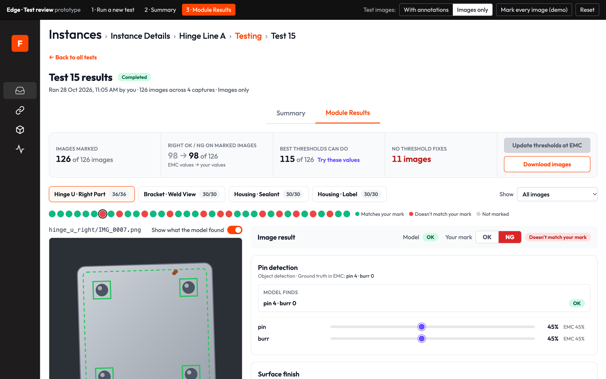
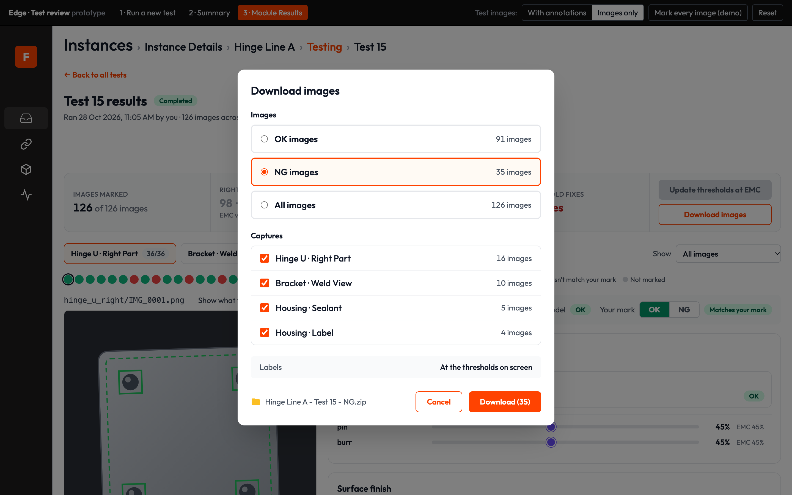
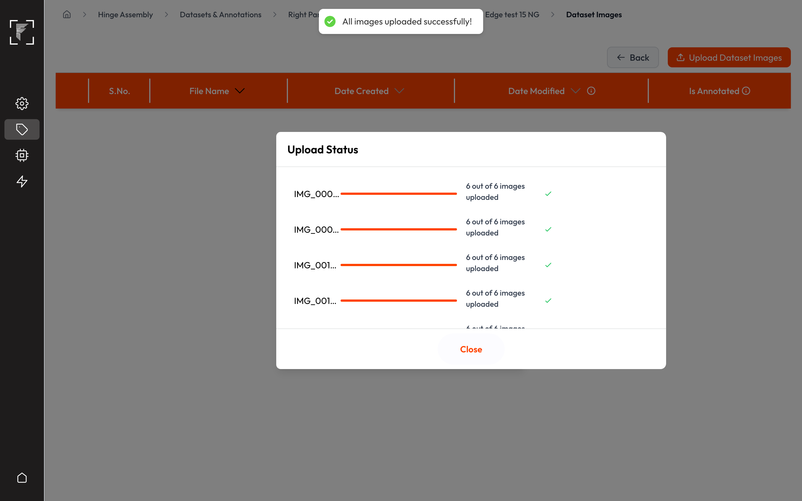
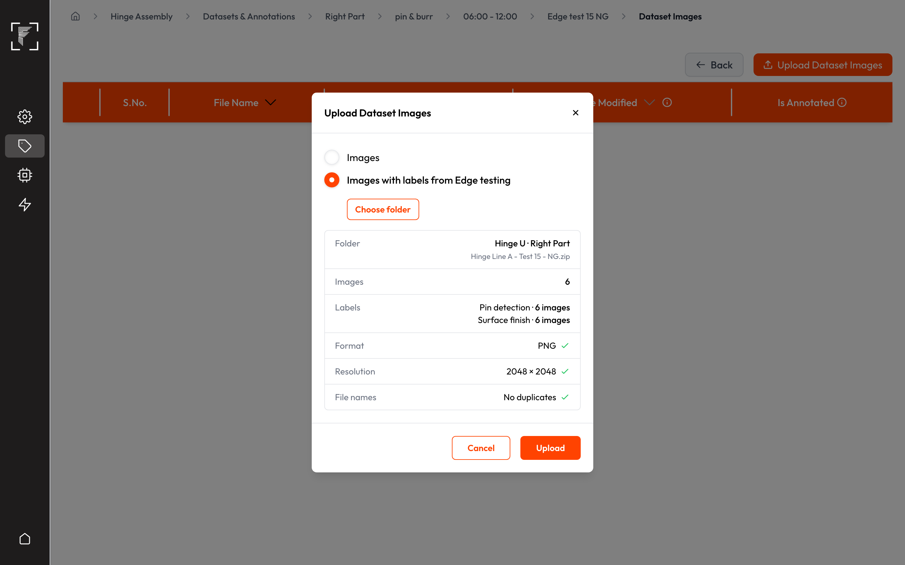
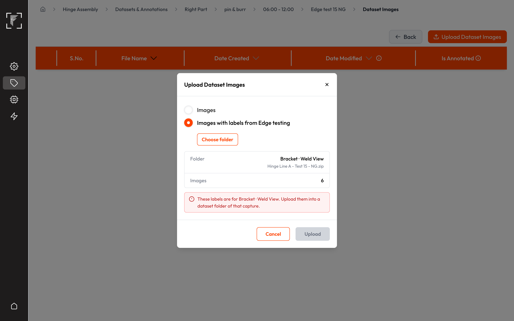
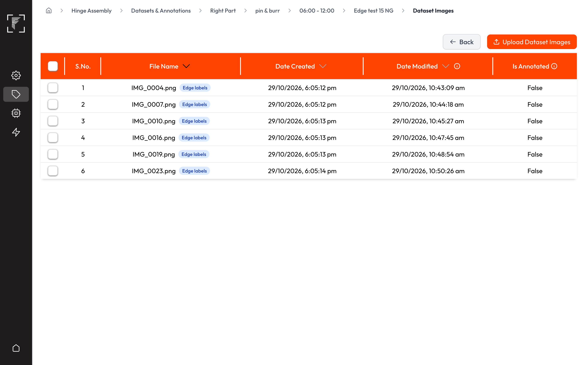
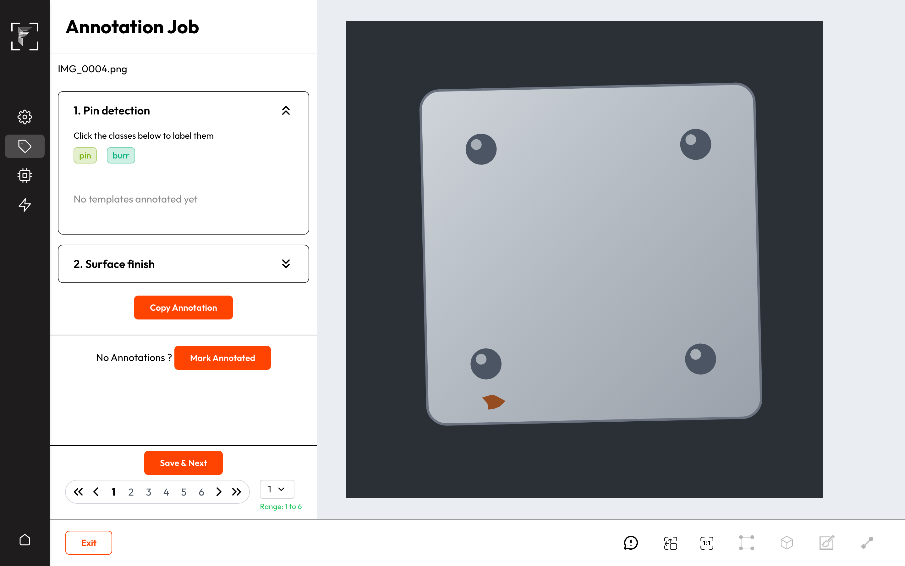
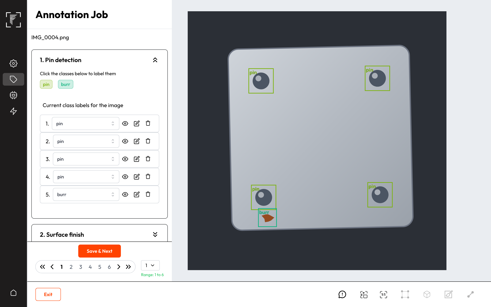

# PRD: Edge Instance Testing v2

**Prototype:** [Interactive workflow, Today vs After change](https://frinks-ai.github.io/frinks-PRDs/2026-10-24-edge-instance-testing-v2/prototype/) · [Test inputs and Module Results playground](https://frinks-ai.github.io/frinks-PRDs/2026-10-24-edge-instance-testing-v2/prototype/review.html#results) · [Download images and Vision upload](https://frinks-ai.github.io/frinks-PRDs/2026-10-24-edge-instance-testing-v2/prototype/?mode=after#edge-download)
**Product:** Frinks Edge + Frinks Vision
**Status:** Draft
**Date:** 26 October 2026 · updated 29 October 2026 (test inputs and Module Results playground) · updated 30 October 2026 (OK / NG marks, Download images, upload to Vision with labels)
**Owner:** Akshat Sharma
**Timeline:** Not planned yet
**Related:** FP-530 (open epic "Modifying the 'Instance Testing' sub-menu", last touched Feb 2025); closed history FP-2253, FP-2160, FP-2895, FP-1875, FP-204. Unfiled ticket draft by Vaibhav Kumar.
**Code checked:** 24 October 2026 — 34 repos at their latest default-branch commit (list in Appendix B); 29 October 2026 re-sync for the download and Vision upload

---

## Discussion points

| # | Point to settle | Options on the table | Owner | Needed by |
|---|---|---|---|---|
| Q1 | A test runs inside a separate testing program on the Edge device. We could not find where that program's code lives, so nobody can yet confirm it can save every found item (including items below the EMC thresholds, AC10.7), time each capture, skip unreadable images, stop on Cancel and keep each found item's shape for Download images (US6, US8, US9, US10, US20). | Find the repo and add it to the code check / rebuild the testing program from the live Python engine in test mode | AI lead | Before sprint planning |
| Q2 | Stories that need both SDE and AI work (US6, US8, US9, US10, US11, US15, US20) need named stakeholders. | Names to be given by the owner | Akshat Sharma | Before sprint planning |
| Q3 | FP-530 is an open epic from Feb 2025 on the same screen. | Close it as replaced by this PRD / link it as parent | Akshat Sharma | Before tickets are made |
| Q4 | With "Images with annotations", each annotation file has to fill in the expected result of every module (AC17.6). Detection and segmentation annotations give counts per class, but it isn't known how a classification label, OCR text or a bead gap is stored in today's test annotation files. | Map each module type's annotation to its expected result / support annotations for detection and segmentation only and leave the rest for the user to enter | AI lead | Before sprint planning |
| Q5 | Bead confidence becomes a value saved in Edit Module Configurations (AC10.3, AC11.6). Today the line always uses 50%, and EMC has no field for it. | Add a Bead confidence field to the bead setup in EMC as well / save it from testing only | Akshat Sharma | Before tickets are made |
| Q6 | The signed-off playground shows one confidence slider per class. The earlier Thresholds panel also had an IOU slider for detection and segmentation. | Keep an IOU slider per class for detection and segmentation (written into AC10.1) / drop IOU from testing | Akshat Sharma | Before tickets are made |
| Q7 | Module Results compares with EMC (ground truths, "EMC <value>" labels, right OK/NG at EMC values), while AC8.4 says results are judged with the settings snapshot taken when the test started. If EMC changes after the test, the two differ. | Use the snapshot everywhere on the results page, and show current EMC only in the Update dialog (recommended) / use current EMC in Module Results | Akshat Sharma | Before tickets are made |
| Q8 | Download images can only label what a test keeps. Today a test keeps detection, classification and OCR findings as boxes and outlines, but no segmentation or bead masks, so those labels can't be downloaded yet (AC20.8). | The testing program also saves each segmentation and bead mask per image, written as Vision mask labels / download segmentation and bead images without labels for now | AI lead | Before sprint planning |
| Q9 | A download can be older than the Vision recipe: a module or class may have been removed or renamed in Vision since the instance was made. | Leave those labels out and list them in the upload dialog (recommended) / refuse the whole upload | Akshat Sharma | Before tickets are made |
| Q10 | Edge tests take PNG images only, while a Vision capture set to JPG accepts only JPG uploads, so a JPG capture's download would fail Vision's format check (AC21.5). | Download images in the capture's format, converted on Edge / let Vision accept PNG for uploads with Edge labels | Akshat Sharma | Before tickets are made |

## 1. Summary
- An **Instance Testing** button on the Instance Details list opens an instance's Testing tab in one click.
- The Testing tab shows a **banner for the last test** ("Testing Completed" with View Results) and the **full history** of tests, each with a plain status (Running, Completed, Completed with errors, Failed, Cancelled), a one-line reason, who ran it, and a **Delete** action.
- Only **one test runs on a device at a time**, a test can't start while a deployment runs, and a deployment can't start while a test runs. The Testing tab says why Run Test is blocked.
- The Run drawer asks **what's in the test folders**: images with annotations, or images only. Each capture is **checked in the Run drawer** before the test starts; problems that block show as errors, the rest as warnings, behind an icon you hover. Images of the wrong size are left out of the upload; the rest of the folder is tested.
- A running test shows its **progress inline** (no full-screen loader) and **anyone allowed to test can cancel it**.
- Results open on their own page with two tabs: a **Summary** per capture (images tested, OK, NG, average inference time) and **Module Results**. Module Results shows each image **exactly as the line would judge it**: OK/NG for the image and every module, the line's Pass/Fail colours, the image's file name, and Shape Extractor results.
- Module Results is a **playground for checking the model**. With **Images with annotations**, each image has an **expected result** for every module (what is really there: counts per class, the class, the text, the bead gap), filled in from its annotation file and editable; its OK/NG follows from the EMC ground truth. With **Images only**, the user **marks each image OK or NG**, starting from the model's verdict. Thresholds are tried per class on the same page, and every saved image is judged again as the sliders move.
- A strip at the top answers two questions: **do thresholds help** (right OK/NG at the EMC values against the values being tried, and the best any thresholds can do) and **is the model good enough** (images no threshold can fix).
- **Update thresholds at EMC** saves values per class to Edit Module Configurations **for this instance only**, after a confirmation that lists every change.
- With Images only, **Download images** saves the tested images (OK, NG or all, chosen captures) in one zip, with what the model found at the thresholds on screen as **label files Vision can read**.
- In Vision, a dataset folder's **Upload Dataset Images** accepts a capture folder from that download. The images arrive with the model's labels drawn in the annotation job, ready to correct; each counts as annotated only once saved, so retraining starts from corrections instead of blank images.

## 2. Why we are making this
- **Today:** Instance Testing is half switched off. On the Testing tab, Test Status, Test Type and Success Rate always show "N/A", and View Test History does nothing, so past tests and their results can't be reached. A full-screen loader blocks Edge while a test runs, and there is no way to cancel it. Starting a second test silently ends the first. Nothing is checked before a test starts, so a wrong folder is only found after the run. Results draw generic boxes in random colours, skip Shape Extractor and show no OK/NG. Apply Thresholds writes one value to every class of a model, also changes other instances that use the same model, and its popup claims the running deployment reloads, which it doesn't. Performance Metrics was removed from the results. Operators, plant admins and quality engineers who prepare an instance before it goes on the line are affected.
- **Evidence:** internal need from Edge commissioning; the v2 design was agreed by the product team (design prototype and ticket draft by Vaibhav Kumar). The site workflow it serves: plant images are split into a set for training in Vision and a set for testing on Edge; the test set tunes thresholds in bulk, and its images feed retraining.
- **After:** anyone allowed to test can run a test safely, follow it, and see exactly how the line would judge each test image, then save better thresholds to this instance on purpose. Thresholds are tuned on a whole folder of images at once instead of by trial on a running deployment, and the images the model got wrong go back to Vision already labelled, to be corrected and used for retraining.

## 3. Goals and non-goals
**Goals**
- G1. Every past test and its outcome can be found from the Testing tab in one click.
- G2. A test can never disturb a running deployment or another test, and the user always sees why a test or deployment can't start.
- G3. Test results match what the line would show for the same image and settings.
- G4. Thresholds are saved per class, to this instance only, and only when the user confirms.
- G5. With or without annotation files, users can check the model against what each test image really shows, and learn whether changing thresholds fixes its mistakes or the model itself isn't good enough.
- G6. Test images can go back to Vision with the model's labels, so new training data is corrected rather than labelled from scratch.

**Non-goals**
- A report or sign-off document from a test: Module Results is a place to try things; its actions are updating EMC and, with Images only, downloading images with labels for Vision.
- Sending images from Edge to Vision directly: the user downloads the zip and uploads it in Vision.
- Saying where in the image an item is when entering an expected result (counts per class are entered, not boxes).
- One verdict that combines several captures into one part verdict.
- Testing frame-sequence logic (assembly sequencing, Tracker counting): a folder of separate images can't test it.
- Changing how inferencing draws or judges on the line.

## 4. Key concepts
- **Test:** one run of an instance's current recipe on folders of saved images, one folder per capture. It never touches the line.
- **Settings snapshot:** the recipe, ground truths, thresholds and Analysed Image Configuration saved with a test when it starts, so its results can be shown as they were.
- **Pre-check:** a check of one capture in the Run drawer before the test starts. An **error** stops that capture from being tested; a **warning** lets it run.
- **Expected result:** what a module should report for one test image, as the user (or an annotation file) says: counts per class for detection and segmentation, a class for classification, the text for OCR, the longest gap in calipers for bead inspection, Readable or Not readable for a code reader. Its OK/NG comes from comparing it with the module's ground truth in EMC.
- **OK / NG mark:** with Images only, the user's verdict for a whole test image (what the part really is), saved per image. It replaces the expected results in that mode.
- **Saved image:** a test image whose expected results (Images with annotations) or OK / NG mark (Images only) have been saved; an annotation file counts as saved. Only saved images count in the strip at the top of Module Results.
- **Edge labels:** what the model found on a test image at the thresholds on screen, written in Vision's own label format and downloaded with the image, so Vision can show it as labels to correct.
- **Result matches / OK-NG matches, result differs / OK-NG doesn't match:** with Images with annotations, the three ways a module's result at the tried thresholds can compare with its expected result. With Images only, an image either **matches your mark** or **doesn't match your mark**.

## 5. Impact map
The parts this changes. Parts checked and not affected are listed at the very end.

| Part | What will happen | User stories |
|---|---|---|
| Instance Details and Testing (edge-instance-details) | New Instance Testing button on the list; Testing tab rebuilt (last test, history, delete, progress, cancel, blocks, pre-checks, two test modes); new results page whose Module Results is a playground (expected results or OK / NG marks, live thresholds, strip, Update thresholds at EMC); Download images with labels for Vision | US1, US2, US3, US4, US5, US6, US8, US9, US10, US17, US18, US19, US20 |
| Deployments (edge-deployment) | A deployment can't start while a test runs anywhere on the device | US4, US7 |
| Edit Module Configurations (edge-emc) | Thresholds from a test saved per class, to this instance only; bead confidence saved per bead module; ground truths read to judge model and expected results | US8, US10, US11, US17 |
| Analysed Image Configuration (edge-inferencing-customization) | Its Pass/Fail colours and Show on/off are used to draw test results (read only) | US9 |
| Result module (mod-result) | Its OK/NG rules give each module and image an OK/NG in tests, for the model's result and for the expected result; with Images only, the model's image OK/NG is compared with the user's mark | US10, US17, US19 |
| Shape Extractor (mod-shape-extractor) | Included in tests for the first time | US9 |
| Bead Inspection (mod-bead-inspection) | Incomplete bead setup blocks that capture in the Run drawer; bead results drawn as on the line; bead confidence tried in tests and saved to EMC, then used by the line instead of the fixed 50% | US5, US9, US10, US11 |
| Object Detection (mod-odc) | Boxes drawn in test results the way the line draws them; per-class thresholds | US9 |
| Image Classification (mod-classification) | Box on its search area drawn the way the line draws it; per-class thresholds tried in tests | US9, US10 |
| Segmentation (mod-segmentation) | Outlines drawn the way the line draws them; per-class thresholds | US9 |
| OCR (mod-ocr) | Text line outlines drawn the way the line draws them; character confidence tried in tests | US9, US10 |
| Code Reader (mod-code-reader) | Code box drawn the way the line draws it | US9 |
| Colour Detection (mod-color-detection) | Colour region box drawn the way the line draws it | US9 |
| Orientation & Tilt (mod-orientation) | Reference and measured line drawn the way the line draws them | US9 |
| Python engine / testing program (engine-workflow) | Saves every found item (also below the EMC thresholds) and each capture's average inference time per image, skips unreadable images, stops on cancel; bead module takes its confidence from EMC; keeps each found item's shape so it can be downloaded as a label (segmentation and bead masks: Q8) | US6, US8, US9, US10, US11, US20 |
| Edge roles and audit log (edge-access-audit) | Cancel, Delete, saving expected results or OK / NG marks, and Download images follow the testing permission; tests and threshold saves are logged | US13 |
| Health and error codes (edge-health) | Free disk space read for a pre-check; no new error codes | US5, US15 |
| Backup and migration (edge-backup-migration) | New test fields, saved expected results and OK / NG marks; old tests mapped to the new statuses; bead confidence 50% for existing bead modules | US16 |
| Datasets, dataset images, annotation (vision-datasets-annotations) | Upload Dataset Images opens a dialog with "Images with labels from Edge testing"; capture check; uploaded images tagged "Edge labels" and not annotated; their labels drawn and editable in the annotation job; saved images count as annotated | US14, US21, US22 |
| Vision roles and permissions (vision-access) | No change: the existing dataset upload and annotation permissions cover the new upload and its labels | US13 |
| Model training (vision-model-training) | No change: a folder whose Edge-labelled images aren't saved yet can't be picked for training, as for any folder not fully annotated | US14 |
| Python Docker image (engine-runtime-packaging) | Testing program image changes | US15 |

## 6. User stories and acceptance criteria

### US1 — Open Testing from the instance list
*As an operator, I want an Instance Testing button on the Instance Details list, so that I can start or check a test in fewer clicks.*
- **Kind:** Feature
- **Parts:** edge-instance-details
- **Teams:** SDE
- **Covers:** C2
- **Today:** Testing is only reachable by opening an instance and then its Testing tab.
- **Prototype:** [edge-instances](https://frinks-ai.github.io/frinks-PRDs/2026-10-24-edge-instance-testing-v2/prototype/#edge-instances)

- **AC1.1** On Edge > Instances > Instance Details, an "Instance Testing" button sits at the top right, left of "Add Instance".
- **AC1.2** With one instance chosen in the instances dropdown, clicking Instance Testing opens that instance's Testing tab.
- **AC1.3** With "All Instances" chosen, clicking Instance Testing opens a short list titled "Which instance do you want to test?"; choosing an instance opens its Testing tab.
- **AC1.4** On the Testing tab and the results page, "Instance Details" in the breadcrumb leads back to the list.

### US2 — Last test banner
*As a plant admin, I want the Testing tab to show how the last test ended, so that I can open its results in one click.*
- **Kind:** Feature
- **Parts:** edge-instance-details
- **Teams:** SDE
- **Covers:** C3, C5
- **Today:** a "Test Parameters" card shows Test Status, Test Type and Success Rate as "N/A" always.
- **Prototype:** [edge-testing-tab](https://frinks-ai.github.io/frinks-PRDs/2026-10-24-edge-instance-testing-v2/prototype/#edge-testing-tab)

- **AC2.1** The tab opens with the title "Testing", the line "Try this instance's current setup on folders of saved images before you use it on the line." and the Run Test button; the "Test Parameters" card and its N/A values are gone.
- **AC2.2** With at least one finished test, a banner for the most recent finished test shows "Testing Completed", "Testing Completed with errors", "Testing Failed" or "Testing Cancelled", the line "Test <n> · <date and time> · by <name>", and the reason when there is one.
- **AC2.3** The banner has a "View Results" button for Completed and Completed with errors tests, and shows nothing else about the test.
- **AC2.4** With no tests, the tab shows "No tests yet", the line "Run a test to check this instance's setup on saved images before using it on the line. Tests don't affect the line." The only way to start a test is the Run Test button at the top; there is no second button in the middle of the tab.

### US3 — Test history, statuses and delete
*As a plant admin, I want every test listed with a plain status and reason, so that I can find results and understand failures.*
- **Kind:** Feature
- **Parts:** edge-instance-details
- **Teams:** SDE
- **Covers:** C3, C5, C12
- **Today:** the history list exists but can't be opened; it shows "Errored" for every test that isn't Completed, including running ones.
- **Prototype:** [edge-testing-tab](https://frinks-ai.github.io/frinks-PRDs/2026-10-24-edge-instance-testing-v2/prototype/#edge-testing-tab)

- **AC3.1** Under the last test banner, an "All tests" table is always shown (no View Test History button), newest first, with columns Test (with "by <name>"), Started, Took, What was tested (captures and image count), Status, and an action.
- **AC3.2** A test's status is exactly one of Running (with %), Completed, Completed with errors, Failed, Cancelled.
- **AC3.3** Completed with errors, Failed and Cancelled always show a one-line reason under the status, e.g. "6 of 120 images for Hinge U · Right Part could not be read (the files are damaged). They were left out; everything else was tested." or "The device ran out of storage space while saving results. Free up space, then run the test again."
- **AC3.4** Completed and Completed with errors tests show "View results"; Failed and Cancelled tests don't.
- **AC3.5** Every finished test shows "Delete". Clicking it asks "Delete Test <n>? Its images and results are removed from this device. This can't be undone." with Keep test / Delete test.
- **AC3.6** Delete test removes the test's images and results, including saved expected results and OK / NG marks, from the device's disk and its row from the history; the banner then shows the next most recent test, or "No tests yet".
- **AC3.7** A running test has no Delete action.

### US4 — When Run Test is blocked
*As an operator, I want Run Test to say why it can't be used, so that I don't disturb the line or someone else's test.*
- **Kind:** Feature
- **Parts:** edge-instance-details, edge-deployment
- **Teams:** SDE
- **Covers:** C5, C8, C10
- **Today:** Run Test always works; starting a test while another runs silently ends the first one, and nothing checks for a running deployment.

- **AC4.1** While any deployment runs on this Edge device, Run Test is disabled and the reason line under it shows "A deployment is running on this device. Stop it to run a test."
- **AC4.2** While any test runs on this Edge device (any instance), Run Test is disabled on every instance's Testing tab and the reason line under it shows "Test running (by <name>) — <n>%. Only one test can run on a device at a time." ("Your test is running — <n>%." when it is yours).
- **AC4.3** A test start that reaches Edge while a deployment or another test runs on the device is refused with the matching message from AC4.1 or AC4.2, and the running deployment or test carries on unaffected.
- **AC4.4** While a test or deployment runs, the history, the last test banner and every results page stay usable.

### US5 — Run drawer: instructions and pre-checks
*As an operator, I want each capture checked before the test starts, so that I don't waste a run.*
- **Kind:** Feature
- **Parts:** edge-instance-details, mod-bead-inspection, edge-health
- **Teams:** SDE
- **Covers:** C4, C5, C11
- **Today:** the drawer shows a long paragraph of instructions; nothing is checked; uploading shows a full-screen loader.
- **Prototype:** [edge-run-test](https://frinks-ai.github.io/frinks-PRDs/2026-10-24-edge-instance-testing-v2/prototype/#edge-run-test)

- **AC5.1** Between the test-mode choice (AC5.11) and the Variant | Capture | Dataset folder table, the drawer shows only: "Choose a folder of test images for each capture you want to test.", with "Images with annotations" chosen also "Each annotation file has the same name as its image; segmentation and bead masks go in a "masks" folder.", and "Tests never send PLC signals, trigger integrations or change production reports." with the green shield icon.
- **AC5.2** A capture whose bead inspection isn't fully set up in Edit Module Configurations has a disabled Choose folder button with an error icon beside it; the icon's message is "Can't be tested: bead inspection isn't set up for this capture yet (bead width and gap rules are missing)." with an "Open Edit Module Configurations" link.
- **AC5.3** A row's errors and warnings aren't written out under it: one icon beside its folder (red for an error, amber for warnings) shows all of them when hovered or focused. After a folder is chosen, the row shows only the folder name with ✕ to remove it, and no image count line.
- **AC5.4** When some chosen images' size differs from the camera's image size, the row warns with the counts and both sizes, e.g. "Image size doesn't match this camera: 12 of 88 images are 1920 × 1080, but this camera takes 2448 × 2048 images. Those 12 won't be uploaded; the other 76 will be tested."
- **AC5.5** On Start Testing, images whose size differs from the camera's aren't uploaded and the rest of the folder is; the upload count and the test's image counts leave them out.
- **AC5.6** When the chosen images need more space than the device has free, the row warns with both figures in GB, e.g. "Not enough free space on the device: these images need about 2.4 GB and only 1.1 GB is free. Free up space or choose fewer images."
- **AC5.7** A capture with no folder and nothing to report shows only its "Choose folder" button.
- **AC5.8** The footer shows "<n> captures will be tested · <n> with warnings · <n> can't be tested"; Start Testing is disabled with "Choose at least one folder to start." until a folder is chosen.
- **AC5.9** If testing becomes blocked while the drawer is open (US4), Start Testing is disabled with "Testing is blocked on this device right now. The Testing tab shows why."
- **AC5.10** After Start Testing, the footer shows "Uploading images for <Variant · Capture> — <x> of <y>" with a bar; when the upload ends the drawer closes and the running test shows on the tab. No full-screen loader is shown.
- **AC5.11** At the top of the drawer, under the heading "What's in your test folders?", two radio cards sit side by side (stacked on narrow screens): "Images with annotations" with "Each image has an annotation file. It fills in the expected result." and "Images only" with "No annotation files. You mark the images you check OK or NG." "Images only" is chosen by default; the chosen card has an orange border and a light orange fill. The choice applies to the whole test; with "Images only", annotation files in the folders are ignored. [Prototype](https://frinks-ai.github.io/frinks-PRDs/2026-10-24-edge-instance-testing-v2/prototype/review.html#run)
- **AC5.12** With "Images with annotations" chosen, the table gets a fourth column, "Annotation files". For a capture with a folder chosen it shows "<n> of <m> images" with a green tick when every image has an annotation file; with no folder, or a capture that can't be tested, it shows "—".
- **AC5.13** When some images of a chosen folder have no annotation file, the Annotation files cell shows "<n> of <m> images" with the amber warning icon, and hovering it shows "Annotation files are missing for <k> of <m> images. You can enter their expected results yourself." Those images are tested, and the row counts towards "<n> with warnings" (AC5.8); the folder's own icon (AC5.3) doesn't repeat this warning.

### US6 — Follow and cancel a running test
*As an operator, I want to see a running test's progress on the tab and cancel it, so that I can keep using Edge.*
- **Kind:** Feature
- **Parts:** edge-instance-details, engine-workflow
- **Teams:** SDE + AI
- **Stakeholders:** see Q2
- **Covers:** C3, C5, C8
- **Today:** a full-screen percentage loader blocks Edge; a test can't be cancelled; a test that stops responding is marked Errored with no reason.
- **Prototype:** [edge-test-running](https://frinks-ai.github.io/frinks-PRDs/2026-10-24-edge-instance-testing-v2/prototype/#edge-test-running)

- **AC6.1** While a test runs, the Testing tab shows "Test <n> is running — <n>%" (with "(by <name>)" when someone else started it), a progress bar, start time and who started it, time so far, estimated time left, images tested of total, and one tile per capture (Done / <x> of <y> / Waiting).
- **AC6.2** The tab says "You can leave this page. The test keeps running, and its results appear here when it's done."; leaving and coming back shows the same progress.
- **AC6.3** Anyone with the testing permission sees "Cancel test", whoever started the test. It asks "Cancel Test <n>? The images tested so far won't be kept. You can run the test again later." with Keep running / Cancel test.
- **AC6.4** Cancel test stops the testing program, keeps no results, and the test shows Cancelled with "Cancelled by <name> after <x> of <y> images. Nothing was kept."
- **AC6.5** When a test finishes or is cancelled, the progress card goes away; no separate card is left behind.
- **AC6.6** A test that stops unexpectedly (the testing program stops, or Edge restarts) ends as Failed with "The test stopped unexpectedly. Run it again.", and the device is no longer blocked for tests or deployments.

### US7 — No deployment while a test runs
*As a plant admin, I want Edge to refuse to start a deployment while a test runs on the device, so that a test is never cut off midway.*
- **Kind:** Feature
- **Parts:** edge-deployment
- **Teams:** SDE
- **Covers:** C8, C10
- **Today:** a deployment is refused only when a test runs for the same instance, with "Model testing is still running."

- **AC7.1** While a test runs on the device, starting a deployment of any instance (from Deployments or the API) is refused with "A test is already running on this device. Wait for it to finish or cancel it, then start the deployment.", and the test carries on unaffected.

### US8 — Results page
*As a plant admin, I want test results on their own page with a clear way back, so that I don't get lost.*
- **Kind:** Feature
- **Parts:** edge-instance-details, edge-emc, engine-workflow
- **Teams:** SDE + AI
- **Stakeholders:** see Q2
- **Covers:** C3, C11
- **Today:** results open on a separate page reached only through the hidden history, with a breadcrumb that doesn't lead back to the Testing tab.
- **Prototype:** [edge-test-results](https://frinks-ai.github.io/frinks-PRDs/2026-10-24-edge-instance-testing-v2/prototype/#edge-test-results)

- **AC8.1** View results opens a page with the breadcrumb Instances › Instance Details › <instance> › Testing › Test <n>, where Testing leads back to the tab, and a "← Back to all tests" link.
- **AC8.2** The page header shows "Test <n> results", the status and the reason.
- **AC8.3** Two centred tabs sit under the header: Summary (open by default) and Module Results.
- **AC8.4** Results are drawn and judged with the settings snapshot saved when the test started, not the current settings.
- **AC8.5** When the recipe, ground truths, thresholds or Analysed Image Configuration have changed since the test, the page shows "These results use the settings from when the test ran. Settings have changed since — run a new test to see the effect." with a "Run a new test" button.
- **AC8.6** The Summary tab has one row per Variant – Capture tested, in a table with orange column headers: Variant – Capture, Images tested, OK, NG, and Average inference time per image (in ms, for the whole capture, measured during the test).
- **AC8.7** Images tested shows e.g. "114 of 120", with small text under it for images left out: "6 couldn't be read" and "12 skipped at upload: wrong image size".
- **AC8.8** OK and NG count each capture's images by image result at the thresholds the test ran with; images that couldn't be read count in neither.
- **AC8.9** Under the table, small text shows "Ran <date> by <name> · took <time> · <n> images across <n> captures · Images with annotations" (or "· Images only"), as chosen in the Run drawer (AC5.11).

### US9 — Each image as the line would show it
*As an operator, I want each test image drawn and judged as the line would, so that I can trust the test.*
- **Kind:** Feature
- **Parts:** edge-instance-details, edge-inferencing-customization, engine-workflow, mod-shape-extractor, mod-odc, mod-classification, mod-segmentation, mod-ocr, mod-code-reader, mod-color-detection, mod-bead-inspection, mod-orientation
- **Teams:** SDE + AI
- **Stakeholders:** see Q2
- **Covers:** C9, C12, C14
- **Today:** a reference image and a visualization with generic boxes in random colours, one module at a time; Shape Extractor is not tested.
- **Prototype:** [Module Results playground](https://frinks-ai.github.io/frinks-PRDs/2026-10-24-edge-instance-testing-v2/prototype/review.html#results)

- **AC9.1** On the Module Results tab, under the strip (AC18.4), one chip per Variant – Capture tested shows "<Variant · Capture>" and a grey count "<saved>/<images>" of saved images (expected results with Images with annotations, OK / NG marks with Images only); clicking a chip opens that capture at its first image, and the chosen chip has an orange border and a light orange fill.
- **AC9.2** At the right of the chips, a "Show" dropdown limits the pager and the arrow keys to those images of the capture; with Images with annotations it offers All images · Not saved · Saved · OK / NG doesn't match · No threshold fixes, and "OK / NG doesn't match" is judged at the tried thresholds. With none it shows "No images in <Variant · Capture> match this filter." in place of the image.
- **AC9.3** Above the images, the image's file name is shown as in the chosen folder, e.g. bracket_weld/IMG_0003.png.
- **AC9.4** One image is shown, up to 460 px wide, left of the module cards (above them on narrow screens) and staying in view while the cards scroll; a "Show what the model found" switch above it (on by default) shows the analysed image when on and the raw image when off. Under it, "‹ Image <i> of <n> ›" ("… in this filter" when filtered) moves between images; the left and right arrow keys do the same.
- **AC9.5** The analysed image shows every module of the capture's recipe at once, each drawn the way the line draws it: detection boxes, classification box on its search area, segmentation outlines, OCR line outlines, code reader box, colour region box, dimension lines and arcs, tilt reference and measured line, bead edges with the reference path and a box per failing caliper.
- **AC9.6** Each item is drawn in its module's Pass or Fail colour from Analysed Image Configuration, by its OK/NG; items with Show off aren't drawn; Shape Extractor shapes and dimensions use green/red as on the line. No PASS/FAIL text is drawn.
- **AC9.7** No labels or values are written on the image; hovering an item shows its label, confidence or value and OK/NG, e.g. "pin · confidence 95% · OK" or "Edge angle: 88.8° · set 89–91° · NG".
- **AC9.8** Shape Extractor runs in tests; with no dimensions set its shapes are drawn and "Shape Extractor: no dimensions configured, showing shapes only." shows under the image.
- **AC9.9** For a camera with no pixel-to-mm value, lengths show in px and "This camera isn't calibrated, so lengths are in pixels (px), not millimetres. Set its "Pixel to mm" value in Dimension Configuration to see millimetres." shows under the image; px values are never labelled mm.
- **AC9.10** An image that couldn't be read shows "This image couldn't be read — The file may be damaged. It was left out of the results." in place of the image and has no Expected boxes or OK / NG mark.
- **AC9.11** With Images only, the Show dropdown offers All images · Not marked · Marked OK · Marked NG · Doesn't match your mark · No threshold fixes; "Doesn't match your mark" is judged at the tried thresholds.

### US10 — Try thresholds and see why an image is OK or NG
*As a plant admin, I want to try thresholds per class and see each module's result, so that I can choose good values.*
- **Kind:** Feature
- **Parts:** edge-instance-details, edge-emc, mod-result, mod-bead-inspection, engine-workflow
- **Teams:** SDE + AI
- **Stakeholders:** see Q2
- **Covers:** C9, C11
- **Today:** one Confidence and one IOU slider per module, redrawing generic boxes; no OK/NG anywhere.
- **Prototype:** [Module Results playground](https://frinks-ai.github.io/frinks-PRDs/2026-10-24-edge-instance-testing-v2/prototype/review.html#results)

- **AC10.1** In each module card, under the Model finds box (with Images with annotations, also the Expected box and any note, AC18.10), one row per class shows the class name, a slider from 5% to 95% in 1% steps, the tried value as a percentage, and "EMC <value>" in grey; detection and segmentation rows also have an IOU slider (see Q6). OCR has one row, "Character confidence"; bead inspection has one row, "Bead confidence" (the share of the model's bead mask a caliper needs to count as bead).
- **AC10.2** Moving a slider immediately redraws the analysed image and that card's Model finds box, and the value applies to every image of the test, not only the one shown; confidence hides items below it; IOU merges overlapping items of the same class; a lower bead confidence counts fainter bead as present.
- **AC10.3** A module with no thresholds (code reader, colour detection, Shape Extractor, orientation & tilt) shows "No thresholds for a <module type>." where the sliders would be.
- **AC10.4** Tried values stay on this results page; nothing is saved to Edit Module Configurations until Update thresholds at EMC (US11).
- **AC10.5** One card per module of the capture's recipe, in recipe order, shows the module name, its type and "Ground truth in EMC: <ground truth>" (e.g. "pin 4 · burr 0", "clean", "HX-2048-B", "NG from a gap of 3 calipers"), then "Model finds" with the module's result at the tried thresholds (e.g. "pin 4 · burr 0", "no class", “HX-248-B”, "gap of 3 calipers") and its OK/NG pill.
- **AC10.6** The image is NG when any judged module is NG; a module with no ground truth shows "Not judged" and doesn't count, with the note "Not judged: the module has no ground truth set, so it doesn't count towards the image result."
- **AC10.7** The test keeps every item the model found down to 5% confidence, below the EMC thresholds too; classification keeps every class's confidence, OCR every character's, bead inspection every caliper's bead confidence.

### US11 — Update thresholds at EMC
*As a plant admin, I want to save chosen thresholds to EMC deliberately, so that the line uses them.*
- **Kind:** Feature
- **Parts:** edge-emc, edge-instance-details, mod-bead-inspection, engine-workflow
- **Teams:** SDE + AI
- **Stakeholders:** see Q2
- **Covers:** C2, C10, C11
- **Prototype:** [Module Results playground](https://frinks-ai.github.io/frinks-PRDs/2026-10-24-edge-instance-testing-v2/prototype/review.html#results)
- **Today:** Apply writes one value to every class of the model, also changes other instances that use it, skips a value of 0, and the popup says the running deployment will reload, which it doesn't.

- **AC11.1** The orange "Update thresholds at EMC" button (placed by AC18.4) is disabled until a tried value differs from EMC, and then shows the number of changed values, e.g. "Update thresholds at EMC (8)".
- **AC11.2** The button opens "Update thresholds at EMC?" listing each changed value as "<Module> · <class> — <EMC value> → <new value>" (confidence, IOU where it applies, character confidence, bead confidence), the line "Only <instance> changes; other instances that use these models keep their values.", and Cancel / Update.
- **AC11.3** On Update, each changed value is saved to its module in Edit Module Configurations of this instance only; other values and other instances keep theirs, and the grey "EMC <value>" on each changed row updates.
- **AC11.4** A value is saved exactly as chosen, including the lowest, 5% (today a value of 0 is skipped).
- **AC11.5** While a deployment runs, the confirmation also says "A deployment is running on this device. It keeps using the old values until it restarts."; the only buttons are Cancel and Update, and Update doesn't restart the deployment.
- **AC11.6** A saved Bead confidence is used by the line for that module from the next deployment start instead of the fixed 50% (see Q5).

### US12 — Performance Metrics tab (removed)
Replaced by the Module Results playground (US17, US18): with annotation files, the expected results come from them and the same strip shows how often the model was right and the best thresholds.
- **AC12.1** (removed)
- **AC12.2** (removed)
- **AC12.3** (removed)
- **AC12.4** (removed)
- **AC12.5** (removed)
- **AC12.6** (removed)
- **AC12.7** (removed)

### US17 — Enter the expected result of each module (Images with annotations)
*As a quality engineer, I want to say what each test image really shows, so that the test can tell me where the model is wrong.*
- **Kind:** Feature
- **Parts:** edge-instance-details, edge-emc, mod-result
- **Teams:** SDE
- **Covers:** C3, C6, C9, C11
- **Today:** there is no way to say what a test image really shows; without annotation files a test only shows what the model found.
- **Prototype:** [Module Results playground](https://frinks-ai.github.io/frinks-PRDs/2026-10-24-edge-instance-testing-v2/prototype/review.html#results)

- **AC17.1** With Images with annotations, each module card with an editor (AC17.2–AC17.6) has an "Expected" box beside Model finds (purple edge, light purple fill, purple "EXPECTED" label), holding the editor for the module's type and, at its right, the OK/NG pill of the expected result.
- **AC17.2** Detection and segmentation: one stepper per class of the module, "<class> − <n> +", from 0 to 9.
- **AC17.3** Image classification: a dropdown of the module's classes.
- **AC17.4** OCR: a text box in a monospace font holding the expected text, with spell-check off.
- **AC17.5** Bead inspection: a stepper "gap − <n> +" followed by "calipers", from 0 to 40, for the longest gap.
- **AC17.6** Code reader: a dropdown with Readable and Not readable.
- **AC17.7** With Images with annotations, an image without an annotation file opens with each Expected box filled with what the model finds at the EMC values; an image with one opens with the expected result taken from that file, already saved (see Q4).
- **AC17.8** With Images with annotations, the expected OK/NG is worked out by comparing the expected result with the module's ground truth in Edit Module Configurations, the same way the model's result is judged (e.g. ground truth "pin 4 · burr 0" and expected "pin 4 · burr 1" give NG; a bead gap at or above the EMC minimum gap gives NG); the user never sets OK/NG directly. The image's expected OK/NG is NG when any judged module's is; a module with no ground truth shows "Not judged" in place of its expected OK/NG pill.
- **AC17.9** With Images with annotations, "Save expected result" (orange outline, below the cards) saves the Expected boxes of every module for this image and shows the toast "Saved the expected result for <file name>."
- **AC17.10** With Images with annotations, "Save and next" (orange) saves the same way and opens the next image in the current filter (with "Not saved" chosen, the next image not yet saved); after the last one it shows "Saved. That was the last image in <Variant · Capture> for this filter."
- **AC17.11** With Images with annotations, a line left of the two buttons shows "Expected result not saved" in grey, "Changed, not saved" in bold amber when the Expected boxes differ from what is saved, or "✓ Saved" in green.
- **AC17.12** Saved expected results are kept with the test on the device and are there when the results are opened again.
- **AC17.13** With "Images with annotations", the Expected boxes stay editable; saving replaces the annotation file's value for this test only, and the annotation file itself isn't changed.
- **AC17.14** With Images with annotations, colour detection, orientation & tilt and Shape Extractor cards have no Expected box; they show Model finds only, and the image's expected OK/NG takes their result as found.

### US18 — See whether thresholds help and whether the model is good enough
*As a plant admin, I want to see, across every image I've checked, whether my thresholds fix the model's mistakes, so that I know when tuning is enough and when the model needs more training.*
- **Kind:** Feature
- **Parts:** edge-instance-details, engine-workflow
- **Teams:** SDE
- **Covers:** C9, C14
- **Today:** a test shows no comparison with what the images really show unless annotation files were added, and then only in Performance Metrics, which was removed.
- **Prototype:** [Module Results playground](https://frinks-ai.github.io/frinks-PRDs/2026-10-24-edge-instance-testing-v2/prototype/review.html#results)

- **AC18.1** With Images with annotations, each module card with an Expected box has a chip at its top right comparing the model's result at the tried thresholds with the Expected box: "Result matches" (green), "OK / NG matches, result differs" (amber) or "OK / NG doesn't match" (red); it updates as sliders and the Expected box change.
- **AC18.2** With Images with annotations, an "Image result" bar above the cards shows "Model <OK/NG> Expected <OK/NG>" and the image's chip: "Result matches" when every module's result matches, "OK / NG doesn't match" when the image OK/NG differs, otherwise "OK / NG matches, result differs".
- **AC18.3** Under the capture chips, a row of round dots, one per image of the capture in file order, is, with Images with annotations, grey for "Not saved" and otherwise green, amber or red by the image's chip at the tried thresholds, with a legend beside it (Images only: AC18.14); the shown image has a dark ring, hovering a dot shows "<file name> · <state>", clicking it opens that image (the Show filter goes back to All images if needed), and the dots recolour as sliders move.
- **AC18.4** At the top of Module Results, a light grey strip has five cells in a row (stacked on narrow screens): the saved count, right OK / NG, Best thresholds can do, No threshold fixes, and the Update thresholds at EMC button (AC11.1). With nothing saved, the middle three show "—".
- **AC18.5** With Images with annotations, the first cell reads "Expected results saved" and shows "<n> of <m> images" for the whole test.
- **AC18.6** With Images with annotations, "Right OK / NG on saved images" shows "<right at EMC values> → <right at tried values> of <saved>", the difference in green with "+" or in red, and "EMC values → your values" under it; a saved image is right when its image OK/NG matches its expected OK/NG.
- **AC18.7** With Images with annotations, "Best thresholds can do" shows "<n> of <saved>": the most saved images that any thresholds get right, found per module (ties go to more exact results, then to values closest to EMC); it is worked out again whenever an expected result is saved.
- **AC18.8** "Try these values", next to it, moves every slider to those best values and shows the toast "Thresholds set to the best values for your saved images."
- **AC18.9** With Images with annotations, "No threshold fixes" shows "<n> images" in red as a link, or "0 images" in green: the saved images where, for at least one module, no threshold value gives the expected OK/NG. For detection and segmentation a value only counts as a fix when every class whose expected count equals the ground truth is still counted right. Clicking it sets Show to "No threshold fixes" and opens the first such image.
- **AC18.10** With Images with annotations, in a module card under the two boxes, a red note "No threshold gives the expected OK / NG on this image." shows when no value gives the expected OK/NG, or a grey note "A threshold can give the expected OK / NG here, but not this exact result." when one gives the OK/NG but none gives the exact result; otherwise nothing shows there.
- **AC18.11** With Images with annotations, at the bottom of each module card, once its capture has saved images: "Saved images in <Variant · Capture>: right OK / NG on <n> of <saved> at these values · <n> at EMC values".
- **AC18.12** With Images only, the first cell reads "Images marked" and shows "<n> of <m> images" for the whole test.
- **AC18.13** With Images only, the second cell reads "Right OK / NG on marked images", with the same figures as AC18.6 counted on marked images; a marked image is right when the model's image OK/NG matches its mark.
- **AC18.14** With Images only, the dots are green for "Matches your mark", red for "Doesn't match your mark" and grey for "Not marked", with that legend beside them.
- **AC18.15** With Images only, "Best thresholds can do" shows "<n> of <marked>": the most marked images any thresholds get right, found by trying each value in turn across every module of a capture (one mark covers all of an image's modules), with ties going to values closest to EMC; it is worked out again whenever a mark is saved.
- **AC18.16** With Images only, "No threshold fixes" counts the marked images still wrong at the best values (AC18.15), with the same colours and link as AC18.9.

### US19 — Mark each image OK or NG (Images only)
*As a quality engineer, I want to mark each test image OK or NG, so that I can check the model on a whole folder without typing what every module should find.*
- **Kind:** Feature
- **Parts:** edge-instance-details, mod-result
- **Teams:** SDE
- **Covers:** C3, C9, C14
- **Today:** without annotation files a test only shows what the model found; nothing records what the part really was.
- **Prototype:** [edge-module-results](https://frinks-ai.github.io/frinks-PRDs/2026-10-24-edge-instance-testing-v2/prototype/?mode=after#edge-module-results)

- **AC19.1** With Images only, the "Image result" bar above the module cards shows "Model <OK/NG>", then "Your mark" with an OK | NG switch (the chosen side filled green for OK or red for NG), then the image's chip.
- **AC19.2** An image not yet marked opens with Your mark set to the model's image OK/NG at the tried thresholds.
- **AC19.3** With Images only, Model finds spans the module card's width; the card has no Expected box, chip (AC18.1), note (AC18.10) or footer line (AC18.11).
- **AC19.4** The image's chip reads "Matches your mark" (green) when the model's image OK/NG at the tried thresholds equals the mark, otherwise "Doesn't match your mark" (red); it changes as sliders move and as the switch is flipped.
- **AC19.5** Below the cards, "Save mark" (orange outline) saves the mark for this image and shows the toast "Marked <file name> <OK/NG>."
- **AC19.6** "Save and next" (orange) saves the same way and opens the next image in the current filter (with "Not marked" chosen, the next image not yet marked); after the last one it shows "Saved. That was the last image in <Variant · Capture> for this filter."
- **AC19.7** Left of the two buttons, a line shows "Not marked" in grey, "Changed, not saved" in bold amber when the switch differs from the saved mark, or "✓ Saved" in green.
- **AC19.8** Saved marks are kept with the test on the device and are there when the results are opened again.

### US20 — Download images with labels for Vision (Images only)
*As a quality engineer, I want to download the tested images with what the model found as labels, choosing OK, NG or all images, so that annotators correct labels in Vision instead of drawing them from scratch.*
- **Kind:** Feature
- **Parts:** edge-instance-details, engine-workflow
- **Teams:** SDE + AI
- **Stakeholders:** see Q2
- **Covers:** C4, C12, C14
- **Today:** there is no download from a test; its images and results stay on the Edge device.
- **Prototype:** [edge-download](https://frinks-ai.github.io/frinks-PRDs/2026-10-24-edge-instance-testing-v2/prototype/?mode=after#edge-download)

- **AC20.1** With Images only, an orange-outline "Download images" button sits under "Update thresholds at EMC" in the strip's last cell; a test run with Images with annotations has no Download images.
- **AC20.2** It opens "Download images" with an "Images" choice of three radio cards, each with its count for the whole test: "OK images" (marked OK), "NG images" (marked NG, chosen when the dialog opens) and "All images" (every image tested, marked or not).
- **AC20.3** Under it, "Captures" lists each Variant · Capture tested with a tick box (all ticked at first) and its count for the chosen images; a capture with 0 is greyed out and can't be ticked.
- **AC20.4** A "Labels" row reads "At the thresholds on screen", adding "· <n> changed from EMC" when tried values differ from EMC.
- **AC20.5** The footer shows the file name "<instance> - Test <n> - <OK|NG|All>.zip" and Cancel / "Download (<n>)", where n counts the chosen images in the ticked captures; Download is disabled at 0.
- **AC20.6** Download saves that zip, with one folder per ticked capture named "<Variant> · <Capture>" holding the chosen images under their test file names, and shows the toast "Downloading <file name>".
- **AC20.7** Next to each image is a label file of the same name holding what every module with a model found on it at the thresholds on screen, in Vision's own label format, naming Vision's capture, module and class for each item (the instance package already carries them).
- **AC20.8** Detection items are saved as boxes, OCR lines as outlines with their text, and classification as the class of its search area; segmentation and bead items depend on Q8.
- **AC20.9** Images that couldn't be read (AC9.10) are left out of the download and its counts.
- **AC20.10** A test's images stay downloadable until the test is deleted (AC3.6), also after later tests have run.

### US21 — Upload Edge test images with their labels (Vision)
*As an annotator, I want to upload an Edge download into a dataset folder with its labels, so that the images arrive ready to correct.*
- **Kind:** Feature
- **Parts:** vision-datasets-annotations
- **Teams:** SDE
- **Covers:** C2, C4, C5, C14
- **Today:** "Upload Dataset Images" opens the computer's file picker straight away and takes images only; no upload accepts label files, and an older label import is switched off.
- **Prototype:** [vision-upload](https://frinks-ai.github.io/frinks-PRDs/2026-10-24-edge-instance-testing-v2/prototype/?mode=after#vision-upload)

- **AC21.1** On a dataset folder's Dataset Images page, "Upload Dataset Images" opens an "Upload Dataset Images" dialog with two radio options: "Images" and "Images with labels from Edge testing".
- **AC21.2** "Images" carries on as today: the file picker, today's checks and the Upload Status dialog.
- **AC21.3** "Images with labels from Edge testing" shows a "Choose folder" button for picking one capture folder from an Edge download.
- **AC21.4** Once a folder is picked, the dialog lists Folder (the capture's name, with the zip name under it), Images (count), Labels (each module with a model and how many images carry its labels), Format, Resolution and File names.
- **AC21.5** Format, Resolution and File names run today's upload checks (the capture's image format, its exact width × height, no file name already in the folder), each with a green tick when it passes; images that fail a check aren't uploaded.
- **AC21.6** When the picked folder's labels are for another capture, the dialog shows "These labels are for <Variant · Capture>. Upload them into a dataset folder of that capture." and Upload is disabled.
- **AC21.7** Upload sends the images with their labels and shows today's Upload Status dialog.
- **AC21.8** The uploaded images are listed with an "Edge labels" tag beside the file name and Is Annotated "False".
- **AC21.9** On Datasets & Annotations, the folder's annotated count leaves them out (e.g. "0/17").

### US22 — Correct Edge labels in the annotation job (Vision)
*As an annotator, I want Edge-labelled images to open with the model's labels already drawn, so that I only fix what the model got wrong.*
- **Kind:** Feature
- **Parts:** vision-datasets-annotations
- **Teams:** SDE
- **Covers:** C14
- **Today:** an uploaded image opens in the annotation job with nothing drawn.
- **Prototype:** [vision-annotate](https://frinks-ai.github.io/frinks-PRDs/2026-10-24-edge-instance-testing-v2/prototype/?mode=after#vision-annotate)

- **AC22.1** Start Annotation opens an Edge-labelled image with its labels drawn: each detection box listed under its module with its class, each OCR line outline with its text, and the classification class already chosen.
- **AC22.2** Edge labels can be moved, resized, given another class or deleted, and new labels added, exactly like labels drawn by hand.
- **AC22.3** "No Annotations ? Mark Annotated" doesn't show on an image that arrives with labels, as for any image with labels today.
- **AC22.4** Save & Next saves the image's labels as they stand and marks it annotated (Is Annotated "True"), adding it to the folder's annotated count.

### US13 — Rules
*As an Org Admin, I want testing actions to follow Edge roles and be logged, so that only the right people change settings and every change can be traced.*
- **Kind:** Rules
- **Parts:** edge-access-audit, vision-access
- **Teams:** SDE
- **Covers:** C1, C16

- **AC13.1** No new role or permission is added. Running, cancelling and deleting a test need the existing testing permission (Instance Details view, "View instances and run a model test"); a user without it sees Run Test, Cancel and Delete disabled.
- **AC13.2** Update thresholds at EMC needs the existing EMC update permission; without it, the button is disabled with the tooltip "You don't have permission to change Edit Module Configurations." and nothing is saved. Trying thresholds needs no extra permission.
- **AC13.3** The audit log records test started, test cancelled, test deleted, and thresholds updated at EMC (with each changed value's old → new), with the user and instance.
- **AC13.4** Saving expected results or OK / NG marks needs the existing testing permission; without it, the Expected boxes and the OK | NG switch are read-only and Save expected result, Save mark and Save and next are disabled.
- **AC13.5** Download images needs the existing testing permission; without it, the button is disabled.
- **AC13.6** In Vision, no new role or permission is added: uploading images with Edge labels needs the existing dataset upload permission, as Upload Dataset Images does today, and correcting their labels needs the existing annotation permission.

### US14 — Keeps working
*As an operator, I want the rest of testing and the line to behave as before, so that nothing I rely on breaks.*
- **Kind:** Keeps working
- **Parts:** edge-instance-details, edge-inferencing-customization, edge-deployment, vision-datasets-annotations, vision-model-training
- **Teams:** SDE
- **Covers:** C8, C12, C14

- **AC14.1** Test folders are read as today: png images, annotation files named like their images, and masks in a "masks" folder.
- **AC14.2** A test sends no PLC signals, runs no actions or integrations, and adds nothing to Reports, counts, shifts or the Live Dashboard.
- **AC14.3** A deployment's other start checks (screens, PLC mapping, bead setup, dimensions, disk space, model files) keep working as today.
- **AC14.4** Only fully annotated dataset folders can be picked for training, as today; a folder whose Edge-labelled images aren't saved yet can't be picked until they are.

### US15 — Platform
*As a Frinks support engineer, I want to know what ships where, so that releases install cleanly.*
- **Kind:** Platform
- **Parts:** engine-runtime-packaging, edge-health
- **Teams:** SDE + AI
- **Stakeholders:** see Q2
- **Covers:** C13, C17

- **AC15.1** Node Docker image: no change; the work is Edge backend and frontend code.
- **AC15.2** Python Docker image: the testing program's image changes (per-item results including items below the EMC thresholds, inference time per capture, unreadable images, stop on cancel, Shape Extractor, and segmentation and bead masks per image if Q8 decides so); the live inferencing image doesn't change: its bead module already reads a confidence from the module settings (falling back to 50%).
- **AC15.3** Scripts bundle: changes, carrying the Edge backend and frontend code.
- **AC15.4** Installer: no change; no new software or drivers.
- **AC15.5** Error codes: no new codes; every message is plain text as listed in this PRD.
- **AC15.6** Frinks Vision: its frontend and backend change for the upload with labels and ship with Vision's own release; nothing extra is installed on Edge for them.

### US16 — Migration requirements
*As a Frinks support engineer, I want existing tests and devices to upgrade cleanly, so that history isn't lost.*
- **Kind:** Migration
- **Parts:** edge-backup-migration, edge-instance-details
- **Teams:** SDE
- **Covers:** C6, C7, C17

- **AC16.1** Existing data — tests already on the device: Completed becomes Completed; Errored becomes Failed with "Reason not recorded"; a test still marked running becomes Failed with "The test stopped unexpectedly. Run it again."; Run by shows "Unknown"; average inference time per image shows "—".
- **AC16.2** Existing tests have no settings snapshot: their results open with the current settings and show no "settings changed" banner.
- **AC16.3** Older Edge with a new instance and older instance on the new Edge: no pairing change; testing works with any instance the Edge can deploy.
- **AC16.4** Upgrading an Edge box in the field keeps every existing test and its results; the upgrade needs no user action.
- **AC16.5** Existing tests open in Module Results with no saved expected results or OK / NG marks and show "Images only" or "Images with annotations" by whether annotations were added. With Images with annotations, their annotation files aren't read into expected results, and expected results can be entered as for a new test.
- **AC16.6** Existing bead modules get a Bead confidence of 50%, the value the line uses today, so nothing changes on the line until someone updates it.
- **AC16.7** Existing tests run with Images only can be marked and downloaded like new ones, with the found items they kept.

## 7. Out of scope
- Combined multi-capture part verdicts; frame-sequence / Tracker testing.
- Changing how the line draws or judges.
- The Performance Metrics tab (accuracy chart, confusion matrix, suggested thresholds): replaced by the Module Results playground.
- Fixing the "deployment reloaded" message on Inferencing Customization (reported separately).
- Restarting a deployment from the test results page.
- Download images for tests run with annotation files: their images already have labels.
- Carrying the OK / NG marks into Vision: a mark only decides which images are downloaded.

## 8. How we'll know it worked
| Measure | Target |
|---|---|
| Tests ending Failed for reasons a pre-check catches (bead not set up, disk full) | 0 in the first month after release |
| Field reports of a test ending another test or a deployment | 0 |
| Thresholds applied from tests that change another instance or another class | 0 |
| Edge-labelled images uploaded to Vision and saved in the annotation job | Counted from release; target set after the first month |

## Appendix A — Coverage
**Not applicable:**
- **C15** — N/A: tests run on the Edge device only; no network, time-zone or offline behaviour changes.
- **C18** — N/A here: the release note is drafted with the tickets; no manual page exists for Instance Testing today.

**Coverage check:** the skill's coverage script on the final draft:

> # Coverage check — PRD-edge-instance-testing-v2.md
>
> **Result:** PASS
>
> - 21 user stories (17 feature, 1 rules, 1 keeps working, 1 platform, 1 migration), 156 ACs, 22 touched parts, 10 discussion points.
> - Checklist: 16 items covered by stories, 2 N/A, 0 open.

**Manual checks (26 Oct 2026, repeated 29 Oct 2026 for the test-inputs update):** every coverage-sheet item maps to exactly one AC (88 of 88 originally; the 26 new items in notes.md each map to their ACs); duplicate and contradiction pass applied (see Changelog); every goal is delivered (G1 US3, G2 US4/US7, G3 US9/US10, G4 US11, G5 US17/US18); code back-check: every file the code check says will change belongs to a part in the impact map. The component map has no part for Instance Testing; it is filed under edge-instance-details until the next map refresh. Repeated 30 Oct 2026 for update 2: the 45 new coverage items (I27–I71 in notes.md) each map to one AC; duplicate and contradiction pass applied (see Changelog); G6 is delivered by US20, US21 and US22; code back-check: the Edge testing results and download (edge-instance-details, engine-workflow) and Vision's upload and annotation job (vision-datasets-annotations) are all in the impact map.

## Appendix B — Code references
For developers. From the 24 Oct 2026 sync.
- **Testing tab and results (frontend):** `frinksedge-deployment-frontend`: `src/modules/instance/components/individual-instance/index.jsx:338-398` — N/A values, commented View Test History; `instance-testing/AllTests.jsx:74-94` — history, "Errored" label, results keyed by end time; `instance-testing/steps/UploadImage.jsx:60-200` — upload batches and client checks; `instance-testing/steps/Results.jsx:3,113,156,225-268,588` — module types shown, single threshold per model, removed metrics; `instance-testing/steps/VisualizationImage.jsx:49-70` — random palette; `modules/instance/index.jsx:67-106` — instance list dropdown, Add Instance, breadcrumb; `instance.route.jsx:22-31` — routes.
- **Testing service (backend):** `frinksedge-deployment-backend`: `src/db/testingJob.schema.ts:51-65` — test table (no run-by, reason, counts, snapshot); `src/config/configuration.ts:25-30` — status codes; `src/service/testing.ts:45-306` — start (`docker-compose … down && up`), progress, heartbeat, completion; `src/service/testing.ts:190-243` — live config, no snapshot; `src/service/testing.ts:328-488,564-696` — results and metrics files; `src/routes/testing.ts:8-28` — routes, no cancel; `src/config/network.ts:48-50` — in-memory test state; `src/controller/cameraConfig.ts:48-53`, `src/service/cameraConfig.ts:278-340` — upload and wipe; `docker-files/docker-compose.testing.yaml:4-29` — testing program image.
- **Shape Extractor in tests:** `frinksedge-deployment-backend`: `src/service/pythonModel.ts:391,932-933` — left out of the test recipe; `src/service/pythonModel.ts:281-389` — Analysed Image Configuration and result module sent to tests.
- **Thresholds:** `frinksedge-deployment-backend`: `src/dao/threshold.ts:17-27,71-93` — instance ignored, 0 skipped, one value per model; `src/db/threshold.schema.ts:27-45` — table; `src/service/threshold.ts:19-24` — no reload.
- **Deployments:** `frinksedge-deployment-backend`: `src/service/deployment.ts:795-977` — start checks, test check only per instance at `:851-864`; `src/error.ts:1-24`, `src/controller/base.ts:66-74` — error format.
- **Pre-check data:** `frinksedge-deployment-backend`: `src/dao/beadInspectionConfig.ts:76-91`; `src/failure/modelFilesCheck.ts:9-56`; `src/service/deployment.ts:260-288`; `src/db/captureLayout.schema.ts:13-36`; `src/db/cameraConfig.schema.ts:61-62`; `src/db/storageUsage.schema.ts:9-19`, `src/utils/storage.ts:38,149`; `frinksedge-health`: `src/service/storageMonitor.ts:757-805`.
- **Analysed Image Configuration:** `frinksedge-deployment-backend`: `src/db/moduleClassRoiConfig.schema.ts:13-39`.
- **Permissions:** `frinksedge-deployment-backend`: `src/rbac/catalogue.ts:66-75,112-121,138-146,248-275`; `src/routes/testing.ts:18-28`.

- **Download images (Edge):** `frinksedge-deployment-backend`: `src/service/testing.ts:260-303,328-369,564-691` — each finished test keeps its raw images and, per module, found items as text lines in image pixels (boxes, outlines, OCR text; no masks); `src/controller/cameraConfig.ts:48-53` — test upload folders are wiped when the next test starts; `src/routes/testing.ts:8-27` — no download route; `frinksedge-deployment-frontend`: `instance-testing/steps/UploadImage.jsx:84-212` — png only, per-image json and masks folder.
- **Vision label format and ids:** `frinksvision-backend`: `src/db/annotation.schema.ts:26-36` — one label record per image, keyed by module; `src/service/instance.ts:1122-1159,1643-1709` — the instance package keeps Vision's capture, module and class ids; `frinksedge-deployment-backend`: `src/service/instance.ts:1704-1745` — Edge loads them as they are. `frinksvision-frontend`: `src/core/annotationPayload.ts:56-160` — box, outline, text, class and mask shapes, coordinates 0–1 of the full image.
- **Vision upload and annotation job:** `frinksvision-backend`: `src/service/dataset.ts:120-137` — upload checks; `:193-315` retired label zip download; `:613-718` switched-off label import; `src/service/annotation.ts:97,614-633` and `src/dao/datasetImage.ts:594-646` — auto labels stay not annotated until saved, folder counts; `frinksvision-frontend`: `src/modules/project/folder-images/index.tsx:246-283,429,732` — file picker and checks; `src/core/annotation.ts:254` — loaded boxes count as drawn; `src/modules/project/anotation-job-temp/index.tsx:603-623` — Mark Annotated prompt.

Repos checked: frinksedge-deployment-frontend @ 3c02701 (2026-10-23), frinksedge-deployment-backend @ be6d0aa (2026-10-22), frinksedge-inferencing-backend @ 310c18e (2026-10-22), frinksedge-health @ 2dbc622 (2026-10-23), vip-inference-python @ 93451d1 (2026-10-15), Python-inference-docker @ 62e22bd (2026-05-29), and the other 28 repos in the skill's list at their latest default-branch commit on 24 Oct 2026. The testing program's own source was not found (Q1). Re-sync 29 October 2026 for update 2: frinksedge-deployment-backend @ 5a69c77 (2026-10-26), frinksedge-deployment-frontend @ 857dfddd (2026-10-26), frinksvision-backend @ ad462a1 (2026-10-28), frinksvision-frontend @ e60ac98 (2026-10-29).

## Changelog
- 30 Oct 2026 — OK / NG marks, Download images and upload to Vision with labels (prototype review.html and vision-dataset-upload.html, workflow steps 8–12): Product now Frinks Edge + Frinks Vision; US19, US20, US21, US22 added; AC9.11, AC18.12–AC18.16, AC13.5, AC13.6, AC14.4, AC15.6, AC16.7 added; AC5.11 (Images only card text), AC9.1, AC9.2, AC9.10, AC10.1, AC13.4, AC15.2, AC16.5 reworded; US17 scoped to Images with annotations (title; AC17.1, AC17.7–AC17.11, AC17.14 prefixed); AC18.1–AC18.3, AC18.5–AC18.7, AC18.9–AC18.11 prefixed for Images with annotations, AC18.4 cell names made general; Q8, Q9, Q10 added, Q1 and Q2 widened; duplicate pass: AC2.3 trimmed (Summary contents are AC8.6), AC3.6 now names saved expected results and OK / NG marks (AC17.12 trimmed to expected results kept, AC19.8 added for marks), AC10.5 trimmed (the Expected box is AC17.1), AC18.3 trimmed (Images only dots are AC18.14), AC21.9 trimmed (saving adds to the count, AC22.4), AC15.2 trimmed (the line using the saved bead confidence is AC11.6), AC5.13 says the folder icon doesn't repeat its warning, AC14.1 reworded (annotation files per image aren't all-or-none); G6, summary, evidence, key concepts, non-goals, out of scope, measures, impact map (vision-datasets-annotations, vision-access, vision-model-training added) and Checked, not affected updated (Vaibhav Kumar)
- 29 Oct 2026 — Test inputs and Module Results playground (draft for review; prototype review.html): Run drawer test mode AC5.11–AC5.13, AC5.1 copy; results tabs AC8.3 (Performance Metrics gone), AC8.9; Module Results AC9.1, AC9.2, AC9.4, AC9.10 reworked; US10 now SDE + AI with AC10.1–AC10.5 rewritten for per-module cards (AC10.4 "Reset to EMC values" dropped), AC10.7 added; US11 button renamed "Update thresholds at EMC" (AC11.1–AC11.3, AC11.5), AC11.6 bead confidence added; US12 (removed) with AC12.1–AC12.7; US17 and US18 added; AC13.2 reworded, AC13.4 added; AC15.2; AC16.5, AC16.6 added; Q4–Q7 added, Q1 and Q2 widened; duplicate pass: AC9.10, AC18.8, AC11.1, AC10.5, AC10.7, AC11.6, AC5.13 trimmed, AC11.3, AC11.4, AC13.3, AC16.1, AC15.2, AC5.11, AC17.8 reworded, US11 renamed, AC17.14 added; G5, summary, key concepts, impact map, non-goals and out of scope updated (Vaibhav Kumar)
- 26 Oct 2026 — Prototype moved to GitHub Pages on Frinks-ai/frinks-PRDs; every Prototype link updated (Akshat Sharma)
- 26 Oct 2026 — Owner review 4: the Summary goes back to its own tab, open by default, counting OK/NG at the thresholds the test ran with (AC8.3, AC8.6, AC8.8, AC10.2); the rest of review 3 stays (Akshat Sharma)
- 26 Oct 2026 — Owner review 3: results back to two tabs (AC8.3); the Summary moves under the Thresholds panel and follows the thresholds being tried (AC8.6, AC8.8, AC10.2); the capture's OK/NG count moves into the Thresholds header (AC10.1); the capture selector is centred and an OK / NG / All filter drives the pager (AC9.1, AC9.2); Module Results sits right under the images and changes with them (AC10.5). The prototype's latest test now completes cleanly; Completed with errors stays a status and is shown on the oldest test (Akshat Sharma)
- 26 Oct 2026 — Owner review 2: the Testing tab shows only a "Testing Completed" banner with View Results (US2); results get three tabs with a per-capture Summary (images tested, OK, NG, average inference time per capture) replacing per-module times (AC8.2, AC8.3, AC8.6–AC8.9); Module Results sits above Thresholds and results tables use orange headers (AC9.1, AC10.1, AC10.5, AC12.6); Run drawer errors and warnings move behind a hover icon, the image count line is dropped, and wrong-size images are skipped at upload (AC5.2–AC5.5) (Akshat Sharma)
- 26 Oct 2026 — Owner review: Run drawer no longer checks for missing model files, Shape Extractor without dimensions, or folders over 500 images (old AC5.3, AC5.4, AC5.7 removed; US5 renumbered AC5.1–AC5.9); the empty Testing tab has no centred Run a new test button (AC2.5) (Akshat Sharma)
- 24 Oct 2026 — Draft started (Akshat Sharma)
- 26 Oct 2026 — Prototype hosted on GitHub Pages; Prototype lines on US1–US6, US8, US9, US12 linked (Akshat Sharma)
- 26 Oct 2026 — Duplicate pass: AC6.5 trimmed (outcome placement lives in AC2.2, AC3.1); AC13.1 trimmed (cancel scope lives in AC6.3); AC4.1, AC4.2 name the reason line under Run Test; AC12.7 states In EMC now updates and sliders stay (Akshat Sharma)
- 26 Oct 2026 — US1–US16 written from the agreed v2 design, the code check and the owner's decisions: anyone with the testing permission can cancel (AC6.3); thresholds apply to this instance only (AC11.3); tests can be deleted (AC3.5–AC3.7); OK/NG worked out by Edge from saved items (AC10.2) (Akshat Sharma)

## Checked, not affected
- vision-auto-annotation: untouched; Edge-labelled images are labelled outside it, though they reach the annotation job the same way auto-labelled ones do (not annotated until saved).
- vision-captures-cameras: the capture's image format and size are read by the upload checks as today (see Q10).
- vision-instance-creation: no change; the instance package already carries Vision's capture, module and class identities that the downloaded labels use.
- vision-model-evaluation, vision-projects, vision-recipe-tree, vision-training-sets-recommender, vision-variants: no change; tests run on Edge with the instance as uploaded, and Edge-labelled images are ordinary dataset images once saved.
- edge-plc-read, edge-plc-setup, edge-plc-write, edge-actions, edge-internal-actions: the testing program never talks to PLC or actions; this stays as it is (AC14.2).
- edge-live-dashboard, edge-dashboard-builder, edge-reports-analytics, edge-storage-image-saving: tests write nothing to dashboards, reports or the line's image store (AC14.2).
- edge-camera-capture, edge-model-loading-variant-change, edge-networking, edge-system-time: tests use saved images, not cameras, and don't load models into the line.
- edge-installer, edge-release-upgrade, edge-encryption-keys: no new software, release flow or licence change (US15).
- mod-input-master-image, mod-masking, mod-matting, mod-search-area, mod-tracker: run in tests as today; nothing new drawn or judged for them beyond their place in the recipe.
