# PRD: Edge Instance Testing v2

**Prototype:** [Interactive workflow, Today vs After change](https://akshat-sharma-frinks.github.io/edge-instance-testing-v2-prototype/)
**Product:** Frinks Edge
**Status:** Draft
**Date:** 26 October 2026
**Owner:** Akshat Sharma
**Related:** FP-530 (open epic "Modifying the 'Instance Testing' sub-menu", last touched Feb 2025); closed history FP-2253, FP-2160, FP-2895, FP-1875, FP-204. Unfiled ticket draft by Vaibhav Kumar.
**Code checked:** 24 October 2026 — 34 repos at their latest default-branch commit (list in Appendix B)

---

## Discussion points

| # | Point to settle | Options on the table | Owner | Needed by |
|---|---|---|---|---|
| Q1 | A test runs inside a separate testing program on the Edge device. We could not find where that program's code lives, so nobody can yet confirm it can save every found item, time each capture, skip unreadable images and stop on Cancel (US6, US8, US9). | Find the repo and add it to the code check / rebuild the testing program from the live Python engine in test mode | AI lead | Before sprint planning |
| Q2 | Stories that need both SDE and AI work (US6, US8, US9, US15) need named stakeholders. | Names to be given by the owner | Akshat Sharma | Before sprint planning |
| Q3 | FP-530 is an open epic from Feb 2025 on the same screen. | Close it as replaced by this PRD / link it as parent | Akshat Sharma | Before tickets are made |

## 1. Summary
- An **Instance Testing** button on the Instance Details list opens an instance's Testing tab in one click.
- The Testing tab shows a **banner for the last test** ("Testing Completed" with View Results) and the **full history** of tests, each with a plain status (Running, Completed, Completed with errors, Failed, Cancelled), a one-line reason, who ran it, and a **Delete** action.
- Only **one test runs on a device at a time**, a test can't start while a deployment runs, and a deployment can't start while a test runs. The Testing tab says why Run Test is blocked.
- Each capture is **checked in the Run drawer** before the test starts; problems that block show as errors, the rest as warnings, behind an icon you hover. Images of the wrong size are left out of the upload; the rest of the folder is tested.
- A running test shows its **progress inline** (no full-screen loader) and **anyone allowed to test can cancel it**.
- Results open on their own page with three tabs: a **Summary** per capture (images tested, OK, NG, average inference time), **Module Results** and **Performance Metrics**. Module Results shows each image **exactly as the line would judge it**: OK/NG for the image and every module, the line's Pass/Fail colours, the image's file name, and Shape Extractor results.
- Thresholds can be tried per class and **saved per class to Edit Module Configurations for this instance only**, after a confirmation that lists every change.
- When the test images had annotations, a **Performance Metrics** tab shows accuracy, a confusion matrix and suggested thresholds.

## 2. Why we are making this
- **Today:** Instance Testing is half switched off. On the Testing tab, Test Status, Test Type and Success Rate always show "N/A", and View Test History does nothing, so past tests and their results can't be reached. A full-screen loader blocks Edge while a test runs, and there is no way to cancel it. Starting a second test silently ends the first. Nothing is checked before a test starts, so a wrong folder is only found after the run. Results draw generic boxes in random colours, skip Shape Extractor and show no OK/NG. Apply Thresholds writes one value to every class of a model, also changes other instances that use the same model, and its popup claims the running deployment reloads, which it doesn't. Performance Metrics was removed from the results. Operators, plant admins and quality engineers who prepare an instance before it goes on the line are affected.
- **Evidence:** internal need from Edge commissioning; the v2 design was agreed by the product team (design prototype and ticket draft by Vaibhav Kumar).
- **After:** anyone allowed to test can run a test safely, follow it, and see exactly how the line would judge each test image, then save better thresholds to this instance on purpose.

## 3. Goals and non-goals
**Goals**
- G1. Every past test and its outcome can be found from the Testing tab in one click.
- G2. A test can never disturb a running deployment or another test, and the user always sees why a test or deployment can't start.
- G3. Test results match what the line would show for the same image and settings.
- G4. Thresholds are saved per class, to this instance only, and only when the user confirms.
- G5. Users with annotated images get model accuracy and suggested thresholds again.

**Non-goals**
- One verdict that combines several captures into one part verdict.
- Testing frame-sequence logic (assembly sequencing, Tracker counting): a folder of separate images can't test it.
- Changing how inferencing draws or judges on the line.
- Changing how the test computes F1, the confusion matrix or suggested thresholds.

## 4. Key concepts
- **Test:** one run of an instance's current recipe on folders of saved images, one folder per capture. It never touches the line.
- **Settings snapshot:** the recipe, ground truths, thresholds and Analysed Image Configuration saved with a test when it starts, so its results can be shown as they were.
- **Pre-check:** a check of one capture in the Run drawer before the test starts. An **error** stops that capture from being tested; a **warning** lets it run.

## 5. Impact map
The parts this changes. Parts checked and not affected are listed at the very end.

| Part | What will happen | User stories |
|---|---|---|
| Instance Details and Testing (edge-instance-details) | New Instance Testing button on the list; Testing tab rebuilt (last test, history, delete, progress, cancel, blocks, pre-checks); new results page | US1, US2, US3, US4, US5, US6, US8, US9, US10, US12 |
| Deployments (edge-deployment) | A deployment can't start while a test runs anywhere on the device | US4, US7 |
| Edit Module Configurations (edge-emc) | Thresholds from a test saved per class, to this instance only; ground truths read for OK/NG | US8, US10, US11, US12 |
| Analysed Image Configuration (edge-inferencing-customization) | Its Pass/Fail colours and Show on/off are used to draw test results (read only) | US9 |
| Result module (mod-result) | Its OK/NG rules give each module and image an OK/NG in tests | US10 |
| Shape Extractor (mod-shape-extractor) | Included in tests for the first time | US9 |
| Bead Inspection (mod-bead-inspection) | Incomplete bead setup blocks that capture in the Run drawer; bead results drawn as on the line | US5, US9 |
| Object Detection (mod-odc) | Boxes drawn in test results the way the line draws them; per-class thresholds | US9 |
| Image Classification (mod-classification) | Box on its search area drawn the way the line draws it | US9 |
| Segmentation (mod-segmentation) | Outlines drawn the way the line draws them; per-class thresholds | US9 |
| OCR (mod-ocr) | Text line outlines drawn the way the line draws them | US9 |
| Code Reader (mod-code-reader) | Code box drawn the way the line draws it | US9 |
| Colour Detection (mod-color-detection) | Colour region box drawn the way the line draws it | US9 |
| Orientation & Tilt (mod-orientation) | Reference and measured line drawn the way the line draws them | US9 |
| Python engine / testing program (engine-workflow) | Saves every found item and each capture's average inference time per image, skips unreadable images, stops on cancel | US6, US8, US9 |
| Edge roles and audit log (edge-access-audit) | Cancel and Delete follow the testing permission; tests and threshold saves are logged | US13 |
| Health and error codes (edge-health) | Free disk space read for a pre-check; no new error codes | US5, US15 |
| Backup and migration (edge-backup-migration) | New test fields; old tests mapped to the new statuses | US16 |
| Python Docker image (engine-runtime-packaging) | Testing program image changes | US15 |

## 6. User stories and acceptance criteria

### US1 — Open Testing from the instance list
*As an operator, I want an Instance Testing button on the Instance Details list, so that I can start or check a test in fewer clicks.*
- **Kind:** Feature
- **Parts:** edge-instance-details
- **Teams:** SDE
- **Covers:** C2
- **Today:** Testing is only reachable by opening an instance and then its Testing tab.
- **Prototype:** [edge-instances](https://akshat-sharma-frinks.github.io/edge-instance-testing-v2-prototype/#edge-instances)

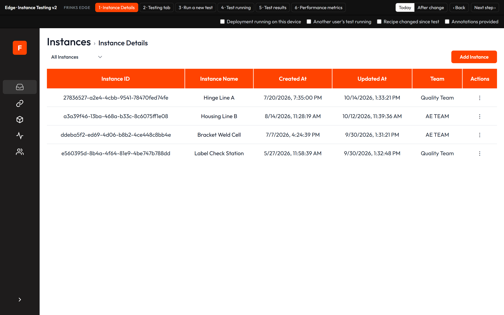
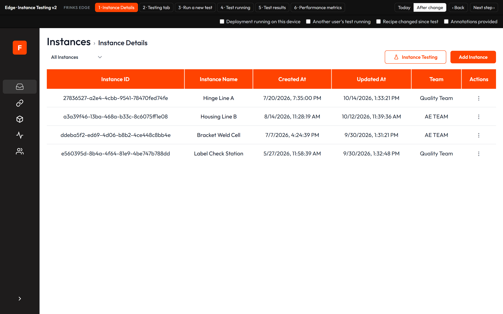

- **AC1.1** On Edge > Instances > Instance Details, an "Instance Testing" button sits at the top right, left of "Add Instance".
- **AC1.2** With one instance chosen in the instances dropdown, clicking Instance Testing opens that instance's Testing tab.
- **AC1.3** With "All Instances" chosen, clicking Instance Testing opens a short list titled "Which instance do you want to test?"; choosing an instance opens its Testing tab.
- **AC1.4** On the Testing tab and the results page, "Instance Details" in the breadcrumb leads back to the list.

### US2 — Last test banner
*As a plant admin, I want the Testing tab to show how the last test ended, so that I can open its results in one click.*
- **Kind:** Feature
- **Parts:** edge-instance-details
- **Teams:** SDE
- **Covers:** C3, C5
- **Today:** a "Test Parameters" card shows Test Status, Test Type and Success Rate as "N/A" always.
- **Prototype:** [edge-testing-tab](https://akshat-sharma-frinks.github.io/edge-instance-testing-v2-prototype/#edge-testing-tab)

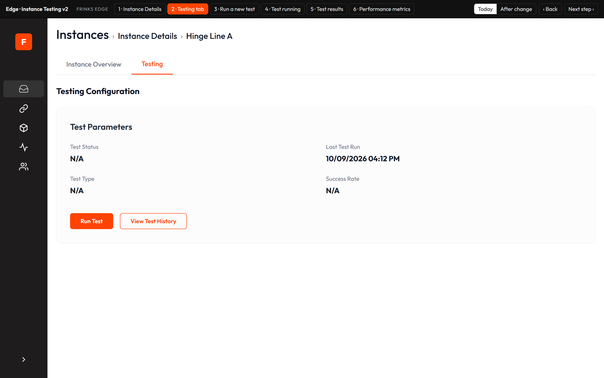
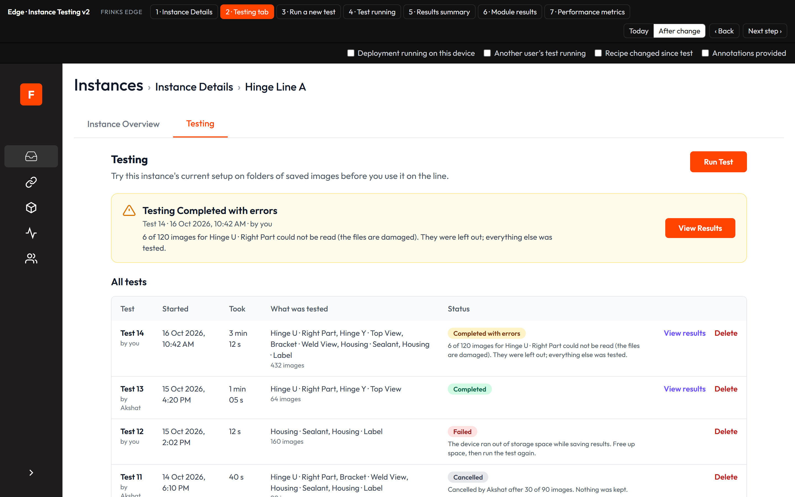

- **AC2.1** The tab opens with the title "Testing", the line "Try this instance's current setup on folders of saved images before you use it on the line." and the Run Test button; the "Test Parameters" card and its N/A values are gone.
- **AC2.2** With at least one finished test, a banner for the most recent finished test shows "Testing Completed", "Testing Completed with errors", "Testing Failed" or "Testing Cancelled", the line "Test <n> · <date and time> · by <name>", and the reason when there is one.
- **AC2.3** The banner has a "View Results" button for Completed and Completed with errors tests, and shows nothing else about the test; its images, OK/NG and timings are on the results Summary (US8).
- **AC2.4** With no tests, the tab shows "No tests yet", the line "Run a test to check this instance's setup on saved images before using it on the line. Tests don't affect the line." The only way to start a test is the Run Test button at the top; there is no second button in the middle of the tab.

### US3 — Test history, statuses and delete
*As a plant admin, I want every test listed with a plain status and reason, so that I can find results and understand failures.*
- **Kind:** Feature
- **Parts:** edge-instance-details
- **Teams:** SDE
- **Covers:** C3, C5, C12
- **Today:** the history list exists but can't be opened; it shows "Errored" for every test that isn't Completed, including running ones.
- **Prototype:** [edge-testing-tab](https://akshat-sharma-frinks.github.io/edge-instance-testing-v2-prototype/#edge-testing-tab)

- **AC3.1** Under the last test banner, an "All tests" table is always shown (no View Test History button), newest first, with columns Test (with "by <name>"), Started, Took, What was tested (captures and image count), Status, and an action.
- **AC3.2** A test's status is exactly one of Running (with %), Completed, Completed with errors, Failed, Cancelled.
- **AC3.3** Completed with errors, Failed and Cancelled always show a one-line reason under the status, e.g. "6 of 120 images for Hinge U · Right Part could not be read (the files are damaged). They were left out; everything else was tested." or "The device ran out of storage space while saving results. Free up space, then run the test again."
- **AC3.4** Completed and Completed with errors tests show "View results"; Failed and Cancelled tests don't.
- **AC3.5** Every finished test shows "Delete". Clicking it asks "Delete Test <n>? Its images and results are removed from this device. This can't be undone." with Keep test / Delete test.
- **AC3.6** Delete test removes the test's images and results from the device's disk and its row from the history; the banner then shows the next most recent test, or "No tests yet".
- **AC3.7** A running test has no Delete action.

### US4 — When Run Test is blocked
*As an operator, I want Run Test to say why it can't be used, so that I don't disturb the line or someone else's test.*
- **Kind:** Feature
- **Parts:** edge-instance-details, edge-deployment
- **Teams:** SDE
- **Covers:** C5, C8, C10
- **Today:** Run Test always works; starting a test while another runs silently ends the first one, and nothing checks for a running deployment.

- **AC4.1** While any deployment runs on this Edge device, Run Test is disabled and the reason line under it shows "A deployment is running on this device. Stop it to run a test."
- **AC4.2** While any test runs on this Edge device (any instance), Run Test is disabled on every instance's Testing tab and the reason line under it shows "Test running (by <name>) — <n>%. Only one test can run on a device at a time." ("Your test is running — <n>%." when it is yours).
- **AC4.3** A test start that reaches Edge while a deployment or another test runs on the device is refused with the matching message from AC4.1 or AC4.2, and the running deployment or test carries on unaffected.
- **AC4.4** While a test or deployment runs, the history, the last test banner and every results page stay usable.

### US5 — Run drawer: instructions and pre-checks
*As an operator, I want each capture checked before the test starts, so that I don't waste a run.*
- **Kind:** Feature
- **Parts:** edge-instance-details, mod-bead-inspection, edge-health
- **Teams:** SDE
- **Covers:** C4, C5, C11
- **Today:** the drawer shows a long paragraph of instructions; nothing is checked; uploading shows a full-screen loader.
- **Prototype:** [edge-run-test](https://akshat-sharma-frinks.github.io/edge-instance-testing-v2-prototype/#edge-run-test)

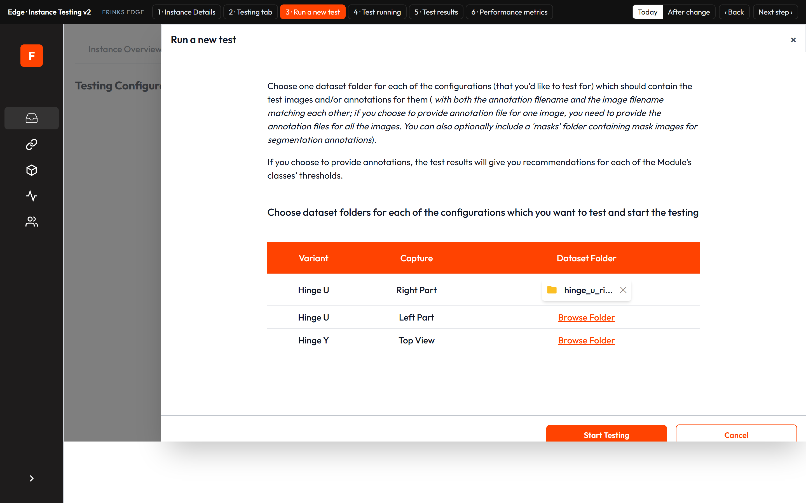
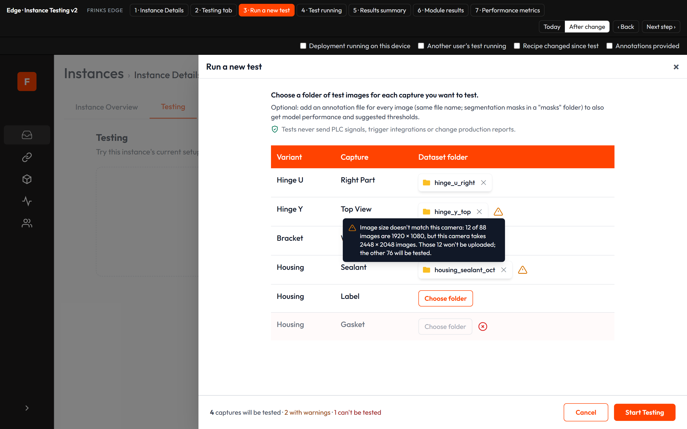

- **AC5.1** Above the Variant | Capture | Dataset folder table, the drawer shows only: "Choose a folder of test images for each capture you want to test.", "Optional: add an annotation file for every image (same file name; segmentation masks in a "masks" folder) to also get model performance and suggested thresholds." and "Tests never send PLC signals, trigger integrations or change production reports."
- **AC5.2** A capture whose bead inspection isn't fully set up in Edit Module Configurations has a disabled Choose folder button with an error icon beside it; the icon's message is "Can't be tested: bead inspection isn't set up for this capture yet (bead width and gap rules are missing)." with an "Open Edit Module Configurations" link.
- **AC5.3** A row's errors and warnings aren't written out under it: one icon beside its folder (red for an error, amber for warnings) shows all of them when hovered or focused. After a folder is chosen, the row shows only the folder name with ✕ to remove it, and no image count line.
- **AC5.4** When some chosen images' size differs from the camera's image size, the row warns with the counts and both sizes, e.g. "Image size doesn't match this camera: 12 of 88 images are 1920 × 1080, but this camera takes 2448 × 2048 images. Those 12 won't be uploaded; the other 76 will be tested."
- **AC5.5** On Start Testing, images whose size differs from the camera's aren't uploaded and the rest of the folder is; the upload count and the test's image counts leave them out.
- **AC5.6** When the chosen images need more space than the device has free, the row warns with both figures in GB, e.g. "Not enough free space on the device: these images need about 2.4 GB and only 1.1 GB is free. Free up space or choose fewer images."
- **AC5.7** A capture with no folder and nothing to report shows only its "Choose folder" button.
- **AC5.8** The footer shows "<n> captures will be tested · <n> with warnings · <n> can't be tested"; Start Testing is disabled with "Choose at least one folder to start." until a folder is chosen.
- **AC5.9** If testing becomes blocked while the drawer is open (US4), Start Testing is disabled with "Testing is blocked on this device right now. The Testing tab shows why."
- **AC5.10** After Start Testing, the footer shows "Uploading images for <Variant · Capture> — <x> of <y>" with a bar; when the upload ends the drawer closes and the running test shows on the tab. No full-screen loader is shown.

### US6 — Follow and cancel a running test
*As an operator, I want to see a running test's progress on the tab and cancel it, so that I can keep using Edge.*
- **Kind:** Feature
- **Parts:** edge-instance-details, engine-workflow
- **Teams:** SDE + AI
- **Stakeholders:** see Q2
- **Covers:** C3, C5, C8
- **Today:** a full-screen percentage loader blocks Edge; a test can't be cancelled; a test that stops responding is marked Errored with no reason.
- **Prototype:** [edge-test-running](https://akshat-sharma-frinks.github.io/edge-instance-testing-v2-prototype/#edge-test-running)

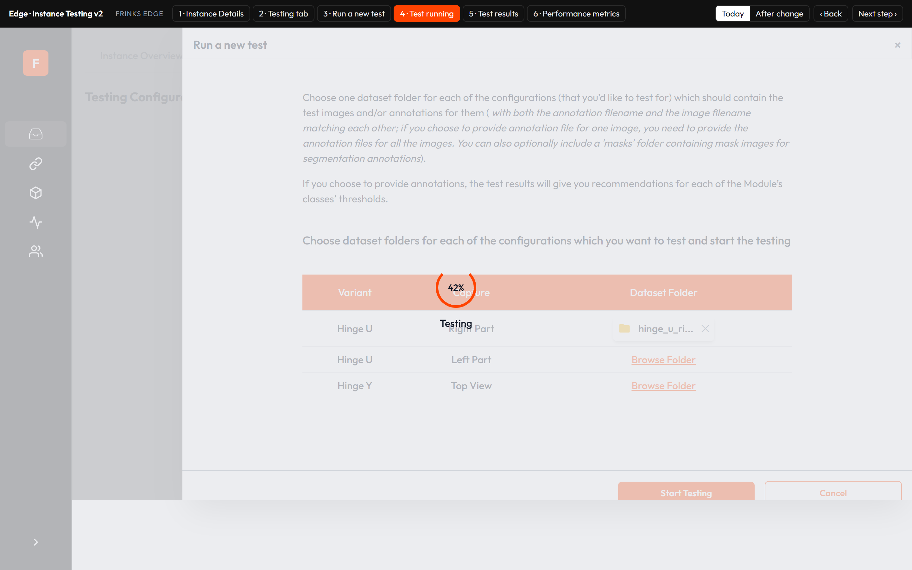
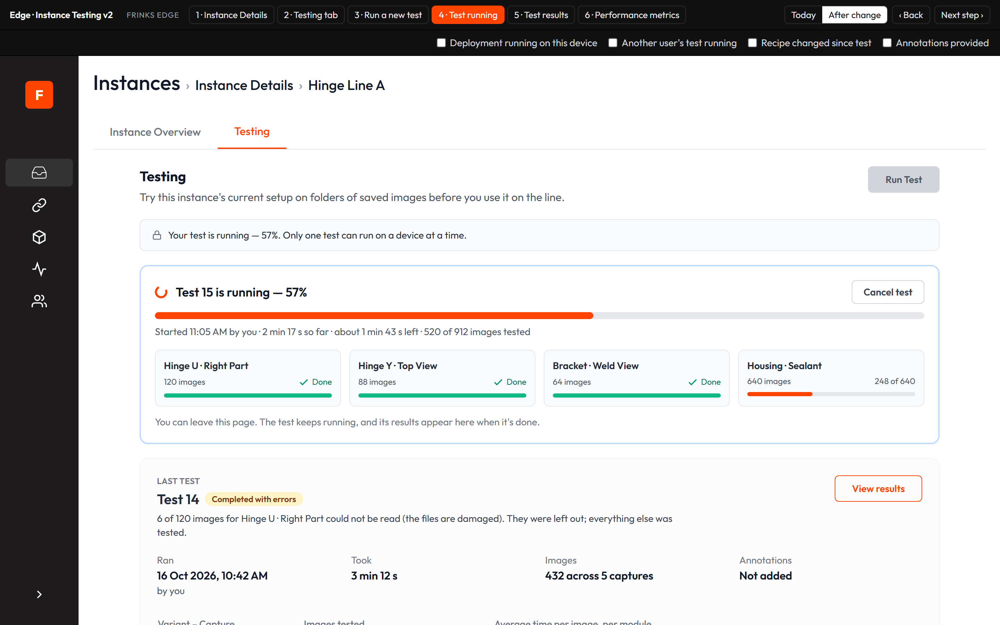

- **AC6.1** While a test runs, the Testing tab shows "Test <n> is running — <n>%" (with "(by <name>)" when someone else started it), a progress bar, start time and who started it, time so far, estimated time left, images tested of total, and one tile per capture (Done / <x> of <y> / Waiting).
- **AC6.2** The tab says "You can leave this page. The test keeps running, and its results appear here when it's done."; leaving and coming back shows the same progress.
- **AC6.3** Anyone with the testing permission sees "Cancel test", whoever started the test. It asks "Cancel Test <n>? The images tested so far won't be kept. You can run the test again later." with Keep running / Cancel test.
- **AC6.4** Cancel test stops the testing program, keeps no results, and the test shows Cancelled with "Cancelled by <name> after <x> of <y> images. Nothing was kept."
- **AC6.5** When a test finishes or is cancelled, the progress card goes away; no separate card is left behind.
- **AC6.6** A test that stops unexpectedly (the testing program stops, or Edge restarts) ends as Failed with "The test stopped unexpectedly. Run it again.", and the device is no longer blocked for tests or deployments.

### US7 — No deployment while a test runs
*As a plant admin, I want Edge to refuse to start a deployment while a test runs on the device, so that a test is never cut off midway.*
- **Kind:** Feature
- **Parts:** edge-deployment
- **Teams:** SDE
- **Covers:** C8, C10
- **Today:** a deployment is refused only when a test runs for the same instance, with "Model testing is still running."

- **AC7.1** While a test runs on the device, starting a deployment of any instance (from Deployments or the API) is refused with "A test is already running on this device. Wait for it to finish or cancel it, then start the deployment.", and the test carries on unaffected.

### US8 — Results page
*As a plant admin, I want test results on their own page with a clear way back, so that I don't get lost.*
- **Kind:** Feature
- **Parts:** edge-instance-details, edge-emc, engine-workflow
- **Teams:** SDE + AI
- **Stakeholders:** see Q2
- **Covers:** C3, C11
- **Today:** results open on a separate page reached only through the hidden history, with a breadcrumb that doesn't lead back to the Testing tab.
- **Prototype:** [edge-test-results](https://akshat-sharma-frinks.github.io/edge-instance-testing-v2-prototype/#edge-test-results)

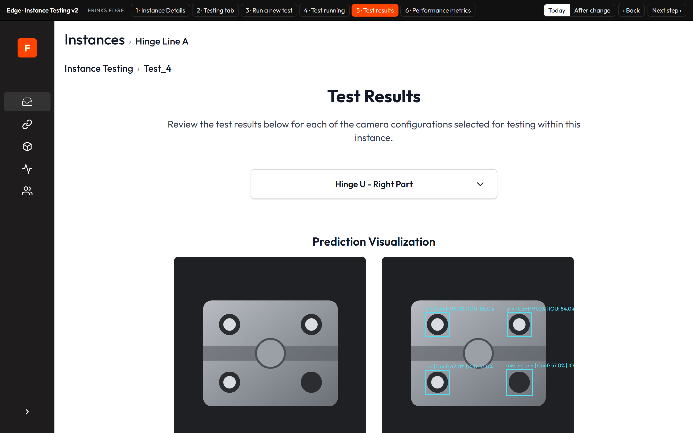
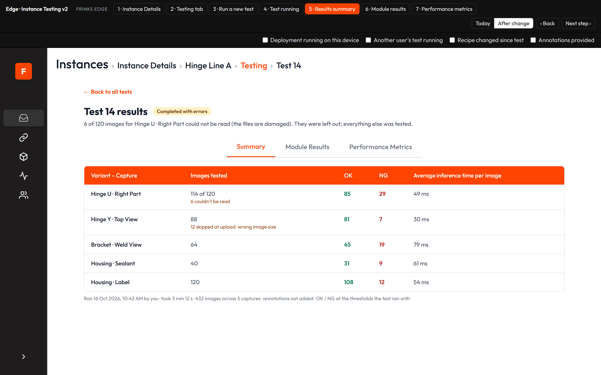

- **AC8.1** View results opens a page with the breadcrumb Instances › Instance Details › <instance> › Testing › Test <n>, where Testing leads back to the tab, and a "← Back to all tests" link.
- **AC8.2** The page header shows "Test <n> results", the status and the reason.
- **AC8.3** Three centred tabs sit under the header: Summary (open by default), Module Results and Performance Metrics.
- **AC8.4** Results are drawn and judged with the settings snapshot saved when the test started, not the current settings.
- **AC8.5** When the recipe, ground truths, thresholds or Analysed Image Configuration have changed since the test, the page shows "These results use the settings from when the test ran. Settings have changed since — run a new test to see the effect." with a "Run a new test" button.
- **AC8.6** The Summary tab has one row per Variant – Capture tested, in a table with orange column headers: Variant – Capture, Images tested, OK, NG, and Average inference time per image (in ms, for the whole capture, measured during the test).
- **AC8.7** Images tested shows e.g. "114 of 120", with small text under it for images left out: "6 couldn't be read" and "12 skipped at upload: wrong image size".
- **AC8.8** OK and NG count the capture's images by image result at the thresholds the test ran with; images that couldn't be read count in neither.
- **AC8.9** Under the table, small text shows "Ran <date> by <name> · took <time> · <n> images across <n> captures · annotations added/not added".

### US9 — Each image as the line would show it
*As an operator, I want each test image drawn and judged as the line would, so that I can trust the test.*
- **Kind:** Feature
- **Parts:** edge-instance-details, edge-inferencing-customization, engine-workflow, mod-shape-extractor, mod-odc, mod-classification, mod-segmentation, mod-ocr, mod-code-reader, mod-color-detection, mod-bead-inspection, mod-orientation
- **Teams:** SDE + AI
- **Stakeholders:** see Q2
- **Covers:** C9, C12, C14
- **Today:** a reference image and a visualization with generic boxes in random colours, one module at a time; Shape Extractor is not tested.
- **Prototype:** [edge-module-results](https://akshat-sharma-frinks.github.io/edge-instance-testing-v2-prototype/#edge-module-results)

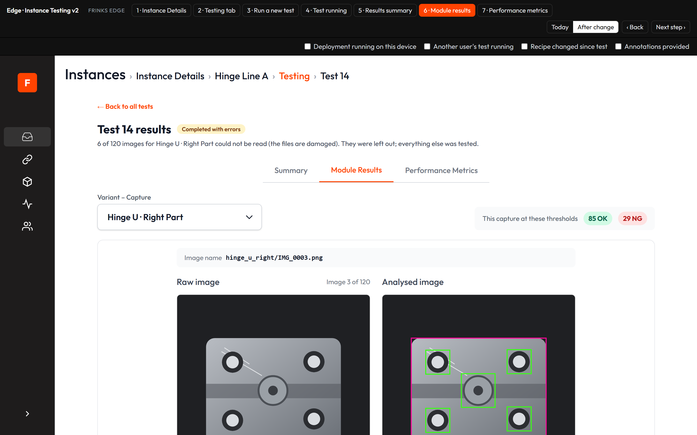

- **AC9.1** On the Module Results tab, a Variant – Capture selector picks the capture; beside it "This capture at these thresholds" shows its OK and NG image counts.
- **AC9.2** Above the images, the image's file name is shown as in the chosen folder, e.g. bracket_weld/IMG_0003.png.
- **AC9.3** The raw image and the analysed image sit side by side, with "Image <i> of <n>" and a pager (first, previous, five numbers, next, last); the left and right arrow keys also move between images.
- **AC9.4** The analysed image shows every module of the capture's recipe at once, each drawn the way the line draws it: detection boxes, classification box on its search area, segmentation outlines, OCR line outlines, code reader box, colour region box, dimension lines and arcs, tilt reference and measured line, bead edges with the reference path and a box per failing caliper.
- **AC9.5** Each item is drawn in its module's Pass or Fail colour from Analysed Image Configuration, by its OK/NG; items with Show off aren't drawn; Shape Extractor shapes and dimensions use green/red as on the line. No PASS/FAIL text is drawn.
- **AC9.6** No labels or values are written on the image; hovering an item shows its label, confidence or value and OK/NG, e.g. "pin · confidence 95% · OK" or "Edge angle: 88.8° · set 89–91° · NG".
- **AC9.7** Shape Extractor runs in tests; with no dimensions set its shapes are drawn and "Shape Extractor: no dimensions configured, showing shapes only." shows under the image.
- **AC9.8** For a camera with no pixel-to-mm value, lengths show in px and "This camera isn't calibrated, so lengths are in pixels (px), not millimetres. Set its "Pixel to mm" value in Dimension Configuration to see millimetres." shows under the image; px values are never labelled mm.
- **AC9.9** An image that couldn't be read shows "This image couldn't be read — The file may be damaged. It was left out of the results." in both panes and counts in neither OK nor NG.

### US10 — Try thresholds and see why an image is OK or NG
*As a plant admin, I want to try thresholds per class and see each module's result, so that I can choose good values.*
- **Kind:** Feature
- **Parts:** edge-instance-details, edge-emc, mod-result
- **Teams:** SDE
- **Covers:** C9, C11
- **Today:** one Confidence and one IOU slider per module, redrawing generic boxes; no OK/NG anywhere.

- **AC10.1** Below the Module Results table, a Thresholds panel with a Module dropdown shows, in a table with orange column headers, one row per class with a Confidence slider and number (0.00–1.00), an IOU slider and number only for detection and segmentation, and "In EMC now".
- **AC10.2** Changing a value immediately redraws the analysed image, the Module Results and the capture's OK/NG counts; confidence hides items below it; IOU merges overlapping items of the same class.
- **AC10.3** A module with no model thresholds (colour, shape, bead, code reader, tilt) shows "<Module> (<type>) has no model thresholds to adjust. Its settings are in Edit Module Configurations."
- **AC10.4** "Reset to EMC values" puts back the EMC values; the panel says "<n> values differ from EMC." or "Same as EMC."; nothing is saved without Apply.
- **AC10.5** Directly under the images, a Module Results table for the current image, with orange column headers, lists every module with Module (and type), Ground truth (EMC), Found in this image, and Result (OK / NG / Not judged), with the Image result (OK/NG) at the top. Example: Weld check, ground truth "weld 1 · spatter 0 · porosity 0", found "weld 1 · spatter 2 · porosity 1" → NG.
- **AC10.6** The image is NG when any judged module is NG; a module with no ground truth shows "Not judged" and doesn't count, with the note "Not judged: the module has no ground truth set, so it doesn't count towards the image result."

### US11 — Apply thresholds to Edit Module Configurations
*As a plant admin, I want to save chosen thresholds to EMC deliberately, so that the line uses them.*
- **Kind:** Feature
- **Parts:** edge-emc, edge-instance-details
- **Teams:** SDE
- **Covers:** C2, C10, C11
- **Today:** Apply writes one value to every class of the model, also changes other instances that use it, skips a value of 0, and the popup says the running deployment will reload, which it doesn't.

- **AC11.1** "Apply thresholds to EMC" is disabled until a value differs from EMC.
- **AC11.2** Apply opens "Apply these thresholds to EMC?" listing each class as "EMC → new" for confidence (and IOU where it applies), with unchanged values marked "(no change)", and the line "Only <instance> changes; other instances that use this model keep their values."
- **AC11.3** On Apply, each class's values are saved to that module in Edit Module Configurations of this instance only; other classes and other instances keep theirs, and "In EMC now" updates.
- **AC11.4** A value of 0.00 is saved as 0.00.
- **AC11.5** While a deployment runs, the confirmation also says "A deployment is running on this device. It keeps using the old values until it restarts."; the only buttons are Cancel and Apply, and Apply doesn't restart the deployment.

### US12 — Performance Metrics tab
*As a plant admin, I want model performance on its own tab, so that I can see how accurate the model was and use the suggested thresholds.*
- **Kind:** Feature
- **Parts:** edge-instance-details, edge-emc
- **Teams:** SDE
- **Covers:** C5, C14
- **Today:** the Performance Metrics section was removed from results.
- **Prototype:** [edge-performance-metrics](https://akshat-sharma-frinks.github.io/edge-instance-testing-v2-prototype/#edge-performance-metrics)

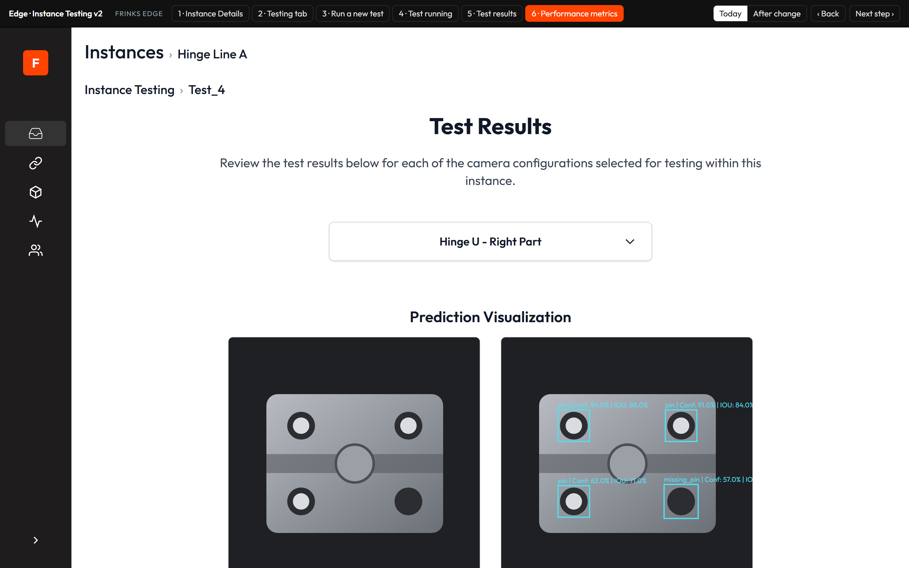
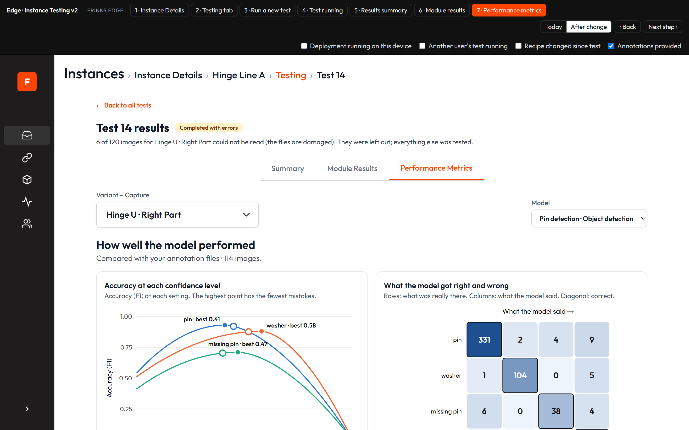

- **AC12.1** The tab has Variant – Capture and Model selectors (only modules that use a model) and the heading "How well the model performed" with "Compared with your annotation files · <n> images."
- **AC12.2** For a test without annotations it shows "No annotations in this test" and "Add an annotation file for each test image next time to see how often the model was right, what it mixed up, and suggested thresholds."
- **AC12.3** For a capture whose modules don't use a model it shows "This capture's modules don't use a model, so there's nothing to measure."
- **AC12.4** "Accuracy at each confidence level" plots accuracy (F1) against confidence, one line per class, with each class's best point and its current EMC value marked, and the line "Accuracy (F1) at each setting. The highest point has the fewest mistakes."
- **AC12.5** "What the model got right and wrong" shows the confusion matrix with "Rows: what was really there. Columns: what the model said. Diagonal: correct."; for text reading it shows "Not shown for text reading (no classes to mix up)."
- **AC12.6** "Suggested thresholds" lists, in a table with orange column headers, Model, Class, Suggested confidence, Suggested IOU (detection and segmentation only) and In EMC now.
- **AC12.7** "Apply suggested thresholds to EMC" opens the confirmation of AC11.2 titled "Apply suggested thresholds to EMC?" with EMC → suggested values, saves as in AC11.3 (so "In EMC now" updates), and leaves the slider values in the Thresholds panel as they were.

### US13 — Rules
*As an Org Admin, I want testing actions to follow Edge roles and be logged, so that only the right people change settings and every change can be traced.*
- **Kind:** Rules
- **Parts:** edge-access-audit
- **Teams:** SDE
- **Covers:** C1, C16

- **AC13.1** No new role or permission is added. Running, cancelling and deleting a test need the existing testing permission (Instance Details view, "View instances and run a model test"); a user without it sees Run Test, Cancel and Delete disabled.
- **AC13.2** Applying thresholds or suggested thresholds needs the existing EMC update permission; without it, Apply is disabled with "You don't have permission to change Edit Module Configurations." and nothing is saved.
- **AC13.3** The audit log records test started, test cancelled, test deleted, and thresholds applied to EMC (with each class's old → new values), with the user and instance.

### US14 — Keeps working
*As an operator, I want the rest of testing and the line to behave as before, so that nothing I rely on breaks.*
- **Kind:** Keeps working
- **Parts:** edge-instance-details, edge-inferencing-customization, edge-deployment
- **Teams:** SDE
- **Covers:** C8, C12

- **AC14.1** Test folders are accepted as today: png images, a matching annotation file per image when any is given, and masks in a "masks" folder.
- **AC14.2** A test sends no PLC signals, runs no actions or integrations, and adds nothing to Reports, counts, shifts or the Live Dashboard.
- **AC14.3** A deployment's other start checks (screens, PLC mapping, bead setup, dimensions, disk space, model files) keep working as today.

### US15 — Platform
*As a Frinks support engineer, I want to know what ships where, so that releases install cleanly.*
- **Kind:** Platform
- **Parts:** engine-runtime-packaging, edge-health
- **Teams:** SDE + AI
- **Stakeholders:** see Q2
- **Covers:** C13, C17

- **AC15.1** Node Docker image: no change; the work is Edge backend and frontend code.
- **AC15.2** Python Docker image: the testing program's image changes (per-item results, inference time per capture, unreadable images, stop on cancel, Shape Extractor); the live inferencing image doesn't change.
- **AC15.3** Scripts bundle: changes, carrying the Edge backend and frontend code.
- **AC15.4** Installer: no change; no new software or drivers.
- **AC15.5** Error codes: no new codes; every message is plain text as listed in this PRD.

### US16 — Migration requirements
*As a Frinks support engineer, I want existing tests and devices to upgrade cleanly, so that history isn't lost.*
- **Kind:** Migration
- **Parts:** edge-backup-migration, edge-instance-details
- **Teams:** SDE
- **Covers:** C6, C7, C17

- **AC16.1** Existing data — tests already on the device: Completed becomes Completed; Errored becomes Failed with "Reason not recorded"; a test still marked running becomes Failed with "The test stopped unexpectedly. Run it again."; Run by shows "Unknown"; time per module shows "—".
- **AC16.2** Existing tests have no settings snapshot: their results open with the current settings and show no "settings changed" banner.
- **AC16.3** Older Edge with a new instance and older instance on the new Edge: no pairing change; testing works with any instance the Edge can deploy.
- **AC16.4** Upgrading an Edge box in the field keeps every existing test and its results; the upgrade needs no user action.

## 7. Out of scope
- Combined multi-capture part verdicts; frame-sequence / Tracker testing.
- Changing how the line draws or judges, or how F1, the confusion matrix and suggested thresholds are computed.
- Fixing the "deployment reloaded" message on Inferencing Customization (reported separately).
- Restarting a deployment from the test results page.

## 8. How we'll know it worked
| Measure | Target |
|---|---|
| Tests ending Failed for reasons a pre-check catches (bead not set up, disk full) | 0 in the first month after release |
| Field reports of a test ending another test or a deployment | 0 |
| Thresholds applied from tests that change another instance or another class | 0 |

## Appendix A — Coverage
**Not applicable:**
- **C15** — N/A: tests run on the Edge device only; no network, time-zone or offline behaviour changes.
- **C18** — N/A here: the release note is drafted with the tickets; no manual page exists for Instance Testing today.

**Coverage check:** the skill's coverage script on the final draft:

> # Coverage check — PRD-edge-instance-testing-v2.md
>
> **Result:** PASS
>
> - 16 user stories (12 feature, 1 rules, 1 keeps working, 1 platform, 1 migration), 87 ACs, 19 touched parts, 3 discussion points.
> - Checklist: 16 items covered by stories, 2 N/A, 0 open.

**Manual checks (26 Oct 2026):** every coverage-sheet item maps to exactly one AC (87 of 87); duplicate and contradiction pass applied (see Changelog); every goal is delivered (G1 US3, G2 US4/US7, G3 US9/US10, G4 US11, G5 US12); code back-check: every file the code check says will change belongs to a part in the impact map. The component map has no part for Instance Testing; it is filed under edge-instance-details until the next map refresh.

## Appendix B — Code references
For developers. From the 24 Oct 2026 sync.
- **Testing tab and results (frontend):** `frinksedge-deployment-frontend`: `src/modules/instance/components/individual-instance/index.jsx:338-398` — N/A values, commented View Test History; `instance-testing/AllTests.jsx:74-94` — history, "Errored" label, results keyed by end time; `instance-testing/steps/UploadImage.jsx:60-200` — upload batches and client checks; `instance-testing/steps/Results.jsx:3,113,156,225-268,588` — module types shown, single threshold per model, removed metrics; `instance-testing/steps/VisualizationImage.jsx:49-70` — random palette; `modules/instance/index.jsx:67-106` — instance list dropdown, Add Instance, breadcrumb; `instance.route.jsx:22-31` — routes.
- **Testing service (backend):** `frinksedge-deployment-backend`: `src/db/testingJob.schema.ts:51-65` — test table (no run-by, reason, counts, snapshot); `src/config/configuration.ts:25-30` — status codes; `src/service/testing.ts:45-306` — start (`docker-compose … down && up`), progress, heartbeat, completion; `src/service/testing.ts:190-243` — live config, no snapshot; `src/service/testing.ts:328-488,564-696` — results and metrics files; `src/routes/testing.ts:8-28` — routes, no cancel; `src/config/network.ts:48-50` — in-memory test state; `src/controller/cameraConfig.ts:48-53`, `src/service/cameraConfig.ts:278-340` — upload and wipe; `docker-files/docker-compose.testing.yaml:4-29` — testing program image.
- **Shape Extractor in tests:** `frinksedge-deployment-backend`: `src/service/pythonModel.ts:391,932-933` — left out of the test recipe; `src/service/pythonModel.ts:281-389` — Analysed Image Configuration and result module sent to tests.
- **Thresholds:** `frinksedge-deployment-backend`: `src/dao/threshold.ts:17-27,71-93` — instance ignored, 0 skipped, one value per model; `src/db/threshold.schema.ts:27-45` — table; `src/service/threshold.ts:19-24` — no reload.
- **Deployments:** `frinksedge-deployment-backend`: `src/service/deployment.ts:795-977` — start checks, test check only per instance at `:851-864`; `src/error.ts:1-24`, `src/controller/base.ts:66-74` — error format.
- **Pre-check data:** `frinksedge-deployment-backend`: `src/dao/beadInspectionConfig.ts:76-91`; `src/failure/modelFilesCheck.ts:9-56`; `src/service/deployment.ts:260-288`; `src/db/captureLayout.schema.ts:13-36`; `src/db/cameraConfig.schema.ts:61-62`; `src/db/storageUsage.schema.ts:9-19`, `src/utils/storage.ts:38,149`; `frinksedge-health`: `src/service/storageMonitor.ts:757-805`.
- **Analysed Image Configuration:** `frinksedge-deployment-backend`: `src/db/moduleClassRoiConfig.schema.ts:13-39`.
- **Permissions:** `frinksedge-deployment-backend`: `src/rbac/catalogue.ts:66-75,112-121,138-146,248-275`; `src/routes/testing.ts:18-28`.

Repos checked: frinksedge-deployment-frontend @ 3c02701 (2026-10-23), frinksedge-deployment-backend @ be6d0aa (2026-10-22), frinksedge-inferencing-backend @ 310c18e (2026-10-22), frinksedge-health @ 2dbc622 (2026-10-23), vip-inference-python @ 93451d1 (2026-10-15), Python-inference-docker @ 62e22bd (2026-05-29), and the other 28 repos in the skill's list at their latest default-branch commit on 24 Oct 2026. The testing program's own source was not found (Q1).

## Changelog
- 26 Oct 2026 — Owner review 2: the Testing tab shows only a "Testing Completed" banner with View Results (US2); results get three tabs with a per-capture Summary (images tested, OK, NG, average inference time per capture) replacing per-module times (AC8.2, AC8.3, AC8.6–AC8.9); Module Results sits above Thresholds and results tables use orange headers (AC9.1, AC10.1, AC10.5, AC12.6); Run drawer errors and warnings move behind a hover icon, the image count line is dropped, and wrong-size images are skipped at upload (AC5.2–AC5.5) (Akshat Sharma)
- 26 Oct 2026 — Owner review: Run drawer no longer checks for missing model files, Shape Extractor without dimensions, or folders over 500 images (old AC5.3, AC5.4, AC5.7 removed; US5 renumbered AC5.1–AC5.9); the empty Testing tab has no centred Run a new test button (AC2.5) (Akshat Sharma)
- 24 Oct 2026 — Draft started (Akshat Sharma)
- 26 Oct 2026 — Prototype hosted on GitHub Pages; Prototype lines on US1–US6, US8, US9, US12 linked (Akshat Sharma)
- 26 Oct 2026 — Duplicate pass: AC6.5 trimmed (outcome placement lives in AC2.2, AC3.1); AC13.1 trimmed (cancel scope lives in AC6.3); AC4.1, AC4.2 name the reason line under Run Test; AC12.7 states In EMC now updates and sliders stay (Akshat Sharma)
- 26 Oct 2026 — US1–US16 written from the agreed v2 design, the code check and the owner's decisions: anyone with the testing permission can cancel (AC6.3); thresholds apply to this instance only (AC11.3); tests can be deleted (AC3.5–AC3.7); OK/NG worked out by Edge from saved items (AC10.2) (Akshat Sharma)

## Checked, not affected
- vision-access, vision-auto-annotation, vision-captures-cameras, vision-datasets-annotations, vision-instance-creation, vision-model-evaluation, vision-model-training, vision-projects, vision-recipe-tree, vision-training-sets-recommender, vision-variants: no Vision change; tests run on Edge with the instance as uploaded.
- edge-plc-read, edge-plc-setup, edge-plc-write, edge-actions, edge-internal-actions: the testing program never talks to PLC or actions; this stays as it is (AC14.2).
- edge-live-dashboard, edge-dashboard-builder, edge-reports-analytics, edge-storage-image-saving: tests write nothing to dashboards, reports or the line's image store (AC14.2).
- edge-camera-capture, edge-model-loading-variant-change, edge-networking, edge-system-time: tests use saved images, not cameras, and don't load models into the line.
- edge-installer, edge-release-upgrade, edge-encryption-keys: no new software, release flow or licence change (US15).
- mod-input-master-image, mod-masking, mod-matting, mod-search-area, mod-tracker: run in tests as today; nothing new drawn or judged for them beyond their place in the recipe.
