# PRD: Image Storage

**Prototype:** [Interactive workflow, Today vs After change](https://frinks-ai.github.io/frinks-PRDs/2026-10-26-image-storage/prototype/)
**Product:** Frinks Edge
**Status:** Draft
**Date:** 28 October 2026
**Owner:** Akshat Sharma
**Related:** File Names (separate PRD, pending); PRDs Captures with no inspection modules (FP-3912), Image Enhancement module (FP-3823), Module Outputs in Reports & Analytics (FP-3949)
**Code checked:** 28 Oct 2026 — 35 repos at their latest default-branch commit (list in Appendix B)

---

## Discussion points
Everything still to be settled, at the top so it gets addressed first.

| # | Point to settle | Options on the table | Owner | Needed by |
|---|---|---|---|---|
| Q2 | **What number names a Cycle ID folder.** A plant admin adds Cycle ID to the tree. The agreed name was "<cycle number as in Reports>_<cycle id>", and Reports stays as it is (only S. No.). But S. No. in Reports is only the row's position in the table on screen: the newest cycle is S. No. 1 today and S. No. 51 after 50 more cycles, and the Excel export numbers its rows again. A folder named with S. No. would stop matching Reports. The cycle id (the number in View JSON) never changes. | a) Folder = cycle id only; b) Edge keeps a stored cycle number per instance (1, 2, 3…, never resets) and names the folder "<cycle number>_<cycle id>"; c) S. No. becomes a stored number | Akshat Sharma | Before development starts |

## 1. Summary
- Inferencing Customization gets an **Image Storage** page in place of File Paths. It decides, per instance, which folders saved analysed and raw images go into.
- The page shows one folder tree under "Frinks Edge saved results". A plant admin builds it from Instance, Variant, Capture, Search area, Day, Hour and Cycle ID.
- **Add folder level** picks a level; **Insert here** then shows every place it may go.
- One **Raw images** folder sits in the same tree and can be moved up. Pass and Fail folders sit at the bottom of the analysed branch and inside the Raw images folder. They are on by default and can be removed and added back.
- Folder names are made by Edge: product folders are "<name>_<id>", Day is a date, and Pass, Fail and raw are fixed names.
- When the tree changes, new images go into the folders that already exist down to the first changed level. Old images stay where they are, and Reports keeps opening them.
- The page cannot be changed while that instance is deployed.
- When Frinks Vision renames an instance, variant, capture or search area and the instance is updated on Edge, Edge renames the matching folders. Reports keeps opening every old image.

## 2. Why we are making this
- **Today:** File Paths offers only "Pass/Fail Images in Separate Folders" or "Overall Folder (All Images Together)". Every instance gets the same fixed folder layout, which includes the project. Teams that look for images by day, recipe, camera or part cannot organise them that way. The page's path preview also does not match the folders Edge really writes. Plant admins and integrators who set up instances are affected, and so are engineers who pull images from the box.
- **Evidence:** plants ask to organise saved images their own way. A competitive comparison showed that competing systems need spreadsheet formulas or scripts for any folder structure beyond one typed path.
- **After:** a plant admin builds the folder layout visually, per instance, without code. Edge keeps old images, Reports and cleanup working through every change.

## 3. Goals and non-goals
**Goals**
- G1. A plant admin can choose, per instance, the folder levels saved images are organised by.
- G2. Raw images and Pass / Fail sorting are part of the same tree and match today's defaults.
- G3. Changing the tree never moves old images and never breaks Reports or cleanup.
- G4. Names changed in Frinks Vision show in the folder names after the instance is updated, and old images keep opening.

**Non-goals**
- Choosing which images are saved, their resolution or quality (stays on Image Saving Configurations).
- File name parts (separate File Names PRD).
- Changing where "Frinks Edge saved results" is on the disk.

## 4. Key concepts
- **Folder tree:** the ordered list of folder levels on the Image Storage page. Each image is saved in the folder path the tree gives for it.
- **Level:** one kind of folder in the tree (Instance, Variant, Capture, Search area, Day, Hour, Cycle ID). Each level creates one folder per value, for example one folder per variant.
- **Lowest product level:** the lowest of Instance, Variant, Capture and Search area in the tree. It decides which result splits Pass and Fail.
- **Capture:** a camera configuration (a capture row on Recipe Management), as in today's folders.
- **Placing:** the state after a level is picked in Add folder level, while the Insert here slots are shown.

## 5. Impact map
The parts this changes. Parts checked and not affected are listed at the very end.

| Part | What will happen | User stories |
|---|---|---|
| Image saving and storage (edge-storage-image-saving) | The folder tree replaces the Pass/Fail vs Overall choice and decides every saved image's folder | US1, US2, US3, US4, US5, US6, US7, US8, US12, US14 |
| Inferencing Customization (edge-inferencing-customization) | Image Storage replaces File Paths in the section list; every cycle has its number before its first image is saved | US1, US7, US9 |
| Python engine core (engine-workflow) | The engine saves each image into the folder the tree gives for it | US6, US7 |
| Search Area Allocator (mod-search-area) | Every saved area, including the master image area, masks, orientator and enhanced areas, gets a Search area folder | US6 |
| Result module (mod-result) | Search-area result and capture result decide the Pass and Fail folders; the verdict itself is unchanged | US5, US12 |
| Master image (mod-input-master-image) | The Input Image area's result decides raw Pass and Fail, as it decides raw saving today | US5 |
| Health Monitoring (edge-health) | Storage cleanup keeps measuring and deleting raw and analysed images in any tree, files only | US12 |
| Reports and Analytics (edge-reports-analytics) | Opens every image by the path stored when it was saved; stored paths follow folder renames | US8, US10, US12 |
| Live Dashboard (edge-live-dashboard) | Keeps showing the latest analysed images | US12 |
| Instance Details (edge-instance-details) | The instance update renames folders after a Vision rename; new instances get the default tree | US1, US10 |
| Deployments (edge-deployment) | Image Storage is read-only while its instance is deployed; the tree reaches the line at the next deployment | US7, US9 |
| Cameras and triggers (edge-camera-capture) | Each frame carries its cycle's number to the engine, so a Cycle ID folder exists before the first image is saved | US7 |
| Action catalog (edge-actions) | The Trigger Image and Cycle Start actions start the cycle and hand its number to the camera side | US7 |
| Edge roles and audit (edge-access-audit) | Same permission as today; a new audit entry records the old and new tree | US11 |
| Backup and migration (edge-backup-migration) | Existing instances get a tree on upgrade; backups keep the folders | US12, US14 |
| Release and upgrades (edge-release-upgrade) | Ships in the scripts bundle; release note and manual change | US13 |

## 6. User stories and acceptance criteria

### US1 — Open Image Storage and see the instance's folder tree
*As a plant admin, I want to see an instance's folder tree on one page, so that I know where its saved images go.*
- **Kind:** Feature
- **Parts:** edge-inferencing-customization, edge-storage-image-saving, edge-instance-details
- **Teams:** SDE
- **Covers:** C2, C5
- **Today:** Inferencing Customization > File Paths shows two radio buttons and a read-only path preview that does not match the real folders.
- **Prototype:** [Image Storage page](https://frinks-ai.github.io/frinks-PRDs/2026-10-26-image-storage/prototype/#edge-image-storage)

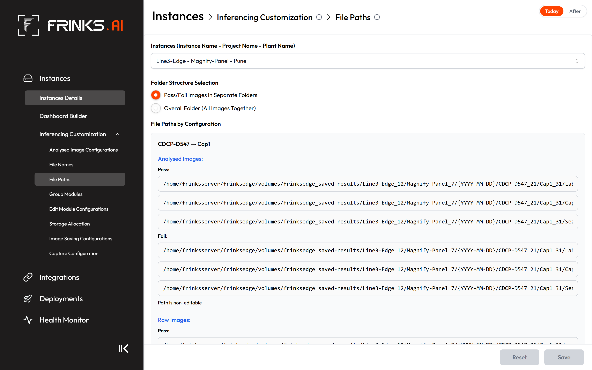
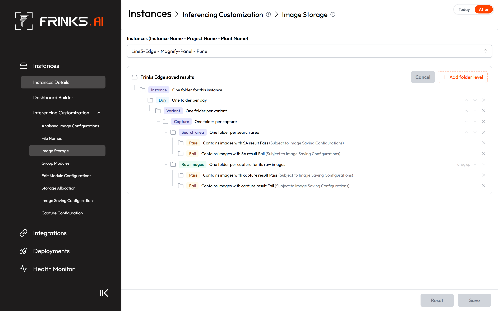

- **AC1.1** In the Inferencing Customization section list, "Image Storage" appears where "File Paths" is today, and "File Paths" is no longer listed.
- **AC1.2** Image Storage has the same Instances selector as the other Inferencing Customization pages. Until an instance is picked, no tree is shown.
- **AC1.3** For the picked instance the page shows one folder tree. The first row is "Frinks Edge saved results", and it cannot be changed or removed.
- **AC1.4** Each level row shows a folder icon, the level name as a coloured chip and a plain description, for example "One folder per variant".
- **AC1.5** The tree box has **Cancel** and **Add folder level** at its top right. The page has the same Reset and Save footer as the other Inferencing Customization pages.
- **AC1.6** A new instance uploaded to Edge starts with the tree Instance › Day › Variant › Capture › Search area. Raw images sits under Capture, and Pass and Fail are on for both analysed and raw images.
- **AC1.7** The tree applies to every variant and capture of the instance. Each instance on the box has its own tree.

### US2 — Add a folder level
*As a plant admin, I want to pick a level and then choose where it goes, so that I place it exactly where I mean.*
- **Kind:** Feature
- **Parts:** edge-storage-image-saving
- **Teams:** SDE
- **Covers:** C4
- **Today:** levels cannot be added; there are only two fixed layouts.
- **Prototype:** [Add folder level](https://frinks-ai.github.io/frinks-PRDs/2026-10-26-image-storage/prototype/#edge-add-folder)

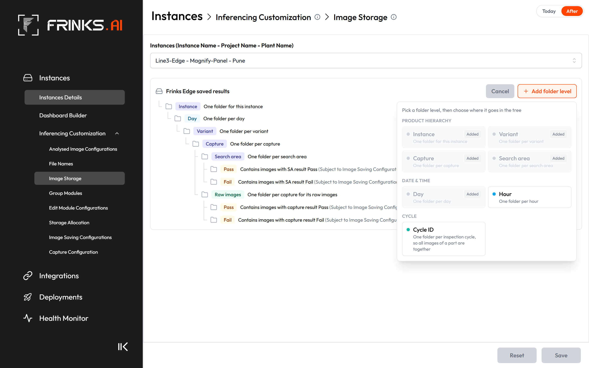
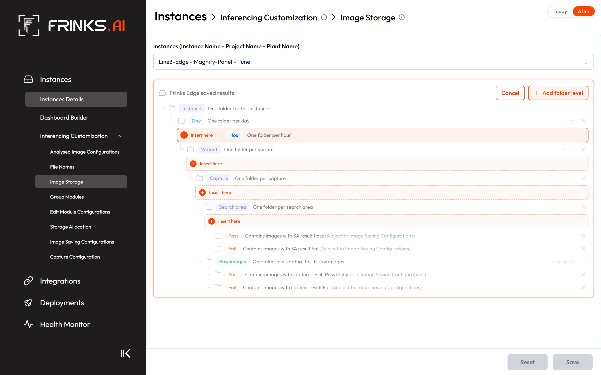

- **AC2.1** **Add folder level** opens a popup of tiles grouped under Product hierarchy (Instance, Variant, Capture, Search area), Date & time (Day, Hour) and Cycle (Cycle ID). Each tile shows the level name and a one-line description.
- **AC2.2** A level that is already in the tree is shown greyed with an "Added" tag and cannot be picked.
- **AC2.3** A level that is not yet in the tree is listed only when it fits somewhere in the current tree, by the placement rules (AC3.3–AC3.10).
- **AC2.4** Picking a tile does not change the tree. Instead, **Insert here** slots appear at every position where that level is allowed, and nowhere else.
- **AC2.5** Hovering an Insert here slot shows the picked level's chip and description in that position.
- **AC2.6** While a level is being placed, the tree box is highlighted, the other rows fade back, **Add folder level** is disabled and **Cancel** is enabled.
- **AC2.7** **Cancel** or the Esc key leaves the placing state without changing the tree. Cancel is disabled whenever no level is being placed.
- **AC2.8** Clicking an Insert here slot adds the level at that position, and the new row is briefly highlighted.

### US3 — Placement rules, moving and removing levels
*As a plant admin, I want Edge to allow only folder trees that make sense, and to let me reorder and remove levels within those rules, so that every image lands in a folder I can understand.*
- **Kind:** Feature
- **Parts:** edge-storage-image-saving
- **Teams:** SDE
- **Covers:** C4
- **Today:** levels cannot be moved or removed.
- **Prototype:** [Image Storage page](https://frinks-ai.github.io/frinks-PRDs/2026-10-26-image-storage/prototype/#edge-image-storage)

- **AC3.1** Each level row below Instance has up and down arrows. An arrow is disabled when that move breaks a placement rule (AC3.3–AC3.10).
- **AC3.2** Each level row below Instance has a remove (×) button. Levels that cannot exist without the removed level are removed with it (removing Capture removes Search area; removing Day removes Hour), and a message lists every level removed.
- **AC3.3** Instance is always the first folder under "Frinks Edge saved results". Its row has no arrows and no ×, and no level can be placed above it.
- **AC3.4** Variant, Capture and Search area always keep the order Variant › Capture › Search area. Any of them may be left out (for example Instance › Capture is allowed; Capture › Variant is not).
- **AC3.5** Search area can only be placed where Capture is somewhere above it (Instance › Variant › Capture › Day › Search area is allowed; Instance › Variant › Search area is not).
- **AC3.6** Hour can only be placed where Day is somewhere above it. Hour is not offered in Add folder level while the tree has no Day (Day › Variant › Hour is allowed; Hour alone or Hour › Day is not).
- **AC3.7** Day and Hour may sit above or below Variant, Capture and Search area, within AC3.6 (Instance › Variant › Day › Capture is allowed).
- **AC3.8** Cycle ID sits below Day and below Hour whenever they are in the tree (Day › Hour › Cycle ID is allowed; Cycle ID › Day is not).
- **AC3.9** Variant, Capture and Search area may sit above or below Cycle ID, within AC3.4 and AC3.5 (Instance › Cycle ID › Capture is allowed).
- **AC3.10** Each level appears at most once in the tree (a second Day is not allowed).

### US4 — Place the Raw images folder
*As a plant admin, I want raw images in their own folder inside the same tree, so that I choose how high up they are kept.*
- **Kind:** Feature
- **Parts:** edge-storage-image-saving
- **Teams:** SDE
- **Covers:** C2
- **Today:** raw images always go to a RAW folder inside each capture folder.
- **Prototype:** [Image Storage page](https://frinks-ai.github.io/frinks-PRDs/2026-10-26-image-storage/prototype/#edge-image-storage)

- **AC4.1** The tree has exactly one Raw images row.
- **AC4.2** The Raw images row is drawn last among its parent's folders, after the analysed branch, and a tree line joins it to its parent level.
- **AC4.3** Raw images can be moved up, by dragging or with its arrows, as high as directly under Instance. It can never sit above Instance, and it cannot be moved below the Search area level (Raw images under Variant is allowed; Raw images below Search area is not).
- **AC4.4** The Raw images row's description says what the folder holds and what it is not split by, for example "One folder per capture for its raw images".

### US5 — Split images into Pass and Fail folders
*As a plant admin, I want Pass and Fail folders at the bottom of the tree, so that rejects are kept apart.*
- **Kind:** Feature
- **Parts:** edge-storage-image-saving, mod-result, mod-input-master-image
- **Teams:** SDE + AI
- **Stakeholders:** To confirm (SDE and AI POC)
- **Covers:** C9, C12
- **Today:** analysed images go into pass or fail folders by their search-area result (or one overall folder); raw images go into OK or NG folders.
- **Prototype:** [Pass and Fail folders](https://frinks-ai.github.io/frinks-PRDs/2026-10-26-image-storage/prototype/#edge-pass-fail)

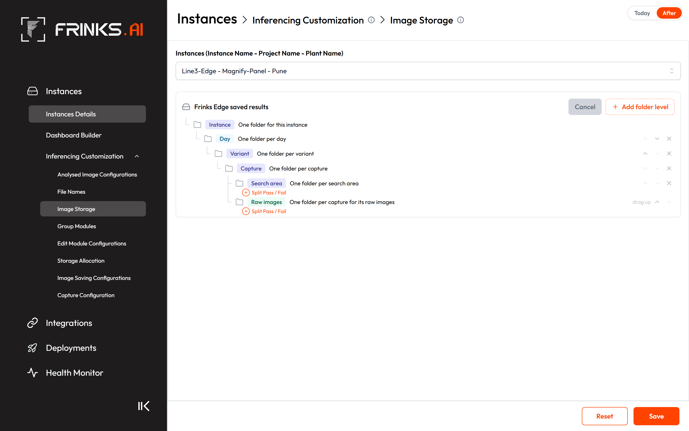

- **AC5.1** Pass and Fail are not offered in Add folder level. They are shown as two folder rows side by side, "Pass" and "Fail", at the bottom of the analysed branch and inside the Raw images folder.
- **AC5.2** Removing either Pass or Fail removes both, and a message says they can be added back.
- **AC5.3** After analysed Pass and Fail are removed, a **Split Pass / Fail** hint, styled like Insert here, appears on hover at the bottom level of the tree. Clicking it brings both folders back.
- **AC5.4** After raw Pass and Fail are removed, a **Split Pass / Fail** hint appears on hover just below the Raw images row. Clicking it brings both folders back.
- **AC5.5** When Search area is the lowest product level, analysed images go into Pass or Fail by their search-area result.
- **AC5.6** When Capture, Variant or Instance is the lowest product level, analysed images go into Pass or Fail by their capture result.
- **AC5.7** Raw images go into Pass or Fail by the same result that decides whether the raw image is saved: the Input Image area's result.
- **AC5.8** Each Pass and Fail row reads "Contains images with <result> <Pass|Fail> (Subject to Image Saving Configurations)", where <result> is "SA result" for analysed images split by search-area result (AC5.5) and "capture result" for the others, raw images included.
- **AC5.9** With Pass and Fail removed, images of both results are saved together in the folder above.

### US6 — Folder names made by Edge
*As an engineer, I want predictable folder names, so that I can tell which instance, variant, capture and search area a folder holds.*
- **Kind:** Feature
- **Parts:** edge-storage-image-saving, engine-workflow, mod-search-area
- **Teams:** SDE + AI
- **Stakeholders:** To confirm (SDE and AI POC)
- **Covers:** C4, C12
- **Today:** folders are "<name>_<id>" for instance, project, variant, capture and search area, plus a date folder and lower-case pass/fail/overall or RAW/OK|NG.
- **AC6.1** Instance, Variant, Capture and Search area folders are named "<name>_<id>", for example "CDCP-D547_12".
- **AC6.2** A Day folder is named with the date as YYYY-MM-DD, for example "2026-10-14".
- **AC6.3** An Hour folder under a Day folder is named with the hour as HH, for example "13".
- **AC6.4** (removed) — an Hour folder always has a Day folder above it (AC3.6).
- **AC6.5** A Cycle ID folder is named by the cycle number agreed in Q2.
- **AC6.6** Pass and Fail folders are named "Pass" and "Fail", for analysed and raw images alike.
- **AC6.7** The raw images folder is named "raw".
- **AC6.8** Every saved area gets a Search area folder named "<name>_<id>": search areas, masks, orientator areas, the master image area of captures with no inspection modules, and enhanced areas.
- **AC6.9** Folder names are never typed by the user.

### US7 — Images are saved into the tree
*As a plant admin, I want every new image saved where the tree says, so that the folders on disk match the page.*
- **Kind:** Feature
- **Parts:** edge-storage-image-saving, engine-workflow, edge-inferencing-customization, edge-deployment, edge-camera-capture, edge-actions
- **Teams:** SDE + AI
- **Stakeholders:** To confirm (SDE and AI POC)
- **Covers:** C2, C8, C10, C12
- **Today:** the engine always writes Instance / Project / Date / Variant / Capture / Search area / pass|fail, with raw in RAW/OK|NG.
- **Prototype:** [Folder added](https://frinks-ai.github.io/frinks-PRDs/2026-10-26-image-storage/prototype/#edge-folder-added)

- **AC7.1** Each analysed image is saved in the folder path the instance's tree gives for its instance, variant, capture, search area, date, hour, cycle and result.
- **AC7.2** Each raw image is saved in the folder path given by the levels above the Raw images folder, then "raw", then Pass or Fail when that split is on. Levels below the Raw images folder do not split raw images.
- **AC7.3** A folder is created only when the first image that belongs in it is saved. With "NG only" on Image Saving Configurations, no Pass folder is created.
- **AC7.4** A saved tree reaches the line at the next deployment of that instance.
- **AC7.5** Every cycle has its number from the moment it starts, before its first image is saved, so that image already goes into the cycle's Cycle ID folder.
- **AC7.6** A saved image's full path is stored completely for Reports, whatever the depth of the tree.
- **AC7.7** With Analysed Image on in Image Saving Configurations, the analysed image of every saved search area of the capture is saved, whatever levels the tree has. Leaving Search area out of the tree never stops search-area images being saved.
- **AC7.8** When the tree has no Search area level, all of a capture's search-area images are saved together in the lowest folder above them (for example the Capture folder), inside its Pass and Fail folders when that split is on.
- **AC7.9** Search-area images saved in the same folder never overwrite each other: each file name carries its search area (File Names PRD).

### US8 — Change the tree after images have been saved
*As a plant admin, I want to change the tree without losing or moving old images, so that I can improve the layout at any time.*
- **Kind:** Feature
- **Parts:** edge-storage-image-saving, edge-reports-analytics
- **Teams:** SDE
- **Covers:** C3, C12
- **Today:** switching between Pass/Fail and Overall changes the last folder for new images; old images stay.
- **Prototype:** [Save confirmation](https://frinks-ai.github.io/frinks-PRDs/2026-10-26-image-storage/prototype/#edge-save-confirm)

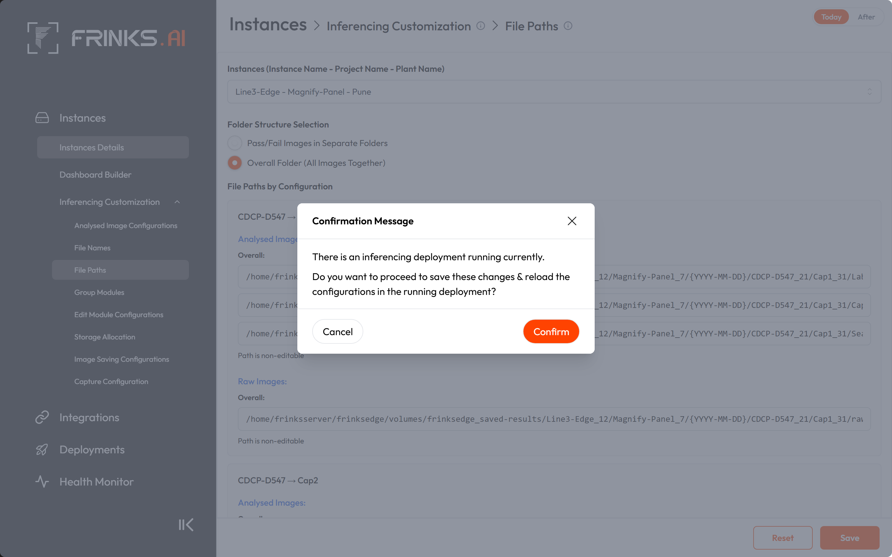
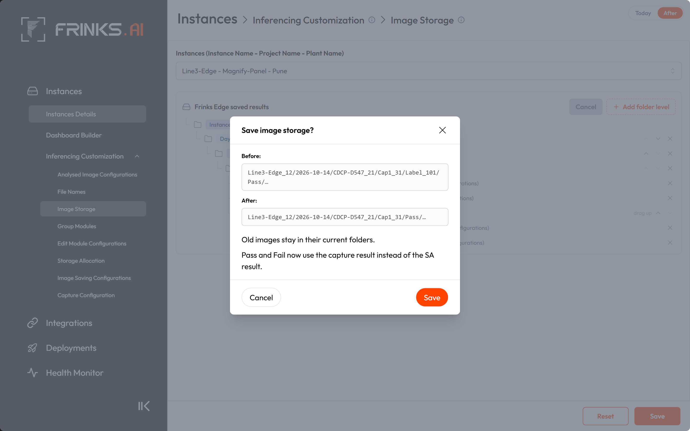

- **AC8.1** A tree change applies only to images saved after it. Old images are never moved or renamed because of it.
- **AC8.2** A new image is saved in an existing folder whenever its folder path already exists; only missing folders are created. So every folder above the first changed level is reused.
- **AC8.3** Removing the bottom level (for example Instance › Variant › Capture › Search area to Instance › Variant › Capture) saves new images in the existing Capture folder.
- **AC8.4** Adding a level at the bottom (for example … › Capture to … › Capture › Search area) creates the new folders inside the existing Capture folder.
- **AC8.5** Removing a middle level (for example Instance › Day › Variant › Capture to Instance › Variant › Capture) reuses the folders above it (Instance) and creates new Variant and Capture folders below that.
- **AC8.6** Moving Day above Variant (Instance › Variant › Day › Capture to Instance › Day › Variant › Capture) reuses the Instance folder and starts new Day folders under it.
- **AC8.7** Changing the tree back to an earlier layout saves new images in the original folders again.
- **AC8.8** Switching Pass and Fail on puts new Pass and Fail folders next to the old loose images. Switching them off saves new images loose, next to the old Pass and Fail folders.
- **AC8.9** After the Raw images folder is moved, new raw images go to a raw folder at the new position.
- **AC8.10** When the tree changed, Save first shows a confirmation with an example path before and after the change and the line "Old images stay in their current folders." The change is saved only on its Save button.
- **AC8.11** When the change switches the Pass and Fail basis (SA result to capture result, or capture result to SA result), the confirmation names the new basis in one line.
- **AC8.12** Reports opens every image through the path stored when it was saved, so images saved under any older tree keep opening.

### US9 — Image Storage is locked while its instance is deployed
*As a plant admin, I want the tree locked while the instance runs, so that one cycle's images never land in two layouts.*
- **Kind:** Feature
- **Parts:** edge-deployment, edge-inferencing-customization
- **Teams:** SDE
- **Covers:** C10
- **Today:** saving File Paths pushes the change into running containers; the only warning is a box-wide "deployment running" confirmation.
- **Prototype:** [Locked while deployed](https://frinks-ai.github.io/frinks-PRDs/2026-10-26-image-storage/prototype/#edge-deployed)

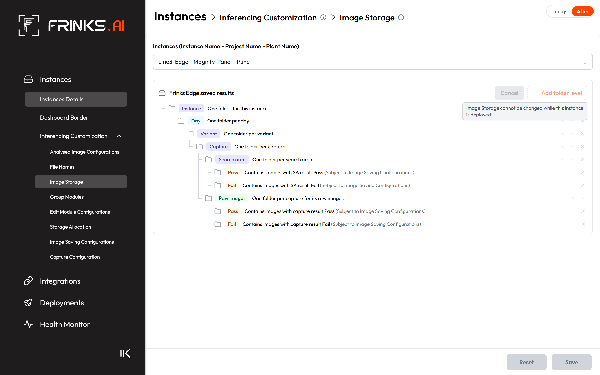

- **AC9.1** While the picked instance is deployed, the tree is read-only: Add folder level, Insert here, the arrows, × and Split Pass / Fail are disabled, and Save is not possible.
- **AC9.2** The page then shows "Image Storage cannot be changed while this instance is deployed." next to Add folder level, and the disabled controls are greyed out as on Capture Configuration.
- **AC9.3** While another instance on the box is deployed but the picked one is not, the picked instance's tree can be edited and saved.
- **AC9.4** A save sent to Edge for an instance that is deployed is refused, and the tree stays as it was.

### US10 — Folders follow renames from Frinks Vision
*As a plant admin, I want folder names to follow names changed in Vision, so that folders always show today's names.*
- **Kind:** Feature
- **Parts:** edge-instance-details, edge-reports-analytics, edge-storage-image-saving
- **Teams:** SDE
- **Covers:** C3, C5, C11
- **Today:** a rename in Vision makes new images go into a new folder with the new name; the old folder keeps the old name.
- **Prototype:** [Instance update](https://frinks-ai.github.io/frinks-PRDs/2026-10-26-image-storage/prototype/#edge-instance-update)

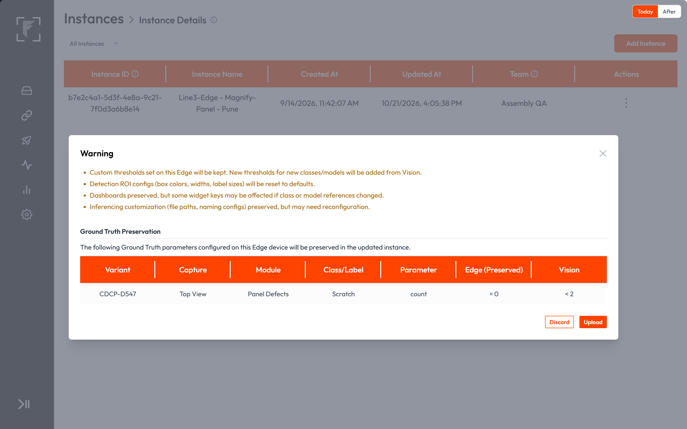
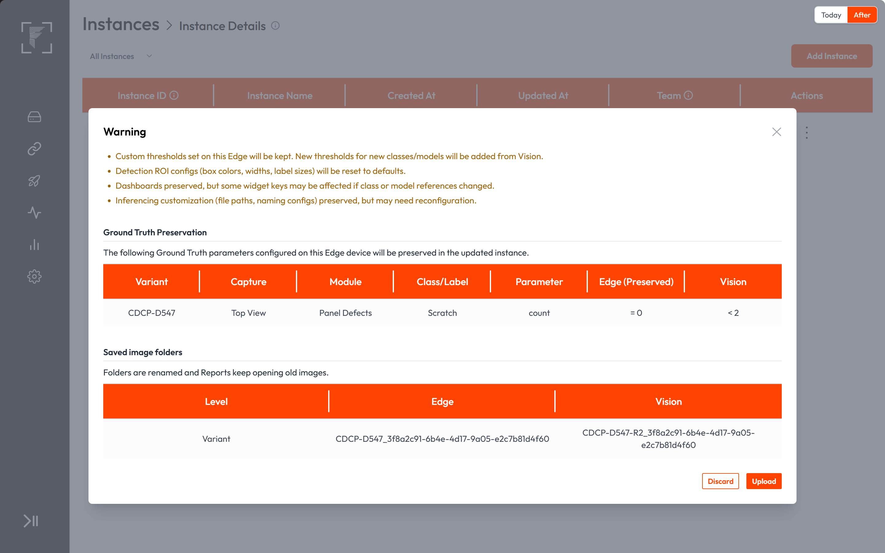
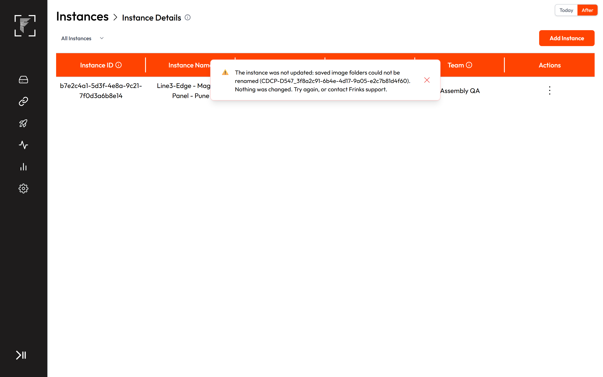

- **AC10.1** When an instance is updated on Edge after its instance, variant, capture or search area was renamed in Vision, Edge renames each matching folder (found by its "_<id>") to "<new name>_<id>".
- **AC10.2** The stored path of every image in a renamed folder is updated, so Reports opens those images after the update.
- **AC10.3** A renamed variant is renamed in the folders of every instance on the box that uses that variant.
- **AC10.4** File names inside renamed folders are not changed.
- **AC10.5** The update's confirmation pop-up has a "Saved image folders" table listing each folder that will be renamed: its level, its name on Edge and its new name from Vision.
- **AC10.6** If any rename or path update fails, the whole update is undone: no folder is renamed, no stored path changes and the instance stays as it was.
- **AC10.7** The failed update shows "The instance was not updated: saved image folders could not be renamed (<folder>). Nothing was changed. Try again, or contact Frinks support."

### US11 — Who may change Image Storage
*As a plant admin, I want the same people who manage file paths today to manage Image Storage, so that no access changes are needed.*
- **Kind:** Rules
- **Parts:** edge-access-audit
- **Teams:** SDE
- **Covers:** C1
- **AC11.1** No role or permission changes. Saving Image Storage needs the Inferencing Customization update permission, as File Paths does today. Without it, the page is read-only.
- **AC11.2** Each save of Image Storage adds an audit entry "Changed image storage" for the instance, recording the old and the new tree.
- **AC11.3** Users cannot move, delete or rename anything inside Frinks Edge saved results.

### US12 — Saving, cleanup and Reports keep working
*As a plant admin, I want everything around saved images to keep working, so that the new tree changes nothing else.*
- **Kind:** Keeps working
- **Parts:** edge-health, edge-reports-analytics, edge-live-dashboard, edge-storage-image-saving, mod-result, edge-backup-migration
- **Teams:** SDE
- **Covers:** C9, C12
- **AC12.1** Image Saving Configurations still decides which analysed and raw images are saved (OK, NG), their resolution and their quality, as today.
- **AC12.2** Storage cleanup keeps each instance under its Storage Allocation limits for raw and analysed images in any tree the placement rules allow (AC3.3–AC3.10), deleting the oldest files first, as today.
- **AC12.3** Storage cleanup deletes files only and never removes a folder; emptied folders stay.
- **AC12.4** The Live Dashboard keeps showing the latest analysed image of each search area.
- **AC12.5** Reverse Judgement keeps copying a cycle's analysed and raw images, as today.
- **AC12.6** The Reports image download keeps zipping the selected images with their folders.
- **AC12.7** The OK / NG verdict of a capture and of a cycle is unchanged by the tree.
- **AC12.8** A system backup keeps including the saved images and their folders.

### US13 — Platform
*As a Frinks support engineer, I want to know what ships, so that the release goes out the usual way.*
- **Kind:** Platform
- **Parts:** edge-release-upgrade
- **Teams:** SDE + AI
- **Stakeholders:** To confirm (SDE and AI POC)
- **Covers:** C13, C17, C18
- **AC13.1** Node Docker image: no change. The new page, setting and rename step are code in the Edge backends.
- **AC13.2** Python Docker image: no change. The engine's new folder logic is code.
- **AC13.3** Scripts bundle: changes. It carries the Edge frontend, the deployment and inferencing backends, the Python engine and the health service changes.
- **AC13.4** Installer: no change. The saved-results folder is created and mounted as today.
- **AC13.5** Error codes: no new code.
- **AC13.6** The Edge manual's File Paths section is replaced by an Image Storage section, and the release note reads: "File Paths is now Image Storage: build each instance's folder tree from instance, variant, capture, search area, day, hour and cycle levels, with Raw images and Pass / Fail folders, and folders follow renames from Frinks Vision."

### US14 — Migration requirements
*As a Frinks support engineer, I want boxes in the field upgraded without losing images, so that plants notice only the new page.*
- **Kind:** Migration
- **Parts:** edge-backup-migration, edge-storage-image-saving
- **Teams:** SDE
- **Covers:** C6, C7
- **AC14.1** Existing data: on upgrade, every existing instance gets the default tree (Instance › Day › Variant › Capture › Search area, Raw images under Capture, Pass and Fail on).
- **AC14.2** Existing data: an instance set to "Overall Folder (All Images Together)" gets the default tree with analysed Pass and Fail removed.
- **AC14.3** Existing data: after the upgrade the existing instance folder is reused, and new images go into new folders below it. Images saved before the upgrade keep opening in Reports.
- **AC14.4** Older Edge with a new instance: no change. The instance package from Vision is unchanged.
- **AC14.5** Older instance on the new Edge: an instance uploaded from an earlier Vision export gets the default tree and saves into it.
- **AC14.6** Upgrades of Edge boxes in the field: the one-time conversion runs once per box on the first start after the upgrade and does not touch image files.

## 7. Out of scope
- Which images are saved, their resolution and quality (Image Saving Configurations).
- File name parts (separate File Names PRD).
- Moving "Frinks Edge saved results" to another disk or a network location.
- Instance Testing runs: they keep saving as today.
- Cross-capture dimension images, which are not saved today.
- A Cycle No. column in Reports: Reports keeps S. No. as it is.

## 8. How we'll know it worked
| Measure | Target |
|---|---|
| Instances on upgraded boxes whose new images land in the folders their tree shows | 100 % |
| Images saved before an upgrade or tree change that open in Reports | 100 % |
| Support tickets asking where an instance's images are saved, after release | Fewer than before release |

## Appendix A — Coverage
**Not applicable:**
- **C14** — N/A: no datasets, annotation, training or models are involved.
- **C15** — N/A: the owner ruled time, time zone and clock topics out of this PRD; date folders use the box's date as today's folders do.
- **C16** — N/A: no licence, encryption or data leaving the box.

**Coverage check:** pasted from the check script on 30 Oct 2026.

**Result:** PASS, 4 warnings

- 14 user stories (10 feature, 1 rules, 1 keeps working, 1 platform, 1 migration), 102 ACs, 16 touched parts, 1 discussion point.
- Checklist: 15 items covered by stories, 3 N/A, 0 open.

**Warnings**
- US5, US6, US7 and US13 are SDE + AI but name no stakeholders yet.

## Appendix B — Code references
For developers. Per touched part: the files that hold today's behaviour, from this sync.
- **Image saving and storage / Python engine:** `vip-inference-python`: `scripts/assembly/modules/resultModule.py:641-686` — folder path builder (Instance / Project / date / Variant / camera config / search area / status); `:531-548` raw RAW/OK|NG; `:391-409` per-area pass and save condition; `:504-528` raw OK/NG from the Input Image area; `:579-639` file name; `:443, 551` folder creation every frame. `scripts/assembly/components/imageSaver.py` — background writer. `scripts/main.py:321-348` — writer choice.
- **Save info sent to the engine:** `frinksedge-inferencing-backend`: `src/python-model/python-model-save-info.service.ts:16-113` (folderStructure :55-57, rawSaving.masterSearchAreaId, areaCondition :77-100); `src/features/initial-data/service/initial-data.service.ts:104-125` (built per container); `src/inference-docker-manager/inference-docker.service.ts:122-162` (deploy refresh push). Testing duplicate: `frinksedge-deployment-backend`: `src/service/pythonModel.ts:400-470`.
- **Cycles:** `frinksedge-inferencing-backend`: `src/cycle/cycle-manager.service.ts:189, 483-511, 603-606` — cycle id is one in-memory counter, assigned when the first result arrives unless a Cycle Start action exists; `src/action/actions/trigger-image/trigger-image.action.ts:103-115` — trigger message (no cycle id); `src/action/actions/cycle-start/cycle-start.action.ts:73`.
- **Stored paths:** `frinksedge-inferencing-backend`: `src/result-flusher/result-flush.service.ts:74-93`; `src/shared/infrastructure/inference-result-config-module-wise/inference-result-config-module-wise.schema.ts:13-14` (result_images JSON, raw_image varchar 512).
- **Reports:** `frinksedge-report`: `src/config/network.ts:13`; `src/shared/utils/safe-path.ts:3-8`; `src/features/analysis/analysis.service.ts:505-546` (Reverse Judgement copies), `:564-599` (image views); `src/features/download/download.service.ts:570-612`. `frinksedge-report-frontend`: `src/modules/analytics/columns.js:3`, `ResultTable.jsx:67, 262, 287` (S. No. is a row index).
- **Live Dashboard:** `frinksedge-inferencing-backend`: `src/orchestrator/orchestrator.service.ts:105-163`.
- **Inferencing Customization page:** `frinksedge-deployment-frontend`: `src/shared/layouts/main/sidebar.jsx:139-202`; `src/modules/inferencing-customizations/index.jsx:31-77, 123-169, 193-223, 235-303, 343-376`; `FilePaths.jsx`; `InstanceSelector.jsx`; `CameraConfiguration.jsx:116-134, 1144-1162` (per-instance lock); `src/app.route.jsx:104-147`.
- **File Paths API and setting:** `frinksedge-deployment-backend`: `src/routes/instance.ts:52`; `src/controller/instance.ts:668-686` (audit); `src/service/instance.ts:2334-2338` (save then deploy refresh); `src/dao/instances.ts:131-145`; `src/db/instance.schema.ts:58` (folder_structure); `src/utils/filePathHelper.ts:9-55` (preview).
- **Deployments:** `frinksedge-deployment-backend`: `src/controller/deployment.ts:215-266` (status); `src/service/deployment.ts:519-526, 1196-1219` (deploy refresh); `src/service/inferenceProcess.ts:237-265` (upload guards).
- **Instance Details:** `frinksedge-deployment-backend`: `src/controller/instance.ts:287-531` (upload and apply); `src/service/instance.ts:1703-1968` (transaction), `:1856-1861` (rows applied by id); `src/service/imageSavingConfig.ts:86-121` (defaults); `src/dao/cameraConfig.ts:745-873` (names).
- **Health cleanup:** `frinksedge-health`: `src/service/storageMonitor.ts:41-48, 65-75, 101-157, 430-454, 500-504, 563-567`; `src/config/network.ts:31-37`.
- **Roles and audit:** `frinksedge-deployment-backend`: `src/rbac/catalogue.ts:125-135`; `src/audit/catalogue.ts:39-55`.
- **Migration and backup:** `frinksedge-deployment-backend`: `dump.sql:1284-1285`; `src/db/dataMigrations/index.ts:35-40`, `migrationFiles/2026-10-21-001-search-area-fail-box-color.ts` (pattern); `src/service/system.ts:211-215` (backup). `frinksedge-installer-electron`: `src/main.js` (dump replay). `frinksedge-staging-environment`: `integrity/modules/inferencing-customization/check.sh:83, 144-145, 253-255, 307-323` (File Paths tests to rewrite).
- **Platform:** `frinksedge-file-releases`: `ubuntu/docker-compose.yaml:94`, `ubuntu/docker-files/docker-compose.yaml:31` (saved-results mounts).

Repos checked (28 Oct 2026): vip-inference-python @ 3af02b5 (27 Oct), frinksedge-inferencing-backend @ 310c18e (22 Oct), frinksedge-deployment-backend @ 5a69c77 (26 Oct), frinksedge-deployment-frontend @ 857dfdd (26 Oct), frinksedge-health @ 2dbc622 (23 Oct), frinksedge-report @ 5fe5390 (15 Oct), frinksedge-report-frontend @ 9893a19 (13 Oct), frinksedge-installer-electron @ b4a5049 (12 Oct), frinksedge-file-releases @ 7041254 (16 Jul), frinksedge-staging-environment @ 4993036 (9 Sep), frinksedge-plc-backend @ e2df75f (26 Oct), frinksvision-backend @ ad462a1 (28 Oct), frinksvision-frontend @ 75b7869 (28 Oct), Python-inference-docker @ 62e22bd (29 May), release-manager-backend @ b8016f7 (22 Sep), and the 20 training, evaluation and data-tooling repos at their latest commits (none touched).

## Changelog
- 28 Oct 2026 — Draft written: US1–US14, Q1–Q2 (Akshat Sharma)
- 28 Oct 2026 — Duplicate pass: AC2.2, AC4.1, AC4.4, AC5.6, AC8.3, AC8.4, AC8.9, AC13.2, AC13.5, AC14.3 trimmed; AC8.6 rewritten as a reorder example; AC2.3, AC5.8, AC7.2, AC7.5, AC8.2 reworded to remove contradictions; AC13.6 level list completed (Akshat Sharma)
- 29 Oct 2026 — Q1 decided: placement rules added as AC3.3–AC3.10 (Instance always first, Variant › Capture › Search area order, Search area needs Capture, Hour needs Day, Day and Hour free around product levels, Cycle ID below Day and Hour, product levels free around Cycle ID, each level once); AC3.1, AC3.2, AC4.3 reworded (Raw images never above Instance); AC2.3, AC12.2 now point at AC3.3–AC3.10; AC6.4 (removed): Hour always has Day above it; US3 renamed (Akshat Sharma)
- 29 Oct 2026 — Prototype hosted in the PRD repo; Prototype links filled in; PRD published to the PRD repo as Draft (Akshat Sharma)
- 30 Oct 2026 — AC7.7, AC7.8, AC7.9 added: with Analysed Image on, every search area's image is saved whatever the tree; with no Search area level they share the lowest folder (for example Capture), split into Pass and Fail when on, and their file names keep them apart (Akshat Sharma)

## Checked, not affected
- vision-access, vision-auto-annotation, vision-captures-cameras, vision-datasets-annotations, vision-instance-creation, vision-model-evaluation, vision-model-training, vision-projects, vision-recipe-tree, vision-training-sets-recommender, vision-variants: Edge-only change; names and ids already arrive in the instance package, which does not change.
- mod-bead-inspection, mod-classification, mod-code-reader, mod-color-detection, mod-masking, mod-matting, mod-ocr, mod-odc, mod-orientation, mod-segmentation, mod-shape-extractor, mod-tracker: what is drawn on saved images and how modules decide is unchanged; only the folder an image lands in changes.
- engine-runtime-packaging: the Python image and the saved-results mount stay as they are.
- edge-internal-actions, edge-plc-read, edge-plc-setup, edge-plc-write: rules and PLC signals do not use image folders.
- edge-model-loading-variant-change, edge-networking, edge-encryption-keys, edge-installer: model loading, ports, keys and installation are untouched.
- edge-dashboard-builder, edge-emc: dashboard design and module tuning do not depend on folders.
- edge-system-time: the owner ruled clock and time-zone topics out; date folders use the box's date as today.
