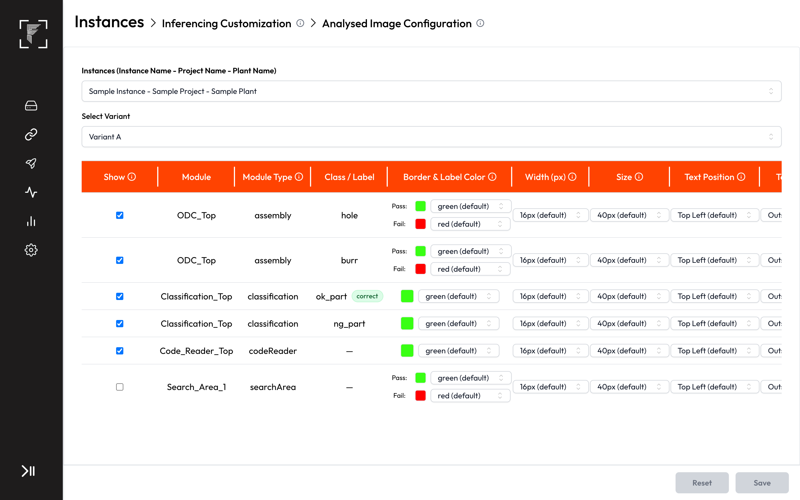
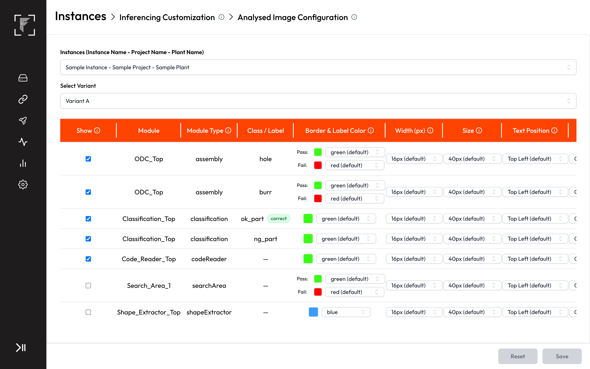
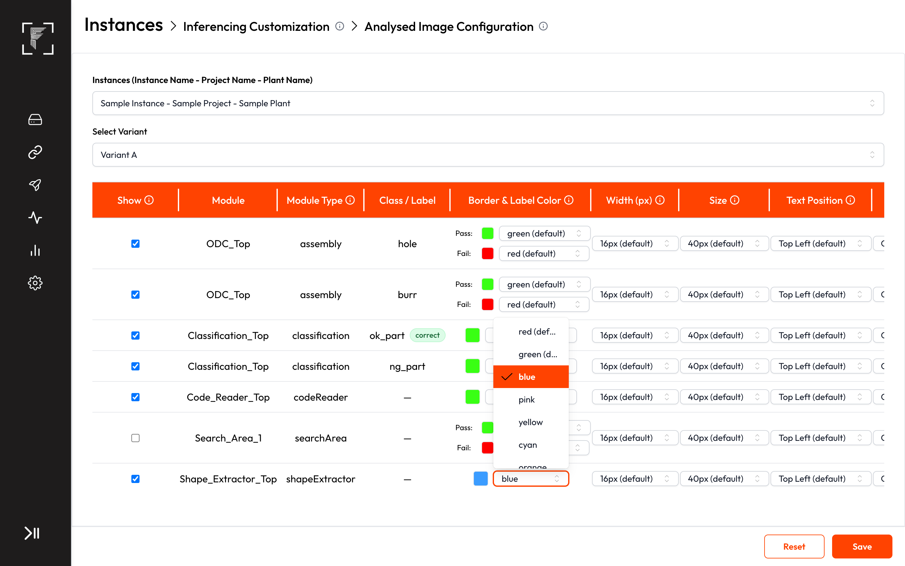
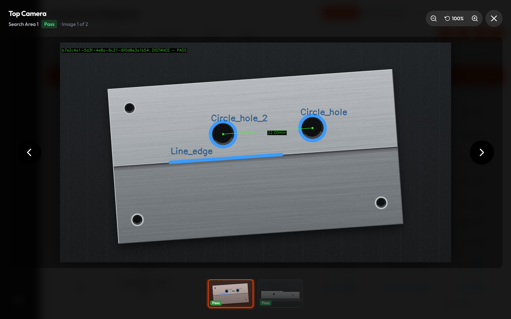
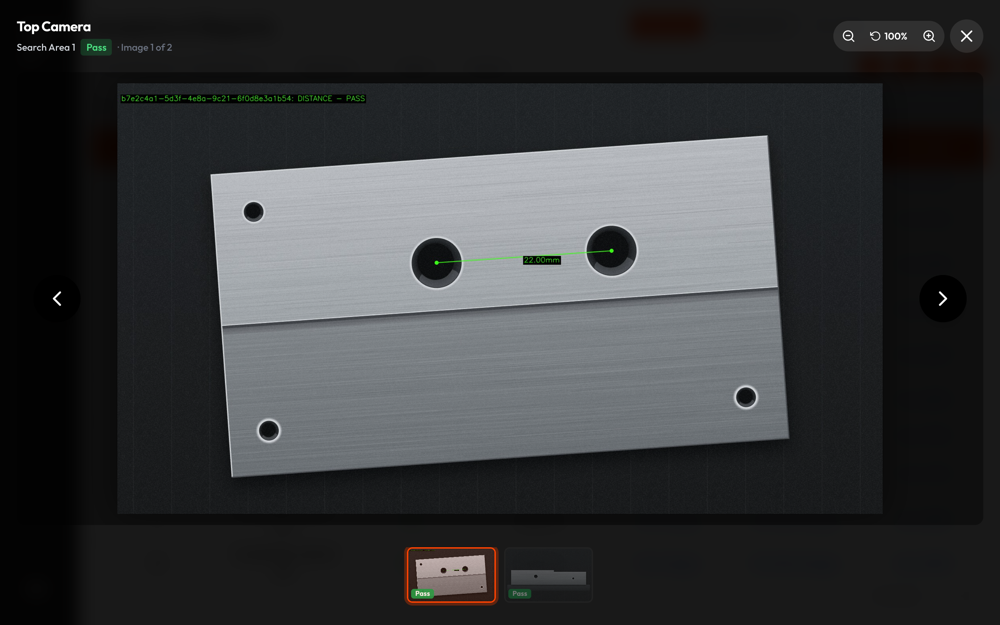

# PRD: Shape Extractor rows in Analysed Image Configurations

**Prototype:** [Interactive workflow, Today vs After change](https://vbv-fr.github.io/shape-extractor-analysed-image-prototype/)
**Product:** Frinks Edge
**Status:** In review
**Date:** 26 October 2026
**Owner:** Tanay Deo
**Related:** FP-3857 Shape Extractor coordinates against the master image are wrong in inferencing (To Do): shapes drawn by this PRD land where the engine places them, so that fix should ship first or together. PRD "Edge Instance Testing v2" (Draft): it draws test results with Analysed Image Configuration colours and adds Shape Extractor to tests, so its owner should know these rows exist. PRD "Dimensioning: distance and angle to a fixed line" (In review): dimension drawings stay on top of shapes.
**Code checked:** 26 October 2026 — 34 repos at their latest default-branch commit (list in Appendix B)

---

## Discussion points
None. Every decision is made and written into the user stories.

## 1. Summary
- On Edge, **Instances → Inferencing Customization → Analysed Image Configurations** now lists one row for every Shape Extractor module, next to the rows of the other modules.
- A Shape Extractor row takes a **single colour**, as Classification and Code Reader rows do today. A Shape Extractor has no OK/NG of its own, so there is no Pass/Fail colour pair.
- All the row's other settings work: **Show**, **Width (px)**, **Size**, **Text Position** and **Text Placement**.
- With Show ticked, the analysed image draws every shape of that module in the row's colour and line width, and writes each shape's name beside it.
- A new row starts with **Show unticked** and colour **blue**, so analysed images look exactly as today until someone turns it on.
- No role or permission changes, no Vision change, and no Docker image or installer change.

## 2. Why we are making this
- **Today:** Shape Extractor shapes (holes, edges, arcs, peaks) are never drawn on the analysed image, and the module has no row in Analysed Image Configurations. When a dimension fails, the operator and the quality engineer can't see which edge or hole the engine actually found, so they can't tell a bad part from a bad fit.
- **Evidence:** Product's own idea, from the PM, 26 October 2026.
- **After:** The integrator ticks Show on the Shape Extractor row, picks a colour, and every analysed image shows the found shapes with their names.

## 3. Goals and non-goals
**Goals**
- G1. Every Shape Extractor module gets a row in Analysed Image Configurations, with one colour and the usual settings.
- G2. With Show ticked, the analysed image shows the found shapes and their names in that colour, on every surface that shows the analysed image.
- G3. Nothing changes for anyone until they tick Show, and every other row works as today.

**Non-goals**
- A colour per shape.
- A Pass/Fail colour for shapes.
- Any change in Frinks Vision.

## 4. Key concepts
- **Shape Extractor row:** one row per Shape Extractor module of the chosen variant, covering all of that module's shapes.

## 5. Impact map
The parts this changes. Parts checked and not affected are listed at the very end.

| Part | What will happen | User stories |
|---|---|---|
| Cycles, cycle result and Inferencing Customization (edge-inferencing-customization) | Analysed Image Configurations lists a single-colour row for each Shape Extractor module. Its settings are sent to the engine with the other rows' settings | US1, US2, US4, US6 |
| Shape Extractor (mod-shape-extractor) | Its shapes are drawn on the analysed image when the row's Show is ticked: in the row's colour and width, with each shape's name | US1, US2, US4 |
| Result module (mod-result) | Draws the shapes before the dimensions, so dimension drawings stay on top. The verdict is unchanged | US2, US4 |
| Edge access & audit (edge-access-audit) | Same Inferencing Customization – Update permission and the same audit entry | US3 |
| Live Dashboard (edge-live-dashboard) | The analysed image shown live carries the shapes when Show is ticked | US2 |
| Image saving (edge-storage-image-saving) | Saved analysed images carry the shapes when Show is ticked | US2 |
| Reports & Analytics (edge-reports-analytics) | Result images carry the shapes when Show is ticked | US2 |
| Edit Module Configurations (edge-emc) | Shapes added or removed on Edge fall under the module's one row | US4 |
| Instance upload (edge-instance-details) | An upload or re-upload creates the Shape Extractor rows, keeps the rows of kept modules and removes the rows of removed ones | US4, US6 |
| Model loading and variant change (edge-model-loading-variant-change) | After a changeover, the new variant's Shape Extractor rows are used | US4 |
| Deployments (edge-deployment) | Saving while a deployment runs shows today's confirmation | US4 |
| Backup and migration (edge-backup-migration) | Rows are added for existing modules on the first start after the update. Backups keep them | US6 |
| Release and upgrades (edge-release-upgrade) | Ships in the scripts bundle. Rolling back removes the rows | US5, US6 |
| Python runtime image (engine-runtime-packaging) | No change: no new library | US5 |
| Installer (edge-installer) | No change: no new stored field | US5 |
| Health and error codes (edge-health) | No new error codes | US5 |
| Instance creation (vision-instance-creation) | No change: Vision sends no display settings | US6 |

## 6. User stories and acceptance criteria

### US1 — Set a Shape Extractor module's colour and settings
*As an integrator, I want a row for each Shape Extractor module in Analysed Image Configurations, so that I can choose how its shapes appear on the analysed image.*
- **Kind:** Feature
- **Parts:** edge-inferencing-customization, mod-shape-extractor
- **Teams:** SDE
- **Covers:** C2, C3
- **Today:** The table lists rows for Object Detection, Classification, OCR, Segmentation, Code Reader, Colour Detection, Search Area and other modules, but none for Shape Extractor. Single-colour rows (for example Classification, or Code Reader in Read mode) show one swatch and one colour dropdown; Pass/Fail rows show two.
- **Prototype:** [Analysed Image Configurations](https://vbv-fr.github.io/shape-extractor-analysed-image-prototype/#edge-aic), [Show ticked, colour list open](https://vbv-fr.github.io/shape-extractor-analysed-image-prototype/#edge-aic-show)

- **AC1.1** After an instance and a variant are picked, the table shows one row for every Shape Extractor module of that variant, however many shapes the module has, none included.
- **AC1.2** The row reads the module's name under Module, "shapeExtractor" under Module Type and "—" under Class / Label.
- **AC1.3** Border & Label Color shows one swatch and one colour dropdown with the same 40 colours as the other rows, and no Pass/Fail pair.
- **AC1.4** A new Shape Extractor row starts with Show unticked and colour blue. Width (px), Size, Text Position and Text Placement start on the same values as every other new row: 16, 40, Top Left (default) and Outside Box (default).
- **AC1.5** Rows stay sorted by Module Type, as today, so the Shape Extractor row sits among the others by that order.
- **AC1.6** Changing any setting on the row turns on Save and Reset. Reset brings back the values the page loaded.
- **AC1.7** Saving keeps the row's settings, and opening the page again on the same instance and variant shows them as saved.

### US2 — See the found shapes on the analysed image
*As an operator or quality engineer, I want the analysed image to show the shapes the engine found, with their names, so that I can see which edge or hole a measurement used.*
- **Kind:** Feature
- **Parts:** mod-shape-extractor, mod-result, edge-inferencing-customization, edge-live-dashboard, edge-storage-image-saving, edge-reports-analytics
- **Teams:** SDE + AI
- **Stakeholders:** Tanay (SDE), Pallavi (AI, Python)
- **Covers:** C5, C12
- **Today:** The engine never draws Shape Extractor shapes on the analysed image. It has a debug-only switch on the Edge box that draws them in fixed colours (green when the fit succeeds, red when it fails), 2 px thick, with no names.
- **Prototype:** [Analysed image](https://vbv-fr.github.io/shape-extractor-analysed-image-prototype/#edge-analysed)

- **AC2.1** With Show ticked, every analysed image of that capture draws each shape of the module the engine found (circle, line, arc, ellipse, sector, parallel lines, edge, peak) where it found it, in the row's colour.
- **AC2.2** Shape outlines are drawn as thick as the row's Width (px).
- **AC2.3** Each drawn shape has its name (as set in the Shape Extractor, for example "Circle_hole") written with it in the row's colour, sized by the row's Size the same way Size sets other modules' labels.
- **AC2.4** The name sits at the row's Text Position (a corner of the box around the shape), inside or outside that box as Text Placement says, the way box labels of other modules are placed.
- **AC2.5** A shape whose fit fails on an image is still drawn in the row's colour: nothing turns red.
- **AC2.6** A shape the engine doesn't find on an image is not drawn on that image.
- **AC2.7** With Show unticked, the analysed image draws no shapes, as today.
- **AC2.8** Dimension drawings sit on top of the shapes.
- **AC2.9** The Live Dashboard image, saved analysed images and the result images in Reports & Analytics show the same drawing as the analysed image.

### US3 — Rules
*As a plant admin, I want Shape Extractor rows governed by the same permission as every row, so that access stays as I set it.*
- **Kind:** Rules
- **Parts:** edge-access-audit
- **Teams:** SDE
- **Covers:** C1

- **AC3.1** No role or permission changes. Saving the page, Shape Extractor rows included, needs Inferencing Customization – Update. Viewing the page stays open to everyone who can open it today.
- **AC3.2** Edge's server refuses a save of Shape Extractor row settings from a user without Inferencing Customization – Update, even when it is sent without the page.
- **AC3.3** Saving writes the same "Changed analysed image" entry to the audit log as any save of the page.

### US4 — Keeps working
*As an integrator, I want everything else on the page and on the line to behave as before, so that the new rows cost me nothing.*
- **Kind:** Keeps working
- **Parts:** edge-inferencing-customization, mod-shape-extractor, mod-result, edge-emc, edge-instance-details, edge-model-loading-variant-change, edge-deployment
- **Teams:** SDE + AI
- **Stakeholders:** Tanay (SDE), Pallavi (AI, Python)
- **Covers:** C9, C10, C11

- **AC4.1** Every other row keeps its modules, classes and its Pass/Fail or single colour cell, and draws exactly as today.
- **AC4.2** A capture's verdict, its Shape Extractor keys and its dimension values are the same with Show ticked or unticked.
- **AC4.3** A shape added or removed in Edit Module Configurations on Edge is drawn, or no longer drawn, under its module's existing row. No row is added or removed for it.
- **AC4.4** After a variant change, the new variant's Shape Extractor rows decide what is drawn.
- **AC4.5** Re-uploading the instance keeps the settings of every Shape Extractor module the re-upload keeps, and removes the row of a module it removes.
- **AC4.6** Saving while a deployment runs shows today's confirmation ("There is an inferencing deployment running currently…"), and a Shape Extractor row's change reaches the line when other rows' changes do.

### US5 — Platform
*As a release engineer, I want to know exactly what ships, so that the release is packaged and documented right.*
- **Kind:** Platform
- **Parts:** edge-release-upgrade, engine-runtime-packaging, edge-installer, edge-health
- **Teams:** SDE + AI
- **Stakeholders:** Tanay (SDE), Pallavi (AI, Python)
- **Covers:** C13, C17, C18

- **AC5.1** Node Docker image: no change. The work is code inside existing Edge services.
- **AC5.2** Python Docker image: no change. Drawing shapes and names uses libraries the engine already has.
- **AC5.3** Scripts bundle: changes. It carries the Edge deployment server (making Shape Extractor rows), the Edge inferencing server (sending the row's settings to the engine) and the Python engine (colour, width and names for shapes).
- **AC5.4** Installer: no change. The rows go in the table that already holds the other rows' settings, and no stored field is added.
- **AC5.5** New error codes: none. Drawing a shape can fail only as it can today, under the existing Shape Extractor error code.
- **AC5.6** The Edge manual's Analysed Image Configurations section mentions Shape Extractor rows. The release note reads: "Analysed Image Configurations now has a row for each Shape Extractor module. Tick Show to draw the found shapes, with their names, on the analysed image in one colour you pick. Rows start unticked, so nothing changes until you turn them on. If Edge is rolled back to an older version, these rows are removed; after upgrading again, set them again."

### US6 — Migration requirements
*As a site engineer, I want updates and rollbacks to leave analysed images as they are, so that upgrading Edge is safe.*
- **Kind:** Migration
- **Parts:** edge-backup-migration, edge-release-upgrade, edge-instance-details, edge-inferencing-customization, vision-instance-creation
- **Teams:** SDE
- **Covers:** C6, C7

- **AC6.1** Existing data: on its first start after the update, Edge adds a Shape Extractor row, with the starting values in AC1.4, for every Shape Extractor module of every instance already uploaded, older instances included. Analysed images look exactly as before until someone ticks Show.
- **AC6.2** The update leaves every other row's settings unchanged.
- **AC6.3** A new instance on an older Edge is unaffected: Vision sends no display settings, and the older Edge draws no shapes, as today.
- **AC6.4** After an Edge is rolled back to an older version, its next start removes the Shape Extractor rows. Upgrading again brings them back with the starting values, not the saved ones; the release note says so.
- **AC6.5** A backup restored on another box keeps the Shape Extractor rows and their settings.

## 7. Out of scope
- A colour, Show or text setting per shape.
- A Pass/Fail colour for shapes.
- Drawing shapes in Instance Testing results.
- Drawing the engine's caliper points.
- Any change in Frinks Vision.

## 8. How we'll know it worked
| Measure | Target |
|---|---|
| Support requests to switch on shape drawing on a box (the debug switch) | None after release |
| Analysed images that change after the update without anyone ticking Show | None |

## Appendix A — Coverage
**Not applicable:** every checklist item no story covers, one line each.
- **C4** — N/A: every setting on the row is picked from a fixed list; nothing is typed.
- **C8** — N/A: drawing a few outlines and names per image has no measurable effect on cycle time, GPU or memory.
- **C14** — N/A: no datasets, annotation, training or models are involved.
- **C15** — N/A: no network or clock dependence; works offline as today.
- **C16** — N/A: no licensing or encryption change, and nothing new leaves the plant.

**Coverage check** (26 Oct 2026): **PASS**, no warnings. 6 user stories (2 Feature, 1 Rules, 1 Keeps working, 1 Platform, 1 Migration), 36 ACs, 17 touched parts, 0 discussion points. Checklist: 13 items covered by stories, 5 N/A, 0 open.

**Checks beyond the script:** every coverage-sheet item maps to exactly one AC; the duplicate pass found 3 duplicates and 2 wording clashes, all fixed (see Changelog); the code back-check found no new part (the files that change sit in the Edge deployment server, the Edge inferencing server and the Python engine, all under parts marked Yes); every goal is delivered (G1: US1; G2: US2; G3: US4, US6).

## Appendix B — Code references
For developers. Per touched part: the files that hold today's behaviour, from this sync.
- **Analysed Image Configurations page (edge-inferencing-customization):** `frinksedge-deployment-frontend`:
  - `src/modules/inferencing-customizations/AnalysedImageConfigurations.jsx:296-328` (instance and variant pickers), `:346-356` (columns), `:360-366` (sort by Module Type), `:373` (rows named like an image file are skipped), `:125-133` (Pass/Fail rows: assembly, ocr, searcharea, segmentation, bead, Code Reader in match mode), `:420-500` (Pass/Fail cell vs single-colour cell), `:66-72,:204` (single-colour rows save their fail colour as green), `:341-344` (empty state).
  - `src/modules/inferencing-customizations/index.jsx:171-191,255-300` — save, running-deployment confirmation; `:194` permission gate.
  - `src/@constants/colors.js:106-147` — NEON_COLORS, 40 colours (blue #3B9CFF); `src/@constants/fontSizes.js` — Width 1–30, Size 8–96.
- **Rows, save, permission, audit (edge-inferencing-customization, edge-access-audit, edge-instance-details, edge-backup-migration):** `frinksedge-deployment-backend`:
  - `src/service/instance.ts:2610-2694` — populateDefaultRoiConfigs: module lists `:2636-2637` (no shapeExtractor), starting values `:2615-2623`, keep/delete/insert `:2666-2693`; runs at boot `src/index.ts:58-66` and after uploads `src/controller/instance.ts:393,483,593`.
  - `src/dao/moduleClassRoiConfig.ts:47-138` (rows per variant), `:140-155` (bulk update); `src/db/moduleClassRoiConfig.schema.ts:13-41`, `dump.sql:2823-2860` — table and columns.
  - `src/routes/instance.ts:40-44,74` — save gated by Inferencing Customization – Update; `src/rbac/catalogue.ts:126-131`; `src/controller/instance.ts:862-868`, `src/audit/catalogue.ts:39` — audit.
  - `src/config/populate.ts:164` — module type id `shapeExtractor`; `src/db/shapeExtractorConfig.schema.ts:48-70` — one row per shape.
  - `src/service/pythonModel.ts:296-300,391` — Instance Testing leaves Shape Extractor out.
- **Engine payload (edge-inferencing-customization, mod-shape-extractor):** `frinksedge-inferencing-backend` `src/python-model/python-model-result.service.ts:45-75` (Shape Extractor hard-coded: not drawn, fixed colours), `:94-139` (other modules read their row); `src/shared/infrastructure/module-class-roi-config/module-class-roi-config.schema.ts` (schema copy).
- **Drawing (mod-shape-extractor, mod-result):** `vip-inference-python` `scripts/assembly/resultProcess/shape.py:315,359` (drawn only when asked or with the debug switch), `:362-364` (fit colour), `:150-231` (2 px outlines), `:172` (peak dot); `scripts/assembly/modules/resultModule.py:981-1009`, `scripts/assembly/resultProcess/utils/Visualisor.py:301` (dimensions drawn after modules).

Repos checked: frinksedge-deployment-frontend @ 857dfddd (2026-10-26), frinksedge-deployment-backend @ 5a69c77 (2026-10-26), frinksedge-inferencing-backend @ 310c18e (2026-10-22), vip-inference-python @ 14670bf (2026-10-26); the other 30 repos were synced and not read.

## Changelog
Every line names the US / AC ids it touched.
- 26 Oct 2026 — Written: US1–US6, 36 ACs, after the duplicate pass (AC1.8 folded into AC1.1; the new-upload migration AC folded into AC1.1; AC4.1 trimmed, update keeps settings is AC6.2; release note in AC5.6 now names the rollback caveat of AC6.4; AC2.3 "with it") (Tanay Deo)

## Checked, not affected
Every other part in the component map, grouped, each group with a one-line reason.
- vision-access, vision-auto-annotation, vision-captures-cameras, vision-datasets-annotations, vision-model-evaluation, vision-model-training, vision-projects, vision-recipe-tree, vision-training-sets-recommender, vision-variants: Analysed Image Configurations exists only on Edge, and Vision sends no display settings.
- mod-bead-inspection, mod-classification, mod-code-reader, mod-color-detection, mod-input-master-image, mod-masking, mod-matting, mod-ocr, mod-odc, mod-orientation, mod-search-area, mod-segmentation, mod-tracker: their rows and drawings stay as they are (AC4.1), and shapes are placed with the search-area positions the engine already uses.
- engine-workflow: runs the result step and hands on the analysed image as today, with no change of its own.
- edge-actions, edge-internal-actions, edge-plc-read, edge-plc-setup, edge-plc-write: no key, verdict or PLC signal changes (AC4.2).
- edge-camera-capture, edge-dashboard-builder, edge-encryption-keys, edge-networking, edge-system-time: no new hardware, widget option, key, service, port or time handling.
