# PRD: Configuration only instance

**Prototype:** [Interactive workflow, Today vs After change (20 steps)](https://vbv-fr.github.io/configuration-only-instance-prototype/)
**Product:** Vision + Edge
**Status:** Draft
**Date:** 29 October 2026
**Owner:** Tanay Deo
**Timeline:** Not planned yet
**Related:** None
**Code checked:** 28–29 Oct 2026 — 10 repos at their latest default-branch commit (list in Appendix B)

---

## Discussion points

| # | Point to settle | Options on the table | Owner | Needed by |
|---|---|---|---|---|
| Q1 | An integrator downloads a Configuration only package and uploads it to an Edge box that is still on an older release. The older Edge doesn't know what a Configuration only package is. | (a) Vision offers only scripts bundle versions that support it, and older Edge refuses the package with a clear message **(recommended)**; (b) older Edge accepts it as a normal instance with empty model slots, as it does today, with no locks | Tanay Deo | Before sprint planning |
| Q2 | A model picked for an instance is later deleted in Vision. Model Selection shows it as "Unknown Model". | (a) Counts as no model, so the instance goes back to Models Remaining **(recommended)**; (b) Stays Completed until someone edits it | Tanay Deo | Before sprint planning |

## 1. Summary
- In Vision, an instance can be finished at Model Selection without picking every model, with **Finish without models** / **Finish without all models**. It is saved as **Models Remaining**.
- The Vision Instances table gets a **Status** column: Draft, Models Remaining, Completed.
- A Models Remaining instance downloads as a **Configuration only** package (no models), or, when some models are picked, the user chooses between configuration only and configuration with the available models.
- On Edge, the package uploads as a new instance with a default dashboard and a yellow **Models Remaining** chip. Everything that doesn't need a model can be set up right away: PLC, dashboards, analysed image, inferencing customization, ground truth and all non-threshold module settings.
- Only three things wait for models: **Deploy** (until every AI module has a model), **thresholds** (per module, per OCR cell) and **Edge testing** (per capture).
- Models are added later from Vision with the row's **Update** on Edge. Nothing set up on Edge is lost.
- Add Instance on Edge refuses a package whose instance is already on that Edge.

## 2. Why we are making this
- **Today:** Edge setup (PLC read/write/internal, dashboards, analysed image configuration, image saving, file names, most of Edit Module Configurations) needs only the instance's configuration, not its models. But an instance reaches Edge only as one package with its models, so integrators wait for training to finish before they can start. The package Vision can already make without models is not marked as such: Edge treats it as complete, deploys it, and shows threshold fields that silently don't save.
- **Evidence:** internal need from deployment teams: Edge setup sits on the critical path behind model training.
- **After:** integrators set up the whole Edge side while models train, and deploy as soon as the models arrive.

## 3. Goals and non-goals
**Goals**
- G1. An instance can be finished and downloaded from Vision before every AI module has a model.
- G2. The Edge side can be fully set up from that package, except what really needs a model.
- G3. Deploy, thresholds and Edge testing are clearly locked until the models they need are on Edge, with the reason shown.
- G4. Adding models later keeps everything already set up on Edge.

**Non-goals**
- Fixing full re-uploads resetting the analysed-image box colours, widths and label sizes.
- Changing how models are trained or picked.
- Changing roles or permissions.

## 4. Key concepts
- **AI module slot:** one place in Model Selection where a model is picked: a detection model, an OCR detection model, an OCR recognition model (when the recipe has recognition on), a segmentation or bead model, and each per-class Classification slot inside an Object Detection module.
- **Configuration only package:** a Vision download with the instance's database and masks and no models, marked as such for Edge.
- **Models Remaining:** an instance that is finished but has at least one empty AI module slot.

## 5. Impact map

| Part | What will happen | User stories |
|---|---|---|
| Instance creation (vision-instance-creation) | Finish without models; Status column; Download Instance popup with package choice; Configuration only marker in the package | US1, US2, US3, US14 |
| Instance upload and details (edge-instance-details) | Configuration only upload, Models Remaining chip, Add Instance refuses an ID already on Edge, models added with Update, Run a new test per capture | US4, US5, US8, US10 |
| Dashboard Builder (edge-dashboard-builder) | Default dashboard on a Configuration only upload; chip in the Instance column | US4, US6 |
| Edit Module Configurations (edge-emc) | Threshold fields locked per module and per OCR cell; everything else open | US7, US12 |
| Deployments (edge-deployment) | Deploy blocked with "Add models to deploy" | US9 |
| Object Detection (mod-odc) | Confidence and IOU lock without a model | US7 |
| OCR (mod-ocr) | Detection and Recognition thresholds lock separately | US7 |
| Segmentation (mod-segmentation) | Class thresholds lock; priority conditions built from recipe classes | US7 |
| Bead Inspection (mod-bead-inspection) | Confidence and Area lock; class name from recipe | US7 |
| Vision access (vision-access) | No change, checked | US11 |
| Edge access (edge-access-audit) | No change, checked | US11 |
| PLC Read (edge-plc-read) | Works on a Models Remaining instance | US12 |
| PLC Write (edge-plc-write) | Works on a Models Remaining instance | US12 |
| Internal actions (edge-internal-actions) | Works on a Models Remaining instance | US12 |
| Actions (edge-actions) | Dashboard actions work on a Models Remaining instance | US12 |
| Inferencing customization (edge-inferencing-customization) | Works on a Models Remaining instance | US12 |
| Image saving (edge-storage-image-saving) | Works on a Models Remaining instance | US12 |
| Python images (engine-runtime-packaging) | No change | US13 |
| Installer (edge-installer) | No change | US13 |
| Error codes (edge-health) | No new codes | US13 |
| Release and upgrade (edge-release-upgrade) | Version pairing for the new package | US14 |
| Backup and migration (edge-backup-migration) | Existing instances get the chip and the deploy block | US14 |

## 6. User stories and acceptance criteria

### US1 — Finish an instance without all its models
*As an ML engineer, I want to finish an instance before every model is trained, so that Edge setup can start now.*
- **Kind:** Feature
- **Parts:** vision-instance-creation
- **Teams:** SDE
- **Covers:** C2, C4, C5
- **Today:** Model Selection requires a pick only where a matching trained model exists; Next then saves empty model rows and Finish activates the instance, so an instance with no models finishes silently.
- **Prototype:** https://vbv-fr.github.io/configuration-only-instance-prototype/#vision-models

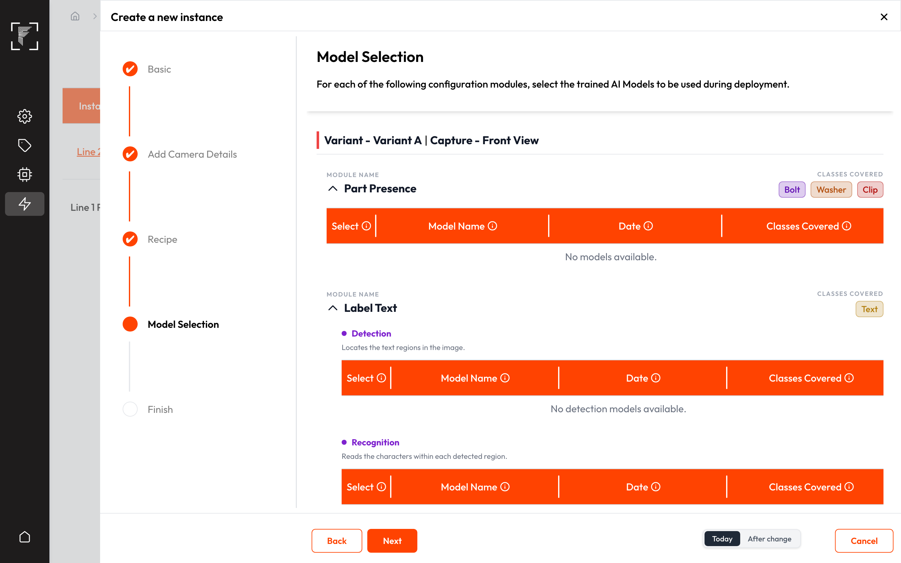
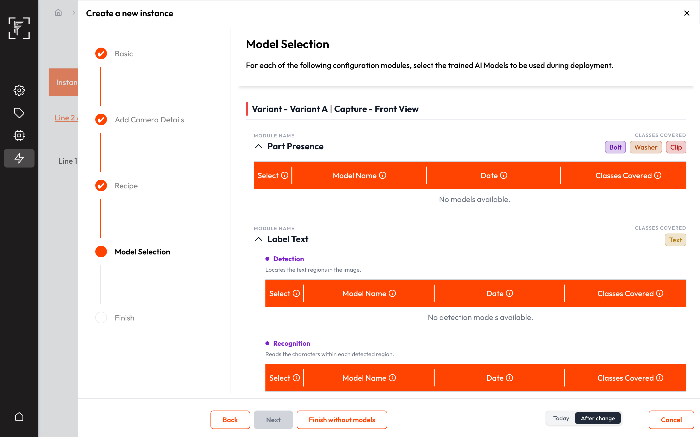

- **AC1.1** Vision, Create/Edit instance drawer, Model Selection step: **Next** is disabled (the existing disabled button style) until every AI module slot has a model. Its tooltip stays "Continue to the next step.".
- **AC1.2** The AI module slots counted are: each module's detection model; OCR's recognition model when the recipe has recognition on; and every per-class Classification slot inside an Object Detection module. Modules that never take a model (for example Code Reader) are not counted.
- **AC1.3** Model Selection footer: a bordered secondary button, styled like Back, sits left of Next. It reads **Finish without models** when no slot has a model, with tooltip "Save this instance without models. It stays Models Remaining until every AI module has a model."
- **AC1.4** The same button reads **Finish without all models** when some but not all slots have a model, with tooltip "Save this instance with the models picked so far. It stays Models Remaining until every AI module has a model."
- **AC1.5** The button is hidden once every slot has a model.
- **AC1.6** Clicking it saves the picked models, activates the instance (no Finish step), closes the drawer, shows the toast "Instance activated successfully!" and returns to the Instances table.
- **AC1.7** If saving the model picks fails, the instance is not activated, the drawer stays open on Model Selection and the existing save-error toast shows.
- **AC1.8** An empty slot is saved as "no model" (empty), never as a blank model ID.
- **AC1.9** (removed): covered by AC1.2 and AC1.4.
- **AC1.10** A slot whose models are still training shows "No models available." as today and counts as empty.
- **AC1.11** Projects with no AI modules skip Model Selection as today.

### US2 — See each instance's status in Vision
*As an ML engineer, I want to see which instances still need models, so that I know what to finish.*
- **Kind:** Feature
- **Parts:** vision-instance-creation
- **Teams:** SDE
- **Covers:** C3, C5
- **Today:** a red superscript "draft" next to the name, and "Draft" in the Plant column when no plant/team.
- **Prototype:** https://vbv-fr.github.io/configuration-only-instance-prototype/#vision-instances

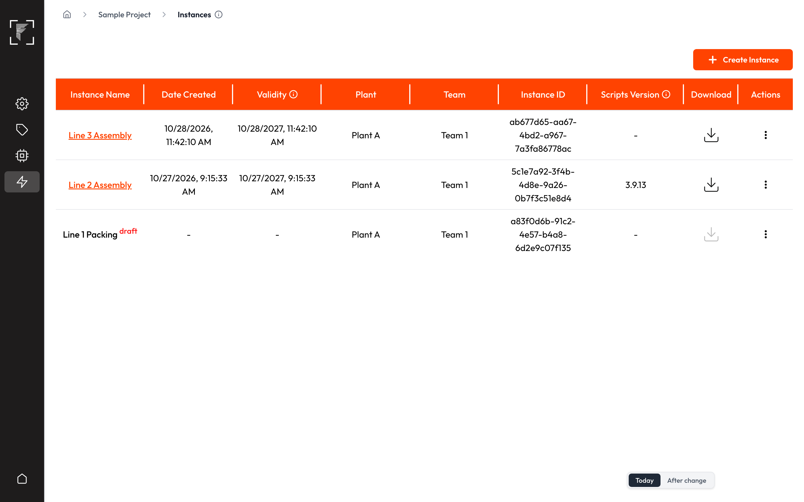
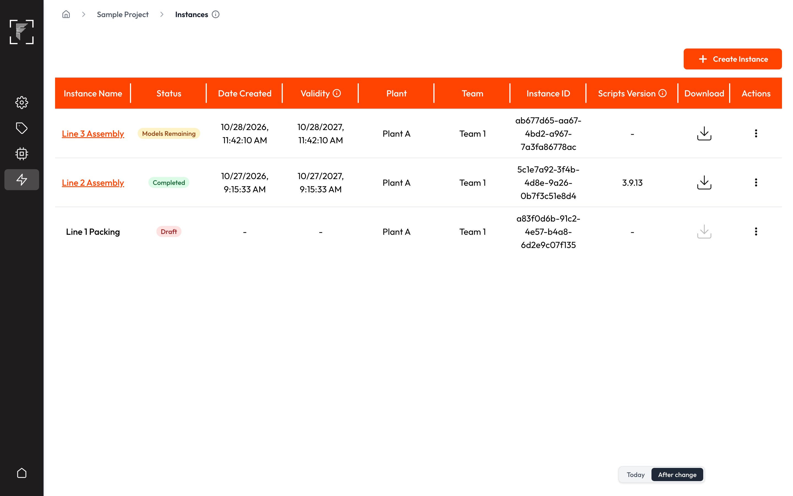

- **AC2.1** Vision, project Instances table: a new **Status** column is the 2nd column, right after Instance Name, showing one pill per row, styled like the existing Vision status pills.
- **AC2.2** **Draft** (grey pill): the instance was never finished, was invalidated by a config change, or has no plant/team. It replaces the red "draft" superscript and the "Draft" text in the Plant column. Tooltip: "Never activated, or invalidated by a config change. Can't be downloaded."
- **AC2.3** **Models Remaining** (yellow pill): finished, with at least one empty AI module slot. Tooltip: "Finished, but at least one AI module has no model yet. Add the models from Edit instance."
- **AC2.4** **Completed** (green pill): finished, and every AI module slot has a model (or the project has no AI modules). Tooltip: "Every AI module has a model."
- **AC2.5** Status is worked out by the backend from the saved model picks, with the same slot list as AC1.2, so it is right after an edit even when the user cancels the drawer after Model Selection.

### US3 — Download a Models Remaining instance
*As an ML engineer, I want to download what is ready, so that the integrator can start on Edge.*
- **Kind:** Feature
- **Parts:** vision-instance-creation
- **Teams:** SDE
- **Covers:** C4, C7
- **Today:** the Download icon opens a menu "Download Complete Instance" / "Download Selected Files".
- **Prototype:** https://vbv-fr.github.io/configuration-only-instance-prototype/#vision-download-some

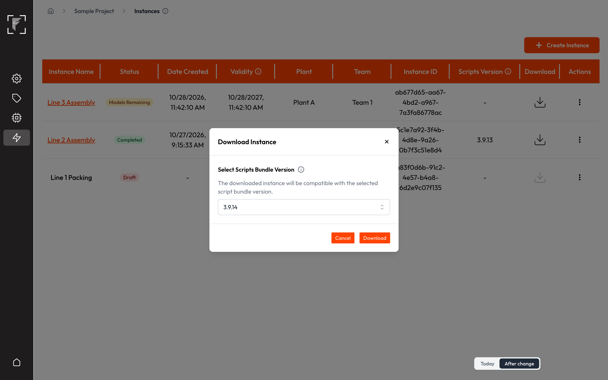
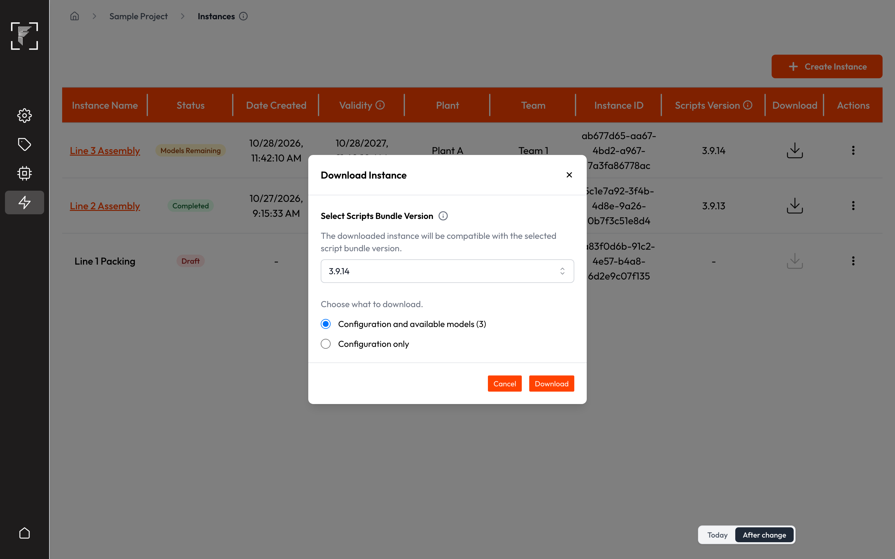

- **AC3.1** Instances table, Download column: on a Models Remaining row the Download icon opens the **Download Instance** popup directly (no menu). Completed rows keep today's menu.
- **AC3.2** The Download Instance popup has the existing "Select Scripts Bundle Version" picker and Cancel / Download buttons, laid out like today's Download Complete Instance popup.
- **AC3.3** When no slot has a model, the popup has no other choice; Download's tooltip is "Download the instance's configuration, without models.".
- **AC3.4** When some slots have models, the popup shows "Choose what to download." and two radio buttons below the version picker: **Configuration and available models (n)** (selected by default, n = number of models) and **Configuration only**. Download's tooltip is "Download the instance with the models picked so far.".
- **AC3.5** "Configuration only" downloads the database and masks with no models; the package is marked Configuration only for Edge.
- **AC3.6** "Configuration and available models" downloads the database, masks and the picked models; the package is marked as having models remaining.
- **AC3.7** The download integrity check skips empty slots, as today.

### US4 — Upload a Configuration only package to Edge
*As an integrator, I want to upload the configuration before the models, so that I can set up Edge now.*
- **Kind:** Feature
- **Parts:** edge-instance-details, edge-dashboard-builder
- **Teams:** SDE
- **Covers:** C2, C5, C10, C12
- **Today:** a database-only package is refused when the instance isn't on the box ("No instance found on edge. Cannot perform DB-only re-upload."); a package with empty model slots is accepted as complete.
- **Prototype:** https://vbv-fr.github.io/configuration-only-instance-prototype/#edge-upload

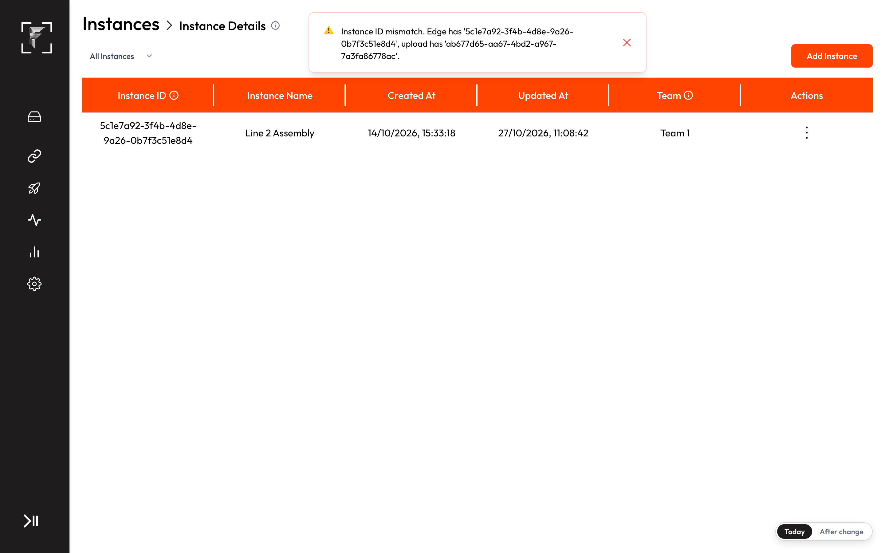
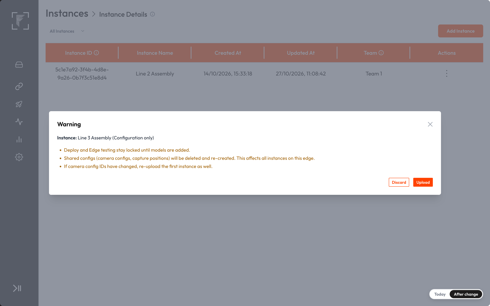

- **AC4.1** Edge, Instances, Add Instance with a Configuration only package for an instance not on the box: the existing Warning dialog opens with the line "Instance: Line 3 Assembly (Configuration only)" at the top (instance name, package kind in brackets; no separate Package line).
- **AC4.2** The dialog's list starts with "Deploy and Edge testing stay locked until models are added.", followed by today's new-instance warnings when other instances are on the box.
- **AC4.3** Upload creates the instance on Edge with every module and class from the package and no models.
- **AC4.4** Upload creates the default dashboard (named after the instance, linked, Active), as for a first full upload.
- **AC4.5** Edge, Instances table, Instance Name column: a yellow **Models Remaining** chip, styled like the Partially configured pill, sits right after the instance name. It disappears once every AI module slot has a model.
- **AC4.6** Instance page, Instance Overview: the same chip sits right after the instance name heading.
- **AC4.7** Instance page, Model - Module Mapping table: modules without a model are grouped in one row with the model name "Not added yet" (grey), listing their captures and modules, instead of being dropped.
- **AC4.8** A package with some models uploads the same way, with "(Models Remaining)" in brackets after the name and the line "Deploy stays locked until every module has a model.".

### US5 — Add Instance refuses an instance already on the Edge
*As an integrator, I want Edge to stop me adding the same instance twice, so that I don't get a duplicate dashboard or overwrite the wrong one.*
- **Kind:** Feature
- **Parts:** edge-instance-details
- **Teams:** SDE
- **Covers:** C4, C5
- **Today:** Add Instance compares the package against one arbitrary instance on the box; a full package for an instance already there can be taken as a new instance and gets a second default dashboard.
- **Prototype:** https://vbv-fr.github.io/configuration-only-instance-prototype/#edge-add-again

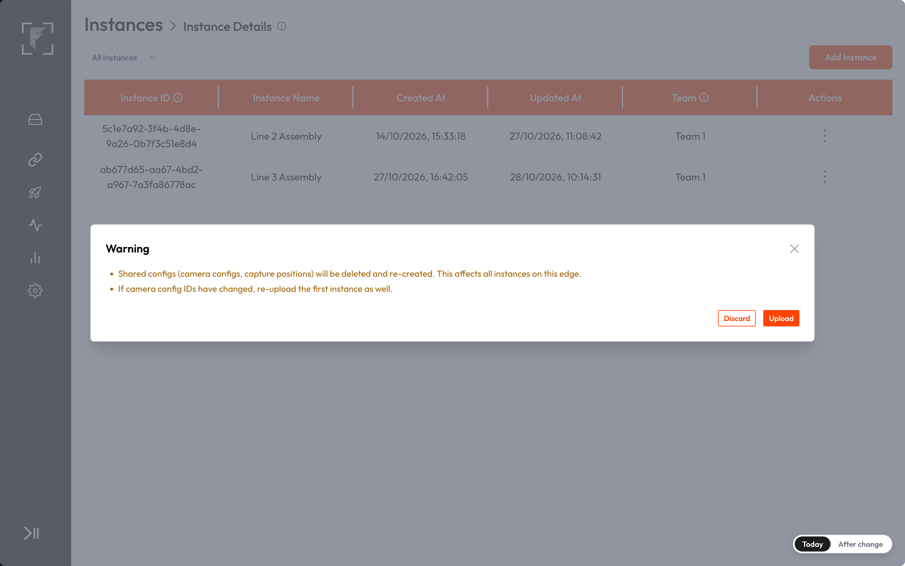
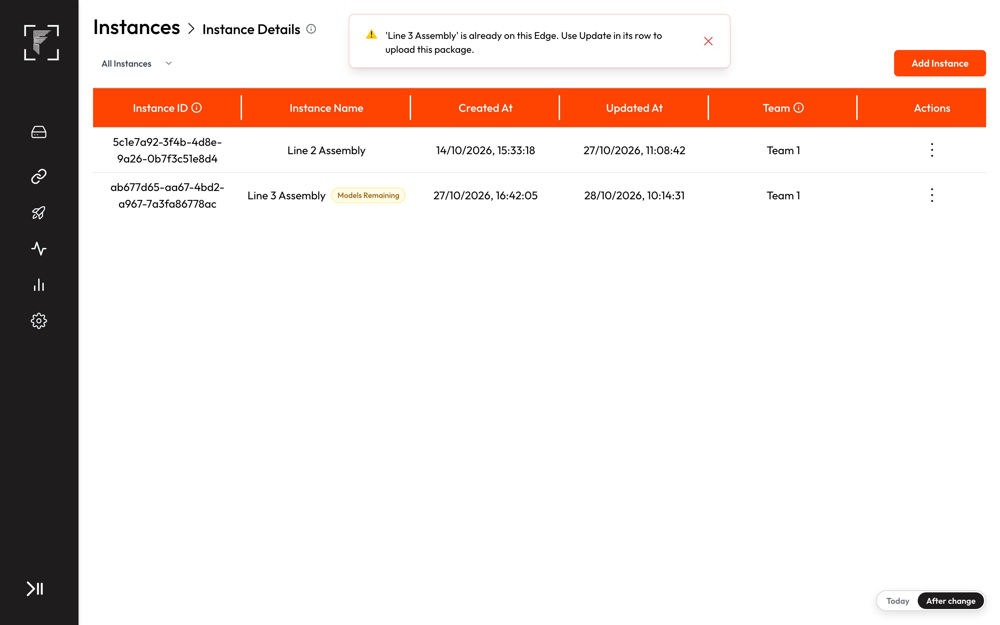

- **AC5.1** Edge, Instances, Add Instance: a package of any kind whose instance ID is already on this Edge is refused after "Verifying...", with the existing red error banner: "'Line 3 Assembly' is already on this Edge. Use Update in its row to upload this package." Nothing is changed.
- **AC5.2** Every upload check finds the instance on the box by the package's own instance ID, never by picking one of the instances on the box.
- **AC5.3** Row **Update** with a package for a different instance is refused with the red banner "This package is for 'Line 3 Assembly', not 'Line 2 Assembly'.".
- **AC5.4** Add Instance with a models-only package for an instance not on the box is refused with "This models package is for 'Line 3 Assembly'. Upload its configuration first.".

### US6 — See Models Remaining in the Dashboard Builder
*As an integrator, I want to see which dashboards belong to instances still missing models.*
- **Kind:** Feature
- **Parts:** edge-dashboard-builder
- **Teams:** SDE
- **Covers:** C12
- **Today:** the Instance column shows only the name.
- **Prototype:** https://vbv-fr.github.io/configuration-only-instance-prototype/#edge-dashboard

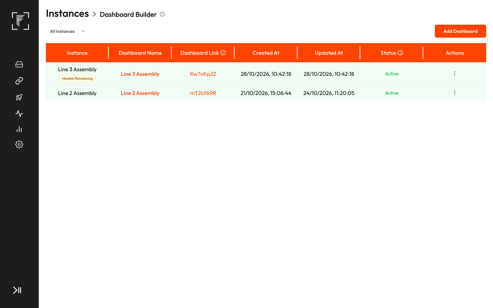

- **AC6.1** Edge, Dashboard Builder table, Instance column: the same yellow **Models Remaining** chip as AC4.5 shows with the instance name (under it when the column is too narrow) for every dashboard of a Models Remaining instance, and disappears with it.

### US7 — Thresholds lock until their model is on Edge
*As an integrator, I want to set everything in Edit Module Configurations except what needs a model, and see why the rest is locked.*
- **Kind:** Feature
- **Parts:** edge-emc, mod-odc, mod-ocr, mod-segmentation, mod-bead-inspection
- **Teams:** SDE
- **Covers:** C11
- **Today:** with no model, threshold fields show empty with a red "This field is required"; typed values are silently dropped while "Changes saved" shows.
- **Prototype:** https://vbv-fr.github.io/configuration-only-instance-prototype/#edge-emc

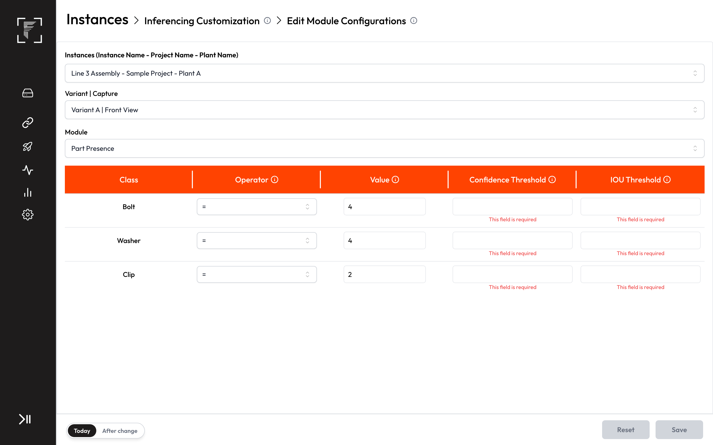
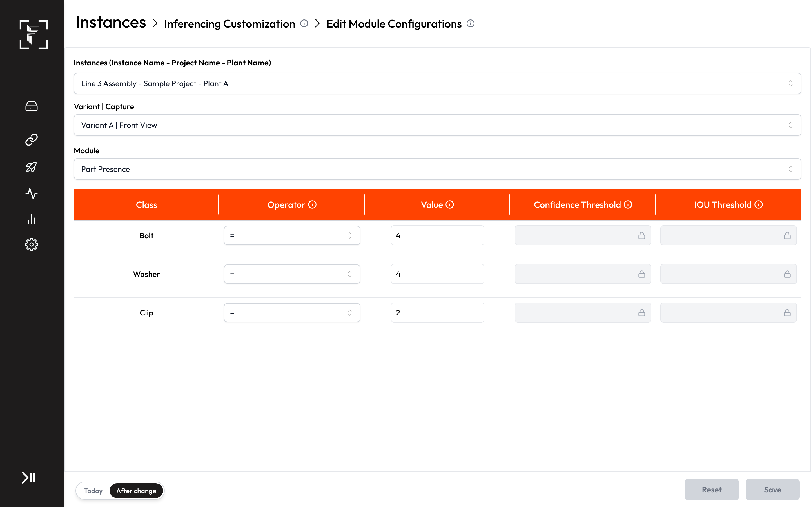

- **AC7.1** Edit Module Configurations, Object Detection: for a module without a model, the Confidence Threshold and IOU Threshold cells are greyed, read-only inputs with a lock icon and the tooltip "Add models to set thresholds". Operator and Value stay editable.
- **AC7.2** Segmentation: the class threshold fields lock the same way; Priority, Default Text and Correct Class stay editable.
- **AC7.3** Segmentation priority conditions are built from the recipe's classes, so they are kept and saved with no model (today they disappear and saving wipes them).
- **AC7.4** OCR: the Detection and Recognition confidence thresholds lock separately, each only while its own model is missing. Labels, ground-truth text and Angle Ground Truth stay editable.
- **AC7.5** Bead Inspection, Module Level Parameters: Confidence and Area lock the same way; Correct Calliper Percentage and all bead-level settings stay editable.
- **AC7.6** Bead class names come from the recipe's classes, so the name (not an ID) shows with no model.
- **AC7.7** A module that has its model shows editable thresholds filled from Vision's defaults (Confidence 0.7, IOU 0.3; OCR 0.7 / 0.7), even while other modules are still locked.
- **AC7.8** Locked fields don't count as errors: Save is enabled when other fields changed and nothing is lost.

### US8 — Edge testing per capture
*As an integrator, I want to test the captures whose models are on Edge, and see which ones can't be tested yet.*
- **Kind:** Feature
- **Parts:** edge-instance-details
- **Teams:** SDE
- **Covers:** C2, C5
- **Today:** Run Test lists every capture; modules without a model are sent with blank model IDs and the test likely ends in "Error in testing".
- **Prototype:** https://vbv-fr.github.io/configuration-only-instance-prototype/#edge-test-locked

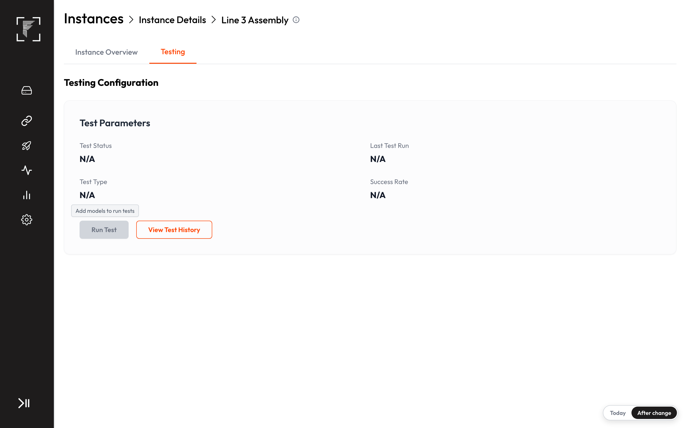
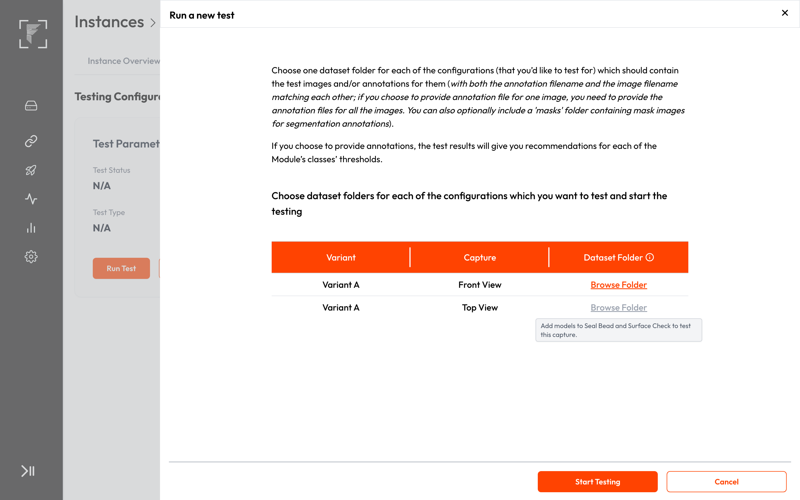

- **AC8.1** A capture can be tested only when every module in it that needs a model has one. A capture with no such module can always be tested.
- **AC8.2** Instance page, Testing tab: **Run Test** is disabled (existing disabled style) with the tooltip "Add models to run tests" when no capture can be tested.
- **AC8.3** Run a new test drawer, Dataset Folder column: for a capture that can't be tested, **Browse Folder** is grey with a not-allowed cursor and doesn't open the folder picker. Its tooltip names the modules: "Add models to Seal Bead and Surface Check to test this capture."
- **AC8.4** The backend refuses to start a test that includes a capture that can't be tested.

### US9 — Deploy waits for every model
*As an integrator, I want Deploy blocked until every model is on Edge, so that I never start a broken inspection.*
- **Kind:** Feature
- **Parts:** edge-deployment
- **Teams:** SDE
- **Covers:** C10
- **Today:** the deploy check skips empty model slots, so an instance with no models can be deployed.
- **Prototype:** https://vbv-fr.github.io/configuration-only-instance-prototype/#edge-deploy

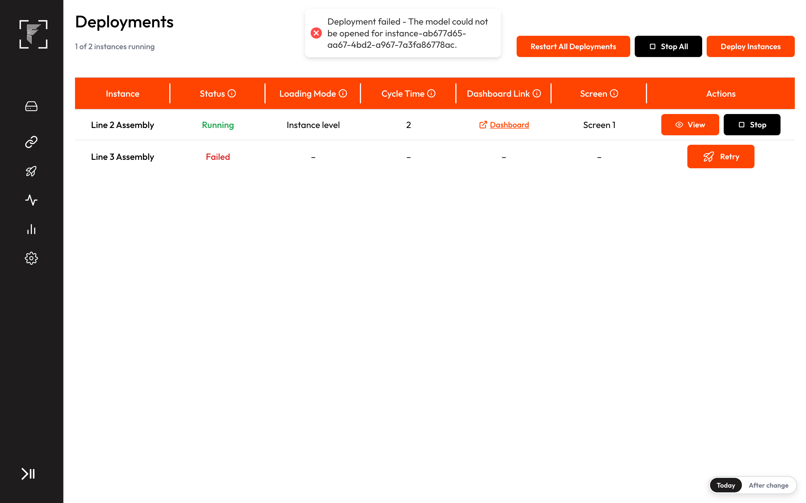
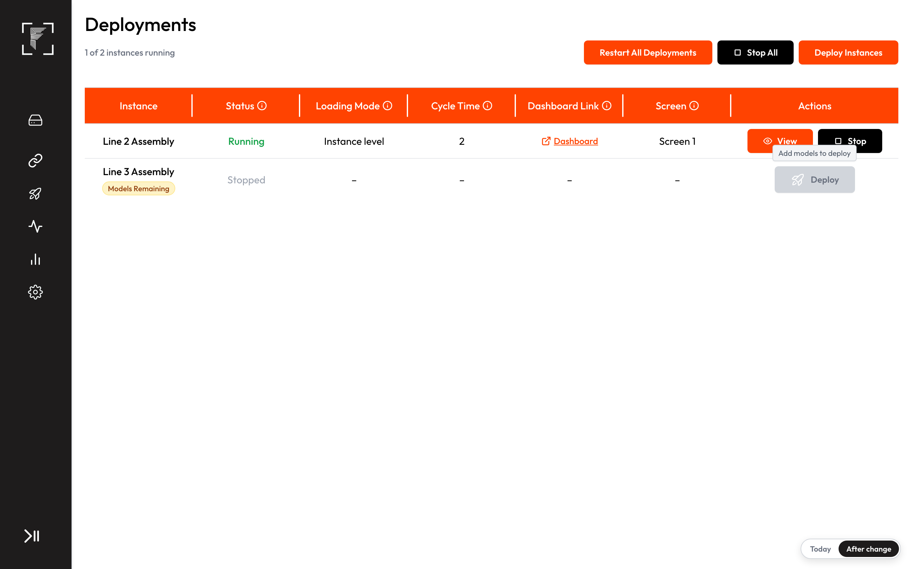

- **AC9.1** Deployments: on a Models Remaining instance's row, **Deploy** is disabled with the tooltip "Add models to deploy", alongside today's other block reasons.
- **AC9.2** In the Deploy drawer's instance list, the same instance's checkbox is disabled with the same tooltip.
- **AC9.3** The backend refuses a deploy of an instance with any empty AI module slot.

### US10 — Add the models later
*As an integrator, I want to add models to the instance I set up, without losing anything.*
- **Kind:** Feature
- **Parts:** edge-instance-details, vision-instance-creation
- **Teams:** SDE
- **Covers:** C3, C10
- **Today:** a models update is checked against an arbitrary instance on the box; the dialog shows only when there are warnings.
- **Prototype:** https://vbv-fr.github.io/configuration-only-instance-prototype/#edge-add-models

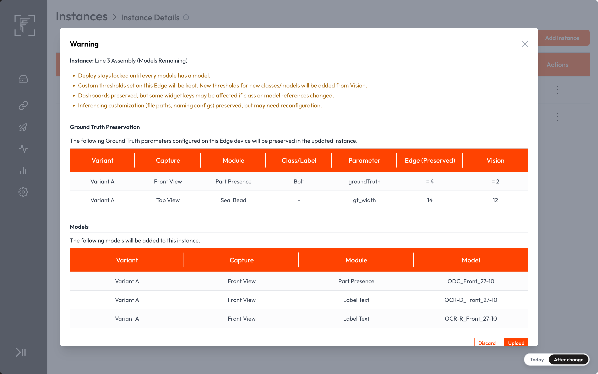
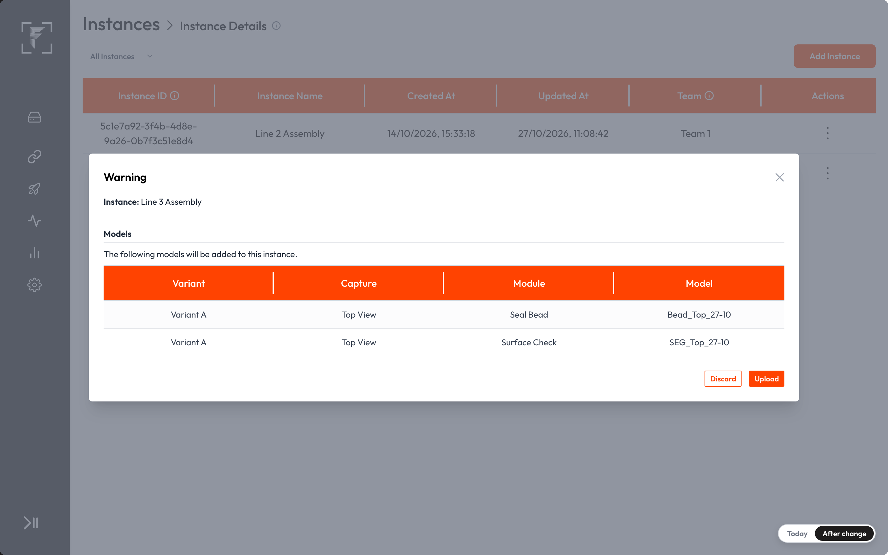

- **AC10.1** Edge, Instances, row Update with a package that adds models always opens the Warning dialog, with a **Models** section after the others: "The following models will be added to this instance." and a Variant | Capture | Module | Model table.
- **AC10.2** When the package also carries the configuration, the dialog shows today's re-upload lines (without the analysed-image reset line) and the Ground Truth Preservation table when a ground-truth value differs.
- **AC10.3** After upload, everything set up on Edge is kept: PLC configs, dashboards, analysed image configuration, inferencing customization and ground truth.
- **AC10.4** (removed): covered by AC4.5, AC7.7, AC8.1, AC9.1.
- **AC10.5** Vision, Completed instance: "Download Selected Files" lets the user pick only the new models, as today.

### US11 — Rules
*As a plant admin, I want access to stay as it is, so that nobody gains or loses rights with this feature.*
- **Kind:** Rules
- **Parts:** vision-access, edge-access-audit
- **Teams:** SDE
- **Covers:** C1
- **AC11.1** No role or permission changes. Finish without models needs the same permission as Finish; downloading needs today's download permission, plant and team.

### US12 — Keeps working: Edge setup without models
*As an integrator, I want every model-free setting to work on a Models Remaining instance.*
- **Kind:** Keeps working
- **Parts:** edge-plc-read, edge-plc-write, edge-internal-actions, edge-actions, edge-dashboard-builder, edge-inferencing-customization, edge-storage-image-saving, edge-emc
- **Teams:** SDE
- **Covers:** C9, C11, C12
- **AC12.1** PLC Read, Write and Internal configs and Dashboard actions can be set and saved; their keys come from the recipe's classes.
- **AC12.2** Dashboards can be edited and added in the Dashboard Builder.
- **AC12.3** Analysed Image Configurations can be set and saved.
- **AC12.4** Inferencing Customization (file names, paths, image saving, space) can be set and saved.
- **AC12.5** Edit Module Configurations: Classification, Code Reader, Tracker, Colour, Orientation, Shape Extractor and Dimensioning settings can be set and saved.
- **AC12.6** Uploads stay blocked while any deployment runs ("Stop all deployments to add an instance.").

### US13 — Platform
*As a Frinks support engineer, I want to know what ships where, so that releases stay predictable.*
- **Kind:** Platform
- **Parts:** engine-runtime-packaging, edge-installer, edge-health
- **Teams:** SDE
- **Covers:** C13, C17
- **AC13.1** Node Docker image: no change; no new libraries.
- **AC13.2** Python Docker image: no change.
- **AC13.3** Scripts bundle: changes; Vision and Edge backend/frontend changes ship in it.
- **AC13.4** Installer: no change.
- **AC13.5** Error codes: none new; the new refusals are upload/deploy/test validation messages.

### US14 — Migration requirements
*As an integrator, I want existing instances and boxes to keep working after the upgrade, so that nothing in the field breaks.*
- **Kind:** Migration
- **Parts:** vision-instance-creation, edge-backup-migration, edge-release-upgrade
- **Teams:** SDE
- **Covers:** C6, C7
- **AC14.1** Existing data: existing Vision instances get their Status from their saved model picks; instances finished with empty slots today show Models Remaining.
- **AC14.2** Existing blank model IDs in Vision are read as "no model".
- **AC14.3** Upgrades in the field: existing Edge instances with empty model slots show the Models Remaining chip and their Deploy is blocked after the upgrade.
- **AC14.4** Older Edge with a new instance: an older Edge receiving a Configuration only package: see Q1.
- **AC14.5** Older instance on the new Edge: complete instances behave exactly as today on the new Edge.

## 7. Out of scope
- Full re-upload resetting analysed-image box colours, widths and label sizes.
- Model training and evaluation.

## 8. How we'll know it worked
| Measure | Target |
|---|---|
| Instances uploaded to Edge as Configuration only | Used on new deployments within one release |
| Time from recipe done to Edge setup started | Down to the same day |

## Appendix A — Coverage
**Not applicable:**
- **C8** — N/A: no runtime path changes; locked instances can't deploy.
- **C14** — N/A: no change to data, annotation or training.
- **C15** — N/A: no network or time behaviour.
- **C16** — N/A: no security or licence change.
- **C18** — N/A: release note only, written with the tickets.

**Coverage check:**

> # Coverage check — PRD-configuration-only-instance.md
> 
> **Result:** PASS
> 
> - 14 user stories (10 feature, 1 rules, 1 keeps working, 1 platform, 1 migration), 73 ACs, 22 touched parts, 2 discussion points.
> - Checklist: 13 items covered by stories, 5 N/A, 0 open.

## Appendix B — Code references
- **Model Selection:** `frinksvision-frontend`: `src/modules/project/instances/steps/ModelSelection.tsx:425-536` — required slots, hasValidDetect; `:641-645` validation; `:688, :711` blank model IDs; `:823-825` swallowed save error; `index.tsx:756-793` footer; `Finish.tsx:123-146` activate.
- **Instances table / download:** `frinksvision-frontend`: `instances/index.tsx:546-552, 598, 673, 688`; `DownloadModal.tsx:599, 631`; `frinksvision-backend`: `service/packageManifest.ts:71-103`, `integrityCheck.ts:64-66`, `service/instance.ts` buildEdgeThresholdRows.
- **Edge upload:** `frinksedge-deployment-backend`: `service/manifestParser.ts:187-215, 245-296`; `service/uploadValidation.ts:50-130, 301-338, 342-425, 746-752, 1060-1470`; `controller/instance.ts:398-401`; `frinksedge-deployment-frontend`: `modules/instance/InstanceTable.jsx:62-160, 405`, `hooks/useInstanceUpload.jsx:164-229`.
- **Dashboard:** `frinksedge-deployment-backend`: `service/dashboard.ts:288-362`; frontend `dashboard-builder/DashboardBuilder.jsx`.
- **EMC:** `frinksedge-deployment-frontend`: `inferencing-customizations/.../AssemblySection.jsx:33-39`, `SegmentationSection.jsx:38`, `OCRSection.jsx:148-186`, `BeadInspectionConfigEditor.jsx:410, 475-487`, `useModuleConfig.js:231-232, 384-386`, `useFormSubmission.js`; backend `dao/threshold.ts:9-27`.
- **Testing:** backend `service/testing.ts:63-243`, `service/pythonModel.ts:529-1007`; frontend `individual-instance/UploadImage.jsx:28-46`.
- **Deploy:** backend `service/deployment.ts:860-985`, `failure/modelFilesCheck.ts:47-60`; frontend `modules/deployments/DeploymentInstanceRow.jsx:23-27`, `InstanceDetails.jsx:53-86`.

Repos checked: frinksvision-frontend, frinksvision-backend, frinksedge-deployment-frontend, frinksedge-deployment-backend, frinksedge-inferencing-backend, frinksedge-plc-backend, frinksedge-report, frinksedge-report-frontend, frinksedge-health, auto-training-backend (synced 28 Oct 2026).

## Changelog
- 29 Oct 2026 — Draft written from the signed-off prototype (US1–US14). Duplicate pass: AC10.4 (removed): covered by AC4.5, AC7.7, AC8.1, AC9.1; AC1.9 (removed): covered by AC1.2, AC1.4; AC12.5, AC13.2, AC1.10, AC1.11 trimmed; AC2.4 tooltip shortened. (Tanay Deo)

## Checked, not affected
- vision-auto-annotation, vision-datasets-annotations, vision-model-training, vision-model-evaluation, vision-training-sets-recommender, vision-projects, vision-variants, vision-captures-cameras, vision-recipe-tree: no change to how recipes, data or models are made.
- mod-classification, mod-code-reader, mod-color-detection, mod-input-master-image, mod-masking, mod-matting, mod-orientation, mod-result, mod-search-area, mod-shape-extractor, mod-tracker: settings need no model and stay as today (US12).
- engine-workflow, edge-model-loading-variant-change: never receive an instance with an empty slot (deploy blocked).
- edge-camera-capture, edge-encryption-keys, edge-live-dashboard, edge-networking, edge-plc-setup, edge-reports-analytics, edge-system-time: not touched.
