# PRD: Configuration only instance and Only Capture deployment

**Prototype:** [Interactive workflow, Today vs After change (33 steps)](https://vbv-fr.github.io/capture-only-deployment-prototype/)
**Product:** Vision + Edge
**Status:** In review
**Date:** 10 November 2026
**Owner:** Deb
**Timeline:** 10 Nov – 23 Nov 2026 (set at the first approval, before the Only Capture scope was added; to be confirmed again)
**Related:** FP-4174 (this work); FP-4000, FP-4001, FP-4003 (model-required checks in Vision and Edge, built after the first approval); PRDs "Captures with no inspection modules", "Image Storage", "Module Outputs in Reports", "Edge Instance Testing v2", "Older Edge with newer instance packages"
**Code checked:** 9–10 Nov 2026 — 10 repos at their latest default-branch commit (list in Appendix B)

---

## Discussion points

| # | Point to settle | Options on the table | Owner | Needed by |
|---|---|---|---|---|
| Q3 | An integrator deploys an instance as Only Capture with **Minute-wise reporting** ticked in Instance Settings. The raw images are saved on the box, but Analytics & Reports' download can't find them: it finds images through the cycle-wise rows, which Minute-wise reporting doesn't write. | (a) Untick and disable Minute-wise reporting for an Only Capture row in Instance Settings. (b) Allow it; raw images are reachable only on the box. (c) Make the download find raw images by folder when Minute-wise reporting is on. | Deb | Before US23 is planned |
| Q5 | An Only Capture cycle where one camera never sends its image (cable pulled, trigger missed). Today a capture that never reports ends the cycle NG at the cycle timeout. | (a) Keep today: the cycle ends NG at the timeout and Reports shows Fail. (b) The cycle ends at the timeout as Not inspected, like every Only Capture cycle. | Deb | Before US20 is planned |
| Q4 | US18, US19 and US21 need both SDE and AI work (inspection engine plus Edge backend/frontend). Who are their stakeholders? | Names from the SDE and AI teams | Deb | Before sprint planning |

## 1. Summary
- In Vision, an instance can be finished at Model Selection without every model, with **Finish without models** / **Finish without all models**, and is saved as **Models Remaining**. The Vision Instances table gets a **Status** column (Draft, Models Remaining, Completed).
- A Models Remaining instance downloads as a **Configuration only** package, or with the models picked so far. On Edge it uploads as a new instance with a default dashboard, so PLC, dashboards, analysed image, image saving, ground truth and every non-threshold setting can be done before the models arrive.
- Edge shows every instance's **Model Status** in the Instances table and the Dashboard Builder: **All models present**, **n of m models present**, **No models**, **Incorrect models**, or **No models required** for an instance whose captures need no model. The chip opens the instance's Model - Module Mapping table.
- Deploy Instances gets a **Deployment Type** per instance: **Inferencing** (today's behaviour; only for instances with all models present or no models required) or **Only Capture** (any instance: cameras capture, raw images are always saved, no model is loaded and no result is made).
- Only Capture cycles complete with no result: no OK/NG, counters don't move, model-output keys stay empty and rules that read them don't run. Analytics & Reports shows them as **Not inspected** and leaves them out of Total, Pass, Fail and Defect %.
- Thresholds and Edge testing wait for their own models; models are added later with the row's **Update**, keeping everything set up on Edge.
- Every upload check Edge runs today keeps its trigger and message. Add Instance also refuses a package whose instance is already on that Edge.

## 2. Why we are making this
- **Today:** Edge setup (PLC, dashboards, analysed image, image saving, file names, most of Edit Module Configurations) needs only the instance's configuration, but an instance reaches Edge only as one package with its models, so integrators wait for training. Since FP-4000/FP-4003, Vision and Edge refuse an instance with any missing model outright. There is also no way to run the line and keep raw images without a trained model: an instance with a missing model either can't be uploaded or crashes the inspection container once deployed.
- **Evidence:** internal need from deployment teams: Edge setup and image collection sit on the critical path behind model training.
- **After:** integrators set up the whole Edge side while models train, can run the line as Only Capture to collect raw images at any time, and deploy with Inferencing as soon as every model is on Edge.

## 3. Goals and non-goals
**Goals**
- G1. An instance can be finished and downloaded from Vision before every AI module has a model.
- G2. The Edge side can be fully set up from that package, except what really needs a model.
- G3. Inferencing, thresholds and Edge testing are clearly locked until the models they need are on Edge, with the reason shown.
- G4. Adding models later keeps everything already set up on Edge.
- G5. Every instance's model state is clear on Edge at a glance.
- G6. Any instance can be deployed as Only Capture: images are captured and saved, and no result is made up.

**Non-goals**
- Fixing full re-uploads resetting the analysed-image box colours, widths and label sizes.
- Changing how models are trained or picked.
- Changing roles or permissions.
- Making model-output triggers work without a model (they stay empty in Only Capture).

## 4. Key concepts
- **AI module slot:** one place in Model Selection where a model is picked: a detection model, an OCR detection model, an OCR recognition model (when the recipe has recognition on), a segmentation or bead model, and each per-class Classification slot inside an Object Detection module.
- **Configuration only package:** a Vision download with the instance's database and masks and no models, marked as such for Edge.
- **Models Remaining:** a Vision instance that is finished but has at least one empty AI module slot.
- **Model Status:** Edge's view of an instance's models: All models present, n of m models present, No models, Incorrect models, No models required.
- **Deployment Type:** per instance in Deploy Instances. **Inferencing** inspects images with AI models (today's deployment). **Only Capture** captures and saves raw images with no model loaded and no result.
- **Not inspected:** the result shown for an Only Capture cycle. It is neither Pass nor Fail.

## 5. Impact map

| Part | What will happen | User stories |
|---|---|---|
| Instance creation (vision-instance-creation) | Finish without (all) models, allowed past today's "model required" check; Status column; download with package choice; Configuration only marker | US1, US2, US3, US14 |
| Instance upload and details (edge-instance-details) | Configuration only upload; Model Status column and popup; mapping table lists each missing module; No models required chip; today's upload checks kept; Add Instance refuses an ID already on Edge; models added with Update; per-capture testing | US4, US15, US16, US5, US8, US10, US17 |
| Dashboard Builder (edge-dashboard-builder) | Default dashboard on a Configuration only upload; Model Status column | US4, US6, US12 |
| Edit Module Configurations (edge-emc) | Threshold fields locked per module and per OCR cell; everything else open | US7, US12 |
| Object Detection (mod-odc) | Confidence and IOU lock without a model | US7 |
| OCR (mod-ocr) | Detection and Recognition thresholds lock separately | US7 |
| Segmentation (mod-segmentation) | Class thresholds lock; priority conditions built from recipe classes | US7 |
| Bead Inspection (mod-bead-inspection) | Confidence and Area lock; class name from recipe | US7 |
| Deployments (edge-deployment) | Deployment Type column (Inferencing / Only Capture) in Deploy Instances; Only Capture tag on running rows; Inferencing refused without all models | US9 |
| Inspection engine (engine-workflow) | Only Capture mode: no model built or loaded, images grabbed, each capture reported done with no result; captured image sent to the Live Dashboard | US18, US19, US21, US24 |
| Model loading and variant change (edge-model-loading-variant-change) | Nothing to load in Only Capture; variant change keeps working | US18, US24 |
| Edge Refinement (mod-matting) | Its bundled weight isn't loaded in Only Capture | US18 |
| Result (mod-result) | An Only Capture cycle has no result | US20 |
| Inferencing customization (edge-inferencing-customization) | Completion keys written, model-output keys left empty in Only Capture; still settable without models | US20, US12, US24 |
| Actions (edge-actions) | Rules on empty model-output keys don't run | US20, US12 |
| PLC Write (edge-plc-write) | "Use key value" writes skipped on empty keys | US20, US12 |
| PLC Read (edge-plc-read) | Works on a Models Remaining instance and in Only Capture | US12, US24 |
| Internal actions (edge-internal-actions) | Works on a Models Remaining instance and in Only Capture | US12, US24 |
| Image saving (edge-storage-image-saving) | Only Capture always saves raw images; note under the Image Saving table | US19, US12 |
| Live Dashboard (edge-live-dashboard) | Captured image without marks; no false NG text on empty keys | US21 |
| Reports (edge-reports-analytics) | Not inspected rows, filter and counters; minute-wise Not inspected column | US22, US23 |
| Health (edge-health) | A container with no models passes readiness and Edge Health; no new error codes | US24, US13 |
| Vision access (vision-access) | No change, checked | US11 |
| Edge access (edge-access-audit) | No change, checked | US11 |
| Python images (engine-runtime-packaging) | No change | US13 |
| Installer (edge-installer) | No change | US13 |
| Release and upgrade (edge-release-upgrade) | Engine and backend ship together; version pairing for the new package | US14 |
| Backup and migration (edge-backup-migration) | Existing instances get Model Status; existing deploy settings read as Inferencing; Reports and minute data take the new values | US14 |

## 6. User stories and acceptance criteria

### US1 — Finish an instance without all its models
*As an ML engineer, I want to finish an instance before every model is trained, so that Edge setup can start now.*
- **Kind:** Feature
- **Parts:** vision-instance-creation
- **Teams:** SDE
- **Covers:** C2, C4, C5
- **Today:** Model Selection requires a model for every module (FP-4000): Next stays disabled with "A model is required for this module." or "No trained model is available for this module. Train a model before creating the instance.", so an instance can't be finished until every model is trained.
- **Prototype:** https://vbv-fr.github.io/capture-only-deployment-prototype/#vision-models

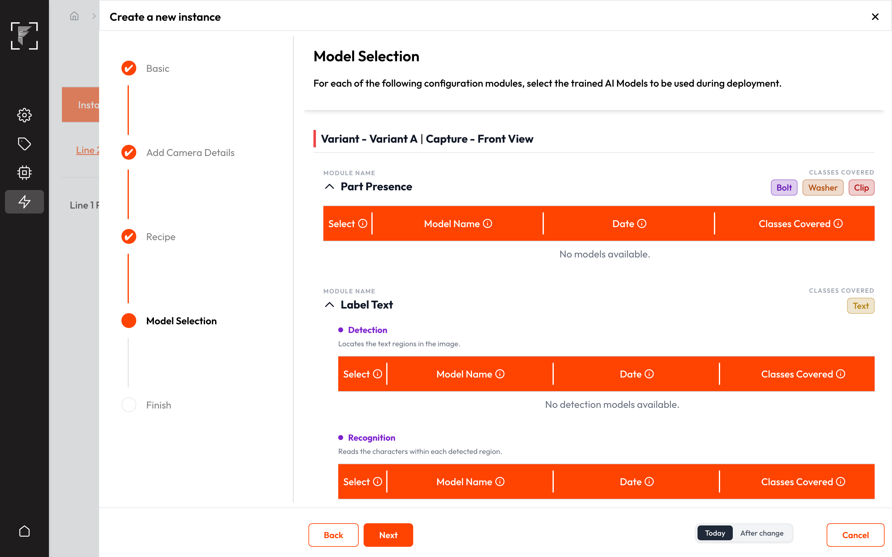
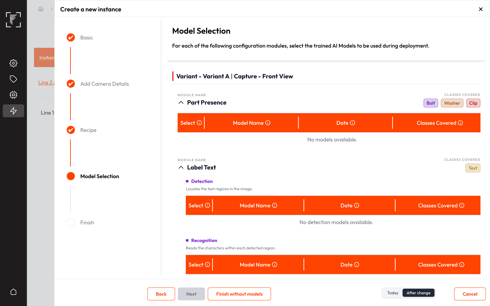
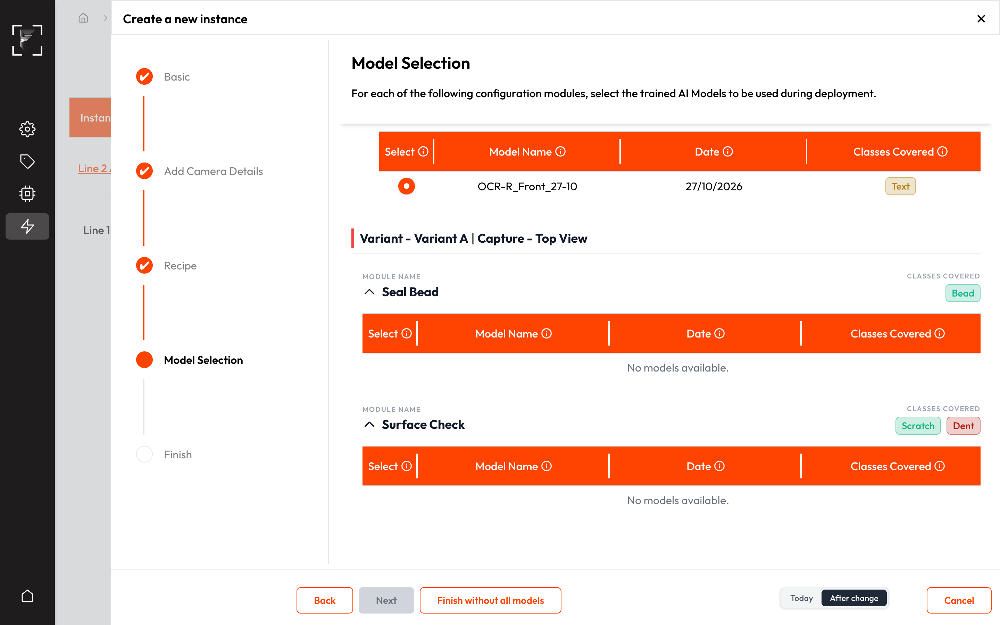

- **AC1.1** Vision, Create/Edit instance drawer, Model Selection step: **Next** is disabled (the existing disabled button style) until every AI module slot has a model. Its tooltip stays "Continue to the next step.".
- **AC1.2** The AI module slots counted are: each module's detection model; OCR's recognition model when the recipe has recognition on; and every per-class Classification slot inside an Object Detection module. Modules that never take a model (for example Code Reader) are not counted.
- **AC1.3** Model Selection footer: a bordered secondary button, styled like Back, sits right of Next. It reads **Finish without models** when no slot has a model, with tooltip "Save this instance without models. It stays Models Remaining until every AI module has a model."
- **AC1.4** The same button reads **Finish without all models** when some but not all slots have a model, with tooltip "Save this instance with the models picked so far. It stays Models Remaining until every AI module has a model."
- **AC1.5** The button is hidden once every slot has a model.
- **AC1.6** Clicking it saves the picked models, activates the instance (no Finish step), closes the drawer, shows the toast "Instance activated successfully!" and returns to the Instances table.
- **AC1.7** If saving the model picks fails, the instance is not activated, the drawer stays open on Model Selection and the existing save-error toast shows.
- **AC1.8** An empty slot is saved as "no model" (empty), never as a blank model ID.
- **AC1.9** (removed): covered by AC1.2 and AC1.4.
- **AC1.10** A slot whose models are still training shows "No models available." as today and counts as empty.
- **AC1.11** Projects with no AI modules skip Model Selection as today.
- **AC1.12** Today's "model required" messages ("A model is required for this module.", "No trained model is available for this module. Train a model before creating the instance.") never block Finish without models or Finish without all models.

### US2 — See each instance's status in Vision
*As an ML engineer, I want to see which instances still need models, so that I know what to finish.*
- **Kind:** Feature
- **Parts:** vision-instance-creation
- **Teams:** SDE
- **Covers:** C3, C5
- **Today:** a red superscript "draft" next to the name, and "Draft" in the Plant column when no plant/team.
- **Prototype:** https://vbv-fr.github.io/capture-only-deployment-prototype/#vision-instances

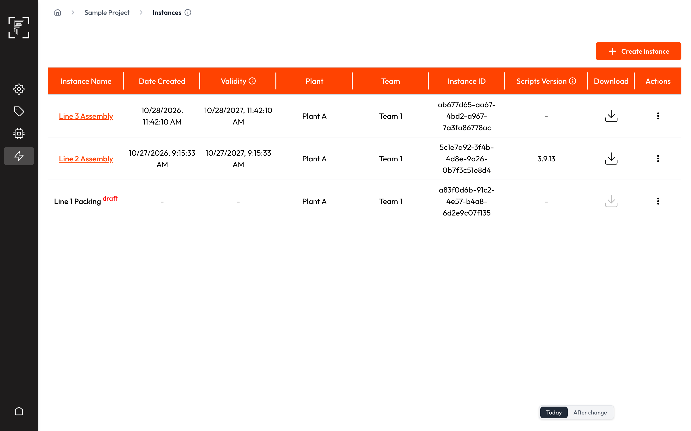
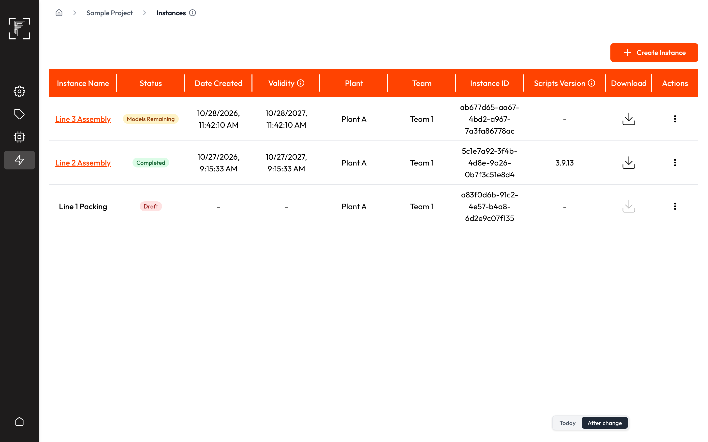

- **AC2.1** Vision, project Instances table: a new **Status** column is the 2nd column, right after Instance Name, showing one pill per row, styled like the existing Vision status pills.
- **AC2.2** **Draft** (grey pill): the instance was never finished, was invalidated by a config change, or has no plant/team. It replaces the red "draft" superscript and the "Draft" text in the Plant column. Tooltip: "Never activated, or invalidated by a config change. Can't be downloaded."
- **AC2.3** **Models Remaining** (yellow pill): finished, with at least one empty AI module slot. Tooltip: "Finished, but at least one AI module has no model yet. Add the models from Edit instance."
- **AC2.4** **Completed** (green pill): finished, and every AI module slot has a model (or the project has no AI modules). Tooltip: "Every AI module has a model."
- **AC2.5** Status is worked out by the backend from the saved model picks, with the same slot list as AC1.2, so it is right after an edit even when the user cancels the drawer after Model Selection.
- **AC2.6** A picked model that was later deleted in Vision (shown as "Unknown Model" in Model Selection) counts as an empty slot, so the instance shows Models Remaining.

### US3 — Download a Models Remaining instance
*As an ML engineer, I want to download what is ready, so that the integrator can start on Edge.*
- **Kind:** Feature
- **Parts:** vision-instance-creation
- **Teams:** SDE
- **Covers:** C4, C7
- **Today:** the Download icon opens a menu "Download Complete Instance" / "Download Selected Files".
- **Prototype:** https://vbv-fr.github.io/capture-only-deployment-prototype/#vision-download-some

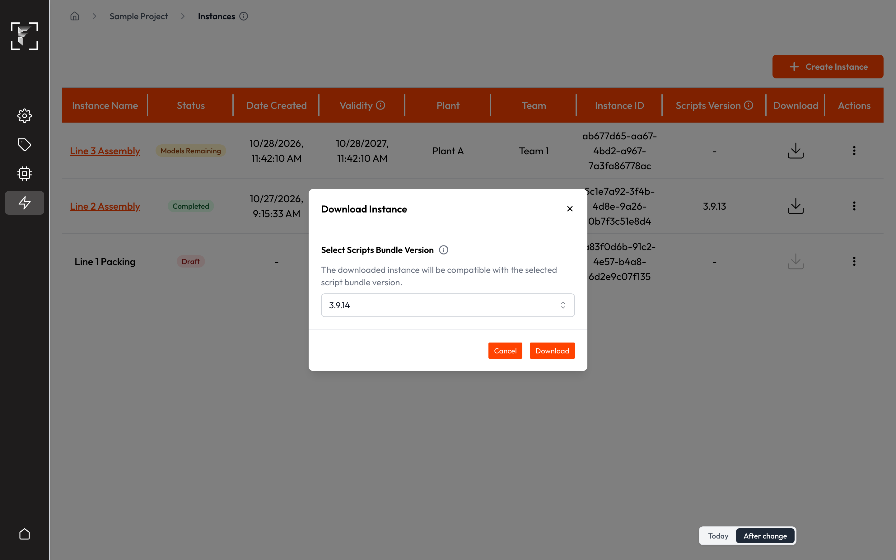
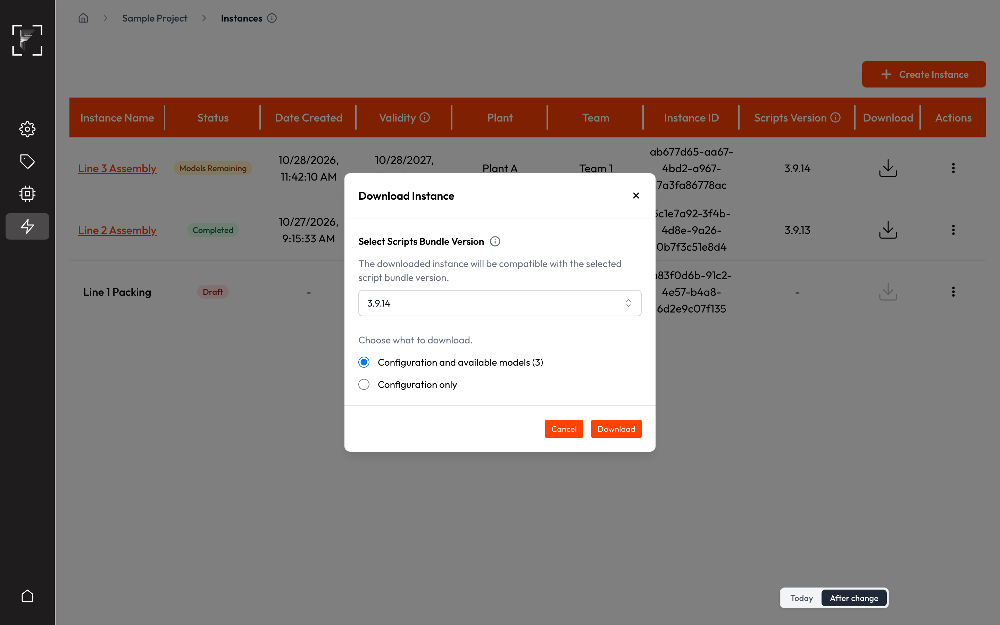

- **AC3.1** Instances table, Download column: on a Models Remaining row the Download icon opens the **Download Instance** popup directly (no menu). Completed rows keep today's menu.
- **AC3.2** The Download Instance popup has the existing "Select Scripts Bundle Version" picker and Cancel / Download buttons, laid out like today's Download Complete Instance popup.
- **AC3.3** When no slot has a model, the popup has no other choice; Download's tooltip is "Download the instance's configuration, without models.".
- **AC3.4** When some slots have models, the popup shows "Choose what to download." and two radio buttons below the version picker: **Configuration and available models (n)** (selected by default, n = number of models) and **Configuration only**. Download's tooltip is "Download the instance with the models picked so far.".
- **AC3.5** "Configuration only" downloads the database and masks with no models; the package is marked Configuration only for Edge.
- **AC3.6** "Configuration and available models" downloads the database, masks and the picked models; the package is marked as having models remaining.
- **AC3.7** The download integrity check skips empty slots, as today.

### US4 — Upload a Configuration only package to Edge
*As an integrator, I want to upload the configuration before the models, so that I can set up Edge now.*
- **Kind:** Feature
- **Parts:** edge-instance-details, edge-dashboard-builder
- **Teams:** SDE
- **Covers:** C2, C5, C10, C12
- **Today:** a database-only package is refused when the instance isn't on the box ("No instance found on edge. Cannot perform DB-only re-upload."), and since FP-4003 a package with an empty model slot is refused with "Upload blocked: <module> in <capture> has no model attached. Assign a model to it in Vision and download the instance again."
- **Prototype:** https://vbv-fr.github.io/capture-only-deployment-prototype/#edge-upload

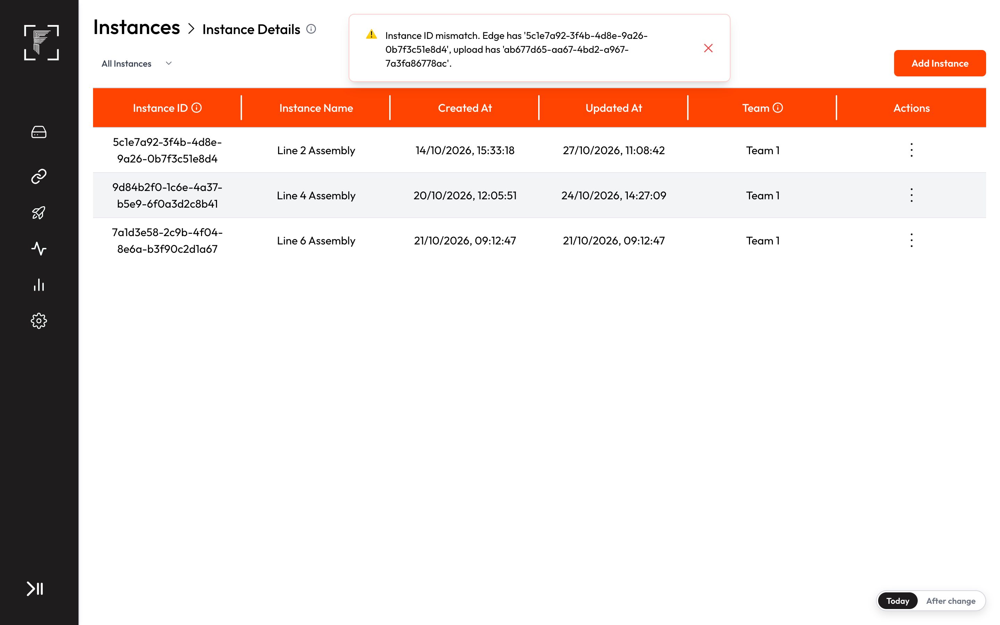
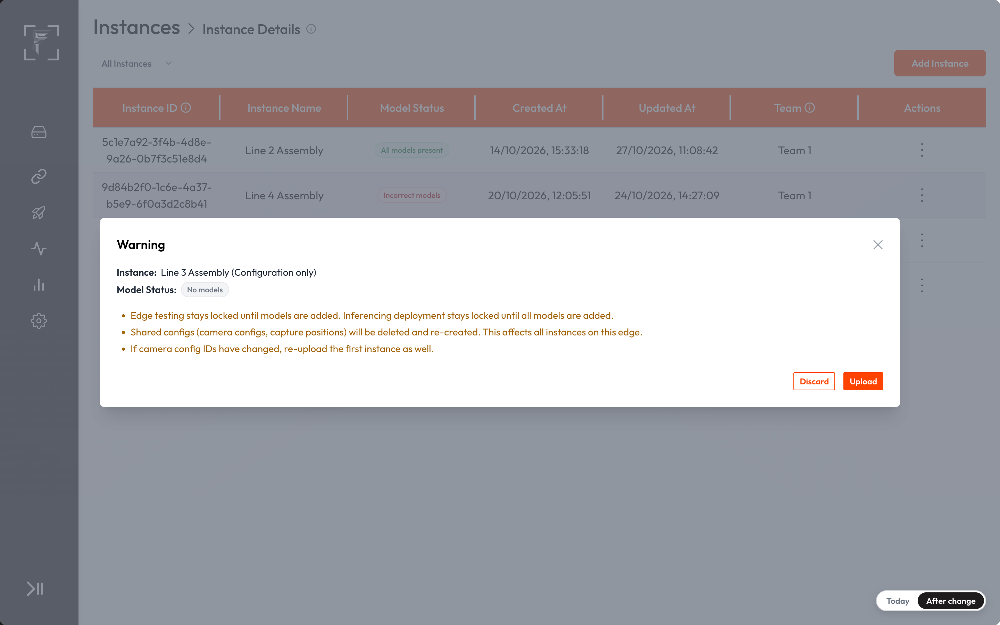
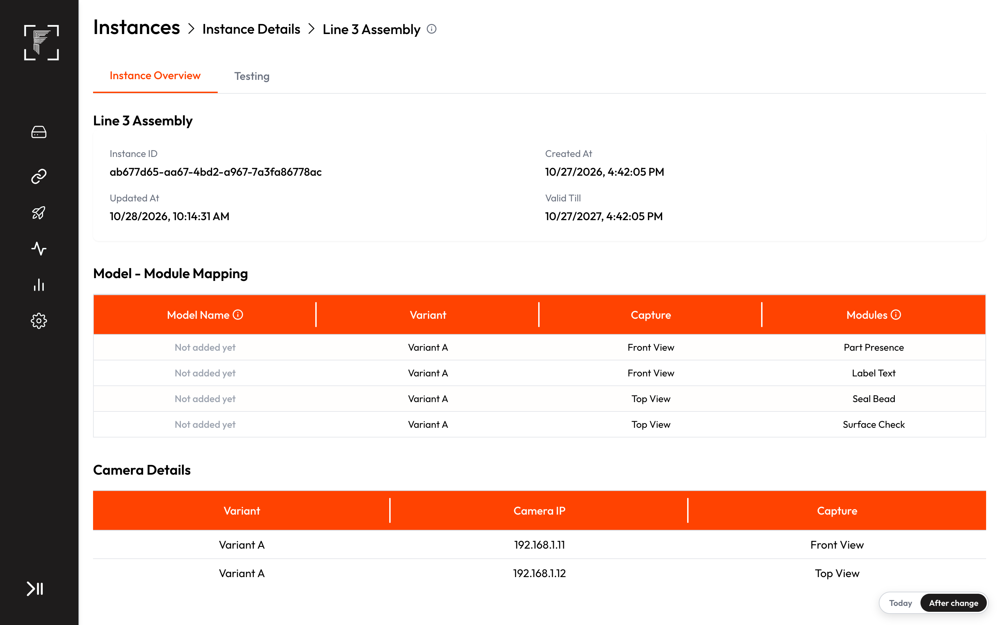

- **AC4.1** Edge, Instances, Add Instance with a Configuration only package for an instance not on the box: the existing Warning dialog opens with the line "Instance: Line 3 Assembly (Configuration only)" at the top (instance name, package kind in brackets; no separate Package line).
- **AC4.2** The dialog's list starts with "Edge testing stays locked until models are added. Inferencing deployment stays locked until all models are added.", followed by today's new-instance warnings when other instances are on the box.
- **AC4.3** Upload creates the instance on Edge with every module and class from the package and no models.
- **AC4.4** Upload creates the default dashboard (named after the instance, linked, Active), as for a first full upload.
- **AC4.5** (removed): replaced by the Model Status column (US15).
- **AC4.6** (removed): the Instance page shows no status chip; its Model - Module Mapping table (AC4.7) shows what is missing.
- **AC4.7** Instance page, Model - Module Mapping table: each module without a model is its own row, with "Not added yet" (grey) as the model name and its Variant, Capture and Module, instead of being dropped.
- **AC4.8** A package with some models uploads the same way, with no bracket after the name and the line "Captures missing models can't be tested. Inferencing deployment stays locked until all models are added.".
- **AC4.9** Under the Instance line, a "Model Status:" line shows the chip the instance will have after the upload (US15), for example "No models".
- **AC4.10** A Configuration only package and a package with some models pass the "Upload blocked: … has no model attached" check, at the check step and again at save.

### US15 — See every instance's Model Status on Edge
*As an integrator, I want to see at a glance which instances have their models, so that I know what can be deployed and how.*
- **Kind:** Feature
- **Parts:** edge-instance-details
- **Teams:** SDE
- **Covers:** C3, C5, C12
- **Today:** the Instances table shows no model information; a row whose model is still optimising or failed is greyed with no reason, and the backend's list status reads an instance with no model rows as complete, so No models and All models look the same.
- **Prototype:** https://vbv-fr.github.io/capture-only-deployment-prototype/#edge-instances

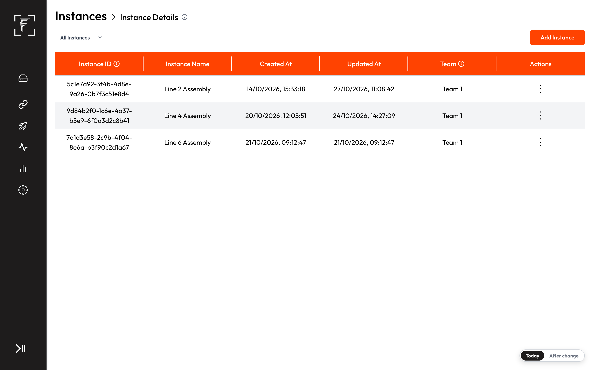
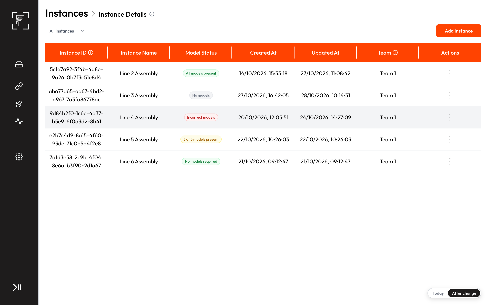
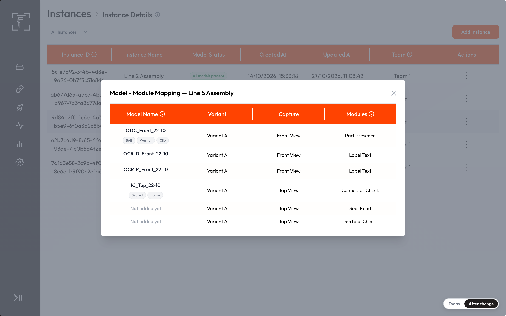
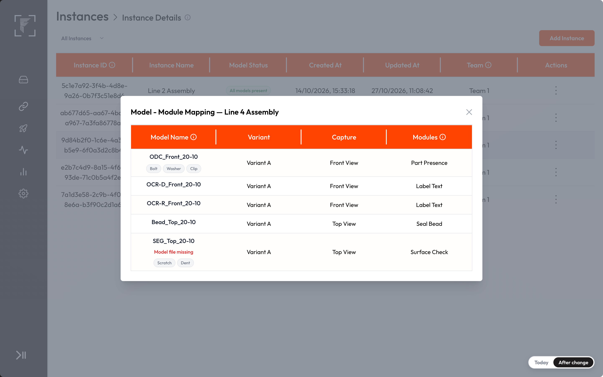

- **AC15.1** Edge, Instances table: a new **Model Status** column sits right after Instance Name, with one chip per row: a small rounded pill with a 1px border, styled like the Edge status pills.
- **AC15.2** Green **All models present** (light green fill, green text and border): at least one module needs a model, and every such module has one.
- **AC15.3** Yellow **n of m models present**, for example "3 of 5 models present": m is the number of modules that need a model (an OCR module's detection and recognition models count as one module) and n is how many of them have their model(s).
- **AC15.4** Grey **No models**: at least one module needs a model, and none of them has one.
- **AC15.5** Red **Incorrect models**: at least one model the instance points to fails a check Edge runs today (model not Completed, weight file missing or unusable, model deleted, model from another project, model not on this Edge). It wins over n of m and No models.
- **AC15.6** The status is worked out by the Edge backend from the instance's module–model mapping, so No models and All models present are told apart.
- **AC15.7** Clicking the chip opens a popup titled "Model - Module Mapping — <instance name>" with a ✕ button, holding the same Model - Module Mapping table as the Instance page. A click outside, ✕ or Esc closes it. A click elsewhere on the row opens the Instance page as today; a row greyed because a model is still optimising or failed stays unopenable, and its chip still opens the popup.
- **AC15.8** The Model - Module Mapping table (Instance page and popup) no longer shows the "n modules" chip in the Model Name column; the Modules column already names them.
- **AC15.9** In the same table, a model that fails an Edge check shows the failed check in red under its name, for example "Model file missing".

### US16 — Tell "No models required" apart from "All models present"
*As an integrator, I want to see when an instance needs no models at all, so that I don't mistake it for one whose models are all on Edge.*
- **Kind:** Feature
- **Parts:** edge-instance-details
- **Teams:** SDE
- **Covers:** C2, C5
- **Today:** an instance whose captures have only master images or Search Areas looks like any complete instance.
- **Prototype:** https://vbv-fr.github.io/capture-only-deployment-prototype/#edge-instances

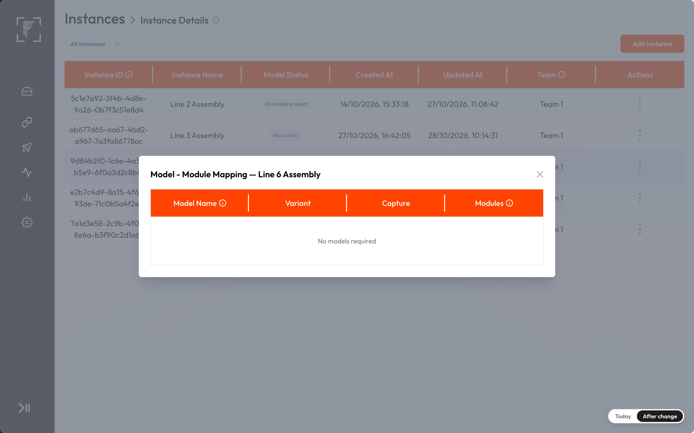

- **AC16.1** Edge, Instances table, Model Status column: an instance none of whose captures has a module that needs a model (for example only master images and Search Areas) shows a green **No models required** chip, styled like All models present.
- **AC16.2** Its chip popup and its Instance page's Model - Module Mapping table show "No models required" where today's table shows "No mapping information found.".

### US5 — Add Instance refuses an instance already on the Edge
*As an integrator, I want Edge to stop me adding the same instance twice, so that I don't get a duplicate dashboard or overwrite the wrong one.*
- **Kind:** Feature
- **Parts:** edge-instance-details
- **Teams:** SDE
- **Covers:** C4, C5
- **Today:** Add Instance compares the package against one arbitrary instance on the box; a full package for an instance already there can be taken as a new instance and gets a second default dashboard.
- **Prototype:** https://vbv-fr.github.io/capture-only-deployment-prototype/#edge-add-again

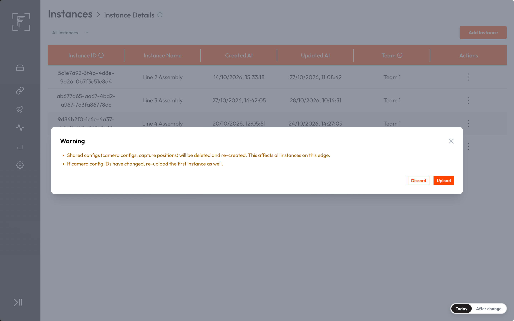
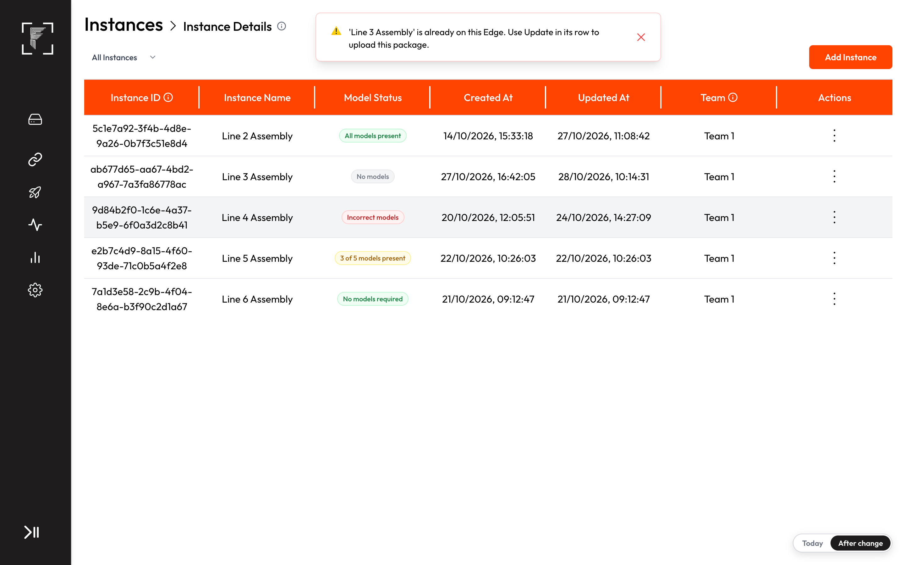

- **AC5.1** Edge, Instances, Add Instance: a package of any kind whose instance ID is already on this Edge is refused after "Verifying...", with the existing red error banner: "'Line 3 Assembly' is already on this Edge. Use Update in its row to upload this package." Nothing is changed.
- **AC5.2** Every upload check finds the instance on the box by the package's own instance ID, never by picking one of the instances on the box.
- **AC5.3** Row **Update** with a package for a different instance is refused with the red banner "This package is for 'Line 3 Assembly', not 'Line 2 Assembly'.".
- **AC5.4** Add Instance with a models-only package for an instance not on the box is refused with "This models package is for 'Line 3 Assembly'. Upload its configuration first.".

### US6 — See Model Status in the Dashboard Builder
*As an integrator, I want to see which dashboards belong to instances still missing models.*
- **Kind:** Feature
- **Parts:** edge-dashboard-builder
- **Teams:** SDE
- **Covers:** C12
- **Today:** the table shows only the instance name.
- **Prototype:** https://vbv-fr.github.io/capture-only-deployment-prototype/#edge-dashboard

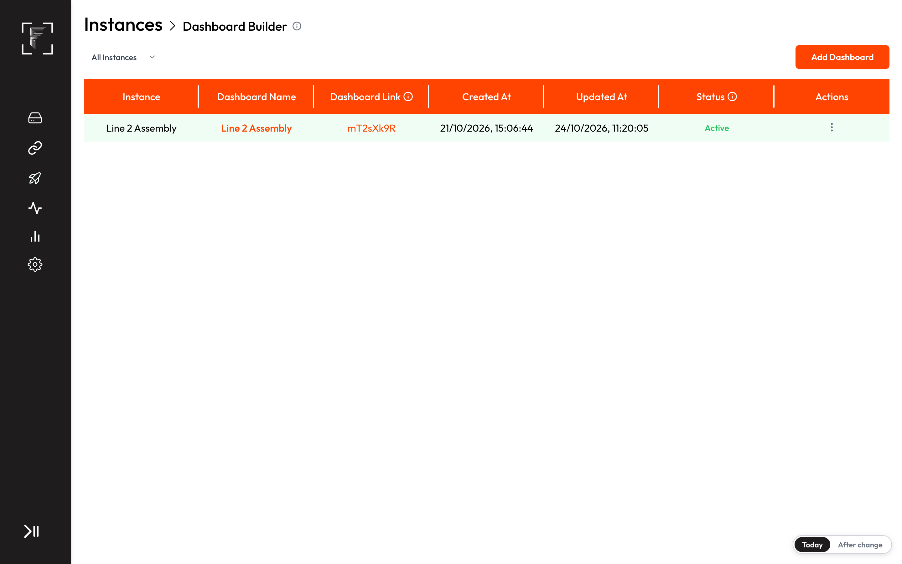
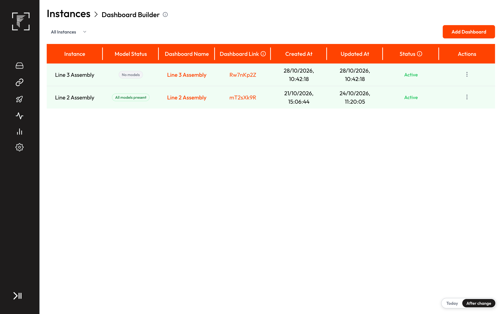

- **AC6.1** Edge, Dashboard Builder table: a **Model Status** column right after Instance shows the instance's chip for every dashboard, the same chips as the Instances table (US15, US16), updating when models are added.

### US7 — Thresholds lock until their model is on Edge
*As an integrator, I want to set everything in Edit Module Configurations except what needs a model, and see why the rest is locked.*
- **Kind:** Feature
- **Parts:** edge-emc, mod-odc, mod-ocr, mod-segmentation, mod-bead-inspection
- **Teams:** SDE
- **Covers:** C11
- **Today:** with no model, threshold fields show empty with a red "This field is required"; typed values are silently dropped while "Changes saved" shows.
- **Prototype:** https://vbv-fr.github.io/capture-only-deployment-prototype/#edge-emc

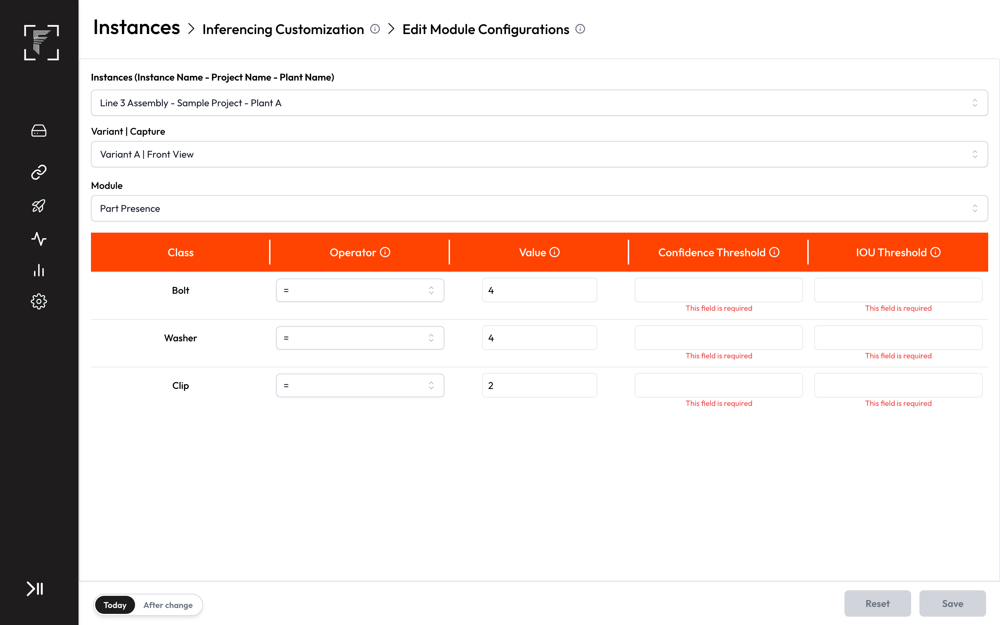
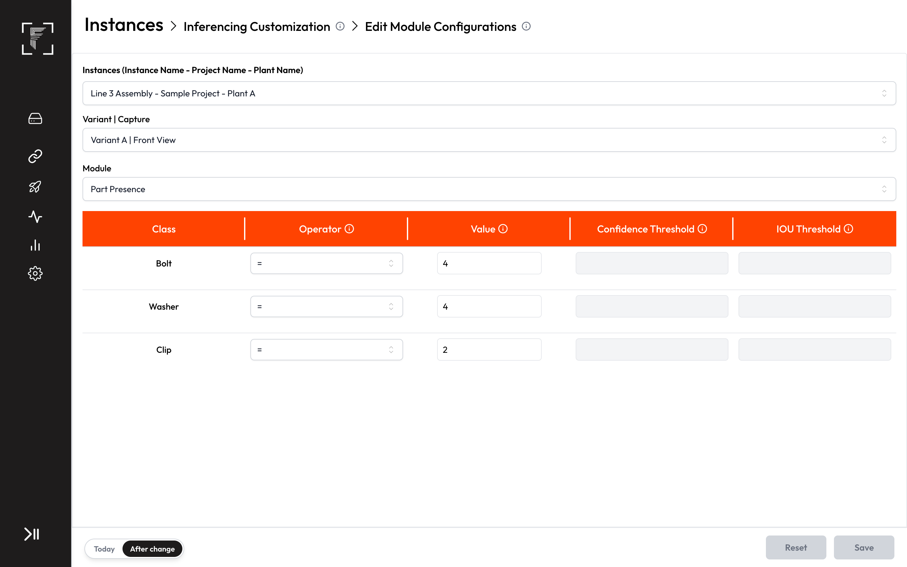

- **AC7.1** Edit Module Configurations, Object Detection: for a module without a model, the Confidence Threshold and IOU Threshold cells are greyed, read-only inputs (no lock icon) with the tooltip "Add models to set thresholds". Operator and Value stay editable.
- **AC7.2** Segmentation: the class threshold fields lock the same way; Priority, Default Text and Correct Class stay editable.
- **AC7.3** Segmentation priority conditions are built from the recipe's classes, so they are kept and saved with no model (today they disappear and saving wipes them).
- **AC7.4** OCR: the Detection and Recognition confidence thresholds lock separately, each only while its own model is missing. Labels, ground-truth text and Angle Ground Truth stay editable.
- **AC7.5** Bead Inspection, Module Level Parameters: Confidence and Area lock the same way; Correct Calliper Percentage and all bead-level settings stay editable.
- **AC7.6** Bead class names come from the recipe's classes, so the name (not an ID) shows with no model.
- **AC7.7** A module that has its model shows editable thresholds filled from Vision's defaults (Confidence 0.7, IOU 0.3; OCR 0.7 / 0.7), even while other modules are still locked.
- **AC7.8** Locked fields don't count as errors: Save is enabled when other fields changed and nothing is lost.
- **AC7.9** Beside the threshold heading of a locked module ("Thresholds for classes", "Confidence Thresholds:"), grey text reads "Add models to set thresholds", with no icon.

### US8 — Edge testing per capture
*As an integrator, I want to test the captures whose models are on Edge, and see which ones can't be tested yet.*
- **Kind:** Feature
- **Parts:** edge-instance-details
- **Teams:** SDE
- **Covers:** C2, C5
- **Today:** Run Test lists every capture; modules without a model are sent with blank model IDs and the test likely ends in "Error in testing".
- **Prototype:** https://vbv-fr.github.io/capture-only-deployment-prototype/#edge-test-locked

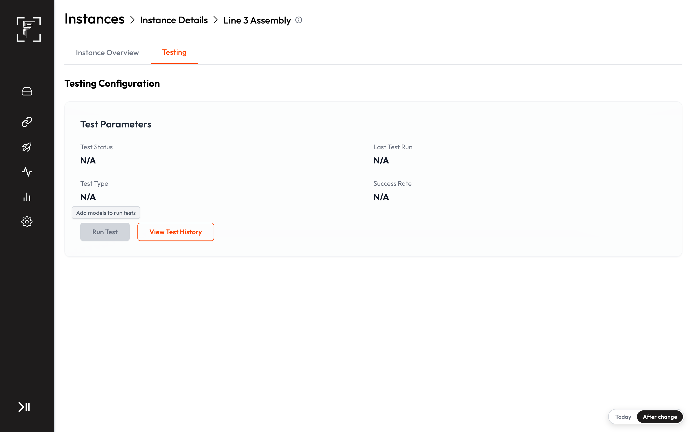
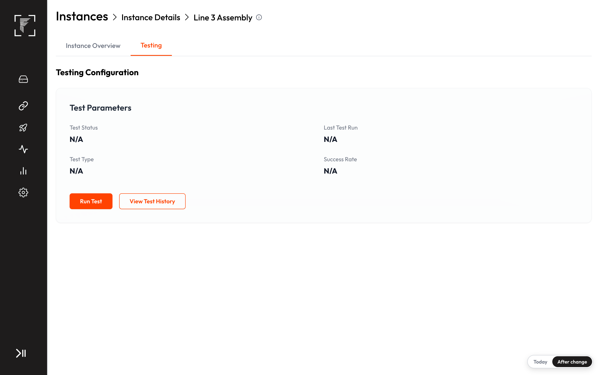

- **AC8.1** A capture can be tested only when every module in it that needs a model has one. A capture with no such module can always be tested.
- **AC8.2** Instance page, Testing tab: **Run Test** is disabled (existing disabled style) with the tooltip "Add models to run tests" when no capture can be tested.
- **AC8.3** Run a new test drawer, Dataset Folder column: for a capture that can't be tested, **Browse Folder** is grey with a not-allowed cursor and doesn't open the folder picker. Its tooltip names the modules: "Add models to Seal Bead and Surface Check to test this capture."
- **AC8.4** The backend refuses to start a test that includes a capture that can't be tested.

### US9 — Choose Inferencing or Only Capture when deploying
*As an integrator, I want to pick per instance whether it inspects or only captures, so that I can run any instance on the line while models are missing, and never start an inspection without its models.*
- **Kind:** Feature
- **Parts:** edge-deployment
- **Teams:** SDE
- **Covers:** C4, C5, C10
- **Today:** Deploy Instances has no deployment type. The deploy check skips empty model slots, so an instance missing models starts and then fails to open them ("Deployment failed - The model could not be opened for instance-<id>."); an instance with a broken model is refused ("Deployment failed - Models are missing or not ready for: <names>.").
- **Prototype:** https://vbv-fr.github.io/capture-only-deployment-prototype/#edge-inference-instances

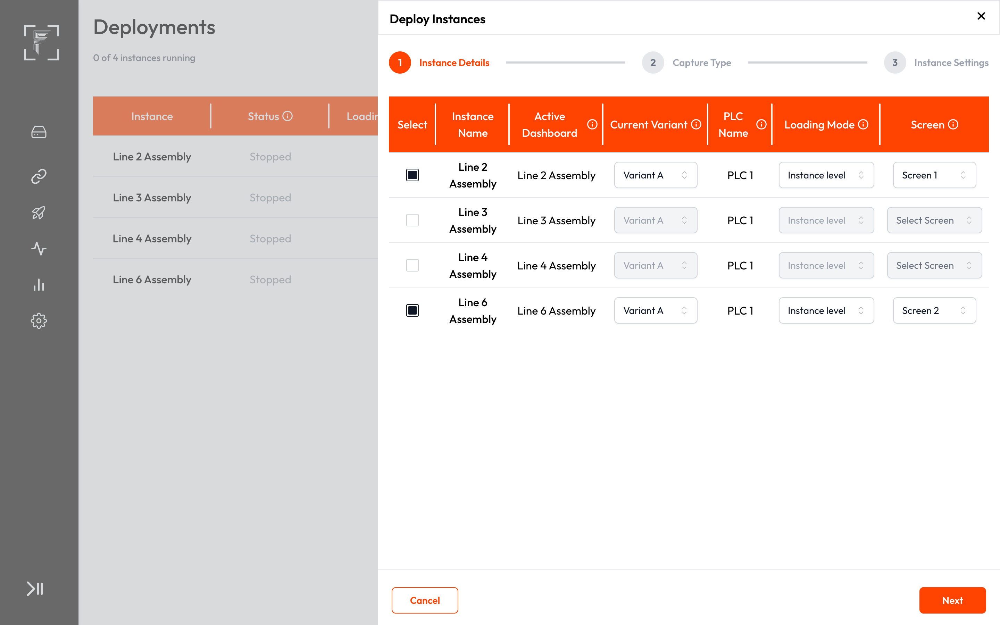
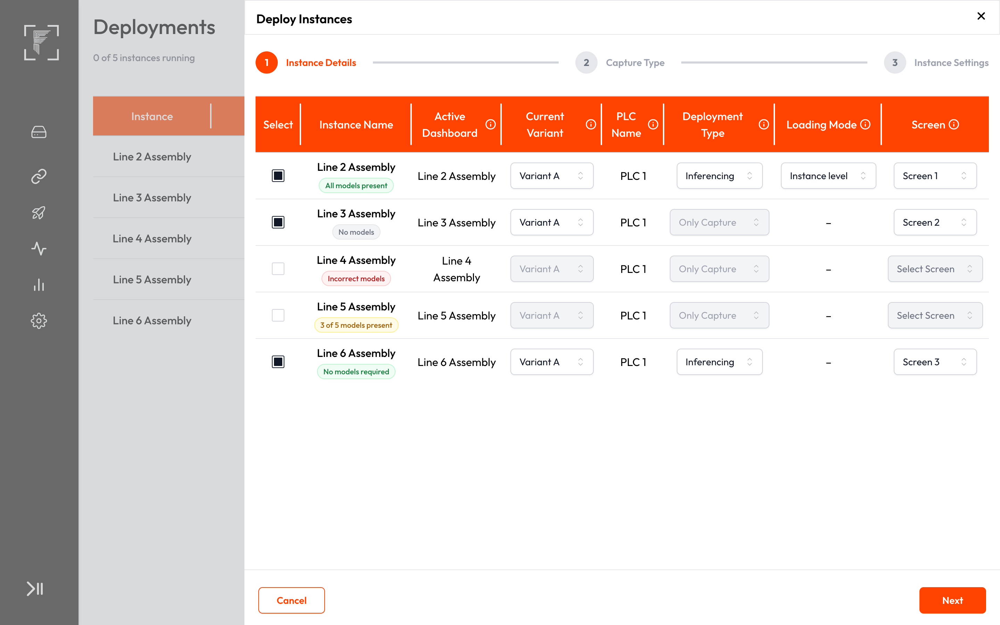

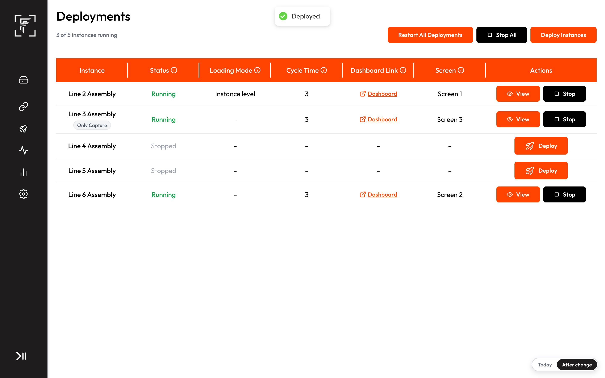

- **AC9.1** (removed): deploy no longer waits for every model; replaced by AC9.4–AC9.16.
- **AC9.2** (removed): instances are no longer greyed for missing models in the drawer; see AC9.7.
- **AC9.3** (removed): replaced by AC9.14.
- **AC9.4** Deploy Instances drawer keeps its 3 steps (Instance Details → Capture Type → Instance Settings). Instance Details gets a **Deployment Type** column right after PLC Name: a dropdown styled like the Loading Mode dropdown, with the header tooltip "Inferencing inspects images with AI models. Only Capture saves raw images without loading models.". The drawer widens so every column fits without side-scrolling.
- **AC9.5** The dropdown offers **Inferencing** and **Only Capture**, and defaults to Inferencing.
- **AC9.6** An instance whose Model Status is n of m models present, No models or Incorrect models defaults to Only Capture and its dropdown is disabled (existing disabled style), with the tooltip "Inferencing needs all models. Not all models are present on this instance.", "Inferencing needs all models. No models on this instance." or "Inferencing needs all models. Incorrect models on this instance.". All models present and No models required instances can choose either.
- **AC9.7** Every stopped instance can be ticked whatever its Model Status; the existing reasons (no active dashboard, already running) still disable the checkbox with today's tooltips.
- **AC9.8** One deployment can mix instances set to Inferencing and to Only Capture.
- **AC9.9** Loading Mode shows "–" for a row set to Only Capture and for an instance that needs no model.
- **AC9.10** The Loading Mode column is hidden when no instance in the drawer needs a model and can run Inferencing (for example a row Deploy of an Incorrect models instance).
- **AC9.11** Instance Details shows each instance's Model Status chip (US15, US16) under its name; Capture Type shows the same chip on each instance's block header.
- **AC9.12** A row's own **Deploy** opens the same drawer for that instance, with its Deployment Type set and locked by the same rules.
- **AC9.13** Capture Type and Instance Settings steps are otherwise unchanged.
- **AC9.14** The backend refuses Inferencing for an instance that is neither All models present nor No models required, with today's message "Deployment failed - Models are missing or not ready for: <names>.", and accepts Only Capture for any instance without running the model file check.
- **AC9.15** Deployments table: a running Only Capture instance shows a grey **Only Capture** pill next to its name (styled like the Edge status pills) and "–" in Loading Mode.
- **AC9.16** The View drawer of a running instance shows its Deployment Type as read-only text in the same column.

### US18 — Run an instance as Only Capture
*As an integrator, I want an Only Capture instance to run its cameras without loading any model, so that the line runs and images are kept before models exist.*
- **Kind:** Feature
- **Parts:** engine-workflow, edge-model-loading-variant-change, mod-matting, edge-inferencing-customization
- **Teams:** SDE + AI
- **Stakeholders:** to be named (Q4)
- **Covers:** C8, C10
- **Today:** there is no capture-only mode. An empty model slot crashes the inspection container (Segmentation, Classification, OCR) or makes every frame fail with no result (Object Detection); loading modes that build on the first frame crash after "Deployed" shows.
- **Prototype:** https://vbv-fr.github.io/capture-only-deployment-prototype/#edge-deployed

- **AC18.1** Only Capture is sent to the inspection engine with each instance's deploy settings (beside Loading Mode), so it applies to that instance only and still holds after a variant change.
- **AC18.2** For an Only Capture instance the engine builds and loads no model, including Edge Refinement's bundled weight.
- **AC18.3** Each capture grabs its image and runs no inspection module.
- **AC18.4** Each capture reports to Edge as done with no result.

### US19 — Only Capture always saves raw images
*As an integrator, I want every Only Capture image kept, so that the run produces images to train with.*
- **Kind:** Feature
- **Parts:** edge-storage-image-saving, engine-workflow
- **Teams:** SDE + AI
- **Stakeholders:** to be named (Q4)
- **Covers:** C12
- **Today:** raw images are saved only when the capture's Raw Image row is on in Image Saving Configurations, and into an OK or NG folder decided by the result.
- **Prototype:** https://vbv-fr.github.io/capture-only-deployment-prototype/#edge-image-saving

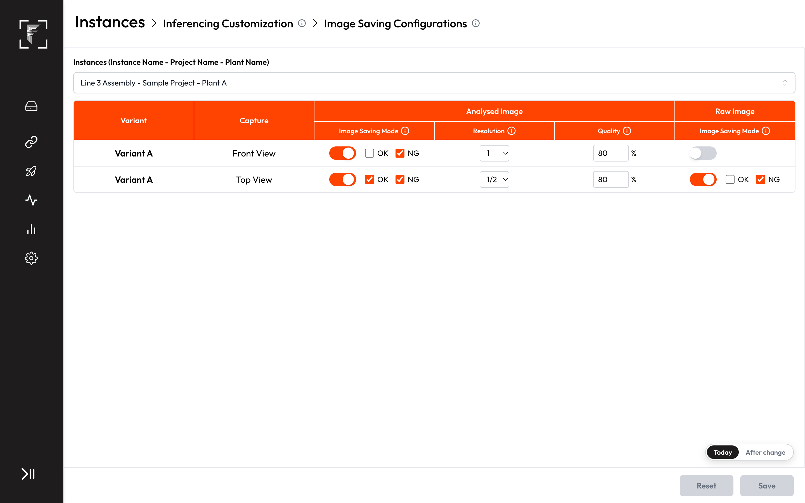
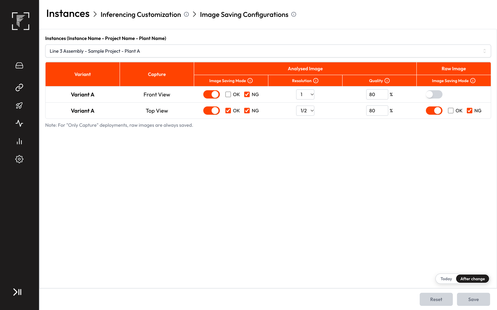

- **AC19.1** In Only Capture, every capture's raw image is saved, whatever the Raw Image row says in Image Saving Configurations.
- **AC19.2** Only Capture images go into the instance's raw images folder with no Pass/Fail subfolder.
- **AC19.3** Edge, Inferencing Customization, Image Saving Configurations: a grey note under the table reads 'Note: For "Only Capture" deployments, raw images are always saved.'.

### US20 — Results, keys and rules in Only Capture
*As an integrator, I want Only Capture cycles to finish without a made-up result, so that no part is rejected and no PLC rule fires on an empty value.*
- **Kind:** Feature
- **Parts:** mod-result, edge-inferencing-customization, edge-actions, edge-plc-write
- **Teams:** SDE
- **Covers:** C9
- **Today:** a capture without a result is stored as a fail, so every part would go NG; empty results are written as 0, and "!=" rules fire on them.
- **Prototype:** https://vbv-fr.github.io/capture-only-deployment-prototype/#edge-deployed

- **AC20.1** An Only Capture cycle completes (cycle complete is set) with no result: neither OK nor NG.
- **AC20.2** OK/NG and pass/fail counts don't change for an Only Capture cycle.
- **AC20.3** Capture completion status and variant completion status are written for every capture and variant of an Only Capture cycle.
- **AC20.4** Model-output keys (capture and variant result, module, class, OCR, bead, shape and dimension keys, inference time) are not written in Only Capture and stay empty.
- **AC20.5** A PLC Write, Internal or Dashboard rule whose condition reads an empty model-output key doesn't run.
- **AC20.6** A Write to PLC action set to use a key's value doesn't write when that key is an empty model-output key.

### US21 — Live Dashboard during Only Capture
*As an operator, I want the Live Dashboard to show what the camera sees and no false verdict, so that I can watch an Only Capture run.*
- **Kind:** Feature
- **Parts:** edge-live-dashboard, engine-workflow
- **Teams:** SDE + AI
- **Stakeholders:** to be named (Q4)
- **Covers:** C12
- **Today:** image components show the engine's annotated image; a text component with a condition such as "!= 1 → NG" matches an empty key and shows NG.
- **Prototype:** https://vbv-fr.github.io/capture-only-deployment-prototype/#edge-deployed

- **AC21.1** Live Dashboard image components show the captured image without marks for an Only Capture instance.
- **AC21.2** A text component's condition doesn't match an empty key, so no NG text shows for an Only Capture cycle.

### US22 — Not inspected cycles in Analytics & Reports
*As a quality engineer, I want Only Capture cycles shown as Not inspected, so that they are never counted as passed or failed parts.*
- **Kind:** Feature
- **Parts:** edge-reports-analytics
- **Teams:** SDE
- **Covers:** C12
- **Today:** a cycle with no result is stored as Fail; with no capture rows its raw images can't be opened ("N/A").
- **Prototype:** https://vbv-fr.github.io/capture-only-deployment-prototype/#edge-reports-capture

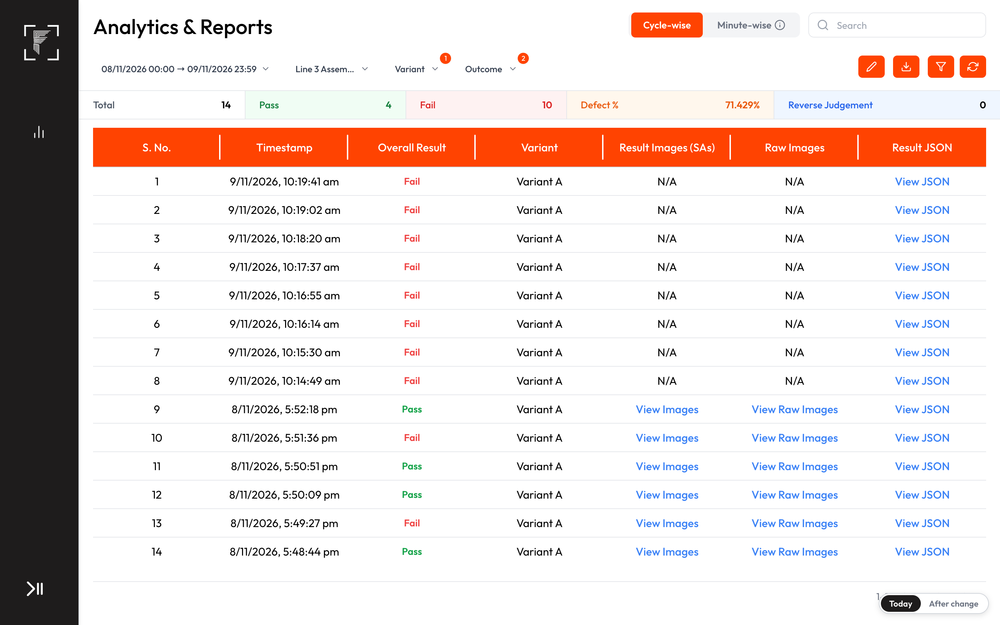
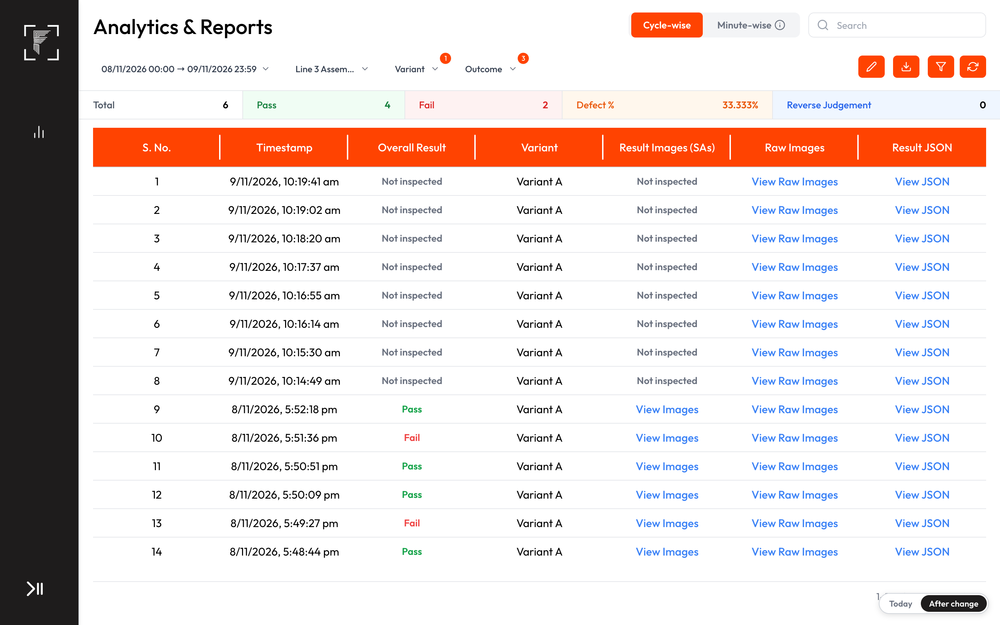
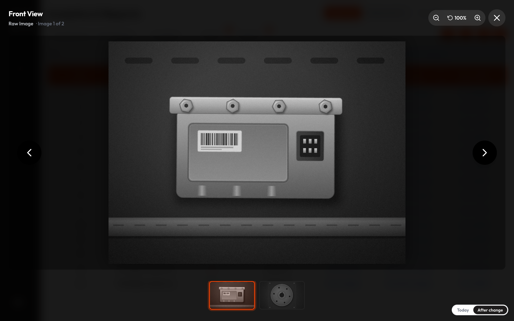

- **AC22.1** Analytics & Reports, Cycle-wise table: each Only Capture cycle is one row with Overall Result "Not inspected" in grey, in the same font and weight as Pass and Fail.
- **AC22.2** Its Result Images (SAs) cell shows "Not inspected" in the same style as AC22.1.
- **AC22.3** Its **View Raw Images** opens the cycle's raw images.
- **AC22.4** The Outcome filter gets a third option, **Not inspected**, ticked by default.
- **AC22.5** The summary bar's Total, Pass, Fail and Defect % leave out Not inspected cycles.
- **AC22.6** A Not inspected cycle is stored as no result, never as Fail.
- **AC22.7** The cycle-wise download writes "Not inspected" as these cycles' result.

### US23 — Not inspected cycles in Minute-wise reporting
*As a quality engineer, I want minute-wise counts to cover inspected parts only, while still seeing how many cycles were Only Capture.*
- **Kind:** Feature
- **Parts:** edge-reports-analytics
- **Teams:** SDE
- **Covers:** C12
- **Today:** with Minute-wise reporting on, a cycle with no result is counted as Fail in its minute.
- **Prototype:** https://vbv-fr.github.io/capture-only-deployment-prototype/#edge-reports-minute

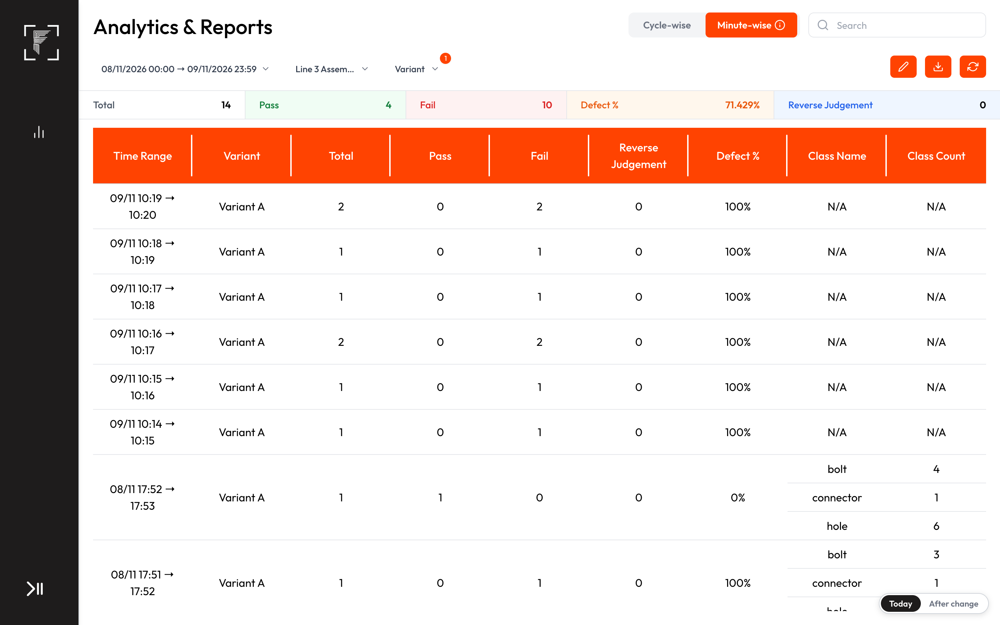
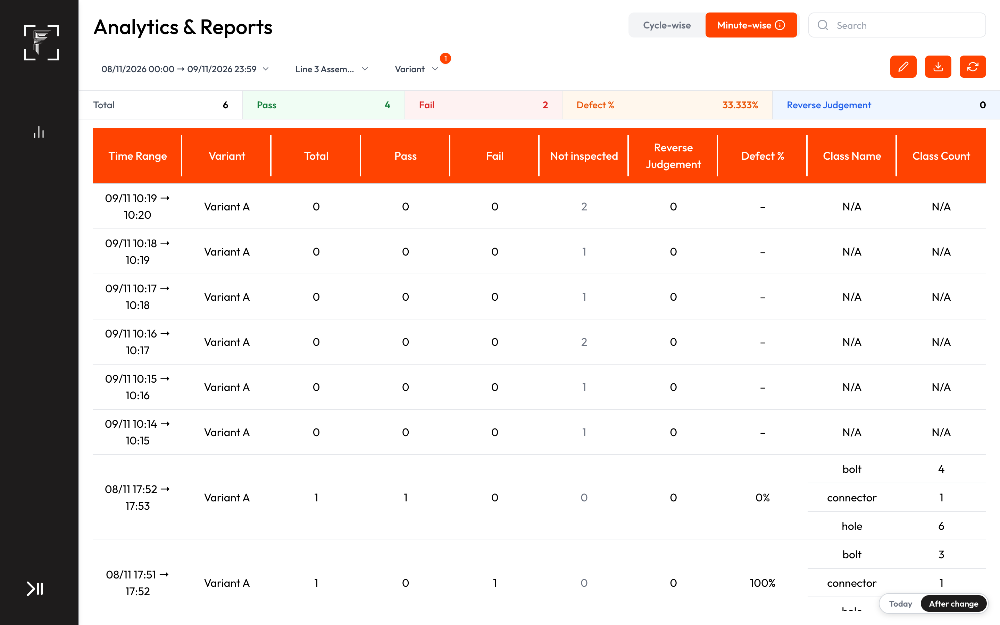
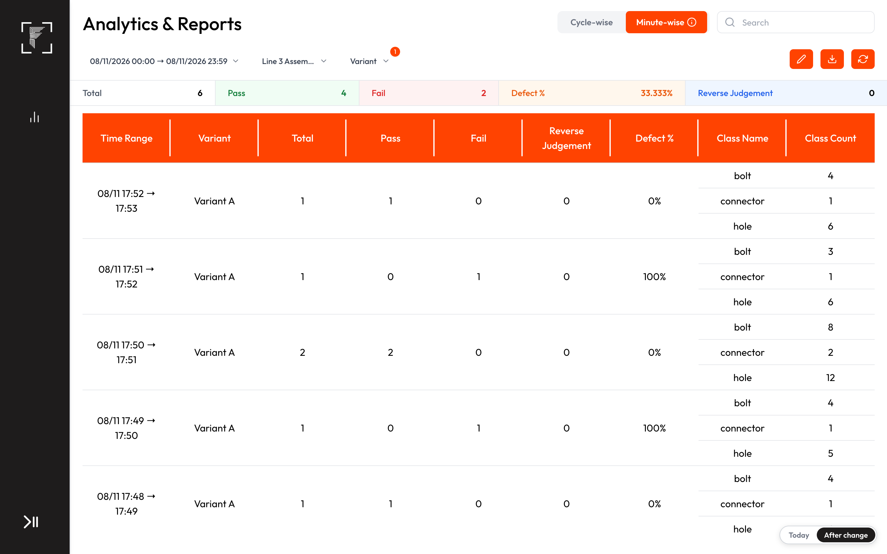

- **AC23.1** Analytics & Reports, Minute-wise table: Not inspected cycles are left out of each minute's Total, Pass, Fail and Defect %.
- **AC23.2** A **Not inspected** count column (grey numbers) sits right after Fail. It shows only when the minutes loaded include at least one Only Capture cycle, and it can be hidden in Edit Table.
- **AC23.3** A minute with only Not inspected cycles shows 0 / 0 / 0 and "–" for Defect %.
- **AC23.4** Edge stores each minute's Not inspected count, and updating a minute that has no inspected cycle doesn't fail.
- **AC23.5** The minute-wise download includes the Not inspected column when the table shows it.

### US10 — Add the models later
*As an integrator, I want to add models to the instance I set up, without losing anything.*
- **Kind:** Feature
- **Parts:** edge-instance-details, vision-instance-creation
- **Teams:** SDE
- **Covers:** C3, C10
- **Today:** a models update is checked against an arbitrary instance on the box; the dialog shows only when there are warnings.
- **Prototype:** https://vbv-fr.github.io/capture-only-deployment-prototype/#edge-add-models

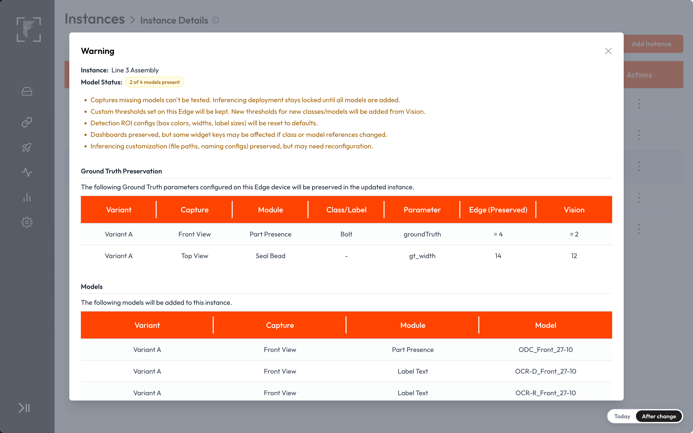
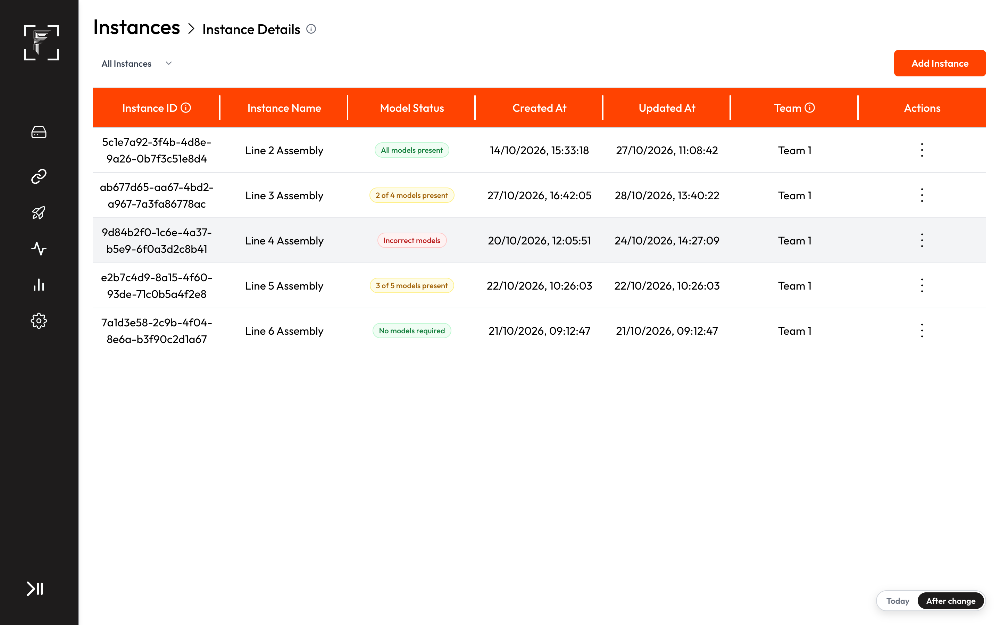

- **AC10.1** Edge, Instances, row Update with a package that adds models always opens the Warning dialog, with a **Models** section after the others: "The following models will be added to this instance." and a Variant | Capture | Module | Model table.
- **AC10.2** (removed): today's re-upload lines and preservation tables are kept by AC17.26 and AC17.28; the analysed-image reset line stays, since today's upload messages are kept.
- **AC10.3** After upload, everything set up on Edge is kept (PLC configs, dashboards, inferencing customization and ground truth), except what today's full re-upload resets: the analysed-image box colours, widths and label sizes.
- **AC10.4** (removed): covered by AC4.5, AC7.7, AC8.1, AC9.1.
- **AC10.5** Vision, Completed instance: "Download Selected Files" lets the user pick the new models together with the database file, as today; Edge needs the database to know which module uses each new model.

### US11 — Rules
*As a plant admin, I want access to stay as it is, so that nobody gains or loses rights with this feature.*
- **Kind:** Rules
- **Parts:** vision-access, edge-access-audit
- **Teams:** SDE
- **Covers:** C1
- **AC11.1** No role or permission changes. Finish without models needs the same permission as Finish; downloading needs today's download permission, plant and team.
- **AC11.2** Choosing a Deployment Type needs today's deploy permission; Only Capture adds no new permission.

### US12 — Keeps working: Edge setup without models
*As an integrator, I want every model-free setting to work on an instance still missing models.*
- **Kind:** Keeps working
- **Parts:** edge-plc-read, edge-plc-write, edge-internal-actions, edge-actions, edge-dashboard-builder, edge-inferencing-customization, edge-storage-image-saving, edge-emc
- **Teams:** SDE
- **Covers:** C9, C11, C12
- **AC12.1** PLC Read, Write and Internal configs and Dashboard actions can be set and saved; their keys come from the recipe's classes.
- **AC12.2** Dashboards can be edited and added in the Dashboard Builder.
- **AC12.3** Analysed Image Configurations can be set and saved.
- **AC12.4** Inferencing Customization (file names, paths, image saving, space) can be set and saved.
- **AC12.5** Edit Module Configurations: Classification, Code Reader, Tracker, Colour, Orientation, Shape Extractor and Dimensioning settings can be set and saved.
- **AC12.6** Uploads stay blocked while any deployment runs ("Stop all deployments to add an instance.").

### US17 — Keeps working: every upload check on Edge
*As an integrator, I want every check Edge runs on an uploaded package today to keep working with its message, so that a bad package is still stopped and I still know why.*
- **Kind:** Keeps working
- **Parts:** edge-instance-details
- **Teams:** SDE
- **Covers:** C4, C5
- **Prototype:** https://vbv-fr.github.io/capture-only-deployment-prototype/#edge-upload

Each check below keeps its trigger, its place (red error banner, Warning dialog line or toast) and its message as today. The changed checks are AC4.10 and AC5.1–AC5.4; the deployment block on Add Instance is AC12.6.

*Before the upload and on the package*
- **AC17.1** A user without upload permission is refused with "Your permissions do not include <action> on <section>." (and the server's "Sign in required: …" / "Your permissions don't include …").
- **AC17.2** A second upload while one is running is refused with "Another instance upload in progress".
- **AC17.3** An upload with no file, or a file that isn't a zip, is refused with "No file uploaded" / "Please upload a zip file.".
- **AC17.4** A zip that can't be opened is refused with the unzip error.
- **AC17.5** A request with a bad form field is refused with "Invalid input".
- **AC17.6** A package whose manifest is unreadable, incomplete or of an unknown kind is refused with "Invalid package manifest".
- **AC17.7** A package whose database file can't be decrypted is refused with the decryption error.
- **AC17.8** A database file that fails its checksum is refused with "SQL file checksum mismatch. Expected: <x>, Got: <y>. File may be corrupted.".
- **AC17.9** A package without its database file is refused with "Missing download_dump.sql in upload package.".
- **AC17.10** A package whose tables or columns don't exist on this Edge is refused with "Schema mismatch: table '<t>' is missing column(s) […] on this edge. Run migrations…" / "…does not exist on this edge. Use the new-installation bootstrap schema…".
- **AC17.11** A package whose data points to a missing record is refused with "Broken FK reference: <table>.<column> references <ref> ID '<id>' which is missing from SQL.".
- **AC17.12** Any other validation failure is refused with "Validation error: <message>".

*Instance and organisation*
- **AC17.13** A package from another organisation, plant or team is refused with "Organization ID mismatch. Edge has '<a>', upload has '<b>'." (or "Plant ID mismatch…", "Team ID mismatch…"; for a new instance "Organization ID mismatch. Edge has [<ids>], upload has '<b>'.").
- **AC17.14** A package that Vision marks as transferred shows today's Warning lines ("This instance was transferred to a different organization on Vision: '<a>' → '<b>'. The Edge will follow the move.", and the matching Plant / Team / project lines).
- **AC17.15** A database-only re-upload package for an instance not on the box is refused with "No instance found on edge. Cannot perform DB-only re-upload.".
- **AC17.16** A masks-only package for an instance not on the box is refused with "No instance found on edge. Upload full instance first.".
- **AC17.17** A masks-only package without its masks folder is refused with "Missing masks folder in upload package.".
- **AC17.18** A package whose model mapping points to modules not on this Edge is refused with "Module ID(s) referenced in mapper do not exist on this edge: […]. Upload a full instance first…".

*Models*
- **AC17.19** A package that lists a model but lacks its folder, weight file or args file is refused with "Missing model folder for model ID: <id>" / "Missing weight file (best.pt/best.bin) for model: <id>" / "Missing args file (args.yaml/args.bin) for model: <id>".
- **AC17.20** A models-only package that lists no model is refused with "No model IDs specified in manifest.".
- **AC17.21** A model that isn't on the instance, isn't on the box, is deleted or belongs to another project is refused with "Model <id> is not deployed to this instance." / "…not found in database." / "Model <id> is deleted. Cannot upload weights." / "Model <id> belongs to a different project.".
- **AC17.22** A model the instance points to whose weights aren't on this Edge is refused with "Model <id> is deployed to this instance but has no weight folder on Edge. Upload a full instance or include this model." / "…weight folder exists on Edge but is missing weight file (best.pt/best.bin).".
- **AC17.23** A database-only package that points to a model without a usable weight file on this Edge is refused with "Model <id> is referenced in the DB upload but has no usable weight file (best.pt/best.bin) on this edge. Upload a model package or full instance first.".
- **AC17.24** Today's model warnings stay: "Missing classes.txt for model <id>. Class names may not display correctly." / "Model <id> already has converted weights. Existing weights will be replaced.".
- **AC17.25** A full package (one not marked Configuration only or models remaining) with a module that needs a model and has none is still refused with "Upload blocked: <module> in <capture> has no model attached. Assign a model to it in Vision and download the instance again.", at the check step and again at save.

*Warnings on new instances and re-uploads*
- **AC17.26** A new instance on a box that already has one shows "Shared configs (camera configs, capture positions) will be deleted and re-created. This affects all instances on this edge." and "If camera config IDs have changed, re-upload the first instance as well.".
- **AC17.27** A re-upload shows today's lines: "Custom thresholds set on this Edge will be kept. New thresholds for new classes/models will be added from Vision.", "Detection ROI configs (box colors, widths, label sizes) will be reset to defaults.", "Dashboards preserved, but some widget keys may be affected if class or model references changed.", "Inferencing customization (file paths, naming configs) preserved, but may need reconfiguration.", and for a database-only package "No model weights included. Existing weights on edge will be used.".
- **AC17.28** Masks warnings stay: "Manifest indicates masks but no masks folder found in upload. Existing masks will be kept." / "Existing mask files will be overwritten with uploaded masks.".
- **AC17.29** The Ground Truth Preservation and Threshold Preservation tables show in the Warning dialog as today.

*At save*
- **AC17.30** Saving while a deployment runs or the inspection service restarts is refused with "Stop all deployments before updating instance configuration." / "The inspection service is restarting. Wait until it is ready, then try again.".
- **AC17.31** A save whose database statements fail is rolled back and refused with "Upload failed: <n> SQL statement(s) failed. Check server logs for details.".
- **AC17.32** A Shape Extractor import that doesn't match is refused with today's messages (for example "Shape "<id>" kept its ID but moved to another module. The upload was rejected.", "Vision upload did not insert <n> expected shape row(s).").
- **AC17.33** A save that leaves the mapping pointing to missing modules or weights is refused with "Upload verification failed: some modules referenced in the deployment mapping do not exist on this edge device. Missing: …" / "DB upload references models without usable weights on this edge: …" / "Upload verification failed: weight folders not found for models: …".
- **AC17.34** A package that isn't a properly created instance is refused with "please upload a file for a properly created instance".
- **AC17.35** A failure copying weights or masks after the save is reported with the copy error.
- **AC17.36** Packages made before manifests existed are checked as today (for example "No model folders found in upload package."); a duplicate ID is refused as in AC5.1.
- **AC17.37** A successful upload shows "Instance uploaded successfully!", or "Instance saved, but the inspection service failed to restart. Deploying will apply it again." when the restart fails.
- **AC17.38** An unexpected error shows "Unknown error occurred" at the check step and "Upload failed" at save.

### US24 — Keeps working: Only Capture runtime and Inferencing
*As an integrator, I want everything that doesn't need a model to keep running in Only Capture, and Inferencing to stay exactly as it is.*
- **Kind:** Keeps working
- **Parts:** engine-workflow, edge-model-loading-variant-change, edge-plc-read, edge-internal-actions, edge-inferencing-customization, edge-health
- **Teams:** SDE + AI
- **Stakeholders:** to be named (Q4)
- **Covers:** C8, C9, C13
- **AC24.1** Model-free keys keep their values in Only Capture: current variant, current variant name, cycle start time, cycle end time, system temperature, system health and camera health.
- **AC24.2** PLC Read triggers, dashboard buttons and internal actions keep working in Only Capture.
- **AC24.3** Changing variant works in Only Capture.
- **AC24.4** An Only Capture deployment passes the deploy readiness check and shows healthy in Edge Health; it still needs a GPU.
- **AC24.5** In Inferencing, a capture that never reports still ends the cycle NG at the cycle timeout (for Only Capture see Q5).
- **AC24.6** An Inferencing deployment of an All models present or No models required instance runs exactly as today.

### US13 — Platform
*As a Frinks support engineer, I want to know what ships where, so that releases stay predictable.*
- **Kind:** Platform
- **Parts:** engine-runtime-packaging, edge-installer, edge-health
- **Teams:** SDE
- **Covers:** C13, C17
- **AC13.1** Node Docker image: no change; no new libraries.
- **AC13.2** Python Docker image: no change; the engine's Only Capture code needs no new library.
- **AC13.3** Scripts bundle: changes; the Vision, Edge backend and frontend, inferencing backend, Reports and inspection engine changes ship in it.
- **AC13.4** Installer: no change.
- **AC13.5** Error codes: none new; the new refusals (Inferencing without all models, upload and test checks) are validation messages.

### US14 — Migration requirements
*As an integrator, I want existing instances and boxes to keep working after the upgrade, so that nothing in the field breaks.*
- **Kind:** Migration
- **Parts:** vision-instance-creation, edge-backup-migration, edge-release-upgrade
- **Teams:** SDE
- **Covers:** C6, C7
- **AC14.1** Existing data: existing Vision instances get their Status from their saved model picks; instances finished with empty slots today show Models Remaining.
- **AC14.2** Existing blank model IDs in Vision are read as "no model".
- **AC14.3** Upgrades in the field: existing Edge instances get their Model Status after the upgrade. One with an empty or broken model slot can then be deployed only as Only Capture (today it can be deployed and then fails).
- **AC14.4** Older Edge with a new instance: handled in a separate PRD, "Older Edge with newer instance packages" (listed in the PRD repo index, not started).
- **AC14.5** Older instance on the new Edge: complete instances behave exactly as today on the new Edge.
- **AC14.6** Existing deployment settings on Edge are read as Inferencing for All models present and No models required instances, and as Only Capture for the rest.
- **AC14.7** Existing Reports rows keep their Pass or Fail.
- **AC14.8** Existing minute-wise rows read 0 Not inspected.

## 7. Out of scope
- Full re-upload resetting analysed-image box colours, widths and label sizes.
- Model training and evaluation.
- Making triggers based on model output work in Only Capture.
- A Deployment Type per capture (a deployment is Inferencing or Only Capture for the whole instance).

## 8. How we'll know it worked
| Measure | Target |
|---|---|
| Instances uploaded to Edge as Configuration only | Used on new deployments within one release |
| Time from recipe done to Edge setup started | Down to the same day |
| Only Capture deployments used to collect training images | Used on new deployments within one release |

## Appendix A — Coverage
**Not applicable:**
- **C14** — N/A: no change to data, annotation or training (Only Capture only saves images).
- **C15** — N/A: no network or time behaviour.
- **C16** — N/A: no security or licence change.
- **C18** — N/A: release note only, written with the tickets.

**Coverage check:**

> # Coverage check — PRD-configuration-only-instance.md
> 
> **Result:** PASS, 5 warnings (kept: US10, US11 and US14 already mixed Vision and Edge in the approved version; AC17.24 and AC17.34 quote today's messages word for word)
> 
> - 24 user stories (18 feature, 1 rules, 3 keeps working, 1 platform, 1 migration), 177 ACs, 28 touched parts, 3 discussion points.
> - Checklist: 14 items covered by stories, 4 N/A, 0 open.
> - Duplicate pass: 7 duplicates and 10 contradictions found; all applied or settled, one left open as Q5.

## Appendix B — Code references
- **Model Selection:** `frinksvision-frontend`: `src/modules/project/instances/steps/ModelSelection.tsx:41-43, :534-564` — FP-4000 required-model messages; `:425-536` required slots; `:641-645` validation; `:688, :711` blank model IDs; `:823-825` swallowed save error; `index.tsx:756-793` footer; `Finish.tsx:123-146` activate.
- **Instances table / download:** `frinksvision-frontend`: `instances/index.tsx:546-552, 598, 673, 688`; `DownloadModal.tsx:599, 631`; `frinksvision-backend`: `service/packageManifest.ts:71-103`, `integrityCheck.ts:64-66`, `service/instance.ts` buildEdgeThresholdRows.
- **Edge upload:** `frinksedge-deployment-backend`: `service/manifestParser.ts:97-181, 187-215, 245-296` (package kinds :128-136); `service/uploadValidation.ts:31-35, 139-141, 585-607` (FP-4003), `:89-94, 167-178, 240-260, 273-305, 310-319, 336-358, 408-439, 483-488, 552-560, 797-837, 868-906, 990-999, 1101-1118, 1166-1210, 1214-1625`; `service/instance.ts:705-731, 975, 1856-1953, 2011-2053, 2159, 2174-2208`; `controller/instance.ts:291-350, 372-422`; `service/inferenceProcess.ts:194-202, 255-266`; `service/shapeExtractorUploadReconciliation.ts:81-149, 230-243, 309-314`; `frinksedge-deployment-frontend`: `modules/instance/components/InstanceTable.jsx:62-160, 255, 339, 383-405`, `InstanceCard.jsx:546-553`, `hooks/useInstanceUpload.jsx:87, 116-128, 164-229`.
- **Model Status:** `frinksedge-deployment-backend`: `dao/instances.ts:270-294` (list status reads no model rows as complete), `db/model.schema.ts:15-20`; frontend `modules/instance/components/InstanceTable.jsx:383-390`, `ModelModuleMappingTable.jsx:40`.
- **Dashboard:** `frinksedge-deployment-backend`: `service/dashboard.ts:288-362`; frontend `dashboard-builder/DashboardBuilder.jsx`.
- **EMC:** `frinksedge-deployment-frontend`: `inferencing-customizations/.../AssemblySection.jsx:33-39`, `SegmentationSection.jsx:38`, `OCRSection.jsx:148-186`, `BeadInspectionConfigEditor.jsx:410, 475-487`, `useModuleConfig.js:231-232, 384-386`, `useFormSubmission.js`; backend `dao/threshold.ts:9-27`.
- **Testing:** backend `service/testing.ts:63-243`, `service/pythonModel.ts:529-1007`; frontend `individual-instance/UploadImage.jsx:28-46`.
- **Deploy:** `frinksedge-deployment-frontend`: `modules/deployments/steps/InstanceDetails.jsx:13-17, 52-90, 129-135, 187`, `steps/CaptureTypes.jsx`, `steps/InstanceSettings.jsx:40, 229-255`, `DeploymentInstanceRow.jsx:23-27`; `frinksedge-deployment-backend`: `service/deployment.ts:742-803, 860-985, 1019-1036`, `failure/modelFilesCheck.ts:31-63`.
- **Engine:** `vip-inference-python`: `scripts/initialize.py:159, 224-233, 298-308`; `segmentationModule.py:43`, `module_validators.py:39-45, 378-389`, `ocrModule.py:49-53`, `workflowManager.py:65-76`, `assemblyModule.py:43-67, 197`, `analysis_logic.py:61-66, 95-109`, `main_utils.py:21-61` (Edge Refinement weight), `resultModule.py:460-575, 641-686, 1137, 1250-1265`, `mainProcessor.py:58, 230-243`, `main.py:202-222`; `frinksedge-inferencing-backend`: `initial-data.service.ts:35-197`, `python-model-save-info.service.ts:59-75`.
- **Results, keys, rules:** `frinksedge-inferencing-backend`: `cycle/cycle-manager.service.ts:486-496, 528-533, 632-671, 725-781, 1032-1035`; `key/key-writer/system-key-writer/system-key-writer.service.ts:80-129, 196-208, 373-411`; `module-tree/nodes/module-node/base.ts:45-63`; `condition.base.ts:66-90`; `write-to-plc.base.ts:49-53`; `key.base.ts:111-127`; `shared/minute-summary/minute-summary.service.ts:66-71, 154`, `minute-summary.repository.ts:26`; `frinksedge-deployment-backend`: `dao/systemKeyDefinition.ts:27-144`.
- **Live Dashboard:** `frinksedge-deployment-frontend` dashboard `util.js:236-237`; inferencing backend `dto.base.ts:14-17`, `parser.dto.ts:674-677`.
- **Reports:** `frinksedge-report`: `db/inferenceResult.schema.ts:24-34`, `inferenceResultConfigModuleWise.schema.ts:30-43`, `result-flush.service.ts:75-144`, `features/analysis/analysis.service.ts:347, 363`, `analysis.repository.ts:143-187, 333`, `download.service.ts:559`, `excel.service.ts`; `frinksedge-report-frontend`: `modules/analytics/index.jsx:781, 992, 1029, 1210-1250, 1318, 1537, 1634`, `MinuteResultTable.jsx:94-236`, `columns.js:93-108`, `ResultTable.jsx:140-175`, `ResultText.jsx:6`.
- **Image saving:** `frinksedge-deployment-frontend` `inferencing-customizations/.../ImageSavingConfigurations.jsx`.

Repos checked: frinksvision-frontend @ 556b15d, frinksvision-backend @ 28bb859, frinksedge-deployment-frontend @ eb71e841, frinksedge-deployment-backend @ 4539998, frinksedge-inferencing-backend @ 026e874, vip-inference-python @ 4540ab4, frinksedge-report @ 5fe5390, frinksedge-report-frontend @ 9893a19, frinksedge-plc-backend @ c9fe377, frinksedge-health @ 2dbc622 (synced 9–10 Nov 2026).

## Changelog
- 10 Nov 2026 — Updated for Only Capture deployment from the merged prototype (signed off 10 Nov, 33 steps); status back to In review; title and Prototype link changed. US9 retitled "Choose Inferencing or Only Capture when deploying"; AC9.1–AC9.3 (removed): deploy no longer waits for every model, replaced by AC9.4–AC9.16. AC4.5 (removed): replaced by US15. AC4.6 (removed): the Instance page has no status chip. AC10.2 (removed): covered by AC17.27, AC17.29, and today's analysed-image reset line now stays. Changed: AC1.3 (button sits right of Next, as built), AC4.2, AC4.7, AC4.8, AC6.1 (US6 retitled), AC7.1, AC10.3 (reset exception), AC10.5 (database file picked with the new models), AC13.2, AC13.3, AC13.5, AC14.3. Added: AC1.12, AC4.9, AC4.10, AC7.9, AC11.2, AC14.6–AC14.8; US15–US24. Today lines of US1, US4, US6, US9 updated (FP-4000, FP-4003). Duplicate pass: AC1.12, AC18.4, AC24.3, AC14.7 trimmed; three duplicates dropped before this first publish of the new ACs (version pairing: AC13.3; modules not marked NG: AC20.4; greyed row: AC15.7); AC9.14, AC15.2, AC15.4, AC24.6 made explicit about No models required. Q3, Q4, Q5 opened. (Tanay Deo)
- 29 Oct 2026 — Owner changed from Tanay Deo to Deb. No AC changes. (Tanay Deo)
- 29 Oct 2026 — Approved; Timeline 10 Nov – 23 Nov 2026. Q2 decided: a deleted model counts as missing (AC2.6 added). Q1 moved out to its own PRD (AC14.4 points to it). (Tanay Deo)
- 29 Oct 2026 — Draft written from the signed-off prototype (US1–US14). Duplicate pass: AC10.4 (removed): covered by AC4.5, AC7.7, AC8.1, AC9.1; AC1.9 (removed): covered by AC1.2, AC1.4; AC12.5, AC13.2, AC1.10, AC1.11 trimmed; AC2.4 tooltip shortened. (Tanay Deo)

## Checked, not affected
- vision-auto-annotation, vision-datasets-annotations, vision-model-training, vision-model-evaluation, vision-training-sets-recommender, vision-projects, vision-variants, vision-captures-cameras, vision-recipe-tree: no change to how recipes, data or models are made.
- mod-classification, mod-code-reader, mod-color-detection, mod-input-master-image, mod-masking, mod-orientation, mod-search-area, mod-shape-extractor, mod-tracker: settings need no model and stay as today (US12); in Only Capture they don't run (US18).
- edge-camera-capture: cameras capture as today in both deployment types.
- edge-encryption-keys, edge-networking, edge-plc-setup, edge-system-time: not touched.
