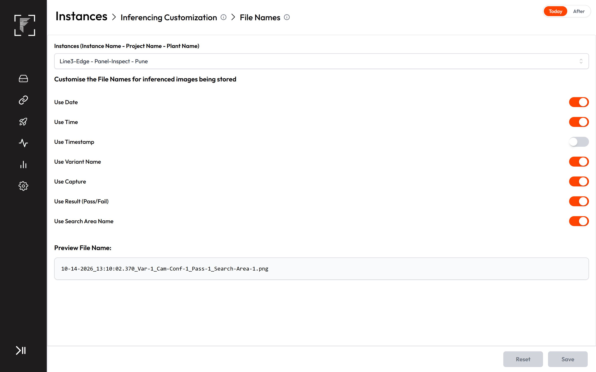
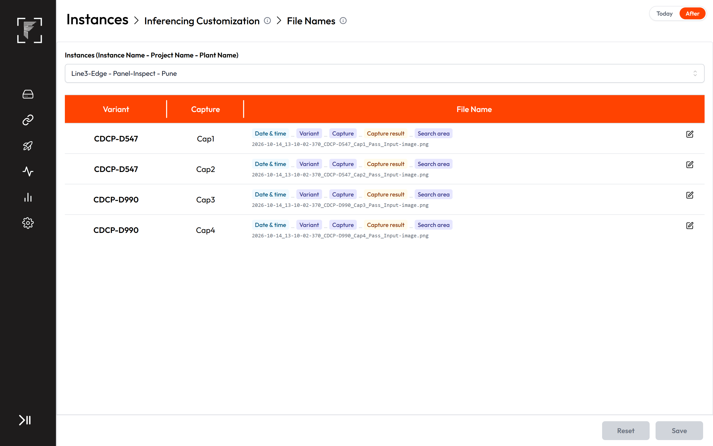
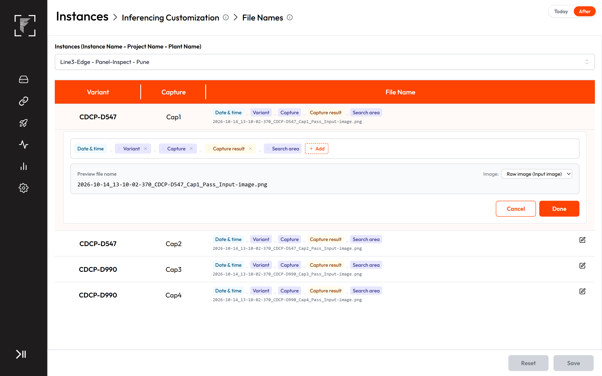
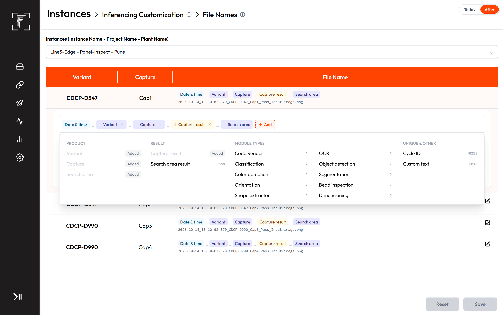
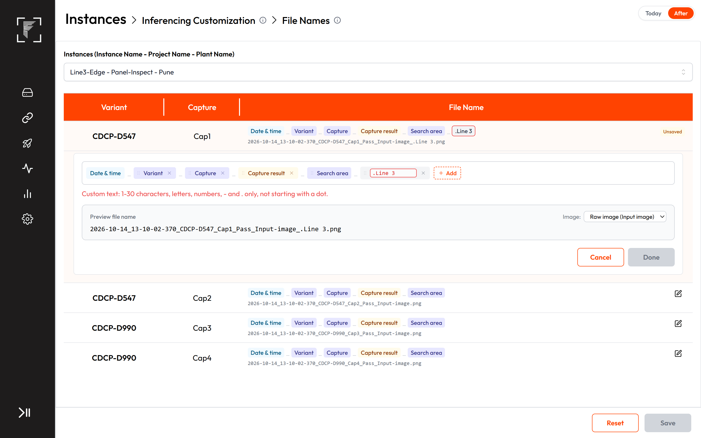
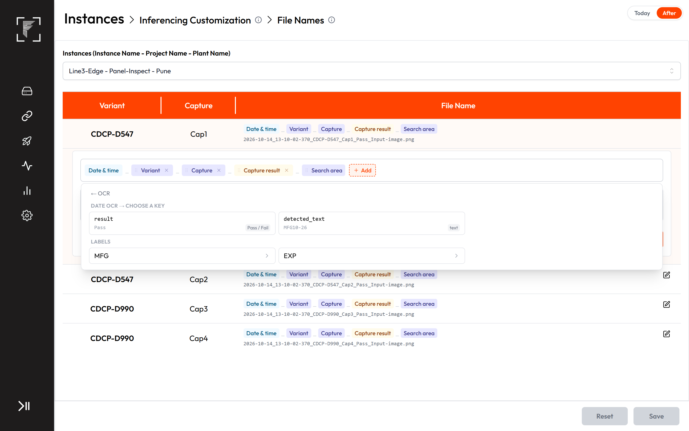
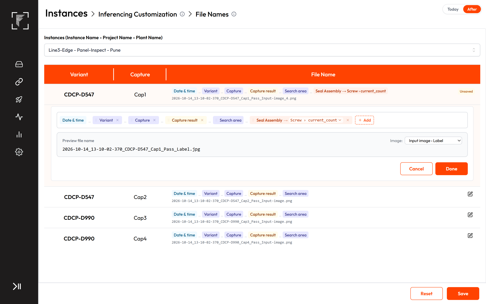
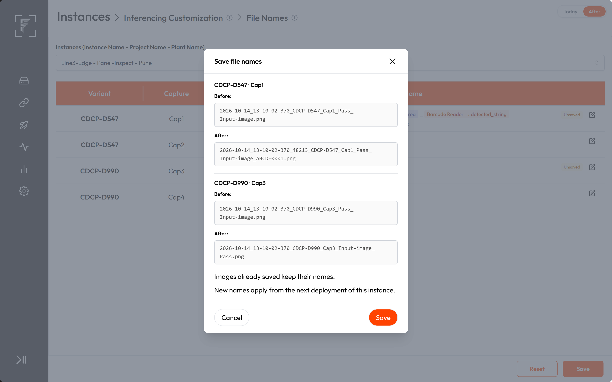
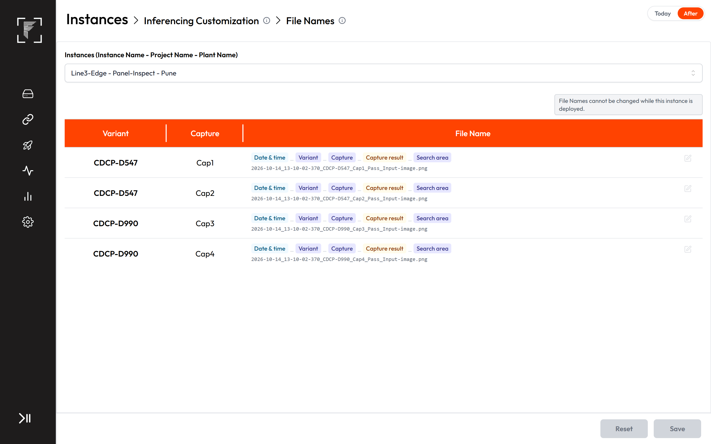
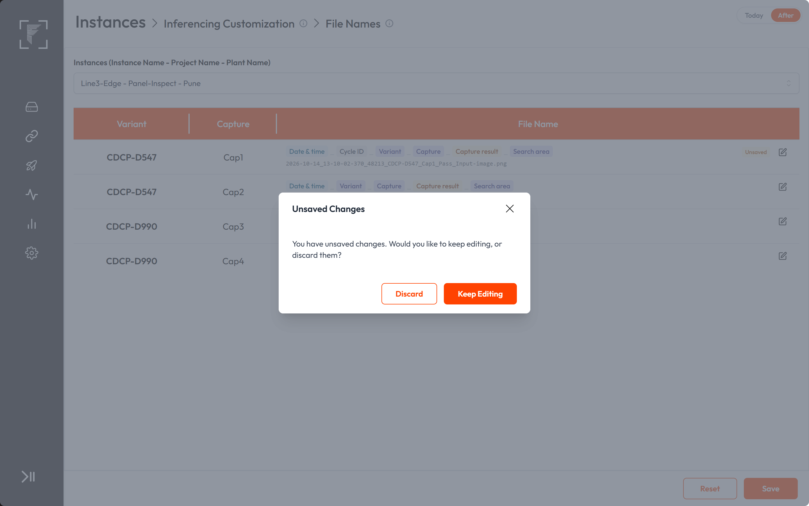

# PRD: File Names

**Prototype:** [Interactive workflow, Today vs After change](https://frinks-ai.github.io/frinks-PRDs/2026-10-30-file-names/prototype/)
**Product:** Frinks Edge
**Status:** Approved
**Date:** 30 October 2026
**Owner:** Akshat Sharma
**Related:** Image Storage PRD and epic FP-4008 (Cycle ID as in FP-4014); PRDs Image Enhancement module (FP-3870), Captures with no inspection modules, Configuration only instance
**Code checked:** 30 Oct 2026 — 35 repos at their latest default-branch commit (list in Appendix B)

---

## Discussion points
Everything still to be settled, at the top so it gets addressed first.

| # | Point to settle | Options on the table | Owner | Needed by |
|---|---|---|---|---|
| Q1 | **Longest allowed file name, and how a long name is shortened.** A plant admin adds an OCR text and a long Data Matrix read to a capture's name. With long variant and capture names, the file name can grow past what the disk and the stored image path allow, and copying to a Windows PC fails above about 260 characters of full path. | a) A limit of about 150–180 characters, shortening only module values (keep their start and end with "~" between), never cutting Date & time, Capture, Search area or the results, and a length hint under the preview; b) another limit or rule chosen by the tech team | Tech team (Mack, Pallavi) | Before development starts |

## 1. Summary
- File Names becomes a table of every variant-capture of the instance. Each capture has its own file name.
- A capture's name is built from parts in any order: Date & time, Variant, Capture, Search area, Capture result, Search area result, Cycle ID, one Custom text and values read by the capture's modules (for example a barcode or OCR text).
- Date & time is always first. Search area is in every name. Both cannot be removed.
- A module's value goes on the images of search areas that have that module below them. The raw image carries every chosen value.
- A value that is missing for an image is left out of its name, with its "_".
- Raw and analysed images of a capture use the same name, each in its own folder.
- File Names can't be changed while the instance is deployed. New names apply from the next deployment; saved images keep their names.

## 2. Why we are making this
- **Today:** File Names has seven on/off toggles for the whole instance, in a fixed order. The name can't carry what the inspection read, such as a serial number, so finding the images of one part means opening folders and matching times. The search area appears as an id, results as True/False, and a running count is added at the end. Plant admins and integrators who set up instances are affected, and so are the engineers and quality teams who look for images later.
- **Evidence:** plants ask to find saved images by part serial or barcode. A competitive comparison showed that competing systems need spreadsheet formulas or scripts to put a read value into a file name.
- **After:** a plant admin builds each capture's file name from parts and module values, without code, and images can be found by what was read on them.

## 3. Goals and non-goals
**Goals**
- G1. A plant admin can set each capture's file name from parts in any order.
- G2. Values read by a capture's modules can be part of its file names.
- G3. Every saved image's name tells its time, its search area and, when chosen, what was read on it.
- G4. Changing names never renames old images and never stops Reports opening them.

**Non-goals**
- Folders (Image Storage PRD).
- Which images are saved, their resolution and quality (Image Saving Configurations).
- Renaming images already saved.

## 4. Key concepts
- **Part:** one piece of a file name, shown as a chip (for example Variant, or Barcode Reader → detected_string).
- **Module value:** a value one module of the capture outputs for one image, picked by module and key.
- **Input image search area:** the capture's root search area (the whole frame). The raw image belongs to it.
- **Below:** a module is below a search area when it sits on that search area or on any search area in the branches coming out of it, in the capture's module tree.

## 5. Impact map
The parts this changes. Parts checked and not affected are listed at the very end.

| Part | What will happen | User stories |
|---|---|---|
| Inferencing Customization (edge-inferencing-customization) | File Names becomes a table of variant-captures with a name builder per capture | US1, US2, US4, US7 |
| Image saving and storage (edge-storage-image-saving) | Every analysed and raw image is saved with its capture's name; no count at the end | US3, US6 |
| Python engine core (engine-workflow) | Builds each image's name from its capture's parts and the module outputs of that image | US3, US5, US6 |
| Result module (mod-result) | Capture result, Search area result and module result values are written Pass or Fail | US3, US5 |
| Search Area Allocator (mod-search-area) | The Search area part is the area's name; module values follow the search-area tree; raw uses the input image search area | US3, US5, US6 |
| Code Reader (mod-code-reader) | Its read string and ground truth can be file name parts | US5 |
| OCR (mod-ocr) | Its read text and per-label values can be file name parts | US5 |
| Image Classification (mod-classification) | Its detected and correct class can be file name parts | US5 |
| Object Detection & Classification (mod-odc) | Its per-class result and count in the image can be file name parts | US5 |
| Color Detection (mod-color-detection) | Its per-colour detected colour, result and distribution can be file name parts | US5 |
| Segmentation (mod-segmentation) | Its detected and correct class can be file name parts | US5 |
| Bead Inspection (mod-bead-inspection) | Its per-image and per-bead values can be file name parts | US5 |
| Shape Extractor (mod-shape-extractor) | Its shape measurements and dimension values can be file name parts | US5 |
| Orientation (mod-orientation) | Its result can be a file name part | US5 |
| EMC (edge-emc) | Ground-truth values in names follow edited ground truths | US5 |
| Deployments (edge-deployment) | File Names is read-only while its instance is deployed; saving no longer reloads deployments | US7 |
| Instance Details (edge-instance-details) | Captures added by an upload or update start with the default name | US1 |
| Edge roles and audit (edge-access-audit) | Same permission as today; one audit entry per changed capture | US8 |
| Reports and Analytics (edge-reports-analytics) | Opens images by their stored names, old and new | US9 |
| Live Dashboard (edge-live-dashboard) | Keeps showing the latest images | US9 |
| Backup and migration (edge-backup-migration) | Existing captures get the default name on upgrade | US11 |
| Release and upgrades (edge-release-upgrade) | Ships in the scripts bundle; release note and manual change | US10 |

## 6. User stories and acceptance criteria

### US1 — Open File Names and see every capture's name
*As a plant admin, I want to see the file name of every capture of an instance in one table, so that I know how each capture's images are named.*
- **Kind:** Feature
- **Parts:** edge-inferencing-customization, edge-instance-details
- **Teams:** SDE
- **Covers:** C2, C3, C5
- **Today:** File Names shows seven toggles for the whole instance and one preview name.
- **Prototype:** [File Names table](https://frinks-ai.github.io/frinks-PRDs/2026-10-30-file-names/prototype/#edge-file-names)

- **AC1.1** File Names stays in the Inferencing Customization section list with the same Instances selector. No table is shown until an instance is picked.
- **AC1.2** For the picked instance, a table lists one row per variant-capture, with the columns Variant, Capture and File Name, in the table style of Image Saving Configurations.
- **AC1.3** Each row shows the capture's name as read-only chips joined by "_", with an example file name under them.
- **AC1.4** Each capture has its own name: changing one capture's name changes no other capture.
- **AC1.5** A capture added to Edge by an instance upload or update starts with the name Date & time_Variant_Capture_Capture result_Search area.

### US2 — Edit a capture's name
*As a plant admin, I want to add, remove and reorder the parts of a capture's name, so that its images are named the way my team looks for them.*
- **Kind:** Feature
- **Parts:** edge-inferencing-customization
- **Teams:** SDE
- **Covers:** C4
- **Today:** parts are switched on or off with toggles and always keep a fixed order.
- **Prototype:** [Edit a name](https://frinks-ai.github.io/frinks-PRDs/2026-10-30-file-names/prototype/#edge-edit-name)

- **AC2.1** An edit icon next to a row's name opens the name builder in an expanded row under it. Only one row's builder is open at a time.
- **AC2.2** Chips other than Date & time can be dragged to a new position. A chip's × removes it from the name.
- **AC2.3** **Add** opens a popup with four columns: Product (Variant, Capture), Result (Capture result, Search area result), Module types, and Unique & other (Cycle ID, Custom text). Each entry shows an example value.
- **AC2.4** A part already in the name is greyed with an "Added" tag and cannot be added again.
- **AC2.5** Parts are always joined with "_". There is no separator choice.
- **AC2.6** Under the builder, "Preview file name" shows the full example name. An Image selector lists "Raw image (Input image)" and each search area of the capture, and the preview follows the chosen image.
- **AC2.7** **Cancel** puts the row's name back as it was when the builder opened. **Done** closes the builder and keeps the changes.
- **AC2.8** A row whose name differs from the saved one shows an "Unsaved" tag until Save or Reset.
- **AC2.9** **Reset** in the page footer returns every row to its saved name.

### US3 — Fixed parts and how they are written
*As an engineer, I want the time, product and result parts written the same way on every image, so that I can read and sort file names.*
- **Kind:** Feature
- **Parts:** edge-storage-image-saving, engine-workflow, mod-result, mod-search-area
- **Teams:** SDE + AI
- **Stakeholders:** Pallavi (AI), Mack (SDE)
- **Covers:** C4, C9, C12
- **Today:** date is DD-MM-YYYY, time is HH:MM:SS:mmm, the search area is its id and the result is True or False.
- **Prototype:** [Edit a name](https://frinks-ai.github.io/frinks-PRDs/2026-10-30-file-names/prototype/#edge-edit-name)

- **AC3.1** Date & time is always the first part. It has no × and cannot be moved.
- **AC3.2** Date & time is written as YYYY-MM-DD_HH-MM-SS-mmm, for example "2026-10-14_13-10-02-370".
- **AC3.3** Search area is in every name. It has no × and cannot be removed.
- **AC3.4** The Search area part is written as the search area's name, for example "Label".
- **AC3.5** Variant and Capture are written as their names from Frinks Vision with spaces turned into "-", as today.
- **AC3.6** Capture result and Search area result are written "Pass" or "Fail".
- **AC3.7** A capture whose inspection ends in an error is written with the Capture result "Fail".
- **AC3.8** Cycle ID is written as the cycle's id, the number shown in View JSON in Reports and used for the Cycle ID folder in Image Storage.

### US4 — Add a custom text
*As a plant admin, I want one fixed text in a name, for example the line name, so that images from different lines can be told apart.*
- **Kind:** Feature
- **Parts:** edge-inferencing-customization
- **Teams:** SDE
- **Covers:** C4
- **Today:** no custom text can be added.
- **Prototype:** [Custom text](https://frinks-ai.github.io/frinks-PRDs/2026-10-30-file-names/prototype/#edge-custom-text)

- **AC4.1** The Custom text chip has a text box for its value.
- **AC4.2** A Custom text value is 1 to 30 characters long, uses only letters, numbers, "-" and ".", and does not start with ".".
- **AC4.3** An empty or invalid value shows a red border on the chip and the message "Custom text: 1-30 characters, letters, numbers, - and . only, not starting with a dot."
- **AC4.4** Save is disabled while any capture's Custom text is empty or invalid.

### US5 — Put module values in the name
*As a quality engineer, I want values read by a capture's modules in its file names, so that I can find a part's images by its serial number or reading.*
- **Kind:** Feature
- **Parts:** mod-code-reader, mod-ocr, mod-classification, mod-odc, mod-color-detection, mod-segmentation, mod-bead-inspection, mod-shape-extractor, mod-orientation, mod-search-area, mod-result, engine-workflow, edge-emc
- **Teams:** SDE + AI
- **Stakeholders:** Pallavi (AI), Mack (SDE)
- **Covers:** C2, C9, C11, C12
- **Today:** no module value can be part of a file name.
- **Prototype:** [Module values](https://frinks-ai.github.io/frinks-PRDs/2026-10-30-file-names/prototype/#edge-module-key)

- **AC5.1** Module types in Add lists only the types of this capture's modules that have values. Tracker, Masking, Edge Refinement and Orientator modules are never listed.
- **AC5.2** Picking a type lists that type's modules in the capture. Picking a module lists its keys; for OCR labels, ODC classes, colours, beads and shapes, a level in between lists those first.
- **AC5.3** Each key shows its name, a sample value and its type (text, number or true / false).
- **AC5.4** A name can hold one key per module. A module already in the name is greyed with an "Added" tag.
- **AC5.5** A module value chip reads "<module> → <key>" with a ▾. Clicking the key reopens that module's key list to pick another key.
- **AC5.6** Running totals are not offered: pass_count, fail_count, count_till_now and every per-label, class, colour and bead pass or fail count.
- **AC5.7** Values of the image itself are offered, including counts in the image such as current_count.
- **AC5.8** A ground-truth key (gt_string, gt_text, correct_class, dim_current_gt) writes the ground truth in use when the image is saved, so it changes after the ground truth is edited.
- **AC5.9** A "result" key is written "Pass" or "Fail". Other true / false keys are written "true" or "false".
- **AC5.10** A number value is written exactly as the inspection returns it.
- **AC5.11** A search area's image carries a chosen module's value only when that module is below that search area. For a search area in another branch, that part and its "_" are left out.
- **AC5.12** When a module has no value for an image (nothing read, shape not found), that part and its "_" are left out.
- **AC5.13** When an instance update removes a module from a capture, that module's value is removed from the capture's name without a message, and Save is not blocked.

### US6 — Images are saved with the capture's name
*As an engineer, I want every saved image named the way its capture is set, so that the files on disk match the File Names page.*
- **Kind:** Feature
- **Parts:** engine-workflow, edge-storage-image-saving, mod-search-area
- **Teams:** SDE + AI
- **Stakeholders:** Pallavi (AI), Mack (SDE)
- **Covers:** C8, C12
- **Today:** every image name ends with "_<count>", a number that starts again at every deployment.
- **Prototype:** [Module values](https://frinks-ai.github.io/frinks-PRDs/2026-10-30-file-names/prototype/#edge-nesting)

- **AC6.1** Each analysed image is saved with its capture's name, built for that image's search area, and the ".jpg" extension, as today.
- **AC6.2** Each raw image is saved with the same capture name, built for the input image search area: its Search area part is that area's name, its Search area result is that area's result, and it carries every chosen module value that the image has. Its extension is the one set on Image Saving Configurations, as today.
- **AC6.3** (removed): covered by AC6.1 and AC6.2, whose names end with the extension, with no count.
- **AC6.4** Masks, orientator areas, enhanced areas and the master image area of a capture with no inspection modules are named like search areas, each with its own name in the Search area part.

### US7 — Save names, locked while deployed
*As a plant admin, I want to see what changes before I save, and to change names only when the instance isn't running, so that one deployment's images are never named two ways.*
- **Kind:** Feature
- **Parts:** edge-deployment, edge-inferencing-customization
- **Teams:** SDE
- **Covers:** C5, C10
- **Today:** Save while a deployment runs asks "There is an inferencing deployment running currently…" and Confirm reloads every running deployment.
- **Prototype:** [Save confirmation](https://frinks-ai.github.io/frinks-PRDs/2026-10-30-file-names/prototype/#edge-save-confirm)

- **AC7.1** Save with changed names first shows a "Save file names" confirmation listing each changed capture with an example name before and after the change.
- **AC7.2** The confirmation says "Images already saved keep their names." and "New names apply from the next deployment of this instance."
- **AC7.3** The names are saved only on the confirmation's Save. Its Cancel returns to the page with the changes still unsaved.
- **AC7.4** Images saved before a name change are never renamed.
- **AC7.5** Saved names reach the line at the next deployment of that instance.
- **AC7.6** Saving File Names does not reload or restart any running deployment.
- **AC7.7** While the picked instance is deployed, the edit icons, Reset and Save are disabled and the page shows "File Names cannot be changed while this instance is deployed."
- **AC7.8** While another instance on the box is deployed but the picked one is not, the picked instance's names can be edited and saved.
- **AC7.9** A save sent to Edge for an instance that is deployed is refused, and the names stay as they were.

### US8 — Who may change File Names
*As a plant admin, I want the same people who manage file names today to manage them after the change, so that no access changes are needed.*
- **Kind:** Rules
- **Parts:** edge-access-audit
- **Teams:** SDE
- **Covers:** C1
- **AC8.1** No role or permission changes. Saving File Names needs the Inferencing Customization update permission, as today. Without it, the page is read-only.
- **AC8.2** Each save adds one audit entry per changed capture, "Changed file name", recording the capture's old and new name.

### US9 — Saving, Reports and dashboards keep working
*As a plant admin, I want everything around saved images to keep working, so that new names change nothing else.*
- **Kind:** Keeps working
- **Parts:** edge-inferencing-customization, edge-storage-image-saving, edge-reports-analytics, edge-live-dashboard, mod-result
- **Teams:** SDE
- **Covers:** C9, C12
- **Prototype:** [Unsaved changes](https://frinks-ai.github.io/frinks-PRDs/2026-10-30-file-names/prototype/#edge-unsaved)

- **AC9.1** Switching the Instances selector with unsaved changes shows the unsaved-changes prompt, as on the other Inferencing Customization pages.
- **AC9.2** Image Saving Configurations still decides which analysed and raw images are saved, their resolution and their quality.
- **AC9.3** Image Storage still decides the folder of every image; the name never changes the folder.
- **AC9.4** Reports opens every saved image through the name stored when it was saved, including images saved before this change.
- **AC9.5** The Reports image download keeps zipping the selected images under their saved names.
- **AC9.6** The Live Dashboard keeps showing the latest analysed image of each search area.
- **AC9.7** Storage cleanup keeps deleting the oldest images under the Storage Allocation limits, whatever their names.
- **AC9.8** The OK / NG verdict of a capture and of a cycle is unchanged by file names.

### US10 — Platform
*As a Frinks support engineer, I want to know what ships, so that the release goes out the usual way.*
- **Kind:** Platform
- **Parts:** edge-release-upgrade
- **Teams:** SDE + AI
- **Stakeholders:** Pallavi (AI), Mack (SDE)
- **Covers:** C13, C17, C18
- **AC10.1** Node Docker image: no change. The new page and setting are code in the Edge frontend and backends.
- **AC10.2** Python Docker image: no change. Building names is code in the Python engine.
- **AC10.3** Scripts bundle: changes. It carries the Edge frontend, the deployment and inferencing backend and the Python engine changes.
- **AC10.4** Installer: no change.
- **AC10.5** Error codes: no new code.
- **AC10.6** The Edge manual's File Names section is rewritten, and the release note reads: "File Names now sets each capture's file name from parts in any order, including values its modules read, such as a barcode or OCR text."

### US11 — Migration requirements
*As a Frinks support engineer, I want boxes in the field upgraded without losing images, so that plants notice only the new page.*
- **Kind:** Migration
- **Parts:** edge-backup-migration
- **Teams:** SDE
- **Covers:** C6, C7
- **AC11.1** Existing data: on upgrade, every capture of every instance gets the name Date & time_Variant_Capture_Capture result_Search area, whatever its old toggles were.
- **AC11.2** Existing data: images saved before the upgrade keep their names.
- **AC11.3** Older Edge with a new instance: no change. The instance package from Vision is unchanged.
- **AC11.4** Older instance on the new Edge: an instance from an earlier Vision export needs nothing new in its package to be named.
- **AC11.5** Upgrades of Edge boxes in the field: the conversion runs once per box, on the first start after the upgrade.

## 7. Out of scope
- Folders (Image Storage PRD).
- Renaming images already saved.
- Instance Testing runs: they keep their own file names.
- Cross-capture dimension images, which are not saved today.
- Grouping or filtering the table when an instance has many captures.

## 8. How we'll know it worked
| Measure | Target |
|---|---|
| Saved images whose name matches their capture's name on File Names | 100 % |
| Images saved before an upgrade or name change that open in Reports | 100 % |
| Support requests to find a part's images by its serial or reading, after release | Fewer than before release |

## Appendix A — Coverage
**Not applicable:**
- **C14** — N/A: no datasets, annotation, training or models are involved.
- **C15** — N/A: the owner ruled time, time zone and clock topics out; Date & time uses the box's time as today.
- **C16** — N/A: no licence, encryption or data leaving the box.

**Coverage check:** pasted from the check script on 30 Oct 2026.

**Result:** PASS

- 11 user stories (7 feature, 1 rules, 1 keeps working, 1 platform, 1 migration), 73 ACs (1 removed), 22 touched parts, 1 discussion point.
- Checklist: 15 items covered by stories, 3 N/A, 0 open.
- Every coverage-sheet item maps to one AC; duplicate pass applied (see Changelog).

## Appendix B — Code references
For developers. Per touched part: the files that hold today's behaviour, from this sync.
- **File Names page:** `frinksedge-deployment-frontend`: `src/modules/inferencing-customizations/FileName.jsx` — seven toggles, preview; `index.jsx:176-299` — deployment-running confirmation and reload; `InstanceSelector.jsx:42-59`, `src/shared/ui/UnsavedChangesModal.jsx` — unsaved prompt.
- **File Names API and setting:** `frinksedge-deployment-backend`: `src/routes/instance.ts:51, 77`; `src/service/instance.ts:2310-2323` (same config written to every capture, then deploy refresh), `:2340-2344` (reads the first capture only); `src/dao/inferenceCustomization.ts:12-21` (default), `createDefaultsForInstance`; `src/db/inferencingCustomization.schema.ts:20-21` (one file_name per camera config); `src/controller/instance.ts:41-54, 637-648` (audit pattern), `:392, 482, 592` (defaults on upload); `src/audit/catalogue.ts:40`; `src/rbac/catalogue.ts:126, 253`.
- **Save info sent to the engine:** `frinksedge-inferencing-backend`: `src/python-model/python-model-save-info.service.ts:29-41` (imageName). Testing duplicate: `frinksedge-deployment-backend`: `src/service/pythonModel.ts:400-414`.
- **Engine naming:** `vip-inference-python`: `scripts/assembly/modules/resultModule.py:581-639` (image_name_creation: order, date/time formats, True/False, search area id, spaces to "-"), `:452, :563` (`_<count>` and extension), `:552-555` (raw uses the input image area and the capture result).
- **Module values:** `frinksedge-inferencing-backend`: `src/module-tree/nodes/module-node/*.ts` (values and running totals written after the engine result, e.g. `code-reader.ts:31`); `src/key/keys/system-key.ts` (key suffixes). Key list: `frinksedge-deployment-backend`: `src/dao/systemKeyDefinition.ts`.
- **Stored paths:** `frinksedge-inferencing-backend`: `src/shared/infrastructure/inference-result-config-module-wise/inference-result-config-module-wise.schema.ts:13-14` (result_images JSON, raw_image varchar 512).
- **Cross-capture names (not saved today):** `frinksedge-inferencing-backend`: `src/dimensioning/cross-capture-save-path.ts` (buildImageName mirrors the engine).
- **Migration:** `frinksedge-deployment-backend`: `src/db/dataMigrations/migrationFiles/2026-10-21-001-search-area-fail-box-color.ts` (pattern); `dump.sql:171`.
- **Tests to rewrite:** `frinksedge-staging-environment`: `integrity/modules/inferencing-customization/check.sh:84, 147-150, 310-312` (File Names probe relies on the save restarting inference).

Repos checked (30 Oct 2026): vip-inference-python @ 613995d (29 Oct), frinksedge-inferencing-backend @ 310c18e (22 Oct), frinksedge-deployment-backend @ 5a69c77 (26 Oct), frinksedge-deployment-frontend @ 638fe84 (30 Oct), frinksedge-health @ 2dbc622 (23 Oct), frinksedge-report @ 5fe5390 (15 Oct), frinksedge-report-frontend @ 9893a19 (13 Oct), frinksedge-staging-environment @ 4993036 (9 Sep), frinksedge-plc-backend @ c9fe377 (30 Oct), frinksvision-frontend @ 3b248b6 (30 Oct), frinksvision-backend @ ad462a1 (28 Oct), and the other 24 repos at their latest commits (none touched).

## Changelog
- 30 Oct 2026 — Draft written: US1–US11, Q1 (Akshat Sharma)
- 30 Oct 2026 — Duplicate pass: AC2.2 reworded (Date & time not draggable; fixed parts' × in US3); AC3.1 trimmed ('not offered in Add' is AC2.3); AC3.3 trimmed ('can be moved' is AC2.2); AC4.1 trimmed (one Custom text is AC2.4); AC6.2 now says 'every chosen module value that the image has' (AC5.12); AC6.3 (removed): covered by AC6.1, AC6.2; AC11.2 trimmed (old images opening in Reports is AC9.4); AC11.5 trimmed (old names kept is AC11.2) (Akshat Sharma)
- 30 Oct 2026 — Approved; prototype hosted and Prototype links live; Q1 (name length) stays open with the tech team (Akshat Sharma)

## Checked, not affected
- vision-access, vision-auto-annotation, vision-captures-cameras, vision-datasets-annotations, vision-instance-creation, vision-model-evaluation, vision-model-training, vision-projects, vision-recipe-tree, vision-training-sets-recommender, vision-variants: Edge-only change; module names and the module tree already arrive in the instance package, which does not change.
- mod-input-master-image, mod-masking, mod-matting, mod-tracker: no values for names (the master image area is covered as the input image search area under mod-search-area).
- engine-runtime-packaging: no new library; the Python image stays as it is.
- edge-health: cleanup works on folders and file age, not names (kept by AC9.7).
- edge-actions, edge-internal-actions, edge-plc-read, edge-plc-setup, edge-plc-write: rules and PLC signals do not use file names.
- edge-camera-capture, edge-model-loading-variant-change, edge-networking, edge-encryption-keys, edge-installer: capture, model loading, ports, keys and installation are untouched.
- edge-dashboard-builder: dashboard design does not use file names.
- edge-system-time: the owner ruled clock and time-zone topics out; Date & time uses the box's time as today.
